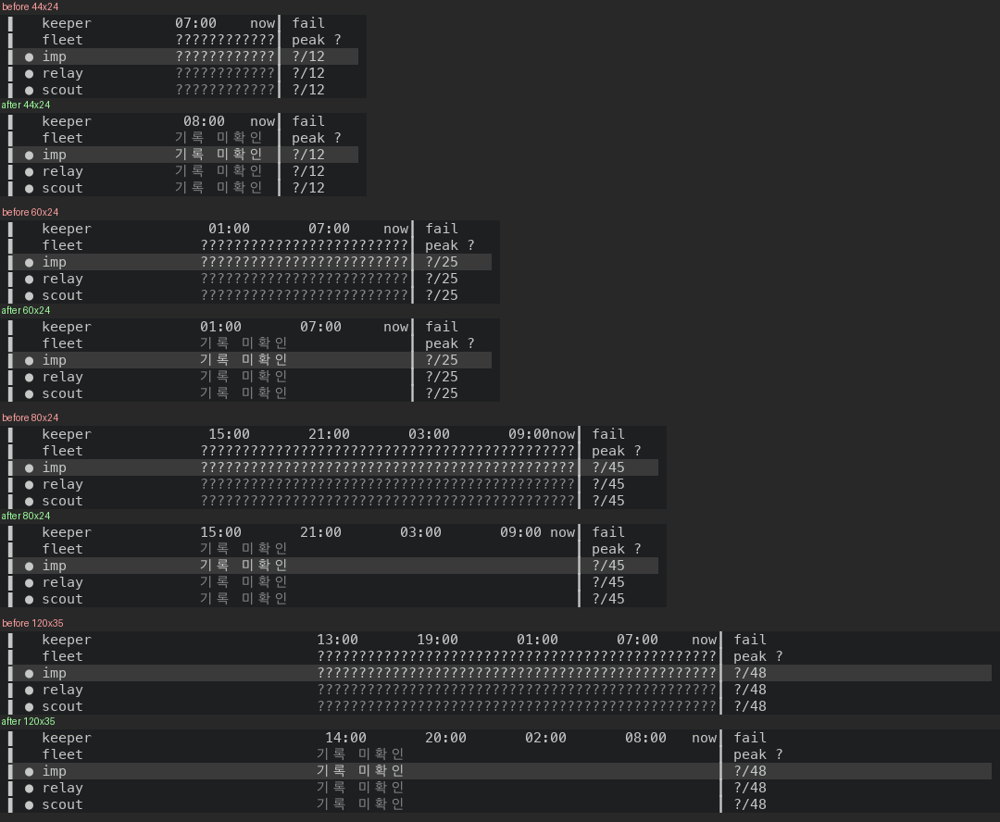

# Keepers 24h 보기: 못 읽은 기록은 한 번만 말해요

24h 보기(`v` 를 일곱 번 누르면 닿는 마지막 보기)의 벽은 Keeper 의 실행 상태를 못 읽을 때 반 시간마다 `?` 를 찍어요. 위쪽 `fleet` 줄과 Keeper 줄마다 폭에 따라 12~48개예요. list 보기의 Keeper 줄은 #50801 부터 `기록 미확인` 한 번이고, `fleet` 줄은 아래 층 #51244 이 같은 글로 바꿔요.

- 이 PR 은 #51244 위에 쌓여요. #51244 가 만든 `history_unknown_label` 을 써요.
- 줄 끝의 `?/N`(실패한 반 시간 수)과 `peak ?` 는 안 바꿨어요.

## 실측

고정 서버(Keeper 의 실행 상태를 못 읽는 상태) 위에서 증명 빌드 둘로 같은 화면을 찍었어요. 앞은 #51244 의 코드 커밋 `66146bffb3a2`(run `42951865957`)이고, 뒤는 이 PR 의 코드 커밋 `cca76c4cf159`(run `42956571610`)예요. 폭 5개(44·50·60·80·120칸)에서 Keepers 화면을 열고 `v` 를 일곱 번 눌러 보기 8개(list·state·cause·time·memory·age·runtime·24h)를 찍었어요. 40장씩이고, 글자는 `captures/before` 와 `captures/after` 에 `<폭>-<장 번호>-<보기>.txt` 로 넣었어요.

이 PR 의 바탕 커밋(`e1ef72621df0`)은 앞 빌드의 코드 커밋에 문서만 더한 것이에요. 두 커밋 사이에 `bin/` 과 `lib/` 는 안 바뀌었어요(`git diff --name-only` 로 센 값이에요).

### 24h 보기의 벽

그림은 폭 44칸, 60칸, 80칸, 120칸의 24h 보기에서 시간 눈금 줄부터 Keeper 줄까지예요. 폭마다 위가 앞이고 아래가 뒤예요.



화면에서 그대로 옮긴 글자예요(`fleet` 줄과 첫 Keeper 줄만, 줄 끝 공백은 뺐어요).

```
44x24   앞   ▌   fleet           ????????????┃ peak ?
        뒤   ▌   fleet           기록 미확인 ┃ peak ?
44x24   앞   ▌ ● imp             ????????????┃ ?/12
        뒤   ▌ ● imp             기록 미확인 ┃ ?/12
50x24   앞   ▌   fleet                 ????????????┃ peak ?
        뒤   ▌   fleet                 기록 미확인 ┃ peak ?
50x24   앞   ▌ ● imp                   ????????????┃ ?/12
        뒤   ▌ ● imp                   기록 미확인 ┃ ?/12
60x24   앞   ▌   fleet              ?????????????????????????┃ peak ?
        뒤   ▌   fleet              기록 미확인              ┃ peak ?
60x24   앞   ▌ ● imp                ?????????????????????????┃ ?/25
        뒤   ▌ ● imp                기록 미확인              ┃ ?/25
80x24   앞   ▌   fleet              ?????????????????????????????????????????????┃ peak ?
        뒤   ▌   fleet              기록 미확인                                  ┃ peak ?
80x24   앞   ▌ ● imp                ?????????????????????????????????????????????┃ ?/45
        뒤   ▌ ● imp                기록 미확인                                  ┃ ?/45
120x35  앞   ▌   fleet                            ????????????????????????????????????????????????┃ peak ?
        뒤   ▌   fleet                            기록 미확인                                     ┃ peak ?
120x35  앞   ▌ ● imp                              ????????????????????????????????????????????????┃ ?/48
        뒤   ▌ ● imp                              기록 미확인                                     ┃ ?/48
```

| 폭 | 띠 칸 수(캡처의 `?/N` 에서 읽은 값) | 앞 | 뒤 |
|---|---|---|---|
| 44x24 | 12 | `?` 12개 | `기록 미확인` |
| 50x24 | 12 | `?` 12개 | `기록 미확인` |
| 60x24 | 25 | `?` 25개 | `기록 미확인` |
| 80x24 | 45 | `?` 45개 | `기록 미확인` |
| 120x35 | 48 | `?` 48개 | `기록 미확인` |

### 40장 전체

| | 앞 | 뒤 |
|---|---|---|
| 벽 줄이 `?` 만으로 찬 줄 | 20 | 0 |
| 벽 줄이 `기록 미확인` 인 줄 | 0 | 20 |

- 벽 줄은 24h 보기 5장에 4줄씩(`fleet` 줄 하나, Keeper 줄 셋)이라 모두 20줄이에요.
- 바뀐 줄은 이 20줄뿐이에요. 벽 줄을 뺀 나머지 줄은 40장 모두 앞뒤가 같아요. 시계 글자(`hh:mm`)와 24h 보기의 눈금 줄은 빼고 견줬어요. 눈금 줄은 찍은 분에 따라 한 칸씩 밀려서 빌드와 상관없이 달라져요.
- 바뀐 줄은 줄 너비도 그대로예요. `┃` 가 놓인 칸이 앞뒤로 같아요.

## 무엇을 바꿨나요

- `Masc_tui_keeper_wall.row` 와 `fleet` 은 벽의 모든 반 시간을 못 읽었으면 `Masc_tui_keeper_strip.history_unknown_label` 이 만든 글(`기록 미확인`, 칸이 모자라면 `?`)을 띠 칸 수만큼의 너비로 그려요. 일부만 못 읽었으면 이전처럼 반 시간마다 표시를 남겨요. 두 함수에 `ko` 인자가 늘었고, 부르는 곳 두 곳(`masc_tui_render_keepers.ml`)이 `state.ui_language` 를 넘겨요.
- `Masc_tui_keeper_pulse.nothing_read` 가 "Keeper 가 하나 이상이고 모든 Keeper 의 모든 반 시간이 못 읽은 상태" 판정 하나예요. #51244 가 `fleet_cells` 안에 두었던 `no_history` 를 여기로 옮겨서, list 보기의 `fleet` 줄과 24h 벽이 같은 판정을 써요.
- RFC-0515 와의 관계: §2.3 의 보기 표는 24h 보기의 행에 48칸 맥박을 둔다고 적고, §2.4.3 은 맥박 칸에서 전부 모르는 창을 `기록 미확인` 한 번(좁으면 `?` 하나)으로 쓴다고 적어요. 24h 행이 §2.4.3 의 맥박 칸을 쓴다고 읽어서 같은 규칙을 적용했어요. 이 읽기는 제 해석이에요. 그래서 §2.4.3 에 한 문장을 더했어요. §2.8 에는 #51244 의 동작(띠 칸이 없는 폭에서는 `fleet` 줄을 안 그리고, 전부 못 읽었으면 `기록 미확인` 한 번)을 적었어요. §2.8 은 띠가 없을 때를 안 적고 있었고, #51244 리뷰의 비차단 메모(P3)가 짚은 곳이에요.
- 바뀐 파일은 코드 6개(+43/−24줄)와 RFC 문서 하나(+2/−2줄)예요.

## 다시 세는 법

이 폴더에서 아래 코드를 돌리면 위 표의 숫자 줄이 나와요(파이썬 표준 라이브러리만 써요).

```python
import glob, re
ROW = re.compile(r"^ ?▌ . \S+\s+(\S.*?)\s*┃ (?:peak \S+|\S+/\d+)\s*$")  # a wall row: the fleet row or one Keeper row (one mark cell, a name, the band)
for side in ("before", "after"):
    walls = labels = 0
    for path in sorted(glob.glob(f"captures/{side}/*-17-24h.txt")):
        for line in open(path, encoding="utf-8").read().split("\n"):
            found = ROW.match(line)
            if found is None:
                continue
            band = found.group(1)
            walls += len(band) > 1 and set(band) == {"?"}
            labels += band == "기록 미확인"
    print(side, "| wall rows drawn as ? only:", walls, "| wall rows saying 기록 미확인:", labels)
```

```
before | wall rows drawn as ? only: 20 | wall rows saying 기록 미확인: 0
after | wall rows drawn as ? only: 0 | wall rows saying 기록 미확인: 20
```

## 시험과 문서

- 증명 빌드(run `42956571610`)가 컴파일을 통과했고 시험 셋(`test_repo_git`·`test_tui_workspace_entries`·`test_workspace_file_confidentiality`)의 종료 코드가 0 이에요. 이 셋은 24h 벽과 상관없는 시험이라 이 변경의 동작을 시험으로 증명한 게 아니에요. 동작은 위 화면으로 봤어요.
- `Masc_tui_keeper_wall`·`nothing_read`·`history_unknown_label` 을 부르는 시험은 `test/` 에 없어요(`git grep` 0건). 화면 배치를 글자로 붙드는 시험은 헌법(354~355행)이 막아서 안 더했어요.
- 이 변경은 키 표를 안 건드려서 증명 빌드가 만든 `key-reference.md` 와 `docs/guides/TUI-KEYS.md` 가 같아요(두 파일 내용을 글자 그대로 견줬어요).

## 장단점

- 장점: list 보기와 24h 보기가 못 읽은 기록을 같은 글로 말해요. `?` 로 찬 벽 줄 넷이 줄마다 글 한 번으로 줄어서, 읽은 기록이 없다는 사실이 `?` 개수를 세지 않고도 읽혀요.
- 단점: 줄 끝의 `?/N` 과 `peak ?` 는 그대로라 `?` 가 줄마다 하나씩 남아요. 실패한 반 시간 수를 모른다는 뜻이라 따로 바꾸지 않았어요.
- 단점: 일부만 읽은 벽은 이전처럼 칸마다 표시가 나와요. 서버를 막 띄운 직후처럼 오래된 쪽 칸만 못 읽은 경우가 여기에 들어요.

## 안 잰 것

- Keeper 실행 상태를 읽은 24h 화면은 안 찍었어요. 고정 서버가 그 상태를 못 읽어서, 읽은 벽과 일부만 못 읽은 벽이 안 바뀐다는 것은 코드(`nothing_read` 가 거짓이면 이전 식 그대로)로만 확인했어요.
- 영어 화면(`history unknown`)과, `기록 미확인`(11칸)이 안 들어가서 `?` 하나로 줄어드는 폭은 안 찍었어요. 코드로 세면 그 폭은 터미널 너비 27칸 이하에서만 생겨요.
- 설치된 TUI 에서 본 화면이 아니에요. 증명 빌드의 receipt 는 `visible_ui_verified` 와 `installed_runtime_verified` 가 둘 다 `false` 예요.
- 캡처를 만든 스크립트와 `.ansi` 원본은 저장소에 안 넣었어요. 그래서 `captures/` 의 글자가 그 빌드에서 나온 것인지는 폴더만으로 확인할 수 없어요. 눌러 본 순서는 위에 적었어요.
- 로컬 `dune` 은 안 돌렸어요. 증명 빌드로 확인했어요.
