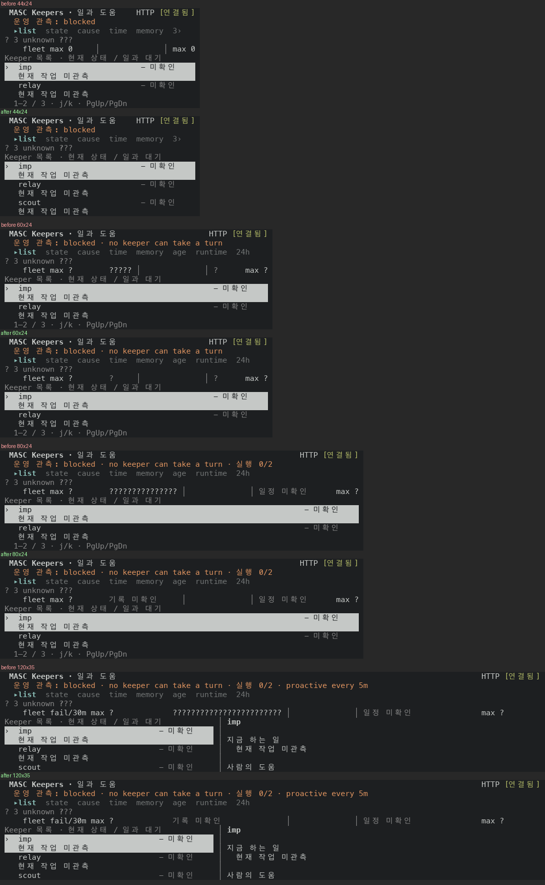

# Keepers 맨 위 `fleet` 행: 못 읽은 기록은 한 번만 말하고, 띠가 없으면 그리지 않아요

Keepers 화면 맨 위 `fleet` 행이 모르는 값을 두 곳에서 잘못 보여요. #50801 이 Keeper 행의 과거 칸을 `기록 미확인`, 미래 칸을 `일정 미확인` 한 번으로 줄였는데, `fleet` 행의 과거 칸은 그대로 남았어요.

- Keeper 의 실행 상태를 못 읽을 때 `fleet` 행의 과거 칸은 반 시간마다 `?` 하나씩이에요. 60칸에서 5개, 80칸에서 15개, 120칸에서 24개예요. 같은 화면의 Keeper 행은 `기록 미확인` 한 번이에요.
- 띠 칸이 0개인 44·50칸에서도 `fleet … max 0` 과 오른쪽 끝의 `max 0` 이 나와요. 그려지지 않은 칸의 최댓값이에요. 같은 서버가 60칸 이상에서는 `max ?` 를 보여 주니, 44·50칸에서는 못 읽은 상태가 0 으로 읽혀요.

## 실측

고정 서버(Keeper 의 실행 상태를 못 읽는 상태) 위에서 증명 빌드 둘로 같은 화면을 찍었어요. 앞은 main `7bda02e85ad4`(run `42924893851`)이고, 뒤는 이 PR 의 코드 커밋 `66146bffb3a2`(run `42951865957`)예요. 폭 5개(44·50·60·80·120칸)에서 Keepers 화면을 열고 `v` 를 일곱 번 눌러 보기 8개(list·state·cause·time·memory·age·runtime·24h)를 찍었어요. 40장씩이고, 글자는 `captures/before` 와 `captures/after` 에 `<폭>-<장 번호>-<보기>.txt` 로 넣었어요.

앞 빌드(main `7bda02e85ad4`)와 이 PR 의 바탕(`e8efeadc388e`) 사이에서 Keeper 머리 줄을 그리는 모듈(`masc_tui_keeper_strip`·`_grid`·`_pulse`·`_next_run`·`_axis`·`_wall`)은 안 바뀌었어요. `masc_tui_render_keepers.ml` 은 `keeper_detail_pane` 안 한 곳(3571행 근처)만 달라요. `git diff` 로 센 값이에요.

### `list` 보기의 `fleet` 행

그림은 폭 44칸, 60칸, 80칸, 120칸의 `list` 보기 위쪽이에요. 폭마다 위가 앞이고 아래가 뒤예요.



화면에서 그대로 옮긴 글자예요(줄 끝 공백은 뺐어요).

```
44x24   앞       fleet max 0     │              │ max 0
        뒤  (행 없음)
50x24   앞       fleet fail/30m max 0  │              │ max 0
        뒤  (행 없음)
60x24   앞       fleet max ?        ????? │              │ ?      max ?
        뒤       fleet max ?        ?     │              │ ?      max ?
80x24   앞       fleet max ?        ??????????????? │              │ 일정 미확인      max ?
        뒤       fleet max ?        기록 미확인     │              │ 일정 미확인      max ?
120x35  앞       fleet fail/30m max ?             ???????????????????????? │              │ 일정 미확인               max ?
        뒤       fleet fail/30m max ?             기록 미확인              │              │ 일정 미확인               max ?
```

| 폭 | 띠 칸 수(`Grid.layout` 식으로 센 값, 앞 캡처의 `?` 개수와 같아요) | 앞의 과거 칸 | 뒤의 과거 칸 |
|---|---|---|---|
| 44x24 | 0 | 행은 있고 띠가 없어요. `max 0` 이 둘이에요 | 행 없음 |
| 50x24 | 0 | 행은 있고 띠가 없어요. `max 0` 이 둘이에요 | 행 없음 |
| 60x24 | 5 | `?` 5개 | `?` |
| 80x24 | 15 | `?` 15개 | `기록 미확인` |
| 120x35 | 24 | `?` 24개 | `기록 미확인` |

### 40장 전체

| | 앞 | 뒤 |
|---|---|---|
| `fleet` 행이 있는 화면 | 35 | 21 |
| 과거 칸이 `?` 만 둘 이상인 화면 | 21 | 0 |
| 행이 `max 0` 을 둘 쓰는 화면 | 14 | 0 |

`age` 보기는 앞뒤 모두 `fleet` 행이 없어요(5장씩). 행이 빠진 14장은 44·50칸의 `age` 를 뺀 일곱 보기예요.

### `fleet` 행 밖의 줄

- 26장은 두 빌드에서 `fleet` 행 말고 줄 글자가 같아요. 시계 글자(`hh:mm`)와 24h 보기의 눈금 줄은 빼고 견줬어요. 눈금 줄은 찍은 분에 따라 한 칸씩 밀려서 빌드와 상관없이 달라져요.
- 행이 빠진 14장은 아래 줄이 한 줄 올라와요. `list` 보기 둘(44·50칸)은 앞에서 `1–2 / 3` 줄과 Keeper 둘만 보였는데 뒤에서는 세 번째 Keeper(`scout`)와 그 둘째 줄이 보이고 `1–2 / 3` 줄이 없어요. 나머지 12장은 줄 끝에 빈 줄이 하나 늘 뿐이에요.

## 무엇을 바꿨나요

- `Masc_tui_keeper_strip.history_unknown_label` 을 만들어 Keeper 행과 `fleet` 행이 같은 글(`기록 미확인`, 칸이 모자라면 `?`)을 써요. 이전에는 Keeper 행을 그리는 `grid_half_hour_pulse` 에만 있던 글이에요.
- `fleet_cells` 는 Keeper 가 하나 이상이고 모든 Keeper 의 모든 반 시간이 못 읽은 상태일 때만 그 글을 써요. 일부만 못 읽었으면 이전처럼 반 시간마다 표시를 남겨요.
- `fleet_cells` 는 띠 칸이 없는 폭이면 `None` 을 돌려주고, 머리 줄을 만드는 `keeper_pulse_headers` 는 그때 행을 안 그려요.
- RFC-0515 와의 관계: §2.4.1 은 `side` 가 0 이하면 맥박·띠 열을 그리지 않는다고 적고, §2.4.3 은 전부 모르는 창을 `기록 미확인` 한 번(좁으면 `?` 하나)으로 쓴다고 적어요. 이 PR 은 두 규칙을 `fleet` 행에도 적용해요. §2.8 은 이 행이 열 머리와 같은 격자를 쓴다고만 적고 띠가 없을 때를 안 적어서, 행을 안 그리는 쪽은 제가 읽은 해석이에요. RFC 문서는 안 고쳤어요.
- 바뀐 파일은 `bin/masc_tui_keeper_strip.ml`·`.mli`, `bin/masc_tui_render_keepers.ml` 셋이고 +44/−17줄이에요.

## 다시 세는 법

이 폴더에서 아래 코드를 돌리면 위 표의 숫자 줄이 나와요(파이썬 표준 라이브러리만 써요).

```python
import glob, re
ROW = re.compile(r"^\s*fleet (?:fail/30m )?max (\S+)\s*(.*?)\s*│")  # the fleet grid row; the 24h wall row has no `max`
def band(lines):  # the past band of the fleet row; None when the screen has no such row
    rows = [m for m in map(ROW.match, lines) if m]
    return rows[0].group(2) if rows else None
for side in ("before", "after"):
    shown = walls = zeros = 0
    for path in sorted(glob.glob(f"captures/{side}/*.txt")):
        lines = open(path, encoding="utf-8").read().split("\n")
        text = band(lines)
        if text is None:
            continue
        shown += 1
        walls += len(text) > 1 and set(text) == {"?"}
        zeros += sum(1 for line in lines if ROW.match(line) and line.count("max 0") == 2)
    print(side, "| screens with a fleet row:", shown, "| past band only ? marks:", walls, "| row reads max 0 twice:", zeros)
```

```
before | screens with a fleet row: 35 | past band only ? marks: 21 | row reads max 0 twice: 14
after | screens with a fleet row: 21 | past band only ? marks: 0 | row reads max 0 twice: 0
```

## 시험과 문서

- 증명 빌드(run `42951865957`)가 컴파일을 통과했고 시험 셋(`test_repo_git`·`test_tui_workspace_entries`·`test_workspace_file_confidentiality`)의 종료 코드가 0 이에요. 이 셋은 `fleet` 행과 상관없는 시험이라 이 변경의 동작을 시험으로 증명한 게 아니에요. 동작은 위 화면으로 봤어요.
- `fleet_cells`·`history_unknown_label`·`grid_half_hour_pulse` 를 부르는 시험은 `test/` 에 없어요(`git grep` 0건). 화면 배치를 글자로 붙드는 시험은 헌법(354~355행)이 막아서 안 더했어요.
- 이 변경은 키 표를 안 건드려서 증명 빌드가 만든 `key-reference.md` 와 `docs/guides/TUI-KEYS.md` 가 같아요(두 파일 내용을 글자 그대로 견줬어요).
- `docs/` 에서 `fleet fail/30m max` 와 `fleet max` 글자를 규칙으로 적은 곳은 RFC-0515 §2.8 하나예요(`docs/evidence/` 의 과거 캡처 글자는 빼고 `git grep` 으로 찾았어요).

## 장단점

- 장점: `fleet` 행과 Keeper 행이 못 읽은 기록을 같은 함수(`history_unknown_label`)가 만든 글로 말해요. 44·50칸에서는 0 으로 읽히던 `max 0` 둘이 사라지고, `list` 보기에 세 번째 Keeper 가 보여요.
- 단점: 일부 Keeper 만 못 읽은 경우는 여전히 칸마다 표시가 나와요. 미래 칸도 일부만 모르면 칸마다 표시를 남기는 설계라(`wake_strip` 의 문서) 안 바꿨어요. 60칸은 띠가 5칸이라 11칸짜리 글이 안 들어가서 `?` 하나만 남아요.
- 단점: Keeper 상태를 읽은 서버에서는 44·50칸의 `max N` 이 Keeper 를 다 더한 지금 반 시간 칸의 깨움 수였어요(코드로 읽은 것이고 안 찍었어요. `wake_strip ~ahead:0` 이 칸 하나를 돌려줘요). 이 행이 안 그려져서 그 숫자를 44·50칸에서는 못 봐요.

## 안 잰 것

- Keeper 실행 상태를 읽은 화면은 안 찍었어요. 고정 서버가 그 상태를 못 읽어서, 실패·예약 막대와 일부만 못 읽은 모습이 안 바뀐다는 것은 코드(`no_history` 가 거짓이면 이전 식 그대로)로만 확인했어요.
- 24h 보기의 `?` 벽(`fleet ???…┃ peak ?` 과 Keeper 행 `???…┃ ?/45`)은 안 바꿨어요. 60칸 이상의 24h 보기에서는 위쪽 `fleet` 행이 `기록 미확인`(60칸은 `?`)이고 24h 벽은 `?` 로 차 있어서, 한 화면에 말하는 방식이 둘이에요.
- 영어 화면(`history unknown`)과 띠가 1~4칸인 52~59칸(`Grid.layout` 식으로 센 값)은 안 찍었어요.
- 설치된 TUI 에서 본 화면이 아니에요. 증명 빌드의 receipt 는 `visible_ui_verified` 와 `installed_runtime_verified` 가 둘 다 `false` 예요.
- 캡처를 만든 스크립트와 `.ansi` 원본은 저장소에 안 넣었어요. 그래서 `captures/` 의 글자가 그 빌드에서 나온 것인지는 폴더만으로 확인할 수 없어요. 눌러 본 순서는 위에 적었어요.
- 로컬 `dune` 은 안 돌렸어요. 증명 빌드로 확인했어요.
