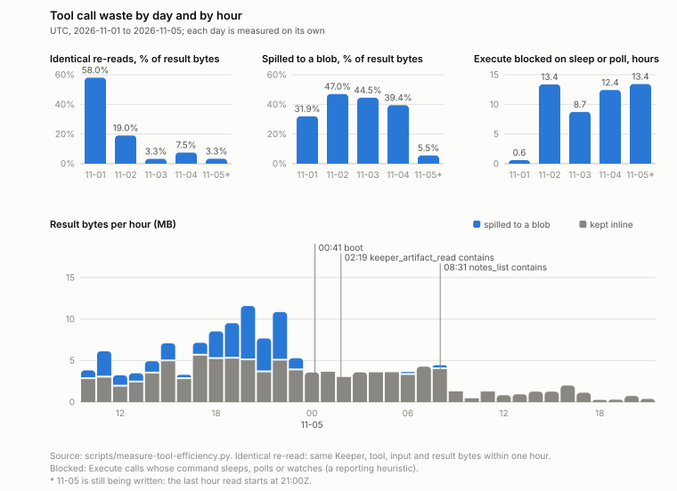
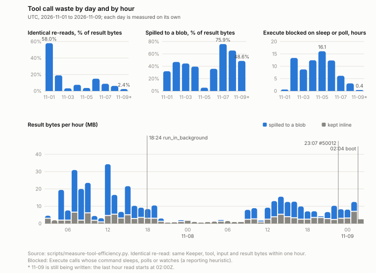

# 도구 호출 낭비 하루별·시간별 그림 (2026-11, UTC)

아래 첫 그림은 11-01 ~ 11-05(2026-11-05T21:20Z에 읽음)이고, 11-09까지 넓힌 그림은 「2026-11-01 ~ 11-09」 절에 있어요.



`scripts/measure-tool-efficiency.py`가 원장(`~/me/.masc/tool_calls`)에서 센 값을 `scripts/tool-efficiency-chart.py`가 SVG 한 장으로 그려요.
읽은 때는 2026-11-05T21:20Z쯤이에요. 같은 숫자가 `result-2026-11-01_11-05.json`에 있고, 막대에 마우스를 올리면 `<title>`에 숫자가 떠요.

## 그림에서 보는 것

위 세 패널은 UTC 하루마다 막대 하나예요.

- **같은 호출 되풀이**: 같은 Keeper가 같은 도구를 같은 입력으로 불러 같은 결과 바이트를 1시간 안에 또 받은 호출의 결과 바이트가, 그날 결과 바이트의 몇 %인지.
- **blob으로 넘친 결과**: 길어서 blob 참조로 돌아간 결과 바이트의 몫. 모델은 `keeper_artifact_read`로 한 쪽씩 읽어야 해요.
- **Execute 대기**: 명령에 sleep, polling, watch가 든 Execute 호출이 기다린 시간(시간 단위).

아래 패널은 마지막 36시간의 결과 바이트예요. 파랑은 blob으로 넘친 부분이고 회색은 그대로 돌려준 부분이에요.
세로선 셋은 `--mark`로 준 시각이에요. 모두 시스템 로그의 부팅 줄(`listening_banner`)에서 읽었고, 둘째와 셋째는 그 부팅이 바뀐 도구 TOML을 받아 들인 시각이에요.

| 시각 (UTC) | 표시 | 뜻 |
|---|---|---|
| 11-05T00:41:30Z | boot | 부팅 |
| 11-05T02:19:09Z | keeper_artifact_read contains | `contains` 인자를 받은 부팅 |
| 11-05T08:31:30Z | notes_list contains | `masc_schedule_notes_list`가 `contains`를 받은 부팅 |

## 다시 만들기

```bash
scripts/measure-tool-efficiency.py --base-path ~/me --from-date 2026-11-01 --to-date 2026-11-05 \
  --json-out docs/evidence/tool-efficiency-days-2026-11/result-2026-11-01_11-05.json
python3 scripts/tool-efficiency-chart.py --json docs/evidence/tool-efficiency-days-2026-11/result-2026-11-01_11-05.json \
  --out docs/evidence/tool-efficiency-days-2026-11/chart.svg --hours 36 \
  --mark '2026-11-05T00:41:30Z=boot' \
  --mark '2026-11-05T02:19:09Z=keeper_artifact_read contains' \
  --mark '2026-11-05T08:31:30Z=notes_list contains'
```

- `--hours` 기본값은 48이에요. 표시선은 3개까지 그리고, 그려진 시간 밖의 시각을 주면 에러로 끝나요.
- 막대가 1 px보다 가늘어지면 에러로 끝나요. 날 패널은 34일, 시간 패널은 215시간이 한계예요.
- 날이 많아서 라벨이 겹치면 값은 최고점과 마지막 막대만 적고, 날짜는 마지막 날부터 간격을 두고 적어요.
- 입력에 행이 없는 시간은 호출이 없는 시간으로 그려요.
- 입력의 마지막 시간이 23시가 아니면 마지막 날에 `*`를 붙이고 그 사실을 아래 줄에 적어요.

## 숫자

날마다 따로 센 값이에요. 합계는 호출 171,646개, 결과 1,024.3 MB예요.

| 날짜 | 호출 | 결과 | 되풀이 | blob으로 넘침 | Execute 대기 |
|---|---:|---:|---:|---:|---:|
| 11-01 | 58,600 | 398.1 MB | 58.02% | 31.94% | 0.60 h |
| 11-02 | 49,075 | 355.8 MB | 19.02% | 46.95% | 13.36 h |
| 11-03 | 18,315 | 96.9 MB | 3.26% | 44.46% | 8.72 h |
| 11-04 | 25,797 | 126.4 MB | 7.50% | 39.43% | 12.42 h |
| 11-05* | 19,859 | 47.1 MB | 3.32% | 5.52% | 13.42 h |

- 합계로는 되풀이가 312.8 MB(30.54%), blob으로 넘친 결과가 389.7 MB(38.05%)예요.
- Execute 대기는 합계 174,658.6초(48.5시간)예요. Execute 시간 488,916.4초의 35.72%예요.

## 읽을 때 주의

- 날 사이 차이를 변경의 효과로 읽지 않아요. Keeper, 모델, 일이 날마다 달라요. 11-01 하루가 되풀이 바이트의 73.8%(230,954,240 / 312,833,142 B)를 차지해요.
- 되풀이는 날마다 새로 세요. 자정을 건너는 되풀이는 세지 않아요.
- 11-05는 21:00Z 칸이 끝나기 전에 읽어서 일부예요(`*`). 마지막 칸은 238호출이에요.
- 11-03T11부터 T14까지 4시간은 입력에 행이 없어서 막대가 없어요.
- blob으로 넘친 몫은 11-05T00 칸에서 갑자기 내려가요. 11-04T23은 27.6%이고 11-05T00은 0.6%예요. 그 사이에 부팅이 없어서(11-04T16:38:13Z 다음 부팅이 11-05T00:41:30Z) 배포 탓이 아니에요. 원인은 보지 않았어요.
- Execute 대기는 명령 글자에서 sleep, polling, watch를 찾는 보고용 휴리스틱이에요. 실제로 기다린 시간과 같지 않을 수 있어요.
- 서버 통계(`/api/v1/tool-metrics/series`)는 호출마다 시각, 도구, 결과 상태, 걸린 시간만 저장해요. 결과 바이트, 되풀이, blob 몫은 원장에서만 셀 수 있어서 이 그림을 따로 그렸어요.

## 2026-11-01 ~ 11-09



읽은 때는 2026-11-09T02:22Z쯤이에요. 11-09는 02:00Z 칸까지(`*`)라서 하루가 끝나지 않았어요. `result-2026-11-01_11-09.json`을 다시 만들면 11-09 값이 커져요(`measure-tool-efficiency.py`에 끝 시각 옵션이 없어요). 11-01 ~ 11-08은 닫힌 날이에요.
세로선 셋은 서버 부팅이에요(`/health`의 `build.started_at`).

| 시각 (UTC) | 표시 | 뜻 |
|---|---|---|
| 11-07T18:24:19Z | run_in_background | #49825가 든 부팅. 이 부팅 뒤 창에서 `run_in_background` 시작이 처음 나왔어요 |
| 11-08T23:07:04Z | #50012 | 읽기 호출이 통과한 원격 점검 결과를 300초 동안 다시 쓰는 부팅 |
| 11-09T02:04:59Z | boot | 다음 부팅(커밋 `0a7164246935`) |

```bash
scripts/measure-tool-efficiency.py --base-path ~/me --from-date 2026-11-01 --to-date 2026-11-09 \
  --json-out docs/evidence/tool-efficiency-days-2026-11/result-2026-11-01_11-09.json
python3 scripts/tool-efficiency-chart.py --json docs/evidence/tool-efficiency-days-2026-11/result-2026-11-01_11-09.json \
  --out docs/evidence/tool-efficiency-days-2026-11/chart-2026-11-01_11-09.svg --hours 48 \
  --mark '2026-11-07T18:24:19Z=run_in_background' --mark '2026-11-08T23:07:04Z=#50012' --mark '2026-11-09T02:04:59Z=boot'
```

날마다 따로 센 값이에요. 합계는 호출 224,642개, 결과 1,528.4 MB예요. 실패는 날 표에서 `disposition`이 `failed`이거나, `disposition`이 없고 `wire_outcome`이 `error`인 호출이에요(`scripts/lib/recorded_tool_outcome.py`).

| 날짜 | 호출 | 결과 | 되풀이 | blob으로 넘침 | Execute 대기 | 대기 / 도구 시간 | 실패 |
|---|---:|---:|---:|---:|---:|---:|---:|
| 11-01 | 58,600 | 398.1 MB | 58.02% | 31.94% | 0.60 h | 3.2% | 0.62% |
| 11-02 | 49,075 | 355.8 MB | 19.02% | 46.95% | 13.36 h | 33.8% | 2.73% |
| 11-03 | 18,315 | 96.9 MB | 3.26% | 44.46% | 8.72 h | 37.1% | 4.36% |
| 11-04 | 25,797 | 126.4 MB | 7.50% | 39.43% | 12.42 h | 42.0% | 3.26% |
| 11-05 | 21,471 | 49.8 MB | 3.65% | 5.36% | 16.07 h | 45.3% | 2.57% |
| 11-06 | 14,603 | 54.2 MB | 14.93% | 35.82% | 12.35 h | 51.5% | 1.06% |
| 11-07 | 20,466 | 277.8 MB | 8.76% | 75.92% | 6.14 h | 35.4% | 1.02% |
| 11-08 | 12,872 | 145.8 MB | 6.17% | 65.45% | 3.07 h | 22.9% | 1.31% |
| 11-09* | 3,443 | 23.7 MB | 2.37% | 48.63% | 0.40 h | 12.5% | 3.19% |

- 합계로는 되풀이가 355.1 MB(23.23%, 47,918호출 중 같은 턴 16,901, 뒤 턴 31,017), blob으로 넘친 결과가 727.0 MB(47.56%)예요. Execute 대기는 263,301.1초(73.14시간)로 Execute 시간 694,122.8초의 37.93%예요. `keeper_artifact_read`는 17,857번 불려 215.8 MB를 돌려줬어요.
- 「대기 / 도구 시간」은 그날 모든 도구의 걸린 시간 합(`daily.time_s`) 중 sleep, polling, watch 명령을 가진 Execute의 시간(`daily.wait_s`)이에요. 11-06의 51.5%에서 11-09의 12.5%로 내려와요. 날 사이 차이는 변경의 효과가 아니에요. 일이 달라요.
- blob으로 넘친 몫은 DOS 화면(`masc_dos_screen`)을 따라 움직여요. 이 도구의 결과가 넘친 바이트에서 차지하는 몫은 11-06 91%(17.7 / 19.4 MB), 11-07 53%(111.8 / 210.9 MB), 11-08 91%(87.2 / 95.4 MB), 11-09 73%(9.8 / 13.4 MB)예요. 2026-11 원장 전체(11-01 ~ 11-09 02:22Z 뒤 줄 포함)에서 `keeper_artifact_read` 17,877번 중 DOS 화면 blob(3,898개)을 가리킨 것은 0번이에요. 6,252번은 blob의 주인을 이 원장에서 못 찾았고, 찾은 것 중에는 `masc_schedule_notes_list` 9,188번(11-01 6,238, 11-02 2,946, 11-03 이후 4), `Execute` 1,831번이 많아요. 그래서 이 패널은 모델이 페이지를 넘겨 읽는 낭비가 아니라 DOS 화면 호출량을 따라 움직여요.
- 11-07의 75.9%는 DOS 화면 밖에도 `Grep` 34.8 MB(113호출), `masc_lane_inspect` 34.3 MB(3호출), `keeper_tools_list` 22.9 MB(81호출)가 들어 있어요. 셋 모두 11-07T18:24:19Z 부팅 앞 줄이에요. 그 부팅 뒤 11-07에는 DOS 화면 13.5 MB 말고 `masc_run_list` 1.0 MB 이하만 남았어요. `masc_lane_inspect`는 11-08 6호출 2.0 MB, 11-09 3호출 2.2 MB로 내려왔지만 이유는 보지 않았어요.
- 11-09 실패 110건(3.19%) 중 59건(53.6%)이 입력이 비어 있는(`{}`) 호출이에요. `Execute` 37, `Read` 10, `keeper_artifact_read` 6, `Edit` 5, `BrowserTabs` 1이에요. 11-06 ~ 11-08의 실패율은 1.0 ~ 1.3%였어요. 11-01 ~ 11-09 전체로는 4,538건 중 1,143건(25.2%)이 빈 입력이에요(`empty_input_failures.total`). 11-09 값은 원장에서 02:22Z 앞 줄만 `ts`로 가려 센 값이에요.
