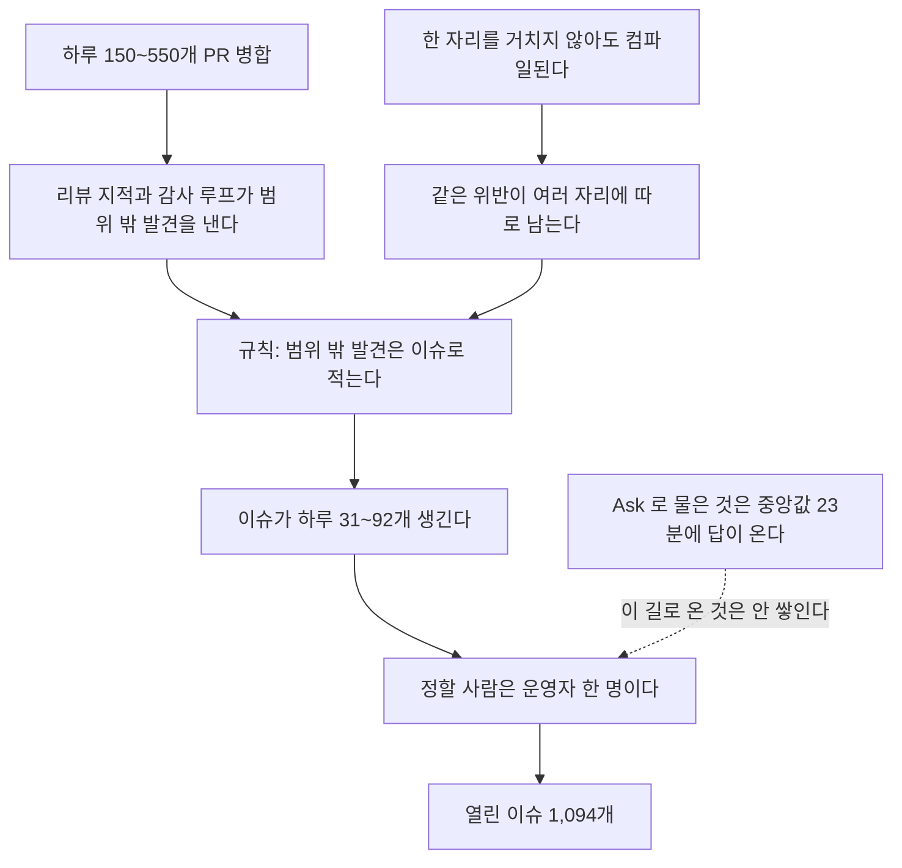
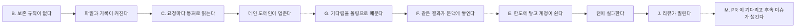

# 열린 이슈 1,094개 지도와 개선 계획 · 2026-11-11

## 한눈에

- 열린 이슈는 1,094개다. 제품이 약속한 것(턴이 돈다, 이어진다, Keeper 끼리 닿는다)을 깨는 이슈는 그중 106개, 9.7%다. 라벨로 센 하한이다.
- 열린 이슈 셋 중 둘은 PR 번호를 인용한다. 11월 1~10일에 PR 3,079개가 병합됐고 이슈 598개가 생겼다. 닫힌 것은 300개다.
- 제품 안에서 운영자에게 묻는 길(Ask)은 막히지 않는다. 1,145건을 물었고 대기 중인 것은 0건이다. 답까지 중앙값 23분이다.
- 그래서 backlog 의 대부분은 지금 제품을 멈추는 결함이 아니라 **정해지지 않은 메모**다. 적는 길은 넓고 정하는 길은 좁다.
- 사례 이슈 수백 개는 정책 결정 열 개 남짓으로 묶인다. 이 문서는 그 묶음, 좌우 두 방향의 개선안, 순서를 적는다.

## 조사 범위와 한계

- 기준 시각은 2026-11-11 19:37 KST(열린 이슈의 마지막 `updatedAt`)이고 코드 기준은 `origin/main` `fe4399c0395a` 다.
- 열린 이슈 1,094개의 제목을 전부 읽었다. 본문은 스크립트로 세었고, 사람이 하나씩 읽은 것은 대표 이슈와 닫기 후보뿐이다.
- 라벨(`kind/*`, `impact/*`, `area/*`, `root/*`)은 2026-11-10 08:22Z 까지 붙은 것을 그대로 썼다. 그 뒤에 생긴 116개는 라벨이 없다.
- 묶음 건수는 제목 정규식으로 셌다. 정규식에 안 걸린 같은 종류가 더 있다. 건수는 하한이다.
- 바깥 자료는 원문을 직접 연 것만 근거로 썼다. 초록만 본 논문은 그렇게 적었다.
- 수치를 다시 뽑는 명령은 [근거 묶음](../evidence/2026-11-11-open-issue-map/README.md)에 있다.

## 1. 흐름

| 값 | 수 |
| --- | --- |
| 열린 이슈 / 닫힌 이슈 | 1,094 / 7,544 |
| 열린 이슈의 생성 월 | 8월 94, 9월 268, 10월 280, 11월(11일간) 452 |
| 2026-11-01~11-10 병합 PR / 생긴 이슈 / 닫힌 이슈 | 3,079 / 598 / 300 |
| 위 병합 PR 가운데 base 가 `main` 인 것 | 1,811 |
| 댓글이 하나도 없는 열린 이슈 | 509 |
| 30일 넘은 열린 이슈 / 60일 넘은 것 | 422 / 138 |
| 작성 계정 | `jeong-sik` 1,047, `anyang-keepers` 36, `pangyo-preachers` 7, 그 밖 4 |

이슈의 96%가 `jeong-sik` 계정에서 나왔다. 이 계정은 운영자의 코딩 세션과 에이전트가 함께 쓰므로, 누가 썼는지는 계정으로 가를 수 없다.

병합 PR 5개마다 이슈 하나가 생긴다. main 에 닿은 PR 로 세면 3개마다 하나다. 생긴 이슈 둘에 하나가 닫힌다(300/598). 주별 backlog 는 아래처럼 움직였다.

| 주(월요일) | 생김 | 닫힘 | 주말 backlog |
| --- | --- | --- | --- |
| 09-14 | 364 | 106 | 1,671 |
| 09-21 | 524 | 955 | 1,240 |
| 09-28 | 276 | 746 | 770 |
| 10-19 | 287 | 308 | 746 |
| 11-02 | 379 | 241 | 982 |
| 11-09(사흘) | 165 | 53 | 1,094 |

9월 하순 두 주에 1,701개를 닫아 770까지 내렸다. 한 달 반 뒤 다시 1,094다. 한 번에 닫는 일은 효과가 있었지만 유입이 그대로라 되돌아왔다.

## 2. 분류

### 라벨로 본 분포

| 축 | 분포 |
| --- | --- |
| 무엇인가(`kind`) | defect 651, gap 167, inquiry 60, erosion 54, capability 43 |
| 누구에게 닿는가(`impact`) | degrades 502, blinds-operator 187, internal 173, breaks-continuity 81, breaks-collab 25 |
| 어디인가(`area`) | dashboard 187, tools 112, runtime 110, persistence 94, ci 88, continuity 72, verification 64, transport 63, turn 63, observability 56, connector 32, goal-task 18, collab 14 |
| 어느 원칙을 어겼나(`root`) | ssot 166, boundary 159, variant 151, silent 117, string 46, telemetry 43, det 39, ndt 37 |

`root` 라벨의 정의는 헌법의 금지 조항과 같은 방향이다. `root/string` 은 "글자를 맞춰 보고 처리를 나눈다", `root/variant` 는 "경우를 다 안 따졌다", `root/silent` 는 "에러를 숨기고 기본값을 쓴다"이다. 원칙은 이미 있다. 이슈 728개가 "원칙을 어긴 자리 하나"를 가리킨다.

### 제목으로 잡은 묶음

| 묶음 | 건수 | 약속에 닿는 수 | 11월 생성 | 대표 이슈 |
| --- | --- | --- | --- | --- |
| H. TUI 화면 잔결함 | 132 | 3 | 75 | #51270, #48617 |
| M. 리뷰 뒤 "후속·남은 것" | 82 | 9 | 37 | #47776, #46746 |
| I. main 에서 실패하는 시험 | 66 | 1 | 41 | #49700, #29064 |
| B. 상한 없이 늘어나는 저장소 | 41 | 5 | 19 | #30695, #40747, #48946 |
| 곁가지 기능(음악 12, MSX·DOS 11, 음성 3, 그 밖 5) | 31 | 2 | 8 | #48999, #49804 |
| A. 하드컷 뒤 옛 데이터를 못 읽음 | 31 | 11 | 16 | #32504, #47772 |
| "N곳 중 M곳·따로·두 벌"(제목) | 31 | 2 | 12 | #42937, #46516 |

같은 표현("N곳 중 M곳", "따로", "두 벌")은 본문까지 보면 315개에 나온다. 제목 묶음 어디에도 안 걸리는 이슈가 728개다. 아래 묶음은 제목을 읽으며 손으로 잡았고 건수는 세지 못했다.

- C. 요청마다 파일을 통째로 읽어 메인 도메인이 멈춤: #46410, #46816, #46413, #51314
- D. 오류를 접거나 모르는 값을 기본값으로 바꿈: `root/silent` 117, `root/variant` 151, `root/string` 46 이 여기 속한다
- E. provider 한도·휴식을 구분하지 않음: #34653, #39190, #41425, #42672, #49369
- F. 요청 크기가 창을 넘음: #50445, #49435, #48999
- G. 같은 호출을 되풀이함: #46863(1,636회), #48963(899회), #49859(26~27%), #49842(81%)
- J. 리뷰와 병합의 신원: #46691(리뷰어 Keeper 7명이 GitHub 계정 3개)
- N. 다계정·workspace 경계: #46477 진행판

### 이전 판정 장부와 겹쳐 보기

2026-11-05 부터 한 세션이 오래된 이슈를 하나씩 판정해 세션 메모에 적었다(저장소 밖). 그 장부에서 아직 열린 806개를 판정별로 세면 이렇다.

| 판정 | 뜻 | 아직 열림 | 약속에 닿는 수 |
| --- | --- | --- | --- |
| SKIP | 다른 캠페인 영역(대부분 TUI)이라 건드리지 않음 | 217 | 5 |
| LOW_ROI | 고칠 값이 낮음. 그중 37개는 라이브 로그에서 0~1건으로 잰 것 | 119 | 11 |
| 닫기 후보(FIXED, CLOSE_CANDIDATE 등) | 이미 고쳐졌거나 닫아도 됨 | 120 | 24 |
| DISCUSS, DESIGN, 결정 | 운영자 결정 대기 | 99 | 15 |
| PARK, DEFER | 지금 안 함 | 73 | 20 |
| 그 밖 | PR 을 냄, 외부 차단, 유지 등 | 178 | — |

판정한 이슈 가운데 "지금 고쳐서 PR 을 낸 것"은 열에 하나가 안 된다. 나머지는 닫을 것, 정할 것, 지금 안 할 것이다.

## 3. 인과

### 이슈가 쌓이는 길



- 열린 이슈의 67%(731개)가 PR 번호를 인용한다. 다른 열린 이슈를 인용하는 것은 180개뿐이고 804개는 다른 열린 이슈와 이어지지 않는다. 이슈끼리 엮이지 않고 PR 에 하나씩 매달려 있다.
- 자기보다 나중에 열려 병합된 PR 이 언급한 이슈가 588개다. 그 가운데 닫는 표현(`Closes #`)으로 이어진 것은 0개다. PR 은 이슈를 언급만 했다. 다 고치고 안 닫았는지 일부만 고쳤는지는 하나씩 읽어야 안다.
- 범위 밖 발견을 이슈로 적으라는 규칙은 운영자의 세션 공통 지침(이 저장소 밖)에 있다. 모든 세션이 이 규칙을 따른다. 열린 이슈의 67%가 PR 번호를 인용하는 비율은 9월부터 달마다 67~70%로 같다.

### 결함끼리 이어지는 길



실선은 이슈가 수치로 보고한 연결이고 점선은 내 추정이다.

| 연결 | 근거 |
| --- | --- |
| 보존 규칙 없음 → 커짐 | #30695 런타임 데이터 221 GB, #40747 이틀에 823 GB, #48946 하루 2~3.5 GB |
| 커짐 → 통째 읽기 → 정지 | #46396 체크포인트 최대 96 MB 파싱에 CPU 2코어·메모리 15 GB, #46413 관측 파일 5만여 개를 binding 마다 다시 읽음, #51314 한 번에 118~132 ms 정지 |
| 폴링 | #49842 Delegate 상태 조회의 81%가 끝나지 않은 operation, #46863 한 턴에 1,636회 |
| 폴링 → 문맥에 쌓임 | #49559 도구를 수백 번 불러 요청이 3 MB, #49435 턴마다 60 KB 넘게 쌓임 |
| 한도 → 턴 실패 | #34653 41분에 실패 턴 183회, #42672 사흘에 약 4,900번 실패 |
| 턴 실패 → 리뷰 밀림 | #46437 직접 작업 턴 완료율 75% → 36%, #46691 Ready PR 56개 중 54개에 현재 head 판정 없음 |

이 사슬에서 헌법의 실패 조건(턴이 못 돈다, 반복한다)에 직접 닿는 고리는 E, G, F 다. B 와 C 는 그 앞에서 압력을 만든다.

## 4. 관통하는 두 축

이슈 하나하나를 두 물음으로 나눈다.

1. **약속에 닿는가.** 헌법의 실패 조건 다섯(턴이 못 돈다, 안 이어진다, 반복한다, Keeper 끼리 못 닿는다, 출력 자리를 못 고른다)을 깨는가. 라벨로는 `impact/breaks-continuity`(1순위)와 `impact/breaks-collab`(2순위)이고 106개다. 운영자가 상태를 못 보는 것(`impact/blinds-operator`, 3순위)까지 넣으면 293개, 26.8%다. `impact` 라벨이 없는 126개는 어느 쪽인지 모른다. 그래서 106은 하한이다.
2. **사례인가 뿌리인가.** 한 자리의 증상인가, 여러 사례를 낳는 자리인가. 라벨로는 셀 수 없다. 2절의 묶음이 뿌리 후보다.

| | 사례 | 뿌리 |
| --- | --- | --- |
| 약속에 닿는다 | 뿌리 이슈의 점검 목록으로 옮긴다 | 지금 고친다. 한 번에 하나씩 |
| 약속에 안 닿는다 | 닫거나 PR 본문에 적고 끝낸다 | 정책을 한 번 정한다 |

두 축에 비추면 공통 원인이 둘 보인다.

- **한 자리는 있는데 거치지 않아도 컴파일된다.** 금지 조항은 헌법에 있고, 한 곳에서 지키게 하는 목록도 여러 번 만들었다. 부팅 정책표(`Keeper_durable_store.Id`, store 23개)와 날짜별 store 보존 목록(Native Stack #42853)이 그렇다. 그런데 보존 RFC 가 스스로 적은 대로 "store 를 새로 만드는 코드는 그 목록을 몰라도 컴파일된다". 그래서 목록 밖에 새 자리가 생기고, 어긴 자리마다 이슈가 하나씩 생긴다. `root/*` 라벨 728개가 그 흔적이다.
- **적는 길은 넓고 정하는 길은 좁다.** 발견은 세션과 Keeper 수십이 한다. 정하는 것은 운영자 한 명이다. 제품 안의 Ask 는 묻는 즉시 한 사람 앞에 놓이고 답이 온다. GitHub 이슈는 누구 앞에도 놓이지 않는다. 이슈만 그런 것이 아니다.

| 적어 둔 것 | 정해지지 않은 수 | 전체 |
| --- | --- | --- |
| GitHub 이슈 | 열림 1,094 | 닫힘 7,544 |
| RFC 문서(`docs/rfc`) | Draft 344 | 상태가 있는 474개. Implemented 65, Active 45, Accepted 13 |
| MASC Task | 배정 안 된 todo 448 | 열린 Task 554 (19:50 KST) |
| Ask | 대기 0 | 1,145. 답 949, 거둠 196 |

둘을 한 문장으로 줄이면 **결정을 바꾸지 않는 정밀함에 주의가 쓰인다**이다. LOW_ROI 119개 중 37개는 "결함은 코드에 있지만 라이브 로그에서 0~1건"이라고 잰 것이다. TUI 묶음 132개 중 약속에 닿는 것은 3개다. 정밀하게 적었지만 다음 행동을 바꾸지 않는다.

## 5. 좌우로 비춰 본 개선안

왼쪽은 **앞에서 한 곳으로 막는다**(타입, 한 함수, 부팅 한 자리)이고 오른쪽은 **받아들이고 버린다**(적지 않는다, 지운다, 새 상태로 시작한다)이다.

| 묶음 | 왼쪽 | 오른쪽 | 고른 쪽 | 대가 | 지금 맡은 곳 |
| --- | --- | --- | --- | --- | --- |
| A. 하드컷 옛 데이터 | 부팅 때 store 전부의 형식을 한 자리에서 확인하고 한 번에 거절한다(#32504) | 옛 데이터를 읽어 달라는 이슈를 "지우고 설치" 정책대로 닫는다 | 둘 다. 사례는 #32504 의 점검 목록으로 옮기고, 표 밖 store 를 표로 옮긴다 | 표에 없는 store 는 열 수 없게 타입으로 막아야 한다. 그 PR 이 크다 | 정책표는 있다(store 23개). RFC `every-durable-store-has-one-boot-policy` 는 Draft |
| B. 늘어나는 저장소 | 저장소마다 보존 기간을 선언하고 한 루프가 지운다 | 읽는 곳이 없는 기록은 쓰기를 지운다 | 오른쪽 먼저. 읽는 곳을 센 뒤 남는 것만 선언한다 | 사후 조사에 쓸 기록이 준다 | 날짜별 store 는 구현됐다(#42853). lane-addons, 계정 home, scratch checkout 은 목록 밖이다 |
| C. 메인 도메인 정지 | 제어 평면을 revision 있는 명령 + 증분 projection 으로 바꾼다 | 잰 것 중 가장 긴 정지부터 하나씩 옮긴다 | 오른쪽. 왼쪽은 측정이 요구할 때 한다 | 구조는 그대로라 새 정지가 또 생길 수 있다 | #51050 병합, RFC-0518 스택 |
| D. 오류 접기·기본값 | 경계에서 닫힌 variant 로 parse 하고 `Result` 를 돌려준다 | 못 읽은 값은 값으로 만들지 않고 "모름"으로 보여 준다 | 왼쪽. 자리마다 고치지 않고 디코더 하나로 모은다(#42937 의 방식) | 디코더를 모으는 PR 이 크다 | 없음 |
| E. provider 한도·휴식 | provider 가 알려 준 리셋 시각·로그인 필요·잔액 없음을 닫힌 상태 하나로 두고 라우팅이 읽는다 | 한도가 찬 계정은 운영자가 다시 넣을 때까지 슬롯에서 뺀다 | 왼쪽. 실패 조건 "턴이 못 돈다"에 직접 닿는다 | 런타임마다 한도 응답을 한 번씩 parse 해야 한다 | RFC-0449(402 는 429 가 아니다)와 RFC `codex-account-quota-scope` 가 둘 다 Draft |
| F. 요청 크기 | 보내기 전에 provider 가 센 수로 한 곳에서 합산한다(#50445) | 턴을 일의 단위에서 끝내 문맥이 안 쌓이게 한다 | 오른쪽이 먼저다. 왼쪽은 그 뒤에 남는 경우만 | 턴이 잘게 나뉘면 턴 사이 인계가 정확해야 한다 | RFC #51309, RFC #51303 병합 |
| G. 반복 호출 | 같은 호출 + 같은 결과를 턴 안에서 세어 사실로 보여 준다 | 기다리는 대상이 끝나면 깨워서 폴링할 일을 없앤다 | 오른쪽 | 깨움이 빠지면 Keeper 가 영영 기다린다. 그래서 하네스로 채점한다 | RFC #51302 병합, 하네스 #51315 Draft |
| H. TUI 잔결함 | 화면 틀·키·표기를 타입 하나로 만든다 | 화면을 옮길 때까지 사례 이슈를 더 만들지 않는다 | 둘 다 | 캠페인이 늦어지면 잔결함이 그대로 남는다 | RFC #51307 병합, 스택 #51312 |
| I. 빨간 시험 | 출시 필수 목록에 든 시험만 고친다 | 나머지 빨간 시험은 지운다 | 둘 다. 이슈 66개를 "필수 목록에 드는가" 하나로 나눈다 | 지운 시험이 잡던 회귀를 놓친다. 지금도 빨개서 못 잡는다 | 없음 |
| J. 리뷰 신원 | 리뷰어 Keeper 마다 GitHub 신원을 하나씩 준다 | 판정을 MASC 안에 기록하고 GitHub 에는 결과만 낸다 | 정하지 않았다. 다계정 작업과 같이 봐야 한다 | 왼쪽은 계정 운영, 오른쪽은 병합 규칙 변경 | #46691 열림 |
| M. 리뷰 후속 | 후속 이슈 첫 줄에 "무엇이 보이면 닫는가"를 적게 한다 | 약속에 안 닿는 후속은 이슈로 만들지 않고 PR 본문에 적는다 | 오른쪽 | PR 본문은 다시 찾기 어렵다. 같은 종류가 세 번째면 뿌리 이슈에 덧붙인다 | 없음 |

900 에이전트 설계서와 초고속 계획서는 C 의 왼쪽과 오른쪽에 해당한다. 두 문서 모두 측정이 조건이다. 초고속 계획서의 관찰 하나가 여기에도 들어맞는다. 모델이 고르는 선택 인자(`if_revision`)의 채택률은 0~0.19%였다. 에이전트가 스스로 골라야 효과가 나는 개선은 안 듣는다. 유입 규칙도 "잘 판단해서 적어라"가 아니라 기본 동작을 바꿔야 한다.

## 6. 바깥에서 본 근거

| 관찰 | 출처 | 여기서 쓰는 곳 |
| --- | --- | --- |
| 긴 작업은 압축만으로 부족하고, 구조화한 인계로 새로 시작하는 쪽이 낫다. 평가자는 만드는 쪽과 나눈다. 모델이 바뀌면 하네스 부품을 뺀다 | [Anthropic 2026-03-24](https://anthropic.com/engineering/harness-design-long-running-apps), [Anthropic 2025-11-26](https://anthropic.com/engineering/effective-harnesses-for-long-running-agents) | F 의 오른쪽. "빼는 쪽"을 먼저 보는 근거 |
| 다중 에이전트는 토큰을 약 15배 쓴다. 초기에는 단순한 질문에 하위 에이전트 50개를 띄웠다 | [Anthropic 2025-06-13](https://anthropic.com/engineering/multi-agent-research-system) | 7절. 사람을 늘리기 전에 조정 비용을 본다 |
| 다중 에이전트 실패는 설계, 에이전트 사이 어긋남, 검증의 세 갈래 14가지다 | [arXiv 2503.13657v3](https://arxiv.org/abs/2503.13657v3) | `breaks-collab` 이 25개뿐인 것은 실패가 적어서가 아니라 안 보여서일 수 있다 |
| 반복은 "같은 호출 + 같은 관찰"로 정의하면 잡힌다. 압축된 이력에서 늘어난다(초록만 확인) | [arXiv 2610.19376](https://arxiv.org/abs/2610.19376) | G 의 왼쪽 정의 |
| 도구 관찰은 ID 붙은 추가 전용 기록에 두고 오래된 것은 인용으로 싣는다(초록만 확인) | [arXiv 2607.25066](https://arxiv.org/abs/2607.25066) | F |
| 저장소 지침 파일은 성공률을 대체로 올리지 못하고 비용을 20% 넘게 올린다(초록만 확인) | [arXiv 2602.11988](https://arxiv.org/abs/2602.11988) | 지시문을 더하지 않고 유입 규칙 한 줄을 바꾸는 쪽 |
| 대표 에이전트가 역할 20개를 만들었더니 메모와 회의만 늘었다 | [HN 47245373](https://news.ycombinator.com/item?id=47245373) | 7절 |
| 들어오는 PR 의 25%가 쓸 수 없는 것이라고 유지보수자들이 추정한다 | [The Register 2026-10-21](https://www.theregister.com/ai-and-ml/2026/10/21/ai-cuts-coding-time-but-its-also-filling-open-sources-inbox-with-crap/5304389) | 병목이 만드는 쪽에서 읽고 정하는 쪽으로 옮겨 갔다 |
| MCP 2026-07-28 판이 세션과 initialize 를 없애고 `tasks/list` 를 뺐다 | [MCP changelog](https://modelcontextprotocol.io/specification/2026-07-28/changelog) | masc MCP 서버 호환 확인이 필요하다. 이 문서에서는 확인하지 않았다 |

확인 시각은 2026-11-11 이고 신뢰도는 Medium 이다. provider 한도 분류, 리뷰어 신원 분리, backlog 자동 정리의 실제 사례는 찾지 못했다.

## 7. 운영 팀 하나에서 본 제품 과제

제품을 실제로 쓰는 운영 팀 하나(Keeper 넷)의 한 달 Goal 을 Board 기록으로 따라갔다. 팀 이름과 수치는 그 팀의 사업 자료라 여기 적지 않고 운영자에게 따로 전했다. 제품 쪽에서 본 것만 적는다.

- Goal 의 값을 움직일 지렛대가 팀 밖(바깥 계정과 권한)에 있었다. 그 사실은 Goal 화면이 아니라 긴 타래의 댓글에 적혀 있었다.
- 조정 타래가 댓글 100개 상한에 걸려 네 번 이어졌다. 무엇이 정해졌는지 알려면 댓글 수백 개를 읽어야 한다.
- 작은 측정 차이를 맞추는 데 조회 예산이 쓰였다. 4절의 문장이 여기서도 보인다. 그 정밀함은 Goal 에 닿는 행동을 바꾸지 않았다.

만드는 Keeper 를 더 두는 것보다 팀 밖 지렛대 하나를 여는 결정이 먼저였다. 제품이 여기서 가져갈 것은 셋이다. 셋 다 강제 장치가 아니라 보여 주는 값이다.

1. Goal 을 볼 때 "팀이 직접 움직일 수 있는 것"과 "운영자만 줄 수 있는 것"이 나뉘어 보인다.
2. 긴 조정 타래에서 정해진 것만 따로 읽힌다.
3. 측정을 맞추는 데 쓴 턴과 결과물을 내는 데 쓴 턴이 나뉘어 보인다.

이 절은 Board 글을 읽은 관찰이다. 그 팀의 저장소와 원자료는 보지 않았다. 팀 리더 Keeper 에게 "MASC 가 일을 막은 것"을 물었고, 답이 오면 이 문서를 다루는 PR 에 적는다.

## 8. 계획

| 순서 | 할 일 | 확인 |
| --- | --- | --- |
| 1 | 이전 장부의 닫기 후보 120개를 지금 main 과 다시 대조하고, 확인된 것만 근거 댓글과 함께 닫는다 | 이슈마다 닫는 댓글, 근거 묶음의 결과 표 |
| 2 | 10절의 결정을 운영자에게 묶어서 묻는다. 결정 하나가 닫는 이슈를 미리 적는다 | 결정마다 닫힌 수 |
| 3 | 유입 규칙을 바꾼다. 약속에 닿는 것만 이슈로 만들고 나머지는 PR 본문에 적는다 | 2주 뒤 하루 유입 수 |
| 4 | 뿌리를 약속에 닿는 순서로 고친다. E(Draft RFC 둘을 정한다) → A(표 밖 store 를 표로) → G·F(병합된 RFC 의 구현) → B(읽는 곳 없는 기록) | 뿌리마다 그 묶음의 열린 수 |
| 5 | 같은 스크립트로 2주 뒤 다시 잰다 | 아래 두 값 |

세는 값은 열린 이슈 수가 아니다. 열린 이슈 수는 닫기만 해도 내려가고 유입이 그대로면 돌아온다. 다음 둘을 본다.

- 약속에 닿는 열린 이슈 수(지금 106). 이 값은 라벨에 달려 있어서 라벨을 낮추면 내려간다. 라벨이 바뀐 수를 같이 본다.
- main 에 닿은 병합 PR 100개마다 생기는 이슈 수(지금 33.0. 스택 층까지 세면 19.4)
- 생긴 이슈 대비 닫힌 이슈(지금 0.50). 닫았다가 다시 연 비율은 이번에 재지 못했다.

## 9. 닫기 1차 검증

이전 장부의 닫기 후보 120개를 지금 main 과 다시 대조하고 있다. 방법은 이렇다.

- 독립 에이전트 여섯이 20개씩 맡아 이전 판정을 반박하려고 읽는다. 이슈 본문과 댓글 전부, 인용된 PR 의 병합 여부, `origin/main` `fe4399c0395a` 의 코드를 본다.
- 판정은 셋이다. 요구한 것이 모두 main 에 있으면 닫는다(완료). 전제가 틀렸거나 다루는 코드가 없어졌으면 닫는다(하지 않음). 그 밖은 열어 둔다. 애매하면 열어 둔다.
- 닫는 이슈에는 무엇을 요구했고 지금 main 의 무엇이 그것을 채우는지 댓글로 적는다.
- 닫기 전에 결과를 한 번 더 읽는다. 그 사이 새 댓글이 달린 이슈는 닫지 않는다.

먼저 나온 네 건은 닫기 둘, 열어 두기 둘이었다. 열어 둔 둘은 이전 판정의 근거가 지금은 성립하지 않았다. 예를 들어 "최근 전체 시험이 두 번 통과했다"던 근거는 틀렸다. 예약 실행되는 전체 시험(`Test` 워크플로)은 2026-09-04 뒤 57번 가운데 4번 통과했고, 마지막 통과가 2026-09-27 이다. 이전 판정을 그대로 믿고 닫으면 안 된다는 뜻이다.

결과 표는 검증이 끝나면 근거 묶음에 더한다. 닫은 이슈마다 댓글이 남으므로 표가 없어도 GitHub 에서 확인할 수 있다.

## 10. 운영자가 정할 것

| # | 정할 것 | 정석 쪽 | 근거 | 대가 | 움직이는 이슈 |
| --- | --- | --- | --- | --- | --- |
| 1 | 하드컷 뒤 옛 데이터를 못 읽는다는 이슈 | 정하는 일(버린다)과 하는 일(표로 옮긴다)을 나눈다. 사례는 #32504 의 점검 목록에 store 이름으로 옮긴 뒤에 닫는다 | 이미 정한 정책이 "지우고 설치"다. 정책표가 main 에 있다 | 사례마다 있던 재현 수치가 한 이슈의 목록 한 줄로 준다 | 약 20 |
| 2 | main 에서 실패하는 시험 | 출시 필수 목록에 든 것만 고치고 나머지는 시험을 지운다 | 66개 중 약속에 닿는 것은 1개다. 예약 전체 시험은 2026-09-27 뒤로 통과한 적이 없다 | 지운 시험이 잡던 회귀를 놓친다 | 66 |
| 3 | 고칠 값이 낮다고 판정한 이슈(LOW_ROI) | 약속에 안 닿는 108개를 "지금 안 함"으로 닫는다. 다시 나면 다시 연다 | 33개는 라이브 로그에서 0~1건으로 쟀다. 75개는 판정만 있다 | 드문 결함이 코드에 남는다 | 108 |
| 4 | TUI 잔결함 | 화면 문법 캠페인이 그 화면을 옮길 때 한꺼번에 닫는다. 그때까지 새 사례 이슈를 만들지 않는다 | 132개 중 약속에 닿는 것은 3개다 | 캠페인이 늦으면 그대로 남는다 | 132 |
| 5 | 곁가지 기능(음악, MSX·DOS, 음성 등) 이슈 | 핵심 경로를 깨는 것만 남기고 나머지는 별도 라벨로 옮겨 backlog 에서 뺀다 | 31개 중 약속에 닿는 것은 2개다 | 곁가지 기능의 결함이 뒤로 밀린다 | 29 |
| 6 | 범위 밖 발견을 적는 규칙 | 약속에 닿는 것만 이슈로 만든다. 나머지는 PR 본문에 적는다. 운영자 결정이 필요하면 Ask 로 묻는다 | 유입이 병합량을 따라간다. Ask 는 대기 0건이다 | PR 본문에 적은 것은 다시 찾기 어렵다 | 하루 유입 |
| 7 | 결정 대기로 적힌 이슈 99개 | 정책 하나를 Ask 하나로 묻는다. 선택지와 기본값을 단다. 이슈는 답이 올 때까지 닫지 않고, 닫는 댓글에 어느 Ask 로 정했는지 한 줄을 적는다 | Ask 의 답은 중앙값 23분에 온다 | 운영자가 한 주에 받는 Ask 가 는다(지금 주 100~190건). 한꺼번에 던지면 흘려 읽힌다 | 99 |
| 8 | 한도·휴식의 Draft RFC 둘(RFC-0449, `codex-account-quota-scope`) | 받아들일지 버릴지 정한다 | E 는 실패 조건 "턴이 못 돈다"에 직접 닿는다 | 받아들이면 런타임마다 한도 응답을 parse 하는 구현이 따라온다 | E 묶음 |
| 9 | 나중 PR 이 언급한 나머지 이슈 514개의 재검증 | 1차 120개에서 닫힌 비율을 보고 정한다 | 9절 | 이슈 하나에 에이전트 시간 5~7분 | 최대 514 |

6번은 이 저장소가 아니라 운영자 지침 파일을 바꾸는 일이라 여기서는 고치지 않았다.

## Keeper 검토에서 받아들인 것

요약을 MASC Board 에 올리고 Keeper 에게 반박을 부탁했다. `masc-productor-owner` 의 지적 가운데 다음을 반영했다.

- 106개는 라벨이 붙은 것만 센 하한이다. 라벨 없는 이슈를 따로 적었고, `blinds-operator` 를 넣은 넓은 값을 같이 적었다(4절).
- "병합 PR 100개마다 이슈 수"는 분모를 main 에 닿은 PR 로 고정했다. 스택 층까지 세면 값이 달라진다(8절).
- 닫힘 쪽 값(생긴 이슈 대비 닫힌 이슈)을 더했다(8절).
- 결정 대기 이슈는 Ask 로 옮기며 닫지 않는다. 답이 온 뒤에 닫고, 닫는 댓글에 어느 Ask 로 정했는지 적는다(10절 7번).
- 하드컷 옛 데이터는 "정하는 일"과 "하는 일"을 나눴다. 닫아도 표로 옮기는 일은 #32504 에 남는다(10절 1번).

반영하지 못한 것도 있다. 사용자에게 보이는 변경(CHANGELOG 항목) 100개마다 이슈 수를 세자는 제안은 이번에 세지 않았다.

## 재현

```sh
cd docs/evidence/2026-11-11-open-issue-map
python3 fetch_issues.py open /tmp/open.jsonl
python3 fetch_issues.py closed /tmp/closed.jsonl
python3 fetch_xrefs.py /tmp/xrefs.jsonl
python3 measure.py /tmp/open.jsonl /tmp/closed.jsonl /tmp/xrefs.jsonl /tmp/clusters.json
```

이슈는 계속 생기고 닫히므로 다시 받으면 수가 달라진다. 이 문서의 수는 근거 묶음 README 의 "관측한 값"과 같다.
