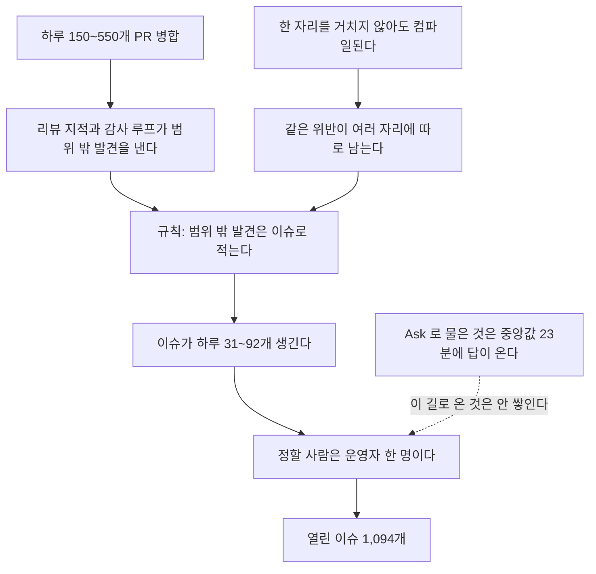
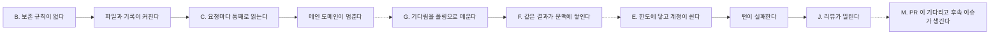

# 열린 이슈 1,094개 지도와 개선 계획 · 2026-11-11

## 한눈에

- 열린 이슈는 1,094개였다. 제품이 약속한 것(턴이 돈다, 이어진다, Keeper 끼리 닿는다)을 깨는 이슈는 라벨로 세면 그중 106개, 9.7%다.
- 라벨은 양쪽으로 틀렸다. 라벨을 가리고 두 판정자가 따로 다시 매기니 106개 가운데 33개만 "실제로 일어났고 약속에 닿는다"였다. 19개는 일어난 기록이 없었고 29개는 일어났지만 결과가 가벼웠다. 라벨 밖 940개를 본문으로 읽히니 그런 이슈가 36개 더 있었다.
- 닫은 것을 빼면 지금 열린 이슈 가운데 두 번 다 "일어났고 약속에 닿는다"로 본 것은 66개다. 가장 큰 묶음은 "요청이 창을 넘거나 세션·기억을 이어가지 못한다" 16개다(8절).
- 열린 이슈 셋 중 둘은 PR 번호를 인용한다. 11월 1~10일에 PR 3,079개가 병합됐고 이슈 598개가 생겼다. 닫힌 것은 300개다.
- 제품 안에서 운영자에게 묻는 길(Ask)은 막히지 않는다. 1,145건을 물었고 대기 중인 것은 0건이다. 답까지 중앙값 23분이다.
- 라벨 밖 940개의 절반(468개)은 일어난 기록이 없다. 그래서 backlog 의 대부분은 지금 제품을 멈추는 결함이 아니라 **정해지지 않은 메모**다. 누가 정할지 정해진 것(PR, Ask)은 흐르고, 정해지지 않은 것(이슈, RFC 초안, 배정 안 된 Task)은 쌓인다.
- 닫기 검증으로 70개를 근거 댓글과 함께 닫았다. 다른 세션이 그 가운데 3개를 다시 열어 67개가 닫혀 있다. 이전 장부가 닫아도 된다고 한 120개 가운데서는 65개, 병합된 PR 제목에 번호가 적힌 이슈 20개 가운데서는 2개다(9절).
- 운영자가 정한 대로 일어난 기록이 없는 메모 이슈 226개를 "지금 안 함"으로 닫았다. 닫은 뒤에 기준의 구멍 둘(보안 등급이 없다, 댓글을 읽지 않았다)을 찾아 12개를 다시 열고 5개는 "완료"로 고쳤다. 209개가 "지금 안 함"으로 닫혀 있다(10절).
- 사례 이슈 수백 개는 정책 결정 열 개 남짓으로 묶인다. 이 문서는 그 묶음, 좌우 두 방향의 개선안, 순서를 적는다.

## 조사 범위와 한계

- 기준 시각은 2026-11-11 19:37 KST(열린 이슈의 마지막 `updatedAt`)이고 코드 기준은 `origin/main` `fe4399c0395a` 다.
- 열린 이슈 1,094개의 제목을 전부 읽었다. 본문은 스크립트로 세었고, 독립 에이전트가 라벨을 가린 본문을 읽고 매겼다. 1·2순위 라벨 106개는 두 판정자가 매겼고, 나머지 940개는 한 번 매긴 뒤 242개를 다시 매겼다. 내가 하나씩 읽은 것은 대표 이슈와 닫기 후보다.
- 본문 분류의 판정자는 댓글을 읽지 않았고, 기준에 보안 등급이 없다. 이 둘 때문에 잘못 닫은 이슈를 닫은 뒤에 찾아 고쳤다(10절).
- 라벨(`kind/*`, `impact/*`, `area/*`, `root/*`)은 2026-11-10 08:22Z 까지 붙은 것을 그대로 썼다. 라벨이 하나도 없는 이슈는 116개다. 60개는 그 시각 뒤에 생겼고, 56개는 그 전에 생겼는데 라벨이 없다. 라벨이 믿을 만한지는 두 번 다시 매겨 보았다(4절).
- 묶음 건수는 제목 정규식으로 셌다. 정규식에 안 걸린 같은 종류가 더 있다. 건수는 하한이다.
- 바깥 자료는 원문을 직접 연 것만 근거로 썼다. 초록만 본 논문은 그렇게 적었다.
- 수치를 다시 뽑는 명령은 [근거 묶음](../evidence/2026-11-11-open-issue-map/README.md)에 있다.

## 1. 흐름

| 값 | 수 |
| --- | --- |
| 열린 이슈 / 닫힌 이슈 | 1,094 / 7,544 |
| 열린 이슈의 생성 월 | 8월 94, 9월 268, 10월 280, 11월(11일간) 452 |
| 2026-11-01~11-10 병합 PR / 생긴 이슈 / 닫힌 이슈 | 3,079 / 598 / 300 |
| 위 병합 PR 가운데 base 가 `main` 인 것 | 1,811 |
| 댓글이 하나도 없는 열린 이슈 | 509 |
| 30일 넘은 열린 이슈 / 60일 넘은 것 | 422 / 138 |
| 작성 계정 | `jeong-sik` 1,047, `anyang-keepers` 36, `pangyo-preachers` 7, 그 밖 4 |

이슈의 96%가 `jeong-sik` 계정에서 나왔다. 이 계정은 운영자의 코딩 세션과 에이전트가 함께 쓰므로, 누가 썼는지는 계정으로 가를 수 없다.

병합 PR 5개마다 이슈 하나가 생긴다. main 에 닿은 PR 로 세면 3개마다 하나다. 생긴 이슈 둘에 하나가 닫힌다(300/598). 주별 backlog 는 아래처럼 움직였다.

| 주(월요일) | 생김 | 닫힘 | 주말 backlog |
| --- | --- | --- | --- |
| 09-14 | 364 | 106 | 1,671 |
| 09-21 | 524 | 955 | 1,240 |
| 09-28 | 276 | 746 | 770 |
| 10-19 | 287 | 308 | 746 |
| 11-02 | 379 | 241 | 982 |
| 11-09(사흘) | 165 | 53 | 1,094 |

표는 흐름이 바뀐 주만 뽑았다. 16주 전체는 근거 묶음의 `measure.py` 출력에 있다.

9월 하순 두 주에 1,701개를 닫아 770까지 내렸다. 한 달 반 뒤 다시 1,094다. 한 번에 닫는 일은 효과가 있었지만 유입이 그대로라 되돌아왔다.

## 2. 분류

### 라벨로 본 분포

| 축 | 분포 |
| --- | --- |
| 무엇인가(`kind`) | defect 651, gap 167, inquiry 60, erosion 54, capability 43 |
| 누구에게 닿는가(`impact`) | degrades 502, blinds-operator 187, internal 173, breaks-continuity 81, breaks-collab 25 |
| 어디인가(`area`) | dashboard 187, tools 112, runtime 110, persistence 94, ci 88, continuity 72, verification 64, transport 63, turn 63, observability 56, connector 32, goal-task 18, collab 14 |
| 어느 원칙을 어겼나(`root`) | ssot 166, boundary 159, variant 151, silent 117, string 46, telemetry 43, det 39, ndt 37 |

`root` 라벨의 정의는 헌법의 금지 조항과 같은 방향이다. `root/string` 은 "글자를 맞춰 보고 처리를 나눈다", `root/variant` 는 "경우를 다 안 따졌다", `root/silent` 는 "에러를 숨기고 기본값을 쓴다"이다. 원칙은 이미 있다. `root` 라벨이 하나라도 붙은 이슈가 728개다(라벨 수로는 758). 이 이슈들은 "원칙을 어긴 자리 하나"를 가리킨다.

### 제목으로 잡은 묶음

| 묶음 | 건수 | 약속에 닿는 수 | 11월 생성 | 대표 이슈 |
| --- | --- | --- | --- | --- |
| H. TUI 화면 잔결함 | 132 | 3 | 75 | #51270, #48617 |
| M. 리뷰 뒤 "후속·남은 것" | 82 | 9 | 37 | #47776, #46746 |
| I. main 에서 실패하는 시험 | 66 | 1 | 41 | #49700, #29064 |
| B. 상한 없이 늘어나는 저장소 | 41 | 5 | 19 | #30695, #40747, #48946 |
| 곁가지 기능(음악 12, MSX·DOS 11, 음성 3, 그 밖 5) | 31 | 2 | 8 | #48999, #49804 |
| A. 하드컷 뒤 옛 데이터를 못 읽음 | 31 | 11 | 16 | #32504, #47772 |
| "N곳 중 M곳·따로·두 벌"(제목) | 31 | 2 | 12 | #42937, #46516 |

같은 표현("N곳 중 M곳", "따로", "두 벌")은 본문까지 보면 315개에 나온다. 제목 묶음 어디에도 안 걸리는 이슈가 728개다(`root` 라벨이 붙은 이슈 수와 우연히 같다. 두 집합은 498개만 겹친다). 아래 묶음은 제목을 읽으며 손으로 잡았고 건수는 세지 못했다.

- C. 요청마다 파일을 통째로 읽어 메인 도메인이 멈춤: #46410, #46816, #46413, #51314
- D. 오류를 접거나 모르는 값을 기본값으로 바꿈: `root/silent` 117, `root/variant` 151, `root/string` 46 이 여기 속한다
- E. provider 한도·휴식을 구분하지 않음: #34653, #39190, #41425, #42672, #49369
- F. 요청 크기가 창을 넘음: #50445, #49435, #48999
- G. 같은 호출을 되풀이함: #46863(1,636회), #48963(899회), #49859(26~27%), #49842(81%)
- J. 리뷰와 병합의 신원: #46691(리뷰어 Keeper 7명이 GitHub 계정 3개)
- N. 다계정·workspace 경계: #46477 진행판

### 이전 판정 장부와 겹쳐 보기

2026-11-05 부터 한 세션이 오래된 이슈를 하나씩 판정해 세션 메모에 적었다(저장소 밖). 그 장부에서 아직 열린 806개를 판정별로 세면 이렇다.

| 판정 | 뜻 | 아직 열림 | 약속에 닿는 수 |
| --- | --- | --- | --- |
| SKIP | 다른 캠페인 영역(대부분 TUI)이라 건드리지 않음 | 217 | 5 |
| LOW_ROI | 고칠 값이 낮음. 그중 37개는 라이브 로그에서 0~1건으로 잰 것 | 119 | 11 |
| 닫기 후보(FIXED, CLOSE_CANDIDATE 등) | 이미 고쳐졌거나 닫아도 됨 | 120 | 24 |
| DISCUSS, DESIGN, 결정 | 운영자 결정 대기 | 99 | 15 |
| PARK, DEFER | 지금 안 함 | 73 | 20 |
| 그 밖 | PR 을 냄, 외부 차단, 유지 등 | 178 | — |

판정한 이슈 가운데 "지금 고쳐서 PR 을 낸 것"은 열에 하나가 안 된다. 나머지는 닫을 것, 정할 것, 지금 안 할 것이다.

### 본문을 읽고 다시 나눈 분류

위의 세 표는 라벨, 제목, 이전 판정으로 센 것이다. 그래서 본문을 읽혀 다시 매겼다. 대상은 940개다. 1·2순위 라벨이 붙은 106개(4절에서 따로 다시 매겼다)와 이번에 닫은 이슈를 뺀 나머지 전부다. 저장소와 GitHub 을 보지 않는 독립 에이전트가 53개씩 맡아, 라벨을 가린 본문만 읽고 네 가지를 매겼다. 일어난 기록이 있는가, 일어났다면 가장 무거운 결과가 무엇인가, 이슈가 바라는 것이 무엇인가, 무엇에 관한 것인가(근거 묶음의 "본문 분류").

| 무엇에 관한 것인가 | 수 | 일어난 기록이 있다 | 약속에 닿는다 | 둘 다 |
| --- | --- | --- | --- | --- |
| TUI 화면 | 137 | 78 | 0 | 0 |
| 실패하는 시험, CI·빌드·설치 | 127 | 104 | 1 | 0 |
| 오류를 숨기거나 기본값으로 바꾼다, 경우를 다 안 따졌다 | 118 | 25 | 14 | 3 |
| 요청 크기, 세션 이어가기, 기억 | 82 | 39 | 32 | 17 |
| 도구 실행, 샌드박스 | 72 | 33 | 5 | 3 |
| dashboard 와 관측값 표시 | 59 | 24 | 0 | 0 |
| 다계정, 권한, 경계 | 53 | 12 | 5 | 1 |
| provider 한도·계정, 모델별 계약 | 52 | 28 | 11 | 6 |
| 상한 없이 늘어난다 | 47 | 31 | 0 | 0 |
| 통째 읽기·잠금으로 멈춘다 | 45 | 31 | 5 | 3 |
| 문서, 이름·구조 정리 | 36 | 5 | 0 | 0 |
| 리뷰·병합, Keeper 사이 전달 | 28 | 20 | 14 | 8 |
| 같은 호출을 되풀이한다, 큐가 밀린다 | 28 | 20 | 5 | 4 |
| 곁가지 기능 | 24 | 11 | 0 | 0 |
| 옛 데이터를 못 읽는다 | 14 | 8 | 3 | 2 |
| 그 밖 | 18 | 3 | 1 | 0 |
| 합계 | 940 | 472 | 96 | 47 |

- 절반(468개)은 일어난 기록이 없다. 코드를 읽거나 리뷰하다 찾은 가능성, 기능 제안, 정리 제안이다.
- "오류를 숨긴다"에 속한 118개는 25개만 일어난 기록이 있다. 다섯 중 넷은 코드를 읽다 찾은 것이다.
- 실패하는 시험과 TUI 는 합쳐 264개이고 그중 약속에 닿는 것은 1개다.
- 일어났고 약속에 닿는 47개 가운데 17개가 "요청 크기, 세션 이어가기, 기억"에 있다.

이슈가 바라는 것으로 나누면 이렇다.

| 바라는 것 | 수 |
| --- | --- |
| 틀린 동작을 고쳐 달라 | 501 |
| 운영자나 설계의 결정을 기다린다 | 182 |
| 없는 기능을 만들어 달라 | 92 |
| 측정·확인을 해 달라 | 78 |
| 정리만 남았다 | 48 |
| 여러 항목을 묶은 추적 이슈 | 39 |

결정을 기다리는 이슈는 182개다. 이전 장부가 결정 대기로 적은 99개보다 많다.

## 3. 인과

### 이슈가 쌓이는 길



- 열린 이슈의 67%(731개)가 PR 번호를 인용한다. 다른 열린 이슈를 인용하는 것은 180개뿐이고 804개는 다른 열린 이슈와 이어지지 않는다. 이슈끼리 엮이지 않고 PR 에 하나씩 매달려 있다.
- 자기보다 나중에 열려 병합된 PR 이 언급한 이슈가 588개다. 그 가운데 닫는 표현(`Closes #`)으로 이어진 것은 0개다. PR 은 이슈를 언급만 했다. 다 고치고 안 닫았는지 일부만 고쳤는지는 하나씩 읽어야 안다.
- 범위 밖 발견을 이슈로 적으라는 규칙은 운영자의 세션 공통 지침(이 저장소 밖)에 있다. 모든 세션이 이 규칙을 따른다. 열린 이슈의 67%가 PR 번호를 인용하는 비율은 9월부터 달마다 67~70%로 같다.

### 결함끼리 이어지는 길



실선은 이슈가 수치로 보고한 연결이고 점선은 내 추정이다.

| 연결 | 근거 |
| --- | --- |
| 보존 규칙 없음 → 커짐 | #30695 런타임 데이터 221 GB, #40747 이틀에 823 GB, #48946 하루 2~3.5 GB |
| 커짐 → 통째 읽기 → 정지 | #46396 체크포인트 최대 96 MB 파싱에 CPU 2코어·메모리 15 GB, #46413 관측 파일 5만여 개를 binding 마다 다시 읽음, #51314 한 번에 118~132 ms 정지 |
| 폴링 | #49842 Delegate 상태 조회의 81%가 끝나지 않은 operation, #46863 한 턴에 1,636회 |
| 폴링 → 문맥에 쌓임 | #49559 도구를 수백 번 불러 요청이 3 MB, #49435 턴마다 60 KB 넘게 쌓임 |
| 한도 → 턴 실패 | #34653 41분에 실패 턴 183회, #42672 사흘에 약 4,900번 실패 |
| 턴 실패 → 리뷰 밀림 | #46437 직접 작업 턴 완료율 75% → 36%, #46691 Ready PR 56개 중 54개에 현재 head 판정 없음 |

이 사슬에서 헌법의 실패 조건(턴이 못 돈다, 반복한다)에 직접 닿는 고리는 E, G, F 다. B 와 C 는 그 앞에서 압력을 만든다.

## 4. 관통하는 세 물음

이슈 하나하나를 세 물음으로 나눈다.

1. **약속에 닿는가.** 헌법의 실패 조건 다섯(턴이 못 돈다, 안 이어진다, 반복한다, Keeper 끼리 못 닿는다, 출력 자리를 못 고른다)을 깨는가. 라벨로는 `impact/breaks-continuity`(1순위)와 `impact/breaks-collab`(2순위)이고 106개다. 운영자가 상태를 못 보는 것(`impact/blinds-operator`, 3순위)까지 넣으면 293개, 26.8%다. `impact` 라벨이 없는 126개는 어느 쪽인지 모른다. 라벨 없는 것을 생각하면 106은 하한이다.
2. **사례인가 뿌리인가.** 한 자리의 증상인가, 여러 사례를 낳는 자리인가. 라벨로는 셀 수 없다. 2절의 묶음이 뿌리 후보다.
3. **일어난 일인가.** 로그·재현·측정으로 일어났다고 적힌 일인가, 코드를 읽다 찾은 "일어날 수 있는 일"인가.

| | 사례 | 뿌리 |
| --- | --- | --- |
| 약속에 닿는다 | 뿌리 이슈의 점검 목록으로 옮긴다 | 지금 고친다. 한 번에 하나씩 |
| 약속에 안 닿는다 | 닫거나 PR 본문에 적고 끝낸다 | 정책을 한 번 정한다 |

셋째 물음은 표의 윗줄을 다시 가른다. 라벨을 가리고 표본 50개를 다시 매겨 보았다(근거 묶음의 "라벨 눈가림 재판정").

| 원래 라벨 | 표본 | 다시 매겨도 1·2순위 | 이유가 "일어난 기록 없음" |
| --- | --- | --- | --- |
| 1·2순위 | 20 | 5 | 9 |
| 3~5순위 | 20 | 1 | 3 |
| `impact` 라벨 없음 | 10 | 2 | 2 |

1·2순위 라벨 20개 가운데 다시 매겨도 1·2순위인 것은 5개였다. 내려간 15개 중 9개는 이유가 "코드를 읽고 찾았고 일어난 기록이 없다"였다. 거꾸로 3~5순위 20개 중 1개와 라벨 없는 10개 중 2개는 1·2순위로 올라갔다. 그래서 106은 위로도 아래로도 틀릴 수 있다.

이 첫 재판정은 판정자가 하나였고, "일어난 기록이 없으면 낮춘다"가 등급에 섞여 있었다. 그래서 1·2순위 라벨 106개 전부를 두 판정자에게 따로 맡기고 물음을 둘로 나눴다. 하나는 "일어난 일인가"(본문에 로그·횟수·시각·재현 결과가 있는가)이고, 하나는 "일어났다면 가장 무거운 결과가 무엇인가"이다.

| | 둘 다 1·2순위 | 한쪽만 1·2순위 | 둘 다 3순위 아래 |
| --- | --- | --- | --- |
| 둘 다 "일어났다" | 33 | 1 | 29 |
| 한쪽만 "일어났다" | 1 | 0 | 1 |
| 둘 다 "일어난 기록 없음" | 19 | 2 | 20 |

두 판정자는 "일어난 일인가"에서 106개 중 104개가 같았고 다섯 등급에서 98개가 같았다. 둘은 같은 모델이고 같은 기준을 받았다. 이 일치는 기준이 흔들리지 않는다는 뜻이지 판정이 옳다는 뜻은 아니다. 판정자는 본문만 읽었으므로 "일어났다"는 "본문이 일어났다고 적었다"이다.

- 둘 다 "일어났고 1·2순위"라고 본 것은 33개다. 그중 3개는 이번에 고쳐진 것을 확인해 닫았다(9절). 남은 30개는 8절의 표에 있다. 판정은 근거 묶음의 `label-audit-2.json` 에 있다.
- 1·2순위로 읽히지만 일어난 기록이 없는 19개는 "지금 고친다"가 아니라 "시험으로 재현해 본다"에 선다.
- 일어났지만 결과가 가벼운 29개는 라벨을 낮출 후보다.

라벨 밖 940개도 같은 두 물음으로 읽혔다(2절의 본문 분류).

| | 약속에 닿는다 | 닿지 않는다 |
| --- | --- | --- |
| 일어난 기록이 있다 | 47 | 425 |
| 일어난 기록이 없다 | 49 | 419 |

- 약속에 닿는다고 본 96개를 전부 다른 에이전트에게 순서를 섞어 다시 맡겼다. "일어났고 약속에 닿는다" 47개 가운데 36개가 두 번째에도 그렇게 나왔다. 11개는 갈렸다. "기록이 없다"던 49개는 두 번째에도 전부 "기록이 없다"였다.
- 그 36개에 붙어 있던 라벨은 `degrades` 25개, `blinds-operator` 4개, `internal` 0개이고 7개는 라벨이 없다. 라벨은 양쪽으로 틀렸다. 1·2순위 라벨 106개 가운데 두 판정자가 모두 "일어났고 약속에 닿는다"고 본 것은 33개였고, 라벨 밖에 36개가 더 있었다.
- 무작위로 고른 두 묶음(106개)을 통째로 다시 맡겼을 때는 "일어난 일인가"가 103개, 약속에 닿는지가 102개, 바라는 것이 104개, 묶음이 100개 같았다.
- 일어난 기록도 없고 약속에도 닿지 않는 것이 419개다. 그 가운데 206개가 "고쳐 달라"이다. 일어난 기록 없이 가벼운 결함을 고쳐 달라는 이슈가 열린 이슈 다섯 중 하나다.

두 목록을 합치면 지금 열린 이슈 가운데 "일어났고 약속에 닿는다"고 두 번 다 본 것은 66개다(30 + 36). 8절의 표가 이 66개다.

세 물음에 비추면 공통 원인이 둘 보인다.

- **한 자리는 있는데 거치지 않아도 컴파일된다.** 금지 조항은 헌법에 있고, 한 곳에서 지키게 하는 목록도 여러 번 만들었다. 부팅 정책표(`Keeper_durable_store.Id`, store 23개)와 날짜별 store 보존 목록이 그렇다. 보존 목록은 Native Stack 42853(PR #42847~#42884 일곱 개, 2026-10-13 병합)으로 들어왔다. 그런데 보존 RFC 가 스스로 적은 대로 "store 를 새로 만드는 코드는 그 목록을 몰라도 컴파일된다". 그래서 목록 밖에 새 자리가 생기고, 어긴 자리마다 이슈가 하나씩 생긴다. `root` 라벨이 붙은 이슈 728개가 그 흔적이다.
- **적는 길은 넓은데, 적힌 것을 누가 정할지는 정해져 있지 않다.** 발견은 세션과 Keeper 수십이 한다. PR 은 리뷰어와 병합 규칙이 있어서 하루 수백 개가 흐른다. Ask 는 묻는 즉시 운영자 한 사람 앞에 놓이고 중앙값 23분에 답이 온다. GitHub 이슈는 누구 앞에도 놓이지 않는다. 운영자가 느려서 쌓이는 것이 아니다. 운영자 앞에 온 Ask 는 0건이 남았다. 이슈만 그런 것도 아니다.

| 적어 둔 것 | 정해지지 않은 수 | 전체 |
| --- | --- | --- |
| GitHub 이슈 | 열림 1,094 | 닫힘 7,544 |
| RFC 문서(`docs/rfc`) | Draft 344 | 상태가 있는 474개. Implemented 65, Active 45, Accepted 13 |
| MASC Task | 배정 안 된 todo 448 | 열린 Task 554 (19:50 KST) |
| Ask | 대기 0 | 1,145. 답 949, 거둠 196 |

둘을 한 문장으로 줄이면 **결정을 바꾸지 않는 정밀함에 주의가 쓰인다**이다. LOW_ROI 119개 중 37개는 "결함은 코드에 있지만 라이브 로그에서 0~1건"이라고 잰 것이다. TUI 묶음 132개 중 약속에 닿는 것은 3개다. 정밀하게 적었지만 다음 행동을 바꾸지 않는다.

## 5. 좌우로 비춰 본 개선안

왼쪽은 **앞에서 한 곳으로 막는다**(타입, 한 함수, 부팅 한 자리)이고 오른쪽은 **받아들이고 버린다**(적지 않는다, 지운다, 새 상태로 시작한다)이다.

| 묶음 | 왼쪽 | 오른쪽 | 고른 쪽 | 대가 | 지금 맡은 곳 |
| --- | --- | --- | --- | --- | --- |
| A. 하드컷 옛 데이터 | 부팅 때 store 전부의 형식을 한 자리에서 확인하고 한 번에 거절한다(#32504) | 옛 데이터를 읽어 달라는 이슈를 "지우고 설치" 정책대로 닫는다 | 둘 다. 사례는 #32504 의 점검 목록으로 옮기고, 표 밖 store 를 표로 옮긴다 | 표에 없는 store 는 열 수 없게 타입으로 막아야 한다. 그 PR 이 크다 | 정책표는 있다(store 23개). RFC `every-durable-store-has-one-boot-policy` 는 Draft |
| B. 늘어나는 저장소 | 저장소마다 보존 기간을 선언하고 한 루프가 지운다 | 읽는 곳이 없는 기록은 쓰기를 지운다 | 오른쪽 먼저. 읽는 곳을 센 뒤 남는 것만 선언한다 | 사후 조사에 쓸 기록이 준다 | 날짜별 store 는 구현됐다(Native Stack 42853). lane-addons, 계정 home, scratch checkout 은 목록 밖이다 |
| C. 메인 도메인 정지 | 제어 평면을 revision 있는 명령 + 증분 projection 으로 바꾼다 | 잰 것 중 가장 긴 정지부터 하나씩 옮긴다 | 오른쪽. 왼쪽은 측정이 요구할 때 한다 | 구조는 그대로라 새 정지가 또 생길 수 있다 | #51050 병합, RFC-0518 스택 |
| D. 오류 접기·기본값 | 경계에서 닫힌 variant 로 parse 하고 `Result` 를 돌려준다 | 못 읽은 값은 값으로 만들지 않고 "모름"으로 보여 준다 | 왼쪽. 자리마다 고치지 않고 디코더 하나로 모은다(#42937 의 방식) | 디코더를 모으는 PR 이 크다 | 없음 |
| E. provider 한도·휴식 | provider 가 알려 준 리셋 시각·로그인 필요·잔액 없음을 닫힌 상태 하나로 두고 라우팅이 읽는다 | 한도가 찬 계정은 운영자가 다시 넣을 때까지 슬롯에서 뺀다 | 왼쪽. 실패 조건 "턴이 못 돈다"에 직접 닿는다 | 런타임마다 한도 응답을 한 번씩 parse 해야 한다 | RFC-0449(402 는 429 가 아니다)와 RFC `codex-account-quota-scope` 가 둘 다 Draft |
| F. 요청 크기 | 보내기 전에 provider 가 센 수로 한 곳에서 합산한다(#50445) | 턴을 일의 단위에서 끝내 문맥이 안 쌓이게 한다 | 오른쪽이 먼저다. 왼쪽은 그 뒤에 남는 경우만 | 턴이 잘게 나뉘면 턴 사이 인계가 정확해야 한다 | RFC #51309 병합 |
| G. 반복 호출 | 같은 호출 + 같은 결과를 턴 안에서 세어 사실로 보여 준다 | 기다리는 대상이 끝나면 깨워서 폴링할 일을 없앤다 | 오른쪽 | 깨움이 빠지면 Keeper 가 영영 기다린다. 그래서 하네스로 채점한다 | RFC #51302 병합, 하네스 #51315는 기준 시각에는 열림, 이후 병합(2026-11-11T15:20:49Z, `3247f46c487a`). 긴 실행 동안 다른 일을 하는 후보는 RFC #51303 병합 |
| H. TUI 잔결함 | 화면 틀·키·표기를 타입 하나로 만든다 | 화면을 옮길 때까지 사례 이슈를 더 만들지 않는다 | 둘 다 | 캠페인이 늦어지면 잔결함이 그대로 남는다 | RFC #51307 병합, 스택 #51312 |
| I. 빨간 시험 | 출시 필수 목록에 든 시험만 고친다 | 나머지 빨간 시험은 지운다 | 둘 다. 이슈 66개를 "필수 목록에 드는가" 하나로 나눈다 | 지운 시험이 잡던 회귀를 놓친다. 지금도 빨개서 못 잡는다 | 일부. `rondo` 가 야간 회귀를 하나씩 재현해 고친다(#51263 병합, #51347 열림) |
| J. 리뷰 신원 | 리뷰어 Keeper 마다 GitHub 신원을 하나씩 준다 | 판정을 MASC 안에 기록하고 GitHub 에는 결과만 낸다 | 정하지 않았다. 다계정 작업과 같이 봐야 한다 | 왼쪽은 계정 운영, 오른쪽은 병합 규칙 변경 | #46691 열림 |
| M. 리뷰 후속 | 이슈 하나에 닫는 조건 하나만 적는다. PR 하나가 닫을 수 있는 크기로 쓴다 | 약속에 안 닿는 후속은 이슈로 만들지 않고 PR 본문에 적는다 | 둘 다. 9절에서 PR 이 번호를 적고도 못 닫은 18개는 이슈가 PR 보다 크게 쓰여 있었다 | PR 본문은 다시 찾기 어렵다. 같은 종류가 세 번째면 뿌리 이슈에 덧붙인다 | 없음 |

900 에이전트 설계서와 초고속 계획서는 C 의 왼쪽과 오른쪽에 해당한다. 두 문서 모두 측정이 조건이다. 초고속 계획서의 관찰 하나가 여기에도 들어맞는다. 모델이 고르는 선택 인자(`if_revision`)의 채택률은 0~0.19%였다. 에이전트가 스스로 골라야 효과가 나는 개선은 안 듣는다. 유입 규칙도 "잘 판단해서 적어라"가 아니라 기본 동작을 바꿔야 한다.

## 6. 바깥에서 본 근거

| 관찰 | 출처 | 여기서 쓰는 곳 |
| --- | --- | --- |
| 긴 작업은 압축만으로 부족하고, 구조화한 인계로 새로 시작하는 쪽이 낫다. 평가자는 만드는 쪽과 나눈다. 모델이 바뀌면 하네스 부품을 뺀다 | [Anthropic 2026-03-24](https://anthropic.com/engineering/harness-design-long-running-apps), [Anthropic 2025-11-26](https://anthropic.com/engineering/effective-harnesses-for-long-running-agents) | F 의 오른쪽. "빼는 쪽"을 먼저 보는 근거 |
| 다중 에이전트는 토큰을 약 15배 쓴다. 초기에는 단순한 질문에 하위 에이전트 50개를 띄웠다 | [Anthropic 2025-06-13](https://anthropic.com/engineering/multi-agent-research-system) | 7절. 사람을 늘리기 전에 조정 비용을 본다 |
| 다중 에이전트 실패는 설계, 에이전트 사이 어긋남, 검증의 세 갈래 14가지다 | [arXiv 2503.13657v3](https://arxiv.org/abs/2503.13657v3) | `breaks-collab` 이 25개뿐인 것은 실패가 적어서가 아니라 안 보여서일 수 있다. 본문으로 읽으니 라벨 밖에서 29개가 더 나왔다(2절) |
| 반복은 "같은 호출 + 같은 관찰"로 정의하면 잡힌다. 압축된 이력에서 늘어난다(초록만 확인) | [arXiv 2610.19376](https://arxiv.org/abs/2610.19376) | G 의 왼쪽 정의 |
| 도구 관찰은 ID 붙은 추가 전용 기록에 두고 오래된 것은 인용으로 싣는다(초록만 확인) | [arXiv 2607.25066](https://arxiv.org/abs/2607.25066) | F |
| 저장소 지침 파일은 성공률을 대체로 올리지 못하고 비용을 20% 넘게 올린다(초록만 확인) | [arXiv 2602.11988](https://arxiv.org/abs/2602.11988) | 지시문을 더하지 않고 유입 규칙 한 줄을 바꾸는 쪽 |
| 대표 에이전트가 역할 20개를 만들었더니 메모와 회의만 늘었다 | [HN 47245373](https://news.ycombinator.com/item?id=47245373) | 7절 |
| 들어오는 PR 의 25%가 쓸 수 없는 것이라고 유지보수자들이 추정한다 | [The Register 2026-10-21](https://www.theregister.com/ai-and-ml/2026/10/21/ai-cuts-coding-time-but-its-also-filling-open-sources-inbox-with-crap/5304389) | 병목이 만드는 쪽에서 읽고 정하는 쪽으로 옮겨 갔다 |
| MCP 2026-07-28 판이 세션과 initialize 를 없애고 `tasks/list` 를 뺐다 | [MCP changelog](https://modelcontextprotocol.io/specification/2026-07-28/changelog) | masc MCP 서버 호환 확인이 필요하다. 이 문서에서는 확인하지 않았다 |
| 저장소 정리를 에이전트에 맡겨도 속도는 사람이 결정하는 속도가 정한다. 한 저장소에서는 PR 61개 중 43개가 평균 18.2일째 리뷰를 기다렸다. 상관이지 인과가 아니라고 스스로 적는다 | [GitHub Next 2026-05-14](https://githubnext.com/posts/dsyme-impact-automated-repo-maintenance/), [보고서](https://github.com/githubnext/repo-assist-impact/blob/main/report.md) | 4절 둘째 원인 |
| 반대쪽 자료. 사내 monorepo 에서는 병목을 사람이 아니라 사람 규모로 만든 인프라(source control, build, CI)로 본다 | [Anthropic 2026-10-13](https://www.anthropic.com/research/redesigning-source-control) | 4절. "운영자가 좁다"가 아니라 "누가 정할지 정해져 있지 않다"로 문장을 좁힌 근거 |
| 에이전트가 낸 PR 의 61.38%(20,621건)에 리뷰 기록이 없다 | [arXiv 2605.02273](https://arxiv.org/html/2605.02273) | 같은 곳. 사람이 정하기로 한 것만 사람 앞에 쌓이고 나머지는 지나간다 |
| 건별 승인 요청은 93%가 그대로 통과된다 | [Anthropic 2026-03-25](https://www.anthropic.com/engineering/claude-code-auto-mode) | 10절 7번. 건마다 묻지 않고 정책 하나로 묶는다 |
| 무활동 기간은 관련성을 못 가렸다. 에이전트가 이슈마다 근거를 모으고 사람이 결과마다 근거를 읽어 1,462개를 닫았다 | [Next.js 2026-09-04](https://nextjs.org/blog/how-we-closed-1500-github-issues) | 9절의 방법. 나이가 아니라 이슈별 근거로 닫는다 |
| stale 봇을 들인 프로젝트는 첫 해에 달마다 활동하는 기여자가 14% 줄었다(2023, PR 대상) | [arXiv 2305.18150](https://ar5iv.labs.arxiv.org/html/2305.18150) | 같은 곳 |
| 새 기여자의 이슈와 PR 을 기본으로 닫고 승인된 것만 받는다. PR 은 받아들여진 이슈에만 연다 | [pi-mono](https://raw.githubusercontent.com/badlogic/pi-mono/main/CONTRIBUTING.md), [ghostty](https://raw.githubusercontent.com/ghostty-org/ghostty/main/CONTRIBUTING.md) | 10절 6번. 이슈를 "받아들인 일"에만 쓴다 |
| 에이전트가 쓴 이슈가 다른 에이전트의 PR 을 불러서 양쪽 일을 AI 가 한다 | [tldraw 2026-01-17](https://tldraw.dev/blog/stay-away-from-my-trash) | 3절 첫 도식과 같은 고리 |
| 에이전트는 기여 규칙을 스스로 찾아 읽지 않는다(초록만 확인) | [arXiv 2607.26819](https://arxiv.org/abs/2607.26819) | 10절 6번. 문서 한 곳에 규칙을 더하는 것으로는 안 되고, 세션마다 읽히는 지침의 기본 동작을 바꾼다 |

확인 시각은 2026-11-11 이고 신뢰도는 Medium 이다. 아래쪽 아홉 줄의 인용문은 원문을 다시 내려받아 글자로 대조했다(근거 묶음의 `quote-check.json`). provider 한도 분류와 리뷰어 신원 분리의 실제 사례는 찾지 못했다. 병목이 어디인지는 자료끼리 어긋난다. 바깥 기여가 많은 공개 저장소는 사람의 결정을 꼽고, 사내 monorepo 는 인프라를 꼽는다.

## 7. 운영 팀 하나에서 본 제품 과제

제품을 실제로 쓰는 운영 팀 하나(Keeper 넷)의 한 달 Goal 을 Board 기록으로 따라갔다. 팀 이름과 수치는 그 팀의 사업 자료라 여기 적지 않고 운영자에게 따로 전했다. 제품 쪽에서 본 것만 적는다.

- Goal 의 값을 움직일 지렛대가 팀 밖(바깥 계정과 권한)에 있었다. 그 사실은 Goal 화면이 아니라 긴 타래의 댓글에 적혀 있었다.
- 조정 타래가 댓글 100개 상한에 걸려 네 번 이어졌다. 무엇이 정해졌는지 알려면 댓글 수백 개를 읽어야 한다.
- 작은 측정 차이를 맞추는 데 조회 예산이 쓰였다. 4절의 문장이 여기서도 보인다. 그 정밀함은 Goal 에 닿는 행동을 바꾸지 않았다.

만드는 Keeper 를 더 두는 것보다 팀 밖 지렛대 하나를 여는 결정이 먼저였다. 제품이 여기서 가져갈 것은 셋이다. 셋 다 강제 장치가 아니라 보여 주는 값이다.

1. Goal 을 볼 때 "팀이 직접 움직일 수 있는 것"과 "운영자만 줄 수 있는 것"이 나뉘어 보인다.
2. 긴 조정 타래에서 정해진 것만 따로 읽힌다.
3. 측정을 맞추는 데 쓴 턴과 결과물을 내는 데 쓴 턴이 나뉘어 보인다.

이 절은 Board 글을 읽은 관찰이다. 그 팀의 저장소와 원자료는 보지 않았다. 팀 리더 Keeper 에게 "MASC 가 일을 막은 것"을 물었고 답은 셋이었다. 실행 레인이 서버와 버전이 어긋나 멈춘 것, 타래의 댓글 상한, 운영자만 줄 수 있는 바깥 권한이다. 이 가운데 내가 코드에서 확인한 것은 댓글 상한뿐이다(`lib/board_types/board_types.ml` 의 `comment_count_cap`, 기본 100, 환경 변수 `MASC_BOARD_COMMENT_COUNT_CAP`).

## 8. 계획

| 순서 | 할 일 | 확인 |
| --- | --- | --- |
| 1 | 이전 장부의 닫기 후보 120개를 지금 main 과 다시 대조하고, 확인된 것만 근거 댓글과 함께 닫는다 | 이슈마다 닫는 댓글, 근거 묶음의 결과 표 |
| 2 | 10절의 결정을 운영자에게 묶어서 묻는다. 결정 하나가 닫는 이슈를 미리 적는다 | 결정마다 닫힌 수 |
| 3 | 유입 규칙을 바꾼다. 약속에 닿는 것만 이슈로 만들고 나머지는 PR 본문에 적는다 | 2주 뒤 하루 유입 수 |
| 4 | 뿌리를 "일어났고 약속에 닿는" 이슈가 많은 순서로 고친다. 아래 표의 순서다 | 뿌리마다 그 묶음의 열린 수 |
| 5 | 같은 스크립트로 2주 뒤 다시 잰다 | 아래 세 값 |

4절에서 "일어났고 약속에 닿는다"고 두 번 다 본 열린 이슈 66개를 묶으면 이렇다. 1·2순위 라벨이 붙어 있던 30개는 내가 제목을 읽고 나눴고, 라벨 밖 36개는 판정자가 본문을 읽고 나눈 묶음을 같은 줄에 넣었다.

| 묶음 | 수 | 1·2순위 라벨이 붙어 있던 것 | 라벨 밖에서 본문으로 찾은 것 | 지금 맡은 곳 |
| --- | --- | --- | --- | --- |
| 요청이 창을 넘는다, 세션·기억을 이어가지 못한다(F) | 16 | #41087, #47789, #47993 | #32802, #35971, #38418, #39195, #42073, #42597, #44102, #46507, #46556, #48999, #49435, #49910, #50828 | RFC #51309 병합(순찰 턴을 일의 단위에서 끝내는 후보 비교). 기억은 진행판 #46556 |
| provider 한도·계정·계약(E) | 10 | #27944, #33057, #35309, #42636, #47679, #49549 | #40793, #42672, #47020, #49686 | Draft RFC 둘(10절 8번) |
| 턴 하나가 큐를 오래 붙잡거나 같은 호출을 되풀이한다, 깨움이 빠진다(G) | 9 | #31364, #44787, #46120, #46722, #46863 | #30803, #42666, #46210, #50927 | RFC #51302, #51303 병합, 하네스 #51315는 기준 시각에는 열림, 이후 병합(2026-11-11T15:20:49Z, `3247f46c487a`) |
| Keeper 사이 전달·리뷰·검증(J) | 9 | #38068, #39677, #42017, #46691, #46747 | #26914, #41311, #41343, #45003 | Draft RFC #51418(멈춘 전달이 그것을 움직일 수 있는 쪽에 닿게 한다) |
| 저장 형식과 상태가 어긋난다(A) | 5 | #29578, #32504, #40586 | #45126, #48087 | RFC `every-durable-store-has-one-boot-policy` Draft |
| 커지고 통째로 읽는다, 잠금을 쥔 채 부른다(B, C) | 5 | #30673, #47799 | #36195, #51261, #51273 | #51050 병합, RFC-0518 스택 |
| 도구와 샌드박스가 턴을 끊는다 | 4 | #46602, #48031 | #29962, #50995 | 없음 |
| 재시작과 프로세스가 도는 일을 끊는다 | 3 | #38700, #46505, #48996 | — | 없음 |
| 실패를 다른 원인으로 바꿔 알린다(D) | 3 | — | #28072, #38402, #50804 | 없음 |
| 다계정·경계(N) | 1 | — | #46719 | 확인 안 함 |
| 여러 항목을 묶은 추적 이슈 | 1 | #33841 | — | — |

라벨만 볼 때는 provider 묶음이 가장 컸다. 본문까지 읽으면 "이어가지 못한다"가 16개로 가장 크다. 그 가운데 13개에는 1·2순위 라벨이 없었다(`degrades` 10개, `blinds-operator` 1개, 라벨 없음 2개). 헌법의 실패 조건 가운데 "안 이어진다"가 가장 많이 깨져 있다는 뜻이다.

라벨 밖에서 첫 판정만 "일어났고 약속에 닿는다"고 본 11개(#28401, #37079, #38548, #39191, #39782, #40765, #40915, #47009, #49165, #49171, #51232)와 두 번째 판정만 그렇게 본 2개(#47257, #48214)는 표에 넣지 않았다. 다시 매기지 않은 698개에도 두 번째 판정이 올릴 것이 몇 개 있을 수 있다. 다시 매긴 가벼운 쪽 146개 가운데 2개가 그랬다.

세는 값은 열린 이슈 수가 아니다. 열린 이슈 수는 닫기만 해도 내려가고 유입이 그대로면 돌아온다. 다음 셋을 본다.

- 일어났고 약속에 닿는 열린 이슈 수(지금 66. 라벨 안 30, 라벨 밖 36). 라벨로 센 106은 라벨을 낮추면 내려가는 무른 값이고, 라벨 밖을 못 본다. 그래서 라벨을 가리고 두 번 따로 매긴 값을 쓴다(4절). 다시 잴 때도 같은 기준 파일로 매긴다.
- main 에 닿은 병합 PR 100개마다 생기는 이슈 수(지금 33.0. 스택 층까지 세면 19.4)
- 생긴 이슈 대비 닫힌 이슈(지금 0.50). 닫았다가 다시 연 비율은 이번에 재지 못했다.

## 9. 닫기 검증

닫아도 되는지 두 목록을 지금 main 과 다시 대조했다. 이전 장부의 닫기 후보 120개와, 병합된 PR 제목에 번호가 적힌 이슈 20개다.

- 독립 에이전트가 20개씩 맡아 이전 판정을 반박하려고 읽었다. 이슈 본문과 댓글 전부, 인용된 PR 의 병합 여부, `origin/main` `fe4399c0395a` 의 코드를 봤다.
- 판정은 셋이다. 요구한 것이 모두 main 에 있으면 닫는다(완료). 전제가 틀렸거나 다루는 코드가 없어졌으면 닫는다(하지 않음). 그 밖은 열어 둔다. 애매하면 열어 둔다.
- 닫기 판정이 나온 이슈는 내가 근거를 다시 읽었다. 처음 닫은 68개 가운데 49개는 근거로 든 심볼과 파일을 `origin/main` 에서 직접 찾아봤다.
- 닫는 이슈에는 무엇을 요구했고 지금 main 의 무엇이 그것을 채우는지 댓글로 적었다. 스냅숏 뒤에 새 댓글이 달린 이슈는 닫지 않았다.

| 대상 | 수 | 닫기 판정 | 그중 닫음 | 그중 남김 | 열어 둠 판정 | 그중 다른 경로로 닫힘 |
| --- | --- | --- | --- | --- | --- | --- |
| 이전 장부의 닫기 후보 | 120 | 69 | 64 | 5 | 51 | 8 |
| 병합된 PR 제목에 번호가 적힌 이슈 | 20 | 2 | 2 | 0 | 18 | 2 |

표는 2026-11-12 02:39 KST 의 상태다. 열어 둠 판정 51개에는 닫았다가 다시 열린 3개(#46470, #47385, #47538)가 들어 있다. 장부에서 다른 경로로 닫힌 8개 가운데 #46384 는 열어 둔 근거가 없어진 것을 확인하고 이 검증이 닫았다(10절 1번). 나머지 7개와 PR 제목 쪽 2개는 "지금 안 함" 묶음이 닫았다. 그래서 이 검증으로 닫혀 있는 것은 장부 65개와 PR 제목 2개, 모두 67개다.

- 이전 장부의 닫기 판정은 절반쯤만 성립했다. 열어 둔 것에는 이전 판정의 근거가 지금은 성립하지 않는 것이 있었다. 예를 들어 "최근 전체 시험이 두 번 통과했다"던 근거는 틀렸다. 예약 실행되는 전체 시험(`Test` 워크플로)은 2026-09-04 뒤 57번 가운데 4번 통과했고, 마지막 통과가 2026-09-27 이다.
- 이슈가 PR 보다 크게 쓰여 있다. PR 이 제목에 번호를 적고 병합됐는데도 20개 가운데 18개는 열려 있어야 했다. 5개는 이슈가 요구한 배포 뒤 실측 댓글이 없었다. 5개는 추적 이슈라 남은 항목이 있었다. 5개는 증상이나 원인이 그대로였다. 3개는 소유자 판단이 남았다. PR 은 한 조각을 고쳤고 이슈에는 닫는 조건이 여러 개 적혀 있었다.
- 닫기 판정이 나왔지만 닫지 않은 것이 5개다. #26716 은 요구한 계약을 넣지 않는다는 것이 설계 판단이고, 이전 댓글이 닫기를 사용자 결정으로 남겼다. #36795 는 `must-do` 라벨이고 이전 댓글이 닫기를 관리자 결정으로 남겼다. #46739 는 남은 항목 하나(S12)가 그대로다. blob 정리 범위에 분류되지 않은 폴더가 있으면 정리가 모든 삭제를 거절한다(`lib/server/server_tool_blob_scope.ml`). #47837 은 운영 중인 설치에 옛 기록이 남았는지 확인하지 못했다(10절 1번). #47009 는 추적용으로 열어 두기로 정해진 이슈다. #47824 는 옛 형식 파일이 남아 있어 남겼다가, 그 파일이 없어진 것을 확인하고 닫았다.
- 한 건은 내가 잘못 닫았다가 다시 열었다(#47357). 검증 에이전트가 끝나기 전의 중간 결과를 읽고 닫았는데 최종 판정은 "열어 둔다"였다. 다시 열고 경위를 댓글로 적었다. 그 뒤로는 최종 결과만 읽고 닫았다.
- "완료"로 닫은 47개 가운데 27개는 요구 항목 하나 이상이 main 에 없거나 확인하지 못한 채였다. 판정자에게 준 기준은 "요구한 것이 모두 main 에 있으면"이었는데, 나는 제목의 결함이 고쳐졌고 남은 항목을 본문·댓글이 뒤로 미뤘거나 다른 열린 이슈가 다루면 닫았다. 남은 항목은 닫는 댓글에 적었다.
- 다른 세션이 그 가운데 3개(#46470, #47385, #47538)를 다시 열었다. 셋 다 본문이 완료 조건으로 요구한 시험이 main 에 없다. 각각 실제 host 중단 시험과 #46449 계약 연결 한 줄, cleanup 읽기·쓰기 사이의 결정적 시험, `cacheWriteInputTokens` 누락 회귀다. 적어 둔 기준대로면 열어 뒀어야 하는 이슈다. 남은 24개는 닫힌 채다. 5개는 확인하지 못한 항목만 있고, 19개는 main 에 없는 항목이 하나 이상 있다.

이슈별 판정과 조치는 근거 묶음의 `close-verification.json` 에 있다. 닫은 이슈마다 근거 댓글이 남아 있다.

## 10. 운영자가 정할 것

| # | 정할 것 | 정석 쪽 | 근거 | 대가 | 움직이는 이슈 |
| --- | --- | --- | --- | --- | --- |
| 1 | 하드컷 뒤 옛 데이터를 못 읽는다는 이슈 | 운영 중인 설치에 옛 형식 파일이 남은 것은 "지우고 설치" 정책대로 지운 뒤 닫는다. 표 밖 store 를 표로 옮기는 일은 #32504 에 남긴다 | 약 20개 가운데 10개는 옛 데이터가 남아 있지 않거나 대상 코드가 없어져서 이번에 닫았다. #46384 는 옛 journal 3,565개가 남아 사흘 동안 경고를 185번 냈고, #47824 는 54개가 남았다 | 옛 journal 에 든 기록을 잃는다 | 남은 약 10 |
| 2 | main 에서 실패하는 시험 | 출시 필수 목록에 든 것만 고치고 나머지는 시험을 지운다 | 66개 중 약속에 닿는 것은 1개다. 예약 전체 시험은 2026-09-27 뒤로 통과한 적이 없다 | 지운 시험이 잡던 회귀를 놓친다 | 66 |
| 3 | 일어난 기록이 없고 약속에도 닿지 않는 이슈 419개(2절의 본문 분류) | "고쳐 달라"와 "정리만 남았다" 248개에서 열린 PR 이 언급하는 9개와 `must-do` 3개를 뺀 236개를 "지금 안 함"으로 닫는다. 닫는 댓글에 "일어난 기록이 생기면 로그와 함께 다시 연다"를 적는다. 같은 종류가 여럿이면 뿌리 이슈 하나에 사례로 옮겨 적는다. 결정을 기다리는 67개는 7번으로 보낸다. 기능 제안 59개, 추적 25개, 측정 20개는 둔다 | 236개 가운데 다시 매긴 43개 중 40개가 같은 칸에 남았다. 이 칸 전체에서 다시 매긴 79개 중 "일어났고 약속에 닿는다"로 올라간 것은 0개다. 가장 큰 묶음은 "오류를 숨기거나 기본값으로 바꾼다" 62개인데, 이 묶음은 자리마다 고치는 것보다 한 자리를 거치게 하는 쪽이 뿌리다(4절). 이전 장부의 LOW_ROI 119개 중 66개가 이 칸이다. 236개에서 20개를 뽑아 내가 직접 읽었다. 20개 모두 일어난 사건의 기록이 없었다. 12개는 본문이 "재현하지 않았다"고 직접 적었고, 8개는 소스를 읽어 따진 조건이나 소스에서 센 수만 있었다 | 본문에 로그를 안 붙였을 뿐 실제로 일어난 일이 섞여 있을 수 있다. 드문 결함이 코드에 남는다. 판정자는 본문만 읽었다. 직접 읽은 20개 가운데 5개(#33108, #35573, #43373, #46725, #50483)는 PR·RFC 가 남긴 후속 일감이었다. 닫으면 열린 이슈 목록에서 빠지고 그 PR·RFC 에만 남는다. 236개 가운데 11개는 9절의 검증도 받았다. 그중 9개는 요구한 것이 main 에 없어서 열어 둔 이슈다. 닫으면 "고쳤다"가 아니라 "지금 하지 않는다"가 된다 | 236 |
| 4 | TUI 잔결함 | 화면 문법 캠페인이 그 화면을 옮길 때 한꺼번에 닫는다. 그때까지 새 사례 이슈를 만들지 않는다 | 132개 중 약속에 닿는 것은 3개다 | 캠페인이 늦으면 그대로 남는다 | 132 |
| 5 | 곁가지 기능(음악, MSX·DOS, 음성 등) 이슈 | 핵심 경로를 깨는 것만 남기고 나머지는 별도 라벨로 옮겨 backlog 에서 뺀다 | 31개 중 약속에 닿는 것은 2개다 | 곁가지 기능의 결함이 뒤로 밀린다 | 29 |
| 6 | 범위 밖 발견을 적는 규칙 | 일어난 일(로그·재현·측정이 있는 것) 가운데 약속에 닿는 것만 이슈로 만든다. 이슈 하나에 닫는 조건 하나를 적는다. 코드를 읽다 찾은 가능성은 그 PR 본문에 적거나 실패하는 시험으로 남긴다. 운영자 결정이 필요하면 Ask 로 묻는다 | 유입이 병합량을 따라간다. 열린 이슈 1,094개 가운데 1,047개가 운영자 계정으로 만들어졌고 Keeper 계정 셋이 만든 것은 45개다(1절). Ask 는 대기 0건이다. 1·2순위 라벨 106개 중 41개는 일어난 기록이 없었고, 라벨 밖 940개는 절반(468개)이 그랬다. PR 이 제목에 번호를 적고도 못 닫은 이슈가 20개 중 18개였다 | PR 본문에 적은 것은 다시 찾기 어렵다 | 하루 유입 |
| 7 | 결정을 기다리는 이슈(이전 장부로는 99개, 본문으로 읽으면 182개) | 정책 하나를 Ask 하나로 묻는다. 선택지와 기본값을 단다. 이슈는 답이 올 때까지 닫지 않고, 닫는 댓글에 어느 Ask 로 정했는지 한 줄을 적는다 | Ask 의 답은 중앙값 23분에 온다. 건마다 묻는 승인은 거의 그대로 통과된다는 바깥 자료가 있다(6절) | 운영자가 한 주에 받는 Ask 가 는다(지금 주 100~190건). 한꺼번에 던지면 흘려 읽힌다 | 182 |
| 8 | 한도·휴식의 Draft RFC 둘(RFC-0449, `codex-account-quota-scope`) | 받아들일지 버릴지 정한다 | E 는 실패 조건 "턴이 못 돈다"에 직접 닿는다 | 받아들이면 런타임마다 한도 응답을 parse 하는 구현이 따라온다 | E 묶음 |
| 9 | 나중 PR 이 언급한 나머지 이슈 514개의 재검증 | 하지 않는다. 대신 PR 이 이슈의 일부만 고칠 때 이슈 본문의 남은 항목을 고쳐 적게 한다(6번과 같이) | 신호가 가장 강한 20개(병합된 PR 제목에 이슈 번호가 있는 것)에서도 닫을 수 있었던 것은 2개였다 | 고쳐졌는데 열려 있는 이슈가 수십 개 남는다. 전부 검증하면 에이전트 시간 43~60시간이 든다 | 하지 않으면 0 |

6번은 이 저장소가 아니라 운영자 지침 파일을 바꾸는 일이라 여기서는 고치지 않았다.

### 2026-11-12 에 운영자가 정한 것과 결과

| # | 결정 | 한 일 | 결과 |
| --- | --- | --- | --- |
| 1 | 옛 journal 은 목록부터 본다 | 운영 중인 설치에서 옛 형식 파일을 다시 셌다 | #46384 의 3,565개와 #47824 의 54개가 이미 없었다. 누가 언제 지웠는지는 확인하지 못했다. 두 이슈를 닫았다. #47837 은 확인하지 못해 열려 있다 |
| 2 | 출시 필수 목록에 든 것만 고치고 나머지 시험은 지운다 | 열려 있던 63개를 main 과 맞춰 읽고, 예약 전체 시험 네 밤의 결과와 대조했다. 지울 후보의 사례 67개를 네 밤의 실패 기록과 하나씩 맞추고, 남은 suite 6개를 하나씩 확인했다 | 15개를 닫았다. 14개는 그 실패가 main 에 없어서 "완료"로, 1개는 "지금 안 함"으로 닫았다. 1개(#51254)는 원인을 고쳤다(PR #51594). 지울 후보 가운데 지금도 실패하는 것은 suite 6개뿐이었다. 운영자가 그 6개를 정했다. 고칠 수 있는 2개는 고친다(#49112, #51122, PR #51646). 원인을 아는 2개는 지운다(#49873, #47964, PR #51654). 원인을 찾지 못한 2개(#46849, #50349)는 시험과 이슈를 둔다. 세 PR 모두 병합됐다. 66개 가운데 44개가 열려 있다 |
| 3 | 닫는다 | 후보 236개에서 10개를 빼고 226개를 "지금 안 함"으로 닫았다 | 닫은 뒤 12개를 다시 열고 5개는 "완료"로 고쳤다. 209개가 "지금 안 함"으로 닫혀 있다 |
| 4 | 화면 문법 캠페인이 그 화면을 옮길 때 한꺼번에 닫는다. 그때까지 새 사례 이슈를 만들지 않는다 | 닫은 것은 없다 | 132개 가운데 94개가 열려 있다 |
| 5 | 별도 라벨로 옮긴다. 핵심 경로를 깨는 2개는 남긴다 | `side-feature` 라벨을 만들어 15개에 붙였다 | 31개 가운데 6개는 이미 닫혀 있었다. 10개에는 붙이지 않았다. 약속에 닿는 2개, `must-do` 1개, 보안·권한 경계 2개, 이 묶음에 잘못 든 5개다 |
| 6 | 바꾼다 | 운영자 지침의 「이슈 기록」 절을 고쳐 지침 저장소에 Draft 로 올렸다 | 병합 전이다. 보안·권한 경계 결함은 일어난 기록이 없어도 재현 조건이 있으면 이슈로 만든다는 한 줄을 더하자고 제안해 뒀다 |
| 8절 4번 | 다음 뿌리는 Keeper 사이 전달·리뷰(J)이고 조사와 RFC 부터 한다. 이어서 RFC 의 L1, L2b, L2a 를 구현한다 | 아홉 이슈를 main 과 운영 중인 설치에 대조하고 RFC 를 썼다. 그 RFC 의 세 층을 구현했다 | RFC #51418 이 병합됐다. 조사 때 운영 중인 설치에서 한 Keeper 의 Board 판정 362건이 Keeper 큐에 들어가지 못하고 있었고, 검증을 기다리는 Task 19건이 재시도 없이 멈춰 있었다. 세 층이 모두 병합됐다. L1(#51440, #51470), L2b(#51525, #51589), L2a(#51540, #51613, #51618)다. 구현하며 달라진 규칙은 RFC 에 옮겨 적었다(#51500, #51621). L1 이 배포된 뒤 다시 쟀다(아래). L2a 는 아직 배포되지 않았다 |

7·8·9번은 정해지지 않았다.

L1 이 배포된 뒤(2026-11-12 09:43Z) 그 RFC 의 8절이 정한 방법으로 운영 중인 설치를 다시 읽었다.

- 정산되지 않은 Board 판정(`completed` partition)은 같은 날 13시의 394건(한 Keeper 382건)에서 3건으로 줄었다. 2건은 잰 시각 기준 30분 안에 생긴 것이다. 1건은 운영자가 그대로 두기로 한 충돌 partition 이다. 그날 로그의 충돌 줄 60줄이 모두 그 후보를 가리킨다.
- 배포 뒤에 새로 생긴 충돌은 없다. 충돌 줄이 가리키는 후보는 그 한 건뿐이다.
- 검증을 기다리는 Task 19건은 그대로다. 판정이 아닌 결과로 서 있고, 제출 뒤 23시간에서 225시간이 지났다. L2a 가 배포되면 다시 잰다.
- 병합 뒤 독립 리뷰가 L2a 에서 시험 빈칸 하나와 문서 두 곳을 짚었다. 틀린 판정이 나오는 경로는 찾지 못했다. 후속은 PR #51660 이다.

2번을 하면서 예약 전체 시험(`Test` 워크플로)의 네 밤(2026-11-08 부터 11-11 까지, UTC) 기록을 읽었다.

- 실패한 suite 는 밤마다 89, 103, 84, 76개다. 셋째 밤은 끝까지 돌지 못했다.
- 네 밤 내내 실패한 suite 가 52개다. 그 가운데 3개는 시험이 통과한 뒤 dune 이 sandbox 를 지우지 못한 경우다.
- 출시 필수 목록은 `config/release-behavior.json` 의 suite 10개다. 9개는 네 밤의 실패 목록에 없다. `test_goal_verification_agent` 는 첫 밤에 실패했고 뒤의 세 밤은 통과했다.
- 조사 에이전트가 63개를 다섯으로 나눴다. 실패가 이미 없는 것 17개, 지목된 시험만 지울 것 25개, 파일째 지울 것 4개, 고칠 것 8개, 실패 시험 이슈가 아닌 것 9개다. 닫은 15개는 닫기 전에 내가 하나씩 다시 확인했다. 나머지 분류는 다시 확인하지 않았다.
- 지울 것 29개 가운데 3개는 인증·권한 경계를 지키는 시험이라 지우는 묶음에서 뺐다.
- 남은 이슈 26개의 사례 67개를 네 밤의 실패 기록과 맞췄다. 29개는 네 밤 동안 실패가 없었다. 19개는 그 이름이 main 소스에 없었다. 2개는 파일이 없었다. 10개는 suite 는 실패했지만 그 사례가 실패 목록에 없었다. 이름으로 실패가 확인된 것은 7개였다. 같은 메시지로 밤마다 실패하는 suite 는 6개였다.
- 그 6개를 하나씩 봤다. 4개는 직접 돌려 같은 실패를 재현했고, 2개(#49873, #47964)는 야간 기록의 실패 메시지가 네 밤 모두 같은 것을 확인했다. 2개는 시험 fixture 가 제품의 새 규칙을 따라가지 못한 것이었다. #49112 는 잠금 재시도가 쓰는 시계를 세팅하지 않았고, #51122 는 fixture Keeper 가 명부에 없었다. 2개는 원인을 알고 지웠다. #49873 은 TUI 열 폭을 숫자로 단언했고, #47964 는 Addon 없이는 성립하지 않는 단언 하나였다(사례는 남겼다). 2개(#46849, #50349)는 원인을 찾지 못했고, 좁힌 데까지 이슈에 적었다.
- 조사 에이전트의 분류를 그대로 따랐다면 실패하지 않는 사례 29개를 지웠을 것이다. "목록의 한 줄만 지우면 통과한다"던 결론 하나(#50349)는 돌려 보니 틀렸다. 그 줄을 빼면 다음 모드가 같은 자리에서 실패했다.
- 네 밤 동안 실패가 없던 사례의 이슈는 건드리지 않았다. 시험도 이슈도 그대로다.

3번을 닫으면서 기준의 구멍 둘을 찾았다. 둘 다 닫은 뒤에 찾았다.

- **보안 등급이 없다.** 본문 분류의 등급은 약속에 얼마나 닿는지만 잰다. 권한 경계가 뚫리는 결함이 "일어난 기록 없음, 약속에 안 닿음"으로 떨어져 닫는 묶음에 들어갔다. 닫는 도중에 멈추고 넷을 기준으로 다시 읽었다. 권한 없는 쪽이 읽거나 실행한다. 권한 검사가 실패했을 때 통과한다. 인증 없는 요청이 서비스를 막는다. 자격 증명이 그 계정 밖으로 나가거나 남는다. 아직 닫히지 않은 5개를 목록에서 뺐고, 닫힌 2개(#46540, #27751)를 다시 열었다. 4개는 main 에서 고쳐진 것을 확인해 "완료"로 고쳤다.
- **댓글을 읽지 않았다.** 분류는 본문만 읽었다. 닫은 이슈 하나(#32910)의 댓글에 "라이브에서 두 번 재현했다"가 있었다. 닫은 226개 가운데 이전 댓글이 있는 83개를 전부 다시 읽었다. 그 결함이 실제로 일어났다고 적힌 것이 11개였다. 9개를 다시 열었고, 1개는 고쳐져 있어 "완료"로 고쳤고, 1개는 뒤 댓글이 그 전제가 해소됐다고 적어 닫힌 채 뒀다. 댓글에 운영자가 하기로 정한 기록이 있던 1개(#36993)도 다시 열었다.

둘 다 3번의 "대가" 칸에 적어 둔 위험이 실제로 난 것이다. 묶음으로 닫기 전에 넷을 먼저 걸러야 했다. 보안·권한 경계, 이전 댓글에 적힌 발생 기록과 운영자 결정, 여러 이슈를 합쳐 둔 통합 이슈, 다른 세션이 다루는 중인 이슈다.

- 닫힌 채 둔 것 가운데 7개(#27831, #35824, #36911, #38669, #38755, #39100, #39284)는 이전 댓글이 운영자에게 선택을 묻겠다고 적은 이슈다. 그 선택은 정해지지 않았다. 7번의 방식(Ask 하나에 정책 하나)으로 물을 대상이다.
- 닫힌 209개가 고쳐졌는지는 보지 않았다. 닫는 댓글마다 "고쳐졌다는 뜻이 아니다"와 "일어난 기록이 생기면 로그와 함께 다시 열어 달라"를 적었다.

이슈마다의 결과와 댓글을 다시 읽은 결과는 근거 묶음의 `not-planned-closure.json`, `comment-recheck.json` 에 있다.

## Keeper 검토에서 받아들인 것

요약을 MASC Board 에 올리고 Keeper 에게 반박을 부탁했다. `masc-productor-owner` 의 지적 가운데 다음을 반영했다.

- 106개는 라벨이 붙은 것만 센 값이다. 라벨 없는 이슈를 따로 적었고, `blinds-operator` 를 넣은 넓은 값을 같이 적었다(4절).
- 라벨을 붙인 쪽이 무겁게 적었을 수 있다는 지적은 표본 50개를 라벨을 가리고 다시 매겨 확인했다. 1·2순위 20개 중 5개만 같은 등급으로 남았다(4절).
- "병합 PR 100개마다 이슈 수"는 분모를 main 에 닿은 PR 로 고정했다. 스택 층까지 세면 값이 달라진다(8절).
- 닫힘 쪽 값(생긴 이슈 대비 닫힌 이슈)을 더했다(8절).
- 결정 대기 이슈는 Ask 로 옮기며 닫지 않는다. 답이 온 뒤에 닫고, 닫는 댓글에 어느 Ask 로 정했는지 적는다(10절 7번).
- 하드컷 옛 데이터는 "정하는 일"과 "하는 일"을 나눴다. 닫아도 표로 옮기는 일은 #32504 에 남는다(10절 1번).

`rondo` 는 빨간 시험 묶음의 뿌리 후보 하나를 알려 줬다. 실제 요청이나 프롬프트를 캡처해 만든 fixture 가 있는데, 그 뒤 제품의 wire 나 프롬프트가 바뀌어도 fixture 를 같이 고치게 하는 자리가 없다. 시험 둘에서 본 것이고 66개 전체에 대한 말은 아니다. 4절의 첫째 원인과 같은 모양이다.

리뷰어 Keeper(`anyang-keepers` 계정)는 이 문서의 수치를 근거 묶음과 다시 맞춰 보고 고칠 것을 짚었다.

- 스택 번호 42853 을 PR 번호처럼 적었다. 스택 번호로 고쳐 적고 그 스택의 PR 을 같이 적었다(4절).
- 728 은 `measure.py` 출력에 없던 수다. `root` 라벨이 하나라도 붙은 이슈 수이고, 이제 스크립트가 그 수를 출력한다(2절).
- 라벨 없는 116개가 모두 마지막 라벨 시각 뒤에 생겼다고 적은 문장은 틀렸다. 60개만 그렇다(조사 범위).
- #51315 는 Draft 가 아니라 열린 PR 이다(5절). 주별 표는 일부 주만 뽑았다고 적었다(1절).

반영하지 못한 것도 있다. 사용자에게 보이는 변경(CHANGELOG 항목) 100개마다 이슈 수를 세자는 제안은 이번에 세지 않았다.

## 재현

```sh
cd docs/evidence/2026-11-11-open-issue-map
python3 fetch_issues.py open /tmp/open.jsonl
python3 fetch_issues.py closed /tmp/closed.jsonl
python3 fetch_xrefs.py /tmp/xrefs.jsonl
python3 measure.py /tmp/open.jsonl /tmp/closed.jsonl /tmp/xrefs.jsonl /tmp/clusters.json
```

이슈는 계속 생기고 닫히므로 다시 받으면 수가 달라진다. 이 문서의 수는 근거 묶음 README 의 "관측한 값"과 같다.
