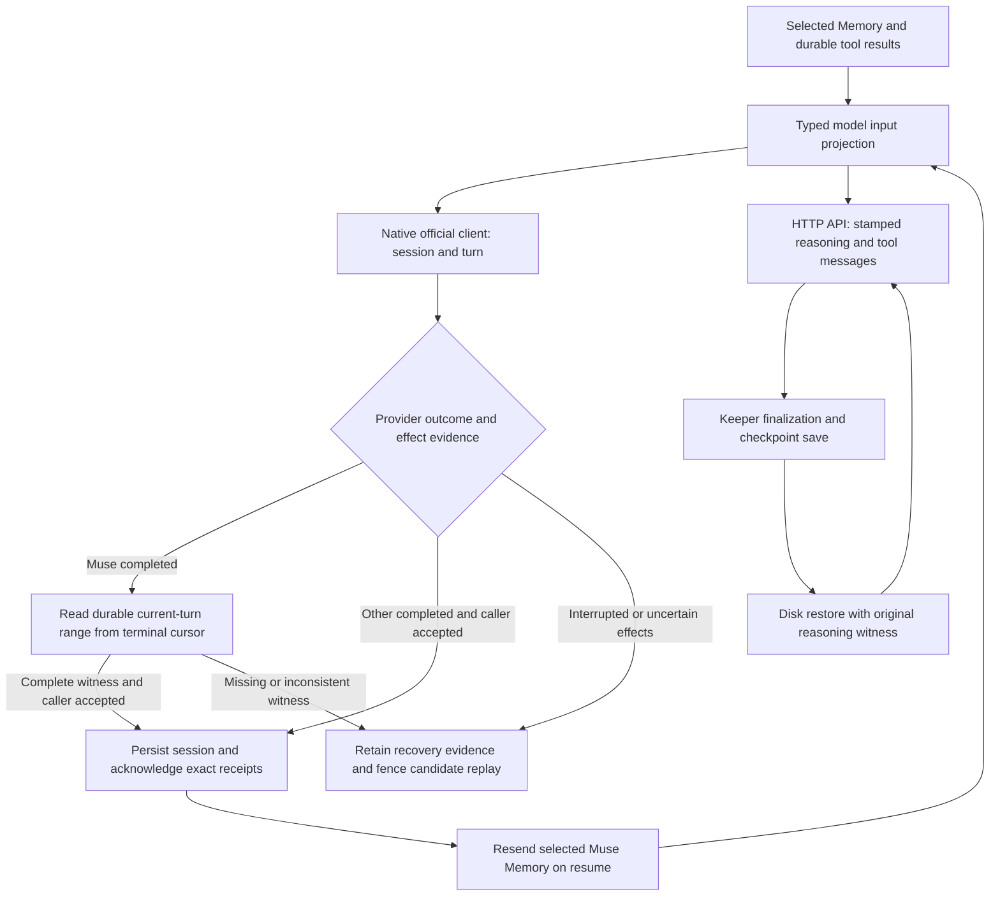

# Official client and provider continuity audit — 2026-11-01

Client/provider contract repairs and protocol-fixture improvements are delivered
in thirteen draft PRs in Native Stack #47014,
whose top layer is [PR #47098](https://github.com/jeong-sik/masc/pull/47098). The review followed current
source, installed client help/schema, primary documentation and read-only runtime
evidence. It does not establish that every provider is free of bugs or that the
repairs are installed.

| Draft PR | Defect | Continuity boundary repaired |
| --- | --- | --- |
| [#47008](https://github.com/jeong-sik/masc/pull/47008) | Muse discarded typed quota/reset facts and misclassified account rest in Board/exact lanes | MSP decode → account-scoped observation → Keeper/Fusion/readiness/Board/exact failure consumers |
| [#47008](https://github.com/jeong-sik/masc/pull/47008) | A Muse event gap could hide compaction; a gap before turn acknowledgement could also turn a lost response into quiet completion | Event observation → held Memory invalidation → durable settlement → resumed prompt; missing final response remains uncertain |
| [#47013](https://github.com/jeong-sik/masc/pull/47013) | GLM cleared the current tool exchange's reasoning together with past user turns | Source-stamped reasoning → checkpoint codec → semantic user boundary → next HTTP request |
| [#47019](https://github.com/jeong-sik/masc/pull/47019) | Visible-text cleanup corrupted or removed a native inline carrier while keeping its exact replay witness | Provider parser → Keeper finalization → disk checkpoint → restored original request bytes |
| [#47022](https://github.com/jeong-sik/masc/pull/47022) | Scoped Kimi Coding declarations did not inherit the native Kimi replay contract; the alias also omitted streamed reasoning | Shipped runtime binding → scoped capabilities → sync/SSE parsing → source identity → disk checkpoint → tool continuation/new user request |
| [#47024](https://github.com/jeong-sik/masc/pull/47024) | Kimi Coding rejected documented low/high/max effort requests | Shipped binding → typed default-on contract → admission → serialized effort; omitted defaults remain omitted |
| [#47025](https://github.com/jeong-sik/masc/pull/47025) | GLM preservation with an omitted default-enabled thinking toggle lost history and omitted its requested wire field | Provider parser → stable provenance → disk checkpoint → effective default and explicit controls → next user request |
| [#47026](https://github.com/jeong-sik/masc/pull/47026) | Antigravity rejected five documented non-completed states as unknown protocol strings | Exact status/init identity → ambiguous durable recovery; no successful turn ACK or candidate replay of uncertain native effects |
| [#47030](https://github.com/jeong-sik/masc/pull/47030) | Codex fixture assertions could be logged and swallowed by production stream-observer isolation | Snapshot the first delta once, assert after cleanup and rethrow ordinary observer failures; preserve cancellation/interruption and final serial-order assertions |
| [#47030](https://github.com/jeong-sik/masc/pull/47030) | OpenRouter catalog tests used an old model ID/output limit and incomplete probe inventory | Exact 25-ID inventory with historical declared ladders separated from the two October 28 measured-disable rows |
| [#47037](https://github.com/jeong-sik/masc/pull/47037) | Two OpenRouter rows admitted unsupported reasoning depths; the Nemotron seed requested an unsupported depth and DeepSeek's enabled default was undeclared | Shipped runtime → scoped catalog → typed completion admission → request JSON; DeepSeek 1017 accepts none/low/high/max and its enabled default, Nemotron uses explicit reasoning.enabled booleans without a depth; omission keeps the provider default |
| [#47095](https://github.com/jeong-sik/masc/pull/47095) | An omitted GLM clear control let the Coding endpoint preserve history that the client had cleared | Resolved reasoning capabilities → explicit client clear policy on the wire; omitted thinking.type and non-reasoning requests remain omitted |
| [#47096](https://github.com/jeong-sik/masc/pull/47096) | An Antigravity native action followed by process exit or idle could leave another candidate eligible, including missing action telemetry | Resolved full-native posture → validated session admission and typed native observations → effect uncertainty before observers; read-only/pre-admission fallback and actual MCP effects retain their own rules |
| [#47097](https://github.com/jeong-sik/masc/pull/47097) | Muse terminal delivery could precede a gap hiding compaction or a newer final answer | Durable current-turn pages → final reply/usage/model witness → successful settlement; selected Memory is resent on resume until retention has durable proof |
| [#47098](https://github.com/jeong-sik/masc/pull/47098) | Three unchanged dialect fixtures depended on undeclared local model contracts; Responses boolean coverage was missing | Explicit fixture contracts and real shipped Nemotron Responses admission → serialization for omitted/true/false controls |

The Kimi change deliberately uses the three shipped model bindings. It does not
guess capabilities for arbitrary operator-created model IDs. Its six fixture
cases retain synthetic reasoning carriers through production code; they do not
certify a provider-reported model identity or live account access.

Kimi effort admission is a separate repair from replay. Explicit disable emits
`none`; the provider documents routing this control to non-thinking K2.8 Preview.
The repair does not certify that disabling thinking preserves K3 model identity.

## Continuity paths inspected

The diagram names boundaries examined in code and fixtures. It is not a record
of live end-to-end execution across every provider.

## Source and runtime evidence

The [retained evidence record](../evidence/2026-11-01-official-client-audit/2026-11-01-official-client-evidence-record.md)
contains the surface-by-surface source map, installed versions, primary links and
sanitized counts from 367557 complete system-log lines. It records the exact
captured prefixes and their digests; counts are log messages, not distinct failed
requests. Private conversation bodies and authentication are excluded.

Codex 0.166.0 was checked against installed stable and experimental app-server
schemas. Claude Code 2.1.316 was checked against CLI/SDK session and compaction
contracts. Antigravity 1.4.12 was checked against headless/resume documentation.
OpenRouter structured reasoning details and Ollama Cloud's `/v1` wire were read
separately from native Ollama's `/api/chat` wire. No additional P0–P2 was established
in the inspected Codex, Claude or Ollama adapter paths. This is bounded source
coverage, not a live provider certification.

Current Kimi primary references add the [model/endpoint contract](https://www.kimi.com/code/docs/en/kimi-code/models.html)
and [K3 multi-turn replay guide](https://platform.kimi.ai/docs/guide/kimi-k3-quickstart)
to the evidence record's [tool-call error reference](https://www.kimi.com/code/docs/en/kimi-code/error-reference.html).
They were read on 2026-11-01; confidence is High for the documented contract and
source comparison. Actual provider behavior was not newly measured.

The [GLM API reference](https://docs.z.ai/api-reference/llm/chat-completion)
establishes the omitted thinking toggle's enabled default. The [Thinking Mode guide](https://docs.z.ai/guides/capabilities/thinking-mode)
distinguishes the Coding endpoint's default preservation from the standard API's
default clearing. Strict review found that the initial omitted-clear behavior
could disagree with the client's replay policy. #47095 explicitly sends that
existing policy on a declared reasoning clear wire while leaving thinking.type
absent; non-reasoning omission and explicit control precedence are preserved.
These primary contracts were checked on 2026-11-01 with High confidence for source
comparison, separately from live endpoint execution. Antigravity's five documented
non-completed states retain partial responses as error evidence, never as a
completed answer. Independent review caught that nonretryable provider errors
could still trigger candidate fanout; the final repair marks unobserved native
effects as unavailable before projection, while preserving known effects.
#47096 additionally bounds uncertainty to the resolved full-native posture and
records it first at the validated conversation-ready callback, before fallible
session persistence. Typed native start/finish observations also fence a partial
stream. A full-native transport exit or idle failure therefore cannot replay an
unobserved action. Read-only/no-native execution does not acquire a native effect
fence; actual MCP effects retain their stronger independent evidence. Invalid
init/config/spawn paths preserve pre-admission behavior. Non-completed provider
statuses keep their existing terminal retry policy independently of that fence.

Strict review also found that live Muse push delivery cannot prove either final
answer completeness or retained context. #47097 reads the contiguous durable
current-turn range backward from the terminal's opaque cursor, folds it forward
and requires the matching turn boundary before successful settlement. It derives
the latest complete final answer and per-call usage/model facts from that same
witness, without replaying tools or approvals. Missing or inconsistent proof
retains uncertainty and receipts. The original reserved exception identity and
known explicit terminal usage survive cleanup or history failure.

Later automated review caught three more witness boundaries. Durable pages now
require the schema's nested SourceRange fields and refuse an injected push-only
view/gap record. All accumulated agent messages require terminal completion,
including an older open message before a newer completed answer or commentary
before quiet completion. Ephemeral item starts with no SourceRange are not
invented as durable records; actual durable updates are retained in the fixtures.
No sequence ordering, closed stream-kind vocabulary or timing heuristic is added.

Muse sessions are still reused, but unproved held-context certificates are no
longer persisted or trusted. Selected current Memory/context is resent on resume.
This increases input bytes and potentially tokens/latency, and durable completion
adds one or more history RPCs. It does not cure historical overflow. The
[strict-review evidence record](../evidence/2026-11-01-official-client-self-review/2026-11-01-official-client-self-review-evidence-record.md)
records the installed/official schema contract, source-review scopes and limits.

OpenRouter's [per-model reasoning options](https://openrouter.ai/docs/guides/best-practices/reasoning-tokens#discovering-per-model-reasoning-options)
define an explicit `supported_efforts` array as the accepted values, `null` as
all gateway efforts, and omission as no effort selection. The [selected public
metadata rows](../evidence/2026-11-01-official-client-audit/openrouter-models-selected.json)
were fetched without authentication at 2026-11-01T01:57:36Z and checked against the
retained raw response digest. Metadata-supported depths and the October 28 real
`none` probes are separate evidence. The earlier 23 ladder assertions include
historical declared/router policy; they are not all complete wire measurements.
DeepSeek's explicit enabled default uses the existing default-on dialect.
Nemotron's missing default fact stays unknown. Its shipped binding retains
thinking support, removes the unsupported `high` depth, and uses the documented
`reasoning.enabled` boolean. A distinct typed dialect encodes explicit true/false
for Chat Completions and Responses, leaves an omitted toggle absent, and rejects
all categorical depths. Regression fixtures materialize the actual shipped
runtime through Keeper policy and admission to the request serializer, including
fleet/global toggle precedence. The retained October 28 `none` probe is historical
measurement; it is not relabeled as a fresh boolean-control generation.

## Verification boundaries

Changed OCaml syntax, embedded fixture syntax, TOML syntax, changelog fragments
and evidence-record format were checked locally. External coding sessions did
not run local Dune. Independent source review found and corrected the optional
mapper callback, missing constructor field, missing quota consumers and the
pre-acknowledgement response-loss path.

The initial `Test` run [41259335179](https://github.com/jeong-sik/masc/actions/runs/41259335179)
on `7e09573bb73df90e45beb70666d132434d667821` failed strict warning 4 in the new
terminal observers before behavioral success could be established. The observers
were replaced by one exhaustive handler shared by their direct consumers.

`Test` run [41259587089](https://github.com/jeong-sik/masc/actions/runs/41259587089)
on `f974b1d2241d07f92d9678a19fe27a0eafa5ad10` completed successfully: four GLM
suites, 235 cases. Later lower-layer Muse repairs do not change those selected
Agent Core source bytes. This remains targeted evidence for the stated SHA and
scope. A later guard also rejects replay when a legacy catalog row explicitly
declares `supports_reasoning = false`; the earlier run does not certify that new
delta. Other exact-head run IDs, selected suites, conclusions and review state
are recorded in the PR descriptions as they become available; a queued run is
not a pass.

| Test run | Exact tested head | Observed evidence |
| --- | --- | --- |
| [41259848104](https://github.com/jeong-sik/masc/actions/runs/41259848104) | `4b388f51316ab5ed9fbce1260454f048a68f1fb8` | SUCCESS: OpenAI codec and Keeper disk checkpoint suites, 93 cases. Later lower-layer changes are test-only Muse repairs. |
| [41259801045](https://github.com/jeong-sik/masc/actions/runs/41259801045) | `a39f630e47f69be2d1ff0a85a58d0b2a4e267d2c` | FAILURE: six selected suites passed, 127 cases; three Muse stop assertions failed before resume. This was baseline fixture drift: caller acceptance rejects a repeated-tool stop while the fixture expected the adapter's intermediate result. |
| [41261288235](https://github.com/jeong-sik/masc/actions/runs/41261288235) | `5e3b61b848e1e9e4403b8ccf4a9768e547e712df` | SUCCESS: all 78 Muse cases after keeping adapter settlement separate and asserting caller rejection plus retained tool receipt. Production stop/effect guards are unchanged. |
| [41260409586](https://github.com/jeong-sik/masc/actions/runs/41260409586) | `d7139136cf45c4744bf75228ee6eeedd3151cb1d` | FAILURE: two exact recorded-Memory wire cases failed; nine suites reported success, 500 cases (Kimi 6, reasoning 58, streaming 42, retention 20, outbox 12, Codex 196, Claude 103, Antigravity 23, session store 40). A Codex callback assertion was logged despite the suite's successful exit; that fixture cannot certify the affected assertion until repaired. |
| [41261854222](https://github.com/jeong-sik/masc/actions/runs/41261854222) | `7cb26cc755ae4e801b390ca190373b1d7a334bbb` | FAILURE: four suites passed, 220 cases (Kimi replay/effort 9, provider config 142, reasoning replay 58, GLM coverage 11). Two OpenRouter catalog assertions failed. Native-test compilation then stopped at two new fixture references to the nonexistent Masc.Runtime_antigravity facade export; these were corrected to the directly linked Runtime_antigravity module. Unexecuted native suites are not passes. |
| [41262679047](https://github.com/jeong-sik/masc/actions/runs/41262679047) | `a52c4d149a9f6545401c3e07becc5a5dc12420d3` | SUCCESS: corrected Codex protocol suite, 198 cases, including ordinary observer-failure propagation and operator interruption. The later direct stream-observer cancellation fixture is a separate untested delta at this boundary. |
| [41263657342](https://github.com/jeong-sik/masc/actions/runs/41263657342) | `16e345622b08347a2aac9090b877f1f9ded488b1` | FAILURE: eight suites passed, 234 cases (catalog 28, Antigravity runtime 69, CLI 24, exact lane 5, Fusion 33, verification 22, checkpoint 29, GLM thinking 24). Two of 25 Keeper Antigravity cases failed during setup: dynamic tools lacked a shared context and the fallback runtime lacked its required timeout. Both fixture setup errors are repaired; assertions and production guards are retained. |
| [41265918467](https://github.com/jeong-sik/masc/actions/runs/41265918467) | `7fd50df9ddb1079279f9ca295cb9a331e4f9fc01` | FAILURE: eleven suites passed, 821 cases, including Codex 199 and Keeper Antigravity 25. Thinking dialects failed three of 51 cases because local Ollama/Anthropic/Gemini fixture contracts were undeclared or mismatched. #47098 repairs those fixtures; this older run does not test the four strict-review followups. |
| [41270288353](https://github.com/jeong-sik/masc/actions/runs/41270288353) | `0d9d54f389309838ca4db1887e9156fde09581f9` | FAILURE: provider config 142, GLM coverage 11 and reasoning replay 59 passed (212 total). New Responses test constructed a private codec value; shared native-test compilation then stopped on a direct Digestif reference. Tests now use the public codec tag and SHA-256 facade. The native executable group did not run. Later bot-boundary/source and compile repairs require their own selected execution. |

Independent source reviews passed the integrated Muse head `5e3b61b848e1e9e4403b8ccf4a9768e547e712df`,
the final Antigravity layer `7cb26cc755ae4e801b390ca190373b1d7a334bbb`,
the Codex fixture delta `0ae2947cedf260bea4deab07db8aa8dbf43ed74f`,
and the original GLM/Kimi/inline deltas. Those statements cover the recorded
source differences, not compilation, formal GitHub approval or live execution.
Review responses additionally preserve Muse quota-terminal recovery during
cancellation, correct Kimi explicit-disable wire expectations, retain Antigravity
partial responses and raw pre-init usage without admitting a session, and test
the original cancellation reason through Codex's stream observer. These changes
were exercised by the twelve-suite run 41265918467, whose overall result remains
FAILURE. Its eleven passing suites do not certify the four later strict-review
layers. Their new selected CI run, exact SHA and observed status are retained in
the followup PR descriptions; a requested run is not a pass.

The strict-review source checks covered eight GLM, two Antigravity, seven Muse,
three caller-fixture and one dialect-fixture OCaml files. All 21 parsed, and their
integrated blobs match the authored review snapshots in the retained
[source-equivalence record](../evidence/2026-11-01-official-client-self-review/source-equivalence.json).
Initial peer source reads and later automated review are recorded separately;
later findings led to the additional posture/admission and witness repairs above.
A source verdict is separate from type checking, behavior CI and formal GitHub approval. The
original nine published heads were preserved; four followup layers carry these
repairs. No external-session local Dune was run.

The Codex warning was a pre-existing fixture mistake: its first delta opened the
release gate correctly, but its later completion delta repeated a pre-settlement
assertion after all three tool responses were already read. The final serial
order was correct. The fixture now retains ordinary observer failures through
cleanup, while explicit operator interruption and Eio cancellation retain their
production semantics. No scheduling defect was established by that warning.

The selected verification paths include actual protocol fixtures, scoped runtime
materialization, Memory redelivery, receipt retention/ACK, checkpoint disk restore
and the next request serializer. They do not replace full regression, installed
binary verification, live ten-turn canaries or long-duration failover measurement.
No running Keeper, runtime-owned configuration, billing setting or service was
changed by this audit.

## Remaining findings

- [#47010](https://github.com/jeong-sik/masc/issues/47010) and [#47011](https://github.com/jeong-sik/masc/issues/47011) now have source repairs in #47026 and #47025. They remain open until the draft stack is reviewed and merged.
- [#47081](https://github.com/jeong-sik/masc/issues/47081) and [#47082](https://github.com/jeong-sik/masc/issues/47082) record the strict-review native-effect and durable-Muse findings. Source repairs are in #47096 and #47097; merge, installation and live operation remain unverified.
- [#47021](https://github.com/jeong-sik/masc/issues/47021): Live custom Kimi API IDs differ from documented IDs and unknown-model replay is unproven. The tracked effort declaration is repaired in #47024. Operator-owned model IDs and actual served identity were not changed or verified.
- [#47028](https://github.com/jeong-sik/masc/issues/47028): Generic/operator-defined Anthropic HTTP configurations do not represent account/linkage identity in durable reasoning source equivalence. Sonnet/Haiku 5.5 blocks can be dropped by an unrelated account while the request succeeds. Existing transformation logging is a partial mitigation; the shipped bindings use Claude Code instead. This P2 needs trusted account or provider-transformation evidence; no deployed incident or safe account-policy repair was established.
- [#44154](https://github.com/jeong-sik/masc/issues/44154#issuecomment-6303936847): The recorded Memory wire fixture predates baseline #43810's `ordered_program_steps` field. The [offline byte witness](../evidence/2026-11-01-official-client-audit/memory-wire-baseline.json) reproduces the exact failed request digest by adding only the missing empty-list field, 27 bytes. Relevant producers, test and historical corpus are unchanged by this audit. Fresh real provider evidence is required for the new request; historical responses and exact-wire assertions are preserved. Memory semantic success is not established by that failing suite.

These issues include symptoms, reproduction conditions, suspected causes and the
checks performed. The runtime observations are retained independently from the
source repairs; historical overflow, subscription exhaustion or an HTTP 402 is
not claimed cured by source review.
