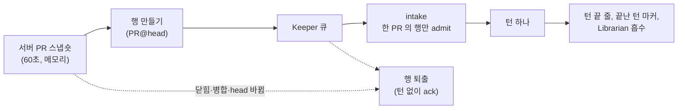

# RFC: 순찰 턴을 일의 단위에서 끝낸다 — 후보 셋의 비교 (a-patrol-turn-ends-at-its-unit-of-work)

순찰 Keeper 의 턴 하나는 도구를 100~800번 부르고 몇 시간을 돈다. 턴이 끝나는 자리와 일이 끝나는 자리가 이어져 있지 않다.
이 RFC 는 턴이 일의 단위(PR 한 건)에서 끝나게 하는 후보 셋을 비교한다. 정하는 것은 없고 코드는 쓰지 않았다.

- 다루는 것: 턴의 단위를 무엇으로 두는가, 단위가 PR 일 때 턴이 거기서 끝나게 하는 구조, 턴을 나누는 비용.
- 다루지 않는 것: 기다림을 줄이는 일(check 완료 감시, 비동기 `Execute`)과 도구 결과의 수명 선언. check 완료 감시는 PR #51302, 비동기 `Execute` 는 PR #51303, 도구 결과의 수명 선언은 PR #51299 가 맡는다. 일의 단위가 PR 이 아닌 Keeper.
- 근거 기준: 코드는 `origin/main` `eb22878fa756` 에서 읽었다. 이 문서가 인용한 파일의 좌표를 그 커밋에서 다시 확인했다. 측정 창(11-11T05:40Z 까지)은 PR #51221(2026-11-11T09:02Z 병합, 채팅이 오면 자율 턴을 끊던 장치를 지움) 앞이다.
- 측정 창: 달리 적지 않으면 2026-11-08T05:40Z ~ 11-11T05:40Z(72시간)이고, 2026-11-11T08:30Z ~ 09:10Z 에 읽었다. 장부와 턴 기록은 오래된 날이 지워지므로 같은 창을 나중에 재면 값이 달라질 수 있다.
- 측정 스크립트는 저장소에 없다. `~/me/.tmp/tools-goal-1110/rfc-a-patrol-unit-1111/` 에 두었고 정의는 본문에 적었다. 긴 턴 표와 PR 번호 정규식은 PR #51284 의 `docs/evidence/tool-efficiency-1111-2026-11/` 것을 그대로 썼다. 아직 main 에 없다.
- 표시: **[사실]** 코드나 데이터에서 확인한 것, **[추정]** 근거는 있으나 직접 보지 못한 것, **[제안]** 이 RFC 가 내놓는 것, **[확인 필요]** 모르는 것.

## 0. 요약

- **[사실]** 호출이 100개 이상인 턴(긴 턴) 164개가 호출의 23.3%(32,899개)를 쓴다. rondo, context-reviewer, masc-productor-owner, code-reviewer-uncle 의 긴 턴 75개가 그중 50.0%(16,448개)다.
- **[사실]** 이 넷은 짧은 턴에서도 서로 다른 PR 번호를 둘 이상 적는다(턴의 42.0~74.2%). 문제는 턴의 길이가 아니라 턴이 어느 단위에서 끝나느냐다.
- **[사실]** PR 을 하나씩 도는 반복은 지금 자연어에 있다. context-reviewer 가 직접 만든 5분 간격 일정의 메시지와 `masc-pr-patrol` 스킬이다. 서버에는 PR 을 가리키는 자극도 턴 이유도 없다.
- **[사실]** 긴 턴은 두 곳에서 값을 치른다. context-reviewer 의 긴 턴 23개 중 5개(21.7%)가 정지 사유 없이 끝났다(짧은 턴 353개 중 12개, 3.4%). 요청당 입력은 짧은 턴의 2.5배(428,662 대 169,172 토큰)이고 늘어난 몫은 거의 캐시 읽기다.
- **[추정]** PR 을 일의 단위로 도는 긴 턴은 context-reviewer 의 것(호출 4,853개, 긴 턴 호출의 14.8%)으로 좁혀 본다. rondo 와 masc-productor-owner 의 긴 턴은 복구·위임 대기·보드 답글이 섞여 있어 PR 이 단위가 아니다.
- **[제안]** 후보 1 은 PR@head 한 건을 큐 행 한 건으로 만들고, 한 턴이 한 PR 의 행만 받게 한다. 후보 2 는 Task 를 단위로 두고 종단 효과로 턴을 끝낸다. 후보 3 은 긴 턴을 두고 도구가 결과의 수명을 선언한다(PR #51299 가 맡고 여기서는 비교만 한다).
- **[사실]** 토큰만으로는 어느 후보도 정당화되지 않는다. 턴을 나누면 캐시 읽기 값 `c` 가 약 0.04~0.06 보다 클 때 이득이 난다(context-reviewer, §5). 이 레인(`ollama_cloud`)의 `c` 는 확인하지 못했다.
- **[제안]** 정석은 후보 1 이다. 상수가 없고 단위가 서버가 읽은 사실이며 선례(`Connector_attention`)가 있다. 대가는 새 variant 와 소비 기억과 받는 사람 정하기이고, 닿는 범위가 좁다. 구현을 승인하기 전에 행 수를 세는 드라이런부터 한다(§7).

정할 것은 §9 의 1~5 다.

## 1. 배경 (측정)

### 1.1 긴 턴의 모양

원장(ledger) 8,017턴, 141,353호출. 턴당 호출 수는 중앙값 6, p90 43, 최대 833이다. 호출이 100개 이상인 턴 164개가 호출의 23.3%(32,899개)를 쓴다. 100 은 보고서를 가르는 숫자일 뿐 어떤 규칙에도 쓰지 않는다. 출처는 PR #51284 `docs/evidence/tool-efficiency-1111-2026-11/README.md` 「긴 턴의 모양」이다. 아래 표의 시간과 도구는 같은 원장을 다시 읽어 냈다(`long_turn_time.py`, `long_turn_tools.py`).

| Keeper | 긴 턴 | 긴 턴 호출 (모든 긴 턴 호출 중 몫) | 한 턴이 도는 시간, 분 (중앙값 / p90 / 최대) | 한 턴의 서로 다른 PR 번호 (중앙값 / p90 / 최대) | 호출 상위 도구 |
|---|---:|---:|---|---|---|
| rondo | 24 | 5,702 (17.3%) | 67.7 / 162.6 / 251.5 | 10 / 28 / 176 | `Execute` 76.7%, `masc_keeper_delegate_status` 6.5%, `Read` 3.6% |
| context-reviewer | 23 | 4,853 (14.8%) | 21.5 / 56.2 / 92.9 | 24 / 54 / 69 | `Execute` 85.9%, `masc_schedule_note_add` 6.4%, `Write` 5.0% |
| masc-productor-owner | 15 | 3,899 (11.9%) | 108.4 / 163.5 / 175.5 | 13 / 25 / 32 | `Execute` 84.3%, `masc_board_comment` 5.3%, `masc_board_post_get` 1.7% |
| code-reviewer-uncle | 13 | 1,994 (6.1%) | 9.0 / 12.0 / 17.6 | 5 / 16 / 20 | `Execute` 52.8%, `keeper_artifact_read` 30.2%, `Read` 6.0% |

- **[사실]** 짧은 턴도 PR 번호를 여럿 적는다. 서로 다른 PR 번호가 둘 이상인 턴의 몫은 짧은 턴에서 rondo 72/97(74.2%), context-reviewer 229/353(64.9%), masc-productor-owner 95/133(71.4%), code-reviewer-uncle 240/572(42.0%)이고, 긴 턴에서 95.8%, 100%, 100%, 84.6%다.
- **[사실]** PR 번호 수는 도구 입력에 적힌 5자리 번호를 정규식으로 센 값이다(측정용이며 제품 규칙이 아니다). 그 PR 을 모두 리뷰했다는 뜻이 아니다.
- **[추정]** 도구 구성으로 보면 PR 을 훑는 순찰은 context-reviewer 의 긴 턴이다. 순찰 일정의 노트(`masc_schedule_note_add`)를 호출 310번 쓴다. rondo 는 복구 반복과 위임 상태 확인이 섞여 있고(호출 833개짜리 한 턴이 251.5분 동안 `Execute` 754번이다, 11-10T12:11Z), masc-productor-owner 는 보드 답글과 Task 목록 읽기가 섞여 있다. code-reviewer-uncle 은 `keeper_artifact_read` 가 호출의 30.2%이고, PR 번호 1개에 호출 241개인 긴 턴이 있다(11-10T23:33Z). 이 턴들을 직접 읽지는 않았다.

### 1.2 무엇이 긴 턴을 깨웠나

장부에는 깨움 이유가 없다. 시스템 로그의 `keepalive turn scheduled for <keeper>: … reasons=<…>` 줄 중, 턴 시작(그 턴 장부 행들의 `ts - duration_ms / 1000` 중 가장 이른 값)에서 900초 안에 있는 가장 늦은 줄을 그 턴의 깨움 이유로 읽었다. 짝짓기 방식과 900초는 측정용이고 제품 규칙이 아니다(`long_turn_wake.py`).

| 깨움 이유 | 긴 턴 | 호출 | 모든 긴 턴 호출 중 몫 | context-reviewer / rondo / masc-productor-owner / code-reviewer-uncle |
|---|---:|---:|---:|---|
| `scheduled_automation_due` (일정) | 26 | 5,783 | 17.6% | 17 / 3 / 5 / 1 |
| `board_event_pending` (보드 사건) | 27 | 6,083 | 18.5% | 4 / 13 / 8 / 2 |
| 900초 안에 줄이 없음 | 15 | 3,612 | 11.0% | 0 / 6 / 2 / 7 |
| `scheduled_autonomous_turn`, `task_backlog` 만 | 3 | 359 | 1.1% | 0 / 1 / 0 / 2 |
| 그 밖 (`scope_message_pending` 등) | 4 | 611 | 1.9% | 2 / 1 / 0 / 1 |
| 합 | 75 | 16,448 | 50.0% | 23 / 24 / 15 / 13 |

- **[사실]** context-reviewer 는 `5-minute review patrol (state-flow lens)` 라는 반복 일정(`recurrence` 가 `interval`, `interval_sec` 300)을 2026-11-09T06:49Z 에 직접 만들었다(`requested_by` 가 자기 자신, `<base>/.masc/schedules.json`). 메시지는 상태 흐름 관점으로 `jeong-sik/masc` PR 을 리뷰하라는 글이고, 읽다 만 리뷰는 그 일정의 노트에 남겨 다음 순찰에서 이어 가라고 적는다. 리뷰 절차는 `masc-pr-patrol` 스킬에 있다고 말한다.
- **[사실]** 창 안에 due 인 일정은 rondo 15건, masc-productor-owner 23건, code-reviewer-uncle 7건이고(`schedules.json`) 전부 Keeper 자신이 만든 일회성 일정이다. 그중 21건의 메시지가 `[github_run_watch]` 로 시작한다(글자 검사, 측정용). 일정이 없다고 나온 것이 아니라 context-reviewer 의 반복 일정은 `due_at` 이 다음 차례만 담아서 창 안 발생이 이 표에 안 잡힌다.
- **[확인 필요]** 일정 id 와 긴 턴을 이어 보지 않았다. context-reviewer 의 가장 이른 긴 턴(11-09T02:51Z)이 위 일정의 생성(11-09T06:49Z)보다 앞이라 17개 전부가 그 일정이라고는 말할 수 없다.
- **[사실]** 순찰의 순서와 반복이 스킬 글에 있다. 직접 요청과 맡은 Task 의 PR, 그다음 리뷰 요청이 온 Ready PR, 그다음 나머지 열린 PR 을 오래된 순으로 보고 "다음 PR로 간다"(`.agents/skills/masc-pr-patrol/SKILL.md:13-14`).

### 1.3 긴 턴은 어떻게 끝났나

턴 기록의 `finish_reason` 을 장부와 `(trace_id, absolute_turn)` 으로 이었다(`patrol_turn_census.py`, `baselines_pr_keepers.py`).

| | 턴 | `completed` | `yielded_to_durable_stimulus` | 없음 |
|---|---:|---:|---:|---:|
| 네 Keeper, 짧은 턴 | 1,155 | 1,074 (93.0%) | 60 (5.2%) | 21 (1.8%) |
| 네 Keeper, 긴 턴 | 74 | 55 (74.3%) | 11 (14.9%) | 8 (10.8%) |
| context-reviewer, 짧은 턴 | 353 | 320 (90.7%) | 21 (5.9%) | 12 (3.4%) |
| context-reviewer, 긴 턴 | 23 | 14 (60.9%) | 4 (17.4%) | 5 (21.7%) |

- **[사실]** `없음` 은 정지 사유를 쓰기 전에 오류로 끝난 턴이다(`lib/types/turn_record.mli:186-190`). 그런 턴은 턴 끝 줄을 남기지 않고, 다음 턴이 그 턴의 atom 을 이어서 싣는다(`keeper-context-window-in-tokens` §13.9).
- **[사실]** `yielded_to_durable_stimulus` 는 도구 경계에서 턴을 넘긴 턴이다. 이 창에서 이유는 둘이다. 기다리는 채팅에 자율 턴의 슬롯을 넘기는 장치와 지연된 도구 결과(`Deferred_tool_result`, `lib/keeper/keeper_tool_terminal_boundary.ml:1-4`)다. 앞의 장치는 PR #51221 이 지웠다(그 커밋 글은 2026-11-09T16:20Z ~ 11-11T02:08Z 에 자율 턴 217개를 그렇게 끊었다고 적는다). 이 표에서 둘의 몫은 가르지 않았다 **[확인 필요]**. 지금 main 에서는 뒤의 이유만 남는다.
- **[사실]** 긴 턴 동안 도착한 다른 행은 기다린다. `arrived-stimuli-reach-the-running-turn` §2 가 2026-11-05T20:24Z 에 raw trace 로 읽은 값은 이렇다. 실행 중에 도착한 행 1,773개가 실행이 끝나기 전에 ack 된 적이 0번이고, 막힌 시간은 합 379.8시간이며, round 100개 이상인 실행 뒤에는 중앙값 25.0분이다. 도착 행의 91.0%가 11-04·11-05 것이라 지금 값이 아니다.

### 1.4 요청당 입력

요청별 사용량은 Agent Core 레인의 턴 이벤트(`<base>/.masc/keeper_turn_events/`)에만 있다. context-reviewer, rondo, masc-productor-owner 의 338턴이고, 모델은 `deepseek-v4.1-flash`(레인 `ollama_cloud`) 319턴과 `glm-5.3-flash` 19턴이다. code-reviewer-uncle 은 표본이 5턴이라 뺐다. 읽은 방법은 #51284 의 `measure_turn_requests.py` 를 불러 썼다(`turn_cost_census.py`).

| | 턴 | 요청 수 (중앙값 / p90) | 요청당 입력 평균 | 요청당 미적중 평균 | 둘째 요청부터의 적중 | 첫 요청 미적중 평균 |
|---|---:|---|---:|---:|---:|---:|
| context-reviewer, 짧은 턴 | 121 | 30 / 62 | 169,172 | 4,789 | 98.5% | 76,234 |
| context-reviewer, 긴 턴 | 22 | 126 / 229 | 428,662 | 4,908 | 99.2% | 184,174 |
| masc-productor-owner, 짧은 턴 | 107 | 29 / 54 | 132,097 | 5,118 | 97.9% | 74,944 |
| masc-productor-owner, 긴 턴 | 13 | 170 / 317 | 330,859 | 5,711 | 98.5% | 153,661 |
| rondo, 짧은 턴 | 60 | 26 / 64 | 148,211 | 5,479 | 98.2% | 93,407 |
| rondo, 긴 턴 | 15 | 107 / 306 | 296,477 | 3,770 | 99.1% | 153,933 |

- **[사실]** 긴 턴의 요청은 입력이 짧은 턴의 2.0~2.5배인데 미적중 입력은 같다(3.8k~5.7k 토큰). 늘어난 입력은 전부 캐시 읽기다.
- **[사실]** 마지막 요청의 지연 중앙값은 context-reviewer 짧은 턴 6.4초, 긴 턴 7.0초, rondo 5.9초와 7.9초, masc-productor-owner 7.2초와 6.8초이고, p90 은 rondo 14.2초와 28.2초, masc-productor-owner 12.8초와 30.5초, context-reviewer 12.8초와 11.3초다. 턴 기록에 남는 마지막 요청 하나의 값이다.

### 1.5 장부에 선언된 단위가 있나

긴 턴 호출 수 상위 열 Keeper 에서, 호출 행의 `runtime_contract.task_id` 와 `goal_ids` 를 센 값이다(`unit_declared_census.py`).

| Keeper | 긴 턴 호출 중 `task_id` 가 있는 몫 | 긴 턴당 서로 다른 task (중앙값 / p90 / 최대) |
|---|---:|---|
| wkbl-data | 100.0% | 1 / 1 / 5 |
| wkbl-front | 100.0% | 1 / 2 / 2 |
| wkbl-web-leader | 69.1% | 1 / 1 / 1 |
| rondo | 66.7% | 1 / 2 / 2 |
| ocaml-agent-ic | 53.0% | 1 / 1 / 1 |
| code-reviewer-uncle | 27.8% | 0 / 1 / 1 |
| masc-productor-owner | 2.9% | 0 / 0 / 1 |
| context-reviewer, msx-retro-mania, code-reviewer-brother | 0.0% | 0 / 0 / 0 |

- **[사실]** `goal_ids` 는 열 Keeper 모두 0.0%다.
- **[사실]** rondo 는 Task 하나(중앙값)가 PR 번호 10개(중앙값)를 덮는다. wkbl-\* 는 긴 턴 하나가 Task 하나다.
- **[확인 필요]** wkbl-\* 와 msx-retro-mania 의 긴 턴(호출 10,899개, 긴 턴 호출의 33.1%)이 무엇을 단위로 도는지는 이 값들로 알 수 없다. 이 두 Keeper 의 긴 턴에는 PR 번호가 거의 없다(#51284 README).

## 2. 문제

PR 을 하나씩 도는 일은 두 부분이다. 열린 PR 중 손댈 것을 가려내는 일과 그 PR 을 리뷰하는 일이다.
앞은 정해진 규칙으로 되는 일이고 뒤는 모델이 한다. 지금은 둘 다 한 턴 안에서 모델이 글로 된 지시(일정 메시지, 스킬)를 따라 한다. 그래서 셋이 생긴다.

1. **턴 경계에서만 일하는 장치가 긴 턴 안에서는 일하지 않는다.** 끝난 턴의 결과를 마커로 바꾸는 규칙(`lib/keeper/keeper_turn_driver_try_provider.ml:986-999`), Librarian 이 흡수하는 위치, 턴 끝 줄이 그렇다. 긴 턴은 그 턴이 만든 결과를 끝까지 원문으로 들고 간다(§1.4: 요청당 입력 2.0~2.5배).
2. **실패 반경이 단위가 아니라 턴이다.** context-reviewer 의 긴 턴은 21.7%가 정지 사유 없이 끝났다(짧은 턴 3.4%). 실패한 턴은 끝 줄이 없어서 다음 턴이 그 턴의 atom 을 싣는다.
3. **단위로 셀 수 없다.** 장부 행에는 PR 키가 없다. §1 의 PR 수는 입력 글자를 정규식으로 센 값이다. "PR 한 건에 든 호출·토큰·시간"을 typed 키로 물을 수 없다.

짧은 턴도 PR 을 여럿 적는다(§1.1). 그래서 이 문제는 턴의 길이가 아니라 단위의 문제다. 턴을 100번째 호출에서 끊어 봐야 PR 이 둘로 갈릴 뿐이다.

## 3. 지금 코드가 하는 일

| 무엇 | 좌표 | 하는 일 |
|---|---|---|
| 턴이 끝나는 길 | `lib/runtime/runtime_agent.mli:19-29` | `Completed`(모델이 멈춤), `Yielded_to_durable_stimulus`(기다리는 자극에 양보), `InputRequired`. 양보 이유는 `Durable_stimulus_waiting` 과 `Terminal_tool_completed` 둘이다. |
| 도구 경계의 양보 | `lib/keeper/keeper_agent_run.ml:339-348`, `lib/keeper/keeper_tool_terminal_boundary.ml:1-4` | 도구를 부를 때마다 종단 효과와 반복 실패를 본다. 종단 효과가 `Deferred_tool_result` 면 `Durable_stimulus_waiting` 으로 턴을 넘긴다. 기다리는 채팅에 슬롯을 넘기는 장치는 없다(#51221). |
| 종단 효과 | `lib/keeper/keeper_tool_terminal_boundary.ml:14-15`, `lib/keeper/keeper_tool_execution.ml:14-15`, `config/tools/keeper_surface_post.toml:16` | `Terminal_effect_completed _` 면 `Yield Terminal_tool_completed`. 효과 영수증(`terminal_effect_receipt`)의 변종은 `Surface_post_completed` 하나이고, 그 도구만 terminal-contract 다. |
| 턴 끝 기록 | `lib/keeper/keeper_agent_run_finalize_response.ml:33,127,404`, `lib/keeper/keeper_carried_front.mli:80-85` | `record_turn_boundary` 는 finalize 에서만 돈다. 실패한 턴은 끝 줄이 없고, 다음 턴의 시작이 `Turn_boundary` 이거나 `Turn_boundary_unknown` 이다. |
| 끝난 턴 마커 | `lib/keeper/keeper_turn_driver_try_provider.ml:986-999`, `:1036-1046` | 끝난 턴의 결과만 마커로 나간다(`aged_result_min_bytes = 2_048`). 이미 보낸 메시지는 보낸 그대로 다시 나간다. 턴 경계가 움직일 때 바꾸면 매 턴 첫 요청의 캐시 접두가 끊기기 때문이다. |
| 큐의 행 | `lib/keeper_runtime/keeper_event_queue.mli:108-` | `stimulus_payload` 는 닫힌 합타입이다. PR 이나 GitHub 를 가리키는 변종이 없다. `Connector_attention` 은 가리키는 값만 싣고 한 번 빼면 새 메시지가 올 때만 다시 건다. |
| 턴 이유 | `lib/keeper_contract/keeper_world_observation_turn_types.ml:65-82` | `turn_reason` 에 `Board_event_pending`, `Scheduled_automation_due` 등이 있고 PR 을 가리키는 변종이 없다. |
| 한 턴이 받는 행 | `lib/keeper/keeper_heartbeat_stimulus_intake.ml:866-873`, `:895-934`, `:937`, `lib/config/env_config_keeper.ml:494-512` | 준비된 행을 어드미션 경계 안에서 한꺼번에 받는다(`MASC_KEEPER_ADMISSION_MAX_EVENTS` 기본 32, 범위 1~256). `Connector_attention` 만 첫 대화 하나로 줄인다(`:955-960`). `ready_batch` 의 `match` 가 모든 종류를 나열하므로 새 종류는 컴파일러가 막는다. |
| 행 퇴출 | `lib/keeper/keeper_heartbeat_stimulus_intake.ml:96-103`, `:1173` | 완료 거절 행은 가리키는 사실이 사라지면(`Obsolete`) 턴 없이 ack 로 큐에서 빠진다. |
| PR 스냅숏 | `lib/repository_pulls.mli:5-12`, `:58-80`, `:221`, `:234`, `:277-283`, `lib/repository_pulls_placement.mli:39-75`, `lib/server/server_repository_pulls.ml:832` | 서버가 60초마다 GraphQL 로 읽은 열린 PR 을 메모리에 둔다. 저장하지 않고 재시작하면 처음부터다. PR 마다 `Needs of attention`(`Checks_failing`, `Changes_requested`, `Conflicting`, `Unreviewed_on_head`, `Awaiting_approval`)이거나 `Not_listed _` 다. `stack` 칸은 없다. |
| PR 을 읽는 도구 | `lib/tool_pull_requests.mli:1-17`, `config/tools/keeper_pull_requests_list.toml` | `keeper_pull_requests_list` 는 위 스냅숏을 답한다. 모든 Keeper 가 모든 등록 저장소를 읽는다. |
| 순찰의 반복 | `.agents/skills/masc-pr-patrol/SKILL.md:13-14`, `<base>/.masc/schedules.json` | 순서와 "다음 PR로 간다"가 스킬 글에 있고, context-reviewer 의 5분 일정이 순찰을 깨운다. |
| 금지 | `docs/constitution.xml:442-450` | `magic_number`: 숫자 비교로 Keeper 흐름을 짜지 않는다. 도구·입력·응답·문장 반복 횟수는 정체나 중단의 근거가 아니다. 중단은 명시적 취소·승인·종단 효과·실제 실패 상태로 정한다. |
| 큐 명세 | `specs/keeper-state-machine/KeeperEventQueue.tla:76-85`, `:104-119` | `TurnDequeue` 가 턴당 자극 하나를 소비한다(`queue_size' = queue_size - 1`). `NextBuggy` 는 `MissedDirectedWake` 를 더한다. 코드는 턴당 최대 32행을 한꺼번에 받으므로(위 "한 턴이 받는 행") 이 명세는 지금 코드의 admit 과 다르다. |

## 4. 후보 설계

### 4.1 후보 1 — 큐 단위: PR 한 건이 행 한 건, 행 한 건이 턴 한 건

**[제안]**

1. **행.** `stimulus_payload` 에 PR 변종을 더한다(이름은 구현 때 정한다). 가리키는 값만 싣는다: 저장소 slug, PR 번호, head object id, 놓인 자리(`Repository_pulls_placement.attention`). 제목과 리뷰 글은 싣지 않고 턴이 읽는다. `Connector_attention` 이 그렇게 한다. 스냅숏의 `head_oid` 는 `string option` 이라 GitHub 가 값을 주지 않으면 `None` 이다(`lib/repository_pulls.mli:94-96`). `None` 인 PR 은 행을 만들지 않는다. 모르는 head 를 빈 값으로 채우면 서로 다른 head 가 같은 행으로 보인다.
2. **원천.** 서버가 이미 60초마다 읽는 PR 스냅숏이다. webhook 도 새 GitHub 읽기도 없다. 스냅숏에서 `Needs _` 에 놓인 PR 마다, 그 PR 을 볼 Keeper(§9 3)에게 행을 만든다.
3. **admit.** 한 턴은 한 PR 의 행만 받는다. 같은 PR 의 밀린 행은 함께 받고, 다른 PR 의 행은 큐에 남는다. `Connector_attention` 이 "턴당 대화 하나"(RFC-0377)로 이미 하는 방식이다. 경계는 개수가 아니라 정체성이라서 `MASC_KEEPER_ADMISSION_MAX_EVENTS` 같은 상수가 아니다.
4. **퇴출.** PR 이 닫히거나 병합되거나 head 가 바뀌어 행이 가리키는 사실이 사라지면 행은 턴 없이 ack 로 빠진다. 선례는 `Stimulus_completion_rejection_obsolete` 다(`keeper_heartbeat_stimulus_intake.ml:96-103`, `:1173`).
5. **턴 이유.** `turn_reason` 에 변종을 더해 턴 기록이 "이 턴은 PR 한 건에 대한 것"을 typed 로 말하게 한다. 그 뒤로 PR 별 호출·토큰·시간을 정규식 없이 센다.
6. **끝.** 턴의 끝은 지금과 같다. 모델이 멈춘다. 달라지는 것은 턴이 받는 입력이다. 서버는 도는 턴을 끊지 않는다(`backlog-never-preempts-a-running-turn`).

**장점**

- 상수가 없다. 단위는 PR@head 이고 경계는 admit 규칙이다.
- 턴 경계가 일의 경계가 되어 §2 의 셋이 한꺼번에 맞는다. 마커·Librarian·턴 끝 줄이 PR 하나가 끝날 때마다 일하고, 실패는 그 PR 의 턴 하나로 끝나며, 턴 기록에 단위가 typed 로 남는다.
- 가려내는 일(열거)을 모델에서 큐로 옮긴다. 모델은 한 PR 의 리뷰만 한다.
- 선례가 둘이다. `Connector_attention`(대화 단위 admit, 새 사실로 다시 걸기)과 `consumed-schedule-occurrences-v1`(소비한 occurrence 기억).
- **[추정]** 긴 턴이 짧아지면 도착한 다른 행이 기다리는 시간이 줄어든다(§1.3 의 25.0분).

**단점**

- 새 variant, producer, 소비한 identity 기억, 받는 사람 정하기가 한꺼번에 들어온다. 닫힌 합타입이라 `match` 를 쓰는 모든 곳이 컴파일러에 걸린다. 최근에 더한 변종 `Owned_job_completed` 는 파일 42개에, `Connector_attention` 은 55개에 나온다(`lib`, `bin`, `test` 에서 단어 경계로 센 값).
- 닿는 범위가 좁다. PR 을 일의 단위로 도는 긴 턴은 context-reviewer 의 것(호출 4,853개, 14.8%)이다 **[추정]**. code-reviewer-uncle 의 6.1% 는 읽지 않았다. rondo 와 masc-productor-owner 는 PR 이 단위가 아니다.
- 효과는 Keeper 가 일정과 지시를 거두는 정도에 달린다. 5분 일정은 Keeper 소유라 서버가 지우지 않는다(§8). 일정이 남으면 그 턴은 지금처럼 PR 을 여럿 본다.
- 한 PR 의 행으로 시작한 턴이 다른 PR 로 걸어 나가는 것을 막지 않는다. `keeper_pull_requests_list` 와 `gh` 가 열려 있다.
- 행이 쌓여 큐 잔량이 평형에 멈출 수 있다. `event-queue-admit-all-ready` §1.1 이 "턴당 1건"에서 본 일이다(taskmaster 잔량 71, 가장 오래된 행 19.8시간). PR 행의 위쪽은 열린 PR 집합이라 끝없이 자라지는 않는다 **[추정]**. 같은 PR 이 풀리지 않은 채 다시 생기면 이 일이 난다(§9 4).
- 리뷰 요청 행을 누구에게 줄지는 `keeper-world-state-shows-open-work` §5.1 이 "공유 계정 Keeper 7명·12명을 다 깨우는 것은 턴만 늘린다"며 깨우기에서 뺀 문제다.
- 스택의 단위가 PR 인지 스택인지 스냅숏으로는 모른다. `stack` 칸이 없다. GitHub REST 는 준다(`docs/guides/NATIVE-GITHUB-STACKS.md`).

**이 설계가 틀렸다면 어디서 드러나는가:** 행 하나로 시작한 턴에서 서로 다른 PR 번호를 둘 이상 적는 턴의 몫이 지금 짧은 턴 수준(context-reviewer 64.9%)에서 내려가지 않을 때. 모델이 단위 밖으로 걸어 나간다는 뜻이다.

### 4.2 후보 2 — 선언 단위: Task 가 단위, 종단 효과가 턴을 끝낸다

**[제안]**

1. 단위는 MASC Task 다. Task 는 claim, 작업, 제출, 완료 권한의 판정(`Task_outcome`, `Completion_authority_rejected`)으로 이어지는 수명과 id 가 있다.
2. 끝은 종단 효과다. `terminal_effect_receipt` 에 변종을 더하고(지금은 `Surface_post_completed` 하나, `keeper_tool_execution.ml:14-15`) 제출 도구가 그것을 돌려주면 `Terminal_effect_completed` 로 `Yield Terminal_tool_completed`(`keeper_tool_terminal_boundary.ml:14-15`) 가 되어 턴이 끝난다. constitution 의 "중단은 명시적 취소·승인·종단 효과·실제 실패 상태로 결정한다"(`docs/constitution.xml:449`)와 같은 길이다.
3. PR 마다 Task 가 있어야 한다. Keeper 가 만들거나(2a) 서버가 PR 스냅숏에서 만든다(2b).

**장점**

- 새 큐 변종이 없다. 단위의 수명과 id 가 이미 있다.
- 끝을 정하는 방법이 상수가 아니라 효과다.

**단점 (모두 §1 의 측정)**

- 장부에 선언된 단위가 없다. 긴 턴 호출 중 `task_id` 가 있는 몫이 context-reviewer 0.0%, masc-productor-owner 2.9%, code-reviewer-uncle 27.8%이고 `goal_ids` 는 열 Keeper 모두 0.0%다. PR 을 도는 Keeper 가 Task 를 쓰지 않는다.
- Task 를 쓰는 Keeper 는 이미 Task 하나가 긴 턴 하나다. wkbl-\* 는 중앙값 1개이고, rondo 는 Task 하나가 PR 번호 10개를 덮는다. Task 단위로 끝내면 지금과 같은 자리에서 끝난다.
- 2b 는 리뷰 한 건마다 Task 를 만들고 완료 권한의 판정(비동기 LLM 판정, RFC-0303)을 돌린다. 그 비용은 재지 않았다 **[확인 필요]**.
- 종단 효과는 "그 도구가 성공하면 턴이 끝난다"는 도구 계약이다. 지금 계약을 쓰는 도구는 한 번에 단독으로 불러야 한다(`config/tools/keeper_surface_post.toml:16`). Task 제출에 걸면 제출 뒤 이어지는 일이 모두 거기서 끊긴다.
- 단위를 Task 대신 PR 참조 하나로 가볍게 선언하는 변형(선언 도구)도 부르는 쪽이 모델이라는 점이 같다. 부르지 않으면 단위가 없다.

**이 설계가 틀렸다면 어디서 드러나는가:** PR 순찰 Keeper 의 긴 턴 호출 중 단위를 선언한 몫이 0.0% 근처에 머물 때. 지금 context-reviewer 가 그렇다.

### 4.3 후보 3 — 긴 턴을 두고 도구가 결과의 수명을 선언한다 (비교만)

PR #51299(`RFC-a-tool-declares-when-a-later-call-replaces-its-result`)가 다룬다. 비교에 필요한 것만 적는다.

- **구조.** `config/tools/<tool>.toml` 에 결과의 수명을 닫힌 값으로 적고, "같은 입력의 더 새 결과가 있다" 같은 사건으로 턴 안에서도 낡은 결과를 마커로 바꾼다. PR #51284 의 `RFC-tool-results-age-out-of-context` 「턴이 길 때」가 적은 둘째 후보다.
- **장점.** 턴 경계도 큐도 바꾸지 않는다. 일의 단위를 모르는 Keeper 에도 닿을 수 있다. 정의가 코드 밖 파일에 있다.
- **단점.** 측정이 가리키는 곳은 msx-retro-mania 의 DOS 도구다. 2 KB 이상 64 KB 이하 결과 346.3 MB 중 같은 입력이 다시 돌아 앞 결과를 대신한 몫이 34.7 MB(10.0%)이고 그중 82%가 `masc_dos_*` 다(#51284 README). context-reviewer 의 긴 턴에는 닿지 않는다. 실패 반경과 단위 회계는 그대로다. 턴 안에서 마커로 바꾸면 그 자리부터 캐시 접두가 끊긴다(`keeper_turn_driver_try_provider.ml:986-999` 의 주석이 턴 경계 밖에서 바꾸지 않는 이유로 든다).
- **이 설계가 틀렸다면 어디서 드러나는가:** 긴 턴 입력의 2.0~2.5배가 같은 입력의 되풀이가 아니라 새 결과가 쌓여서라면 닿는 몫이 작다. 지금 되풀이가 대신한 몫이 10.0%뿐이다.
- 후보 1 과 배타가 아니다. 같이 쓸 수 있다.

### 4.4 고르지 않은 것

- **Keeper 가 PR 마다 일회성 일정을 만들어 자기를 깨운다.** 이미 하는 일이다. 11-08T00:00Z ~ 11-11T05:40Z(77.67시간)에 성공한 `masc_schedule_create` 464건 중 자기 깨우기가 459건이다(#51284 README). 그런데도 긴 턴이 남아 있다. 단위 경계가 모델이 지시를 따르는 일에 달린다.
- **`MASC_KEEPER_ADMISSION_MAX_EVENTS` 를 1 로 둔다.** 개수 상한이다. `event-queue-admit-all-ready` §5 가 하지 않기로 했고 §7 이 이 설정을 지우려 한다. 채팅과 보드 행도 한 건씩 받게 된다.
- **서버가 도구 호출 100번에서 턴을 끊는다.** 100 은 보고서를 가르는 숫자다. constitution 의 `magic_number` 가 반복 횟수를 중단 근거로 쓰는 것을 막는다(`docs/constitution.xml:442-450`). 서버가 턴을 끊는 일은 `backlog-never-preempts-a-running-turn`(Draft)이 채팅 작업·승인·직접 입력으로 좁히자고 제안한다. 채팅으로 자율 턴을 끊던 장치는 #51221 이 지웠다.
- **서버가 "PR 하나를 끝냈다"를 알아보고 끊는다.** 서버가 보는 것은 도구 호출의 글자뿐이다. `gh pr review` 를 알아보려면 명령 문자열 분류기가 필요하다.

### 4.5 비교

| | 후보 1 큐 단위 | 후보 2 선언 단위 | 후보 3 긴 턴 유지 |
|---|---|---|---|
| 단위가 오는 곳 | 서버가 읽은 GitHub 사실 | Task (Keeper 나 서버가 만든 선언) | 없음 |
| 새 상수 | 없음 | 없음 | 없음 |
| 새 durable 상태 | 소비한 identity | 없음 (Task 수명은 이미 있다) | 없음 |
| 새 variant 와 칸 | `stimulus_payload`, `turn_reason` | `terminal_effect_receipt` | 도구 TOML 의 수명 칸 |
| 닿는 긴 턴 호출 | context-reviewer 4,853 (14.8%) **[추정]** | 지금 Task 단위와 같은 자리 | msx-retro-mania 쪽 |
| 닿지 않는 곳 | rondo, masc-productor-owner, wkbl-\*, msx-retro-mania | context-reviewer (Task 0.0%) | 실패 반경, 단위 회계 |
| 토큰 | §5, `c` 에 달림 | 같음 | 요청당 입력 감소, 캐시 접두 끊김 |
| 가장 큰 구현 비용 | producer, 받는 사람, 소비 기억 | PR 마다 Task 생성과 판정 | 수명 칸과 마커 규칙 |

## 5. 턴을 나누는 비용

### 5.1 앞 턴이 클수록 턴의 첫 요청은 더 읽는다

context-reviewer, rondo, masc-productor-owner 에서 앞 턴(같은 trace 의 직전 번호)이 읽힌 270턴이다. 구간 경계는 보고용이다(`start_cost_vs_predecessor.py`).

| 앞 턴의 요청 수 | 턴 | 첫 요청 미적중 입력 평균 (중앙값) | 첫 요청 적중 |
|---|---:|---:|---:|
| 20개 미만 | 64 | 54,202 (46,194) | 66.6% |
| 20~49개 | 130 | 77,729 (61,324) | 49.4% |
| 50~99개 | 53 | 101,294 (83,363) | 43.8% |
| 100개 이상 | 23 | 206,458 (145,158) | 26.2% |

- **[사실]** 상관계수는 앞 턴의 요청 수와 0.59, 앞 턴 마지막 요청의 입력 토큰과 0.65다.
- **[사실]** 앞 턴이 끝난 지 60초가 안 된 219턴만 보아도 같은 방향이다(미적중 평균 54,851 / 82,591 / 100,942 / 218,394). 캐시가 식어서가 아니다.
- **[추정]** 턴의 시작 비용은 고정분과 앞 턴이 남긴 양에 비례하는 몫으로 갈린다. 앞 턴의 결과를 마커로 바꾸는 규칙(`:986-999`)이 그 뒤의 접두를 끊어서일 수 있다. 이 측정은 원인을 가리지 못한다 **[확인 필요]**.
- **[추정]** 비례하는 몫은 긴 턴 하나로 두든 단위 턴 여럿으로 나누든 합이 같다. 그러면 나누어서 더 내는 것은 고정분(`a`)뿐이다.

### 5.2 손익분기

긴 턴 하나를 단위 턴 `k` 개로 나눈다고 하자. 요청 수 `R` 은 그대로다.

- 절감 = `c × Δ × R`. 긴 턴 요청의 입력이 짧은 턴 평균이 되어 `Δ`(요청당 입력 평균의 차) 만큼 캐시 읽기가 줄고, `c` 는 캐시 읽기 토큰 하나가 미적중 토큰 하나 대비 드는 값이다.
- 추가 = `(k - 1) × a`. `a` 는 턴 시작 하나를 더 하는 값(첫 요청의 미적중 입력)이다.
- 이득이 나는 조건은 `c × Δ × R > (k - 1) × a` 다.

context-reviewer 의 72시간에 대입한다. 턴 이벤트가 있는 턴 143개의 입력은 2,015,438,580 토큰이고 그중 미적중이 34,754,022(1.7%), 캐시 읽기가 1,980,684,558이다.

| 값 | 크기 | 근거 |
|---|---:|---|
| `Δ` | 259,490 토큰 | 긴 턴 428,662 − 짧은 턴 169,172 (요청당 입력 평균) |
| `R` | 3,086 | 긴 턴 22개의 요청 수 합 |
| 줄어드는 캐시 읽기 | 800,785,365 토큰 | 긴 턴 입력 1,322,850,157 − 3,086 × 169,172 |
| 추가 턴 시작 `k - 1` | 643 | 긴 턴 23개의 서로 다른 PR 번호 수 합 666 − 23. 훑기만 한 PR 도 센 상한이다 |
| `a` (낮은 쪽) | 54,202 토큰 | 앞 턴 요청 20개 미만일 때 첫 요청 미적중 평균 (§5.1) |
| `a` (높은 쪽) | 76,234 토큰 | 짧은 턴의 첫 요청 미적중 평균 (§1.4) |

| `c` | 절감 (백만 토큰) | 추가 (백만 토큰) | 순 절감, + 는 줄고 − 는 는다 | 지금 총량 대비 |
|---:|---:|---:|---:|---:|
| 0.02 | 16.0 | 34.9 ~ 49.0 | −18.8 ~ −33.0 | −25% ~ −44% |
| 0.05 | 40.0 | 34.9 ~ 49.0 | +5.2 ~ −9.0 | +4% ~ −7% |
| 0.10 | 80.1 | 34.9 ~ 49.0 | +45.2 ~ +31.1 | +19% ~ +13% |
| 0.25 | 200.2 | 34.9 ~ 49.0 | +165.3 ~ +151.2 | +31% ~ +29% |

- 단위는 "미적중 토큰으로 환산한 값"이다. 지금 총량은 미적중 34.75 + `c` × 캐시 읽기 1,980.68(백만)이다.
- 손익분기 `c` 는 34.85 ÷ 800.79 = 0.044 에서 49.02 ÷ 800.79 = 0.061 사이다. 약 0.04~0.06 이다.
- rondo 와 masc-productor-owner 는 단위가 PR 이 아니라서 같은 계산을 하지 않았다.

### 5.3 줄지 않는 것과 가정

- **[사실]** 요청 수와 도구 호출 수는 그대로다. 각 PR 의 읽기와 쓰기 시간도 그대로다. 마지막 요청 지연의 중앙값은 긴 턴과 짧은 턴이 1~2초 안에서 같다(§1.4). 줄 수 있는 것은 p90 쪽이다(rondo 28.2 → 14.2초, masc-productor-owner 30.5 → 12.8초 수준) **[추정]**.
- **[가정]** 단위 턴의 요청 수와 입력이 지금의 짧은 턴과 같다고 보았다. 단위 턴은 PR 하나만 받지만 PR 하나가 지금 짧은 턴 하나와 같은 일이라는 근거는 없다.
- **[확인 필요]** `c`. `ollama_cloud` 는 구독 레인이라 토큰 값표가 없다. 공식 클라이언트 레인은 요청별 사용량이 없어서 이 계산이 닿지 않는다.
- **[확인 필요]** Librarian 이 읽을 턴이 늘어나는 비용. 재지 않았다.

## 6. 다른 RFC 와의 관계

### 6.1 `keeper-context-window-in-tokens`

- **§13.2 와 같은 원칙이다.** 창 크기를 숫자로 정하지 않고 일어난 일을 경계로 삼는다. 후보 1 의 경계는 PR@head 이고 100번은 측정용이다.
- **§13.6 과 이득이 겹친다.** §13.6 은 "지금 턴의 결과도 조립 때 마커로 나가게 한다"고 적는다. 구현되면 긴 턴의 요청당 입력 2.0~2.5배가 줄고 후보 1 의 토큰 이득이 작아진다. 남는 것은 실패 반경, 도착 행의 대기, 단위 회계다. 반대로 후보 1 이 먼저 들어가면 §13.6 의 "지금 턴"이 작아진다. 두 이득을 합쳐 재려면 순서를 정해야 한다.
- **§13.9 와 맞물린다.** 실패한 턴은 끝 줄이 없고 다음 턴이 그 atom 을 싣는다. 긴 턴이 실패하면 다음 턴이 싣는 양이 크다(§5.1: 앞 턴 100개 이상 뒤 첫 요청 미적중 평균 206,458). 후보 1 은 이 범위를 단위 하나로 줄인다 **[추정]**.
- **Librarian.** 흡수 지점은 Librarian 이 읽은 턴만 지난다(§13.6). 턴 경계가 늘면 지점이 더 자주 앞으로 간다 **[추정]**. 읽을 턴도 늘어난다(§5.3).

### 6.2 `tool-results-age-out-of-context`

- 끝난 턴의 결과만 마커가 된다. 후보 1 은 경계를 늘려 이 규칙이 더 자주 일하게 한다. 이 규칙의 비용(턴 첫 요청의 캐시)이 §5.1 과 같은 곳에서 나오는지는 확인하지 못했다.
- 그 RFC 가 턴 경계에서만 바꾸는 이유는 `keeper_turn_driver_try_provider.ml:986-999` 에 있다. 이 RFC 는 그 규칙을 바꾸지 않는다.

### 6.3 `event-queue-admit-all-ready`

- §1.1 은 "턴당 1건"이 유입을 따라가지 못해 잔량이 평형에 멈춘 일을 적는다. 후보 1 은 PR 종류에 한 PR 단위 admit 을 다시 도입한다. 단위가 개수가 아니라 정체성인 점이 다르지만, 같은 일이 PR 행에서 나는지는 드라이런과 배포 뒤 잔량으로 본다(§7).
- §5 는 개수 상한을 두지 않기로 했고 §7 은 `turn.admission_max_events` 를 지우려 한다. 후보 1 은 그 값을 쓰지 않고 새 상한도 더하지 않는다.
- §3 은 ack 가 "봤다"이지 "처리했다"가 아니라고 적는다. PR 행의 ack 도 리뷰가 끝났다는 뜻이 아니다.

### 6.4 `backlog-never-preempts-a-running-turn`, `arrived-stimuli-reach-the-running-turn`

- 후보 1 은 도는 턴을 끊지 않는다. 앞 RFC 와 부딪히지 않는다.
- 뒤 RFC 의 `Arrived_stimuli` 블록은 도는 중에 도착한 행을 보이면서 "그 행은 큐에 남고 이 턴이 끝난 뒤 자기 턴을 시작한다"는 사실을 적는다. PR 행이 이 블록에 실리면 그 문장이 한 턴이 단위를 넘지 않게 돕는다 **[추정]**. PR 행을 이 블록에 싣는지는 구현 때 정한다.

### 6.5 `keeper-world-state-shows-open-work`

- **같은 원천이다.** 둘 다 서버 PR 스냅숏을 쓴다. 이 RFC 가 새로 읽는 것은 없다.
- **받는 사람은 그 RFC 를 따른다.** §4.1 은 운영자가 2026-09-28 에 정한 기준(checkout 이 있는 저장소 ∪ keeper TOML 의 `watch_repositories`)을 적는다. `watch_repositories` 는 아직 코드에 없다(`lib`, `bin`, `config` 에 참조가 없다).
- **부딪히는 곳.** §5.1 은 리뷰 요청으로는 깨우지 않기로 했다. 공유 계정으로 가서 받을 Keeper 가 하나로 정해지지 않고, 여러 Keeper 를 다 깨우면 턴만 늘기 때문이다. 후보 1 이 리뷰 행을 주려면 이 결정을 바꾸거나 드라이런으로 늘어나는 턴의 수를 먼저 봐야 한다(§9 3). 스냅숏에는 PR 작성자 이름으로 Keeper 를 찾는 `keeper_of_author` 가 있으나 표시용이고 권한의 근거가 아니라고 적혀 있어서(`lib/repository_pulls.mli:221-228`) 받는 사람을 정하는 데 쓰지 않는다.
- **역할이 다르다.** `Pull_requests` 절은 무엇이 열려 있는지를 보이고, 행은 이 턴이 무엇 하나에 대한 것인지를 준다 **[제안]**.

### 6.6 `0379` §6.6, `0303`

- §6.6 의 `Pull_heads` 는 Keeper 가 본 head 를 일정에 걸어 두면 서버가 비교해 깨운다. 같은 원천(PR head)을 Keeper 가 "무엇을 기다리는가"로 선언하는 쪽이고, 후보 1 은 서버가 "무엇이 생겼는가"를 알리는 쪽이다. 합칠지는 사용자가 정한다. §6.6.2 의 6번이 world-state RFC 와의 겹침을 이미 적었다.
- RFC-0303 은 진행 점수, 무진행 카운터, 자동 멈춤, wake tombstone 을 거절했다. 후보 1 의 소비 기억은 진행 여부를 보지 않고 사실의 identity(head 와 놓인 자리)만 본다. tombstone 과 다르다는 것을 §9 4 에서 사용자가 판단한다.

### 6.7 같은 날 올린 RFC 셋

- **PR #51302(check 완료 감시).** 순찰 턴이 `sleep` 반복으로 `Execute` 하나를 쥐는 시간을 줄이는 길을 비교한다. 이 RFC 의 단위와 따로 쓸 수 있다.
- **PR #51303(비동기 `Execute`).** 이 RFC 가 센 긴 턴 호출의 52.8~85.9% 가 `Execute` 다(§1.1). 그중 얼마가 기다림인지는 이 RFC 가 재지 않았다. #51303 이 긴 `Execute` 가 쥔 시간과 채팅 작업의 대기가 겹친 시간을 잰다. 그 RFC 의 후보 (나)는 영수증을 기다리며 턴이 끝나는 길을 낸다. 턴이 PR 단위에서 끝나는지와는 다른 물음이다.
- **PR #51299(도구 결과의 수명 선언).** 후보 3 이다.

## 7. 하네스

**[제안]**

### 7.1 단위와 키

- 센 단위는 이미 있는 typed 키다. 턴은 장부의 `(trace_id, keeper_turn_id)` 와 턴 기록의 `finish_reason`, 요청은 턴 이벤트의 요청별 사용량이다.
- 후보 1 이 들어가면 행 identity `(repo_slug, number, head_oid)` 와 `turn_reason` 변종이 typed 키가 되어, PR 별 호출·토큰·시간을 정규식 없이 센다. 지금의 PR 정규식과 900초 짝짓기는 측정용이고 그때 쓸모가 없어진다.

### 7.2 구현 전: 드라이런

- 서버가 스냅숏을 새로 고칠 때마다 `(Keeper, PR, head, 놓인 자리)` 행이 몇 개 생길지 센다. 큐에 쓰지 않고 턴을 만들지 않는다. 하루 이상 모은다.
- 이 값이 정하는 것: Keeper 별 행 수와 시간당 행 수(§9 3 의 받는 사람, 큐 잔량 위험), 같은 PR 이 풀리지 않은 채 다시 생기는 빈도(§9 4).
- 스냅숏이 저장되지 않아서(`lib/repository_pulls.mli:9-12`) 과거 값은 잴 수 없다. 이 드라이런이 첫 값이다.

### 7.3 고정하는 것

- 정의와 기준선은 이 RFC 와 `docs/evidence/` 의 결과 파일이 고정한다. 구현 PR 은 정의와 기준선을 바꾸지 않고, 같은 정의와 같은 길이의 창으로 다시 잰 값을 더한다(#51284 가 쓴 방식이다).
- 기준선(72시간, 위 정의):

| 지표 | 기준선 |
|---|---|
| 서로 다른 PR 번호가 둘 이상인 턴의 몫 | rondo 짧은 74.2%, context-reviewer 짧은 64.9%, masc-productor-owner 짧은 71.4%, code-reviewer-uncle 짧은 42.0% |
| 정지 사유 없이 끝난 턴의 몫 | 네 Keeper 짧은 1.8%, 긴 10.8%. context-reviewer 짧은 3.4%, 긴 21.7% |
| 첫 요청 미적중 입력 | §5.1, §1.4 |
| 요청당 입력, 요청당 미적중 | §1.4 |
| PR 행이 생긴 때부터 그 PR 을 다루는 첫 턴이 시작할 때까지의 시간 | 기준선 없음. 지금 재지 못한다. 드라이런과 구현이 첫 값을 낸다 |
| 큐의 PR 행 수와 가장 오래된 행의 나이 | 기준선 없음. 평형에 멈추는지 본다(`event-queue-admit-all-ready` §1.1) |

- 판정의 폭(기준선에서 얼마나 내려가야 성공인가)은 지금 정하지 않는다. 맞춘 숫자를 이 RFC 에 박지 않고, 드라이런 값을 본 뒤 구현을 승인할 때 사용자가 정한다.

### 7.4 시험과 명세 (구현 PR 이 만든다)

- 한 턴에 서로 다른 PR 의 행이 둘 admit 되지 않는다. 다른 PR 의 행은 큐에 남는다. 같은 PR 의 밀린 행은 함께 admit 된다.
- PR 이 닫히거나 병합되거나 head 가 바뀌면 행은 턴 없이 빠진다.
- 소비한 identity 는 재시작 뒤에도 같은 사실로 다시 행을 만들지 않는다. 새 head 는 새 행을 만든다.
- `ready_batch` 의 `match` 가 새 종류를 컴파일러로 막는다(`keeper_heartbeat_stimulus_intake.ml:914-917` 의 주석이 이미 그렇게 쓴다).
- `specs/keeper-state-machine/KeeperEventQueue.tla` 는 턴당 자극 하나를 소비하는 모델이라 지금 코드의 한꺼번에 받기(§3)와 다르다. 구현 PR 이 먼저 한꺼번에 받기를 모델에 넣고, 그 위에 단위 identity 를 더한다. `TurnDequeue` 는 한 단위의 행만 소비하고, `NextBuggy` 에 "두 단위가 한 턴에 들어간다"와 "소비한 identity 가 다시 생긴다"를 BugAction 으로 더한다. 정상 cfg 는 통과하고 buggy cfg 는 불변식을 어겨야 한다. 두 cfg 를 모두 돌린다.
- 변이 시험으로 admit 경계(`한 PR` 대신 `모든 PR`), 퇴출 조건, identity 비교를 하나씩 바꿔서 시험이 잡는지 본다.

## 8. 하지 않는 것

- 코드를 쓰지 않는다. 승인 전에는 구현하지 않는다.
- 순찰 일정을 지우거나 막지 않는다. Keeper 가 만든 일정은 Keeper 소유다.
- `masc-pr-patrol` 스킬이나 Keeper 지시문의 문장을 제안하지 않는다. 구조(큐, 도구 정의, 이벤트)로만 푼다.
- 서버가 도는 턴을 끊지 않는다.
- 개수 상한, 쿨다운, 도착 창(debounce), 반복 횟수를 근본 해결로 두지 않는다.
- 진행 점수, 무진행 카운터, wake tombstone(RFC-0303)을 만들지 않는다.
- PR 이 단위가 아닌 Keeper(wkbl-\*, msx-retro-mania)에 단위를 강제하지 않는다.
- 행에 "이 PR 을 리뷰하라"는 의무를 싣지 않는다. 행은 사실이 생겼다는 일반 메시지다. 응답·대기·재시도 의무가 없고 ack 는 "봤다"는 뜻이다(`event-queue-admit-all-ready` §3).
- 옛 큐 데이터를 읽는 reader, converter, migration 을 만들지 않는다. 새 variant 는 새 상태에서 시작한다.
- 리뷰 판정이나 병합 권한에 손대지 않는다.

## 9. 사용자가 정할 것

| # | 물음 | 선택지 | 추천과 근거 |
|---|---|---|---|
| 1 | 턴의 단위를 무엇으로 두나 | (가) PR@head, 후보 1. (나) Task, 후보 2. (다) 단위를 두지 않고 후보 3 만 한다 | **추천 (가).** 구현 승인은 2번의 드라이런 값을 본 뒤에 한다. 근거: 단위가 서버가 읽은 사실이고 상수가 없으며 `Connector_attention` 선례가 있다. 닿는 것은 context-reviewer 의 긴 턴 호출 4,853개(14.8%)다. 대가: 새 variant(최근 변종 `Owned_job_completed` 는 파일 42개, `Connector_attention` 은 55개에 나온다), producer, 소비 기억. (나)는 PR 순찰 Keeper 의 Task 비율이 0.0%라 닿지 않는다. |
| 2 | 구현 전에 드라이런을 먼저 하나 | (가) 한다. 서버가 스냅숏마다 Keeper 별 행 수를 세고 큐에 쓰지 않는다. (나) 바로 구현한다 | **추천 (가).** 근거: 행 수와 받는 사람의 영향이 지금 재지 못한 값이고 1·3 번의 입력이다. 대가: 드라이런 코드 한 벌과 하루 이상의 관찰. |
| 3 | 리뷰 행을 누구에게 주나 | (가) `keeper-world-state-shows-open-work` D1 그대로(checkout ∪ `watch_repositories`). (나) PR 마다 Keeper 하나 | **추천 (가).** 근거: 운영자가 2026-09-28 에 정한 기준이고 새 기준을 만들지 않는다. 대가: 같은 PR 을 보는 Keeper 수만큼 행과 턴이 는다. 그 RFC 의 §5.1 이 같은 이유로 리뷰 요청 깨움을 뺐다. `watch_repositories` 는 아직 코드에 없다. 드라이런이 늘어나는 양을 잰다. |
| 4 | 행이 다시 생기는 조건 | (가) 사실이 바뀔 때만(head 나 놓인 자리). 소비한 identity 기억이 필요하다. (나) 사실이 참인 동안 계속. 기억이 없다 | **추천 (가).** 근거: `Connector_attention` 선례(한 번 빼면 새 사실에만 다시 건다). (나)는 풀리지 않은 PR 에서 턴이 반복된다. 대가: 소비 기억이 운영자 지침의 "과거 evidence(확인 응답 포함)를 scheduling Gate 로 쓰지 않는다"와 RFC-0303 의 tombstone 거절에 부딪힐 수 있다. 부딪히는지는 사용자가 판단한다. 스냅숏이 저장되지 않아서 (나)가 아니면 재시작 뒤에 기억이 필요하다. |
| 5 | 단위를 모르는 Keeper(wkbl-\*, msx-retro-mania, 긴 턴 호출 10,899개, 33.1%)를 어떻게 하나 | (가) 단위를 강제하지 않고 후보 3 에 맡긴다. (나) Keeper 별로 단위를 선언하게 한다(TOML) | **추천 (가).** 근거: 단위를 모르는 채 만들면 상수나 문자열 분류가 들어온다. 대가: 이 Keeper 들의 긴 턴은 그대로다. |

판정의 폭(§7.3)은 위 다섯과 따로, 드라이런 값을 본 뒤 정한다.

## 10. 확인하지 못한 것

- **`c`.** `ollama_cloud` 레인의 캐시 읽기 값. 구독 레인이라 토큰 값표가 없다. 다른 레인의 값도 확인하지 않았다. 공식 클라이언트 레인(claude_code, codex, muse, antigravity)은 요청별 사용량이 없어서 §5 가 닿지 않는다.
- **첫 요청 미적중이 앞 턴 크기에 따라 느는 이유.** 마커 규칙이 뒤의 접두를 끊어서인지 다른 이유인지 가리지 못했다.
- **단위 턴의 요청 수와 입력.** 지금의 짧은 턴과 같다고 가정했다(§5.3).
- **모델이 행 하나로 시작한 턴에서 다른 PR 로 넘어가는지.** 지금은 짧은 턴도 context-reviewer 의 64.9% 가 PR 번호를 둘 이상 적는다. 구현 전에는 잴 수 없다.
- **rondo, masc-productor-owner, code-reviewer-uncle 의 긴 턴이 무엇을 단위로 도는지.** 도구 구성과 PR 번호로만 추정했고 턴을 직접 읽지 않았다. wkbl-\* 와 msx-retro-mania 의 단위는 모른다.
- **보드 사건으로 시작한 긴 턴**(호출 6,083개, 18.5%)에서 PR 행이 그 사건을 대신하는지.
- **행이 하루에 몇 개 생기는지.** Keeper 별 분포도 모른다. 스냅숏이 저장되지 않아 과거를 잴 수 없다.
- **소비한 identity 를 어디에 기억하나.** 큐의 disposition 기록으로 되는지 읽지 않았다. `consumed-schedule-occurrences-v1` 이 선례다.
- **스택 PR 의 단위.** 스냅숏에 `stack` 칸이 없다.
- **일정과 긴 턴의 연결.** 일정 id 로 이어 보지 않았다(§1.2). `900초 안에 줄이 없음` 11.0%(호출 3,612개)는 깨움 이유를 모른다.
- **PR 정규식과 깨움 짝짓기는 측정용 휴리스틱이다.** 5자리 번호만 세므로 다른 저장소의 4자리 번호는 빠지고 5자리 이슈 번호는 들어간다.
- **도착 행의 대기**(§1.3)는 2026-11-05T20:24Z 에 읽은 값이고 도착 행의 91.0%가 그 이틀 것이다. 지금 값을 다시 재지 않았다.
- **Librarian 이 읽을 턴이 늘어나는 비용.**
