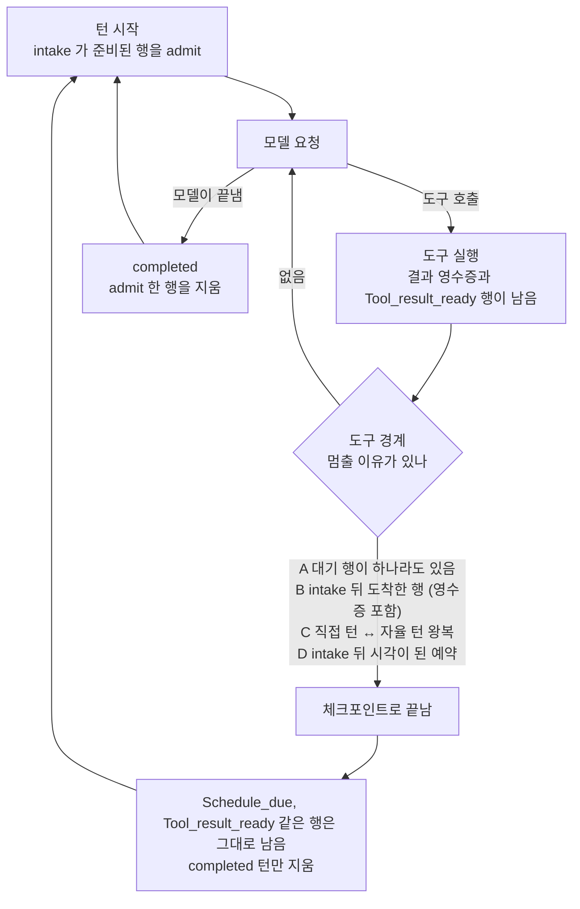
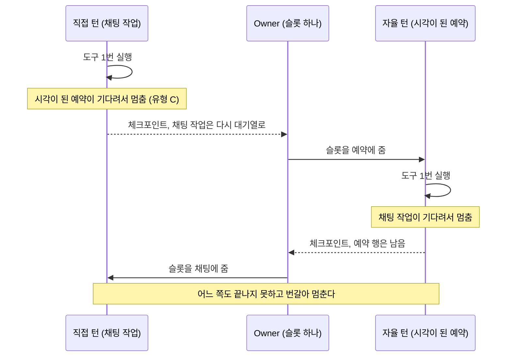
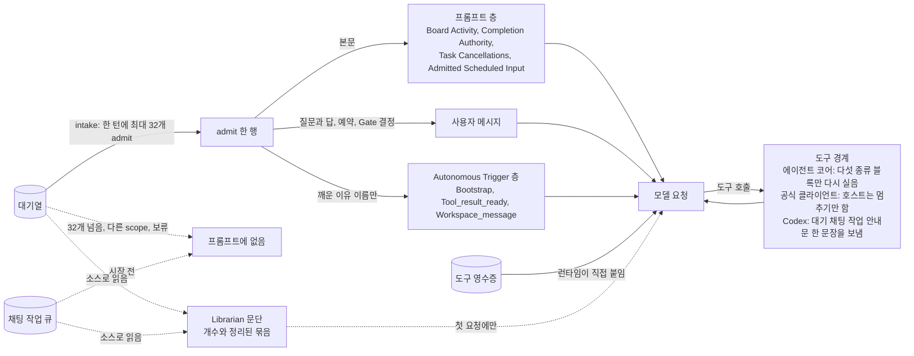
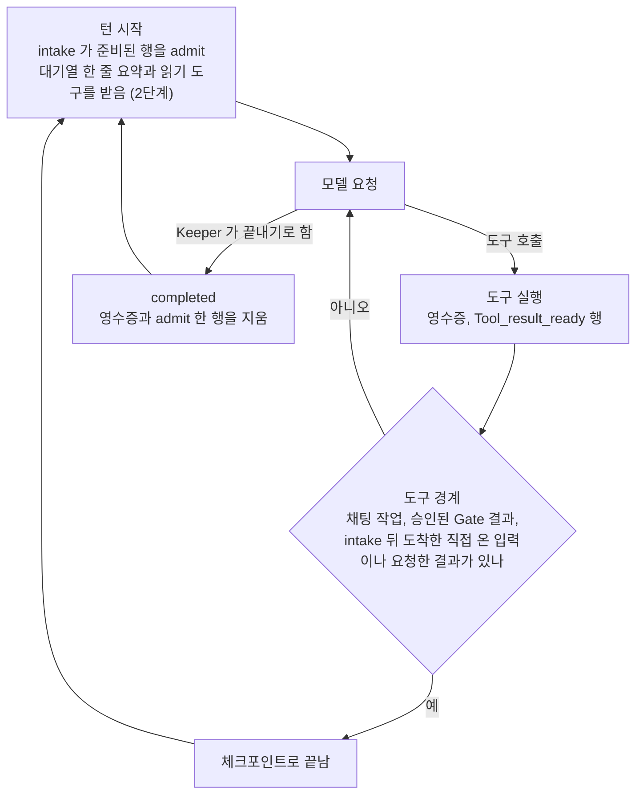
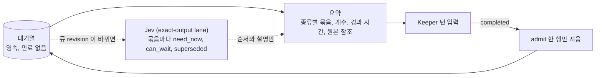

# RFC: 쌓인 대기열은 실행 중인 턴을 멈추지 않는다 — 끝낼 때는 Keeper 가 정한다

2026-10-26 저녁(KST)부터 Keeper 의 도는 턴을 서버가 중간에 멈추는 일이 늘었다. 멈춘 턴이 하루 780~1,580개다.
멈춘 턴은 큐의 행을 지우지 못해서, 다음 턴이 같은 행을 다시 처리한다.
이 RFC 는 턴을 멈추는 이유를 채팅 작업, 승인, Keeper 에게 직접 온 입력으로 좁히고, 그 밖의 일은 Keeper 가 턴을 끝낼 때 정하게 하자고 제안한다.

- 다루는 것: 도는 턴이 멈추는 조건, 큐를 Keeper 에게 보여 주는 방법(요약), 요약에 Jev 를 쓰는 방법.
- 다루지 않는 것: 누가 다음 슬롯을 받는지(RFC-0373 의 admission), 큐 행의 저장 형식, `Operation_queued` 와 `Repeated_*` 멈춤(6절).
- 용어: **멈춘다**는 서버가 도는 턴을 도구 호출 사이에 끝내는 일이다. 그렇게 끝난 턴이 **체크포인트**다(TUI 의 노란 줄 `Continuation checkpoint recorded`).
  **intake** 는 턴이 시작할 때 큐에서 처리할 행을 고르는 단계이고, 고른 행을 **admit** 했다고 한다. 시스템 로그에는 `consumed` 로 남는다.
- 근거 기준: `origin/main` = `3e41385b549` (2026-10-29). 측정 구간(10-29 02:54Z 까지)에 도는 서버 바이너리도 이 커밋이다. 서버는 10-29 03:07Z 에 `216f7ab8456` 으로, 06:06Z 에 `575e4665d63` 으로 다시 시작했다. 멈춤과 관련된 파일의 차이는 두 커밋 모두 이 RFC 와 상관없는 부분뿐이다.
- 측정: [`docs/evidence/2026-10-29-keeper-backlog-preemption/`](../evidence/2026-10-29-keeper-backlog-preemption/README.md). 도구는 `scripts/keeper-queue-probe.py` 다.
- 표시: **[사실]** 은 코드나 데이터에서 확인한 것, **[추정]** 은 근거는 있지만 직접 보지 못한 것, **[제안]** 은 이 RFC 가 정하려는 것, **[확인 필요]** 는 아직 모르는 것이다.

## 0. 요약

**[사실]** 자율 턴(예약이나 알림으로 시작한 턴)이 `durable` 이나 `op_q` 로 멈춘 비율이 10-26 에 2.1% 에서 22.2% 로 올랐다.
`durable` 은 대기 중인 입력 때문에 멈춘 것, `op_q` 는 기다리는 채팅 작업 때문에 멈춘 것이다.

| 기간 (UTC) | 턴 | `durable` | `op_q` | 모든 턴이 멈춘 비율 | 자율 턴이 멈춘 비율 | 직접 턴이 끝까지 간 비율 |
|---|---|---|---|---|---|---|
| 10-15 ~ 10-25 (열하루) | 16,684 | 137 | 1,336 | 8.8% | 2.1% | 54.3% |
| 10-26 ~ 10-29 02:54Z (3.1일) | 13,319 | 2,570 | 1,245 | 28.6% | 22.2% | 40.1% |

- 10-26 안에서 보면 06~11Z 여섯 시간은 자율 턴이 멈춘 비율이 0.0~8.1% 이고, 12Z 부터 16.9~33.7% 다(`before-fleet-hourly-1026.txt`). 11:47Z 에 #46133 과 #46134 가 병합됐다.
- 합계를 낸 건 전체 Keeper 다. 늘어난 `durable` 의 87% 는 여섯 Keeper 에서 났다(10-26 ~ 10-28 `durable` 2,431개 중 `ocaml-agent-ic` 489, `context-reviewer` 437, `code-reviewer` 384, `ocaml-refactor-woman` 361, `pr-updater` 235, `you-never-change` 215).
- 체크포인트나 `completed` 로 끝난 턴 중 도구를 쓴 10,022개에서 3,770개(38%)가 체크포인트로 끝났다.

**[사실]** 같은 증상이 두 모양으로 보인다.

- `code-reviewer`: 직접 턴(채팅 작업)과 자율 턴이 번갈아 멈춘다. 10-26 12:36~12:59Z 에이전트 코어 13턴은 연속 12쌍 모두에서 번갈았다. 앞 11턴에서 직접 턴 5개는 모두 `durable`, 자율 턴 6개는 모두 `op_q` 였다. 10-29 02:08~02:47Z 에는 Claude Code 64턴의 연속 63쌍 중 56쌍이 번갈았다.
- `ocaml-agent-ic`: 10-27 12:49Z ~ 10-28 00:39Z 연속 120턴이 모두 자율 턴이고 모두 체크포인트다. 그동안 시각이 된 예약이 199개 처리됐고(중앙값 199초 간격), 턴 120개 중 109개가 도는 동안 새 예약이 도착했다.

**[사실]** 멈춘 턴은 큐의 행을 지우지 못한다. 10-28 03:01Z 부터는 `Schedule_due` 도 체크포인트가 남기고, `completed` 로 끝난 턴만 지운다.
그 뒤로 이미 한 번 처리한 예약 입력을 다시 처리하는 비율이 10-24~10-27 의 6.4~17.8% 에서 10-28 31.7% 로 올랐다.

**[제안]**

1. **1단계.** 도는 턴은 쌓인 대기열 때문에 멈추지 않는다. 채팅 작업이 기다릴 때, 승인된 Gate 결과가 도착했을 때,
   Keeper 에게 직접 온 입력이나 Keeper 가 요청한 결과가 intake 뒤에 도착했을 때만 멈춘다. 코드를 지우는 변경이다.
2. **2단계.** Keeper 가 admit 하지 못한 행과 아직 시작하지 않은 채팅 작업의 요약(종류별 묶음, 개수, 가장 오래된 행의 경과 시간, 원본 참조)을 받는다. 지금은 이 둘의 내용이 프롬프트에 없다(1.7). 요약은 보여 주는 용도이고 아무것도 지우지 않는다.
3. **3단계.** 요약의 묶음과 순서를 Jev 가 정한다. Jev 의 답은 요약에 붙는 설명과 순서로만 쓰고, 큐에서 지우는 근거로는 쓰지 않는다.

이 PR 에는 측정 도구, 증거, TLA+ 모델, 이 RFC 가 있다. 1단계 코드는 위에 쌓은 PR 에 있고, 2·3단계는 설계만 있다.

## 1. 지금 모양

### 1.1 어떻게 늘었나

**[사실]** 시각은 UTC 다. 병합 시각은 `git log`, 로그 수는 시스템 로그에서 센 값이다.

| 때 | 변경 | 로그에서 보이는 것 |
|---|---|---|
| 10-26 10:56 | #46120 등록. `code-reviewer` 의 시각이 된 예약이 2시간 넘게 처리되지 않았다. 채팅 작업이 슬롯을 계속 가져갔다. | |
| 10-26 11:47 | #46133 병합. 도는 턴이 도구 경계에서 시각이 된 예약에 멈추고, 다음 슬롯을 그 예약에 먼저 준다. | 병합 뒤 첫 서버 시작은 12:11Z 다(`masc-start-1026-2111.log`). 12Z 부터 자율 턴이 멈춘 비율이 0.0~8.1% 에서 16.9~33.7% 로 오른다. |
| 10-26 11:47 | #46134 병합. 공식 클라이언트(Codex, Claude Code, Muse, Antigravity)의 도구 경계도 같은 멈춤 판정을 따른다. | 공식 클라이언트의 `durable` 첫 기록이 12:17~12:18Z 다. 그 전 열하루에는 자율 턴 약 8,200개에서 7개뿐이었다. |
| 10-27 09:20 | #46125 병합. 도착한 행 12종이 도는 턴을 멈추게 한다(에이전트 코어 도구 경계에서 새로 도착한 비동기 결과와 메시지). 같은 시각에 #46109(비동기 답을 Board 대기보다 먼저 admit), #46138, #46145(영수증 소비)가 병합됐다. | `source turn yields to a new durable successor` 로그가 10-27 10:30Z 에 처음 나온다(전에는 0줄). `Tool_result_ready` admit 로그가 10-26 39줄, 10-27 1,297줄, 10-28 10,892줄이다. |
| 10-28 03:01 | #46202 병합. 체크포인트가 `Schedule_due` 를 지우지 않고 남긴다. | 이미 처리한 예약 입력을 다시 처리하는 비율이 10-24~10-27 에 6.4~17.8%, 10-28 에 31.7%, 10-29 에 44.5%(하루 일부)다. |

다음 슬롯을 시각이 된 예약에 먼저 주는 쪽(Owner, #46133)은 이 RFC 도 남긴다. #46120 은 아직 열려 있고, 이것만으로 충분한지는 예약의 지연을 재야 안다. 수정 전 값은 3.4 의 1 과 증거 2.8 에 있다.
도는 턴을 끊어서 막는 쪽은 이 RFC 가 접는다.

**[추정]** 위 변경들이 원인의 전부라고 확정하지는 않는다. 날짜가 맞고 변경 내용(커밋 메시지, diff)이 아래 1.2 의 유형과 맞는다.
공식 클라이언트 런타임이 같은 날 새로 시작했다는 설명은 맞지 않는다. 같은 클라이언트들이 10-15~10-25 에도 자율 턴을 Claude Code 2,732개, Codex 2,525개, Muse 2,623개 돌렸고, `durable` 은 0개, 7개, 0개였다.
12:11Z 서버 시작에 두 변경이 들어 있었는지는 바이너리 커밋으로 확인하지 않았다. **[확인 필요]**

### 1.2 턴이 멈추는 유형

**[사실]** 위치는 `3e41385b549` 기준이다. 도구 경계마다 멈춤 판정이 돈다. 판정에 쓰이는 유형이 넷이다.

| 유형 | 어떤 턴이 | 무엇 때문에 멈추나 | 들어온 때 | 위치 | 로그에 남는 증거 |
|---|---|---|---|---|---|
| A | admit 한 행이 없는 자율 턴 (`Proactive_tick`, `Woken []`) | 대기 행이 하나라도 있으면 | 오래됨. 공식 클라이언트 경계는 #46134 | `keeper_unified_turn.ml:232`, `:524` | head 가 남은 양보 108건 (`schedule_due` 62, `board_signal` 31, `tool_result_ready` 13, `completion_authority_rejected` 2) |
| B | admit 한 행이 있는 자율 턴 (`Woken (_ :: _)`) | intake 뒤에 도착한 행 12종. `Tool_result_ready` 도 든다 | #46125 | `keeper_unified_turn.ml:451`, `:494` | head 가 남은 양보 272건 (`tool_result_ready` 243, `ask_answered` 13, `keeper_delegate_completed` 8, `completion_authority_rejected` 3, `task_outcome` 3, `task_cancelled` 2) |
| C | 직접 턴 ↔ 자율 턴 | 직접 턴은 시각이 된 예약에, 자율 턴은 기다리는 채팅 작업에 | 직접 턴의 예약 멈춤은 #46133 | `keeper_chat_yield_request.ml:17`, `:31` | 로그를 남기지 않는다 |
| D | admit 한 행이 있는 자율 턴 | B 에 해당하는 행이 없을 때, intake 뒤에 시각이 된 예약(어느 예약이든)이 도착하면. Owner 가 받아들일 때만 | #46133 | `keeper_unified_turn.ml:500-518` | 로그를 남기지 않는다 |

유형 A·B 의 head 는 양보 로그에 적힌 첫 대기 행이다. 380건을 센 값이고, `tool_result_ready` 는 `pr-updater` 100, `code-reviewer` 53, `context-reviewer` 34건이 많다.
유형 C·D 는 로그가 없어서 건수를 모른다. 1.4 의 두 사례는 간접 증거다.

이 RFC 가 바꾸지 않는 멈춤도 있다.

- 큐에 있는 채팅 작업(`Operation_queued`)과 승인된 Gate 결과.
- 도구가 스스로 deferred 로 답한 경우(`keeper_tool_terminal_boundary.ml:3`).
- `Repeated_*` 멈춤.

공식 클라이언트는 도구 경계에서 `Operation_queued` 와 `Durable_stimulus_waiting` 을 같은 `Durable_stimulus_deferred` 로 끝낸다(`keeper_agent_run.ml:272-276`).
그래서 Codex, Claude Code, Muse, Antigravity 턴이 도구 경계에서 멈춘 `durable` 과 `op_q` 는 원인을 나눈 값이 아니다. 에이전트 코어 턴은 둘을 따로 적는다.
Codex 직접 턴은 하나 더 있다. 대기 채팅 작업을 알리는 안내문(1.7)을 받고 모델이 자연히 끝내면 `Yielded_to_operation_queued` 로 적힌다. 직접 턴 297개 중 `op_q` 가 21개다(`before-fleet.txt` 표 4).

### 1.3 멈추면 왜 같은 행이 다시 나오나

**[사실]**

- 체크포인트로 끝난 턴은 알림형 행(`Bootstrap`, `Board_signal`, `Board_attention`, `Hitl_resolved`)만 지운다.
  나머지(`Connector_attention`, `Tool_result_ready`, `Schedule_due`, `Ask_answered` 등)는 `completed` 턴이 지울 때까지 남는다(`keeper_heartbeat_loop.ml:613-631`). `Schedule_due` 는 10-28 03:01Z(#46202) 전에는 지우는 쪽이었다.
- 공식 클라이언트의 도구 결과 영수증도 `completed` 로 끝난 턴만 지운다(`keeper_client_tool_outbox.ml:270`). 남은 영수증은 다음 요청에 전부 실린다(`keeper_client_tool_outbox.ml:230`, `keeper_codex_runtime.ml:1107`, `keeper_antigravity_runtime.ml:652`, `keeper_turn_driver_try_provider.ml:2450`).
- 그래서 멈춘 다음 턴이 같은 행을 다시 admit 한다. 한 큐 행이 체크포인트 턴에 admit 되고도 남은 횟수가 `checkpoint_retentions` 다.
  `code-reviewer` 는 10-29 02:08~02:47Z 에 시각이 된 예약 4개를 27번 admit 했고, 하나는 15번 admit 했다(`before-code-reviewer-pingpong.txt`).

**[확인 필요]** 큐 길이를 시간순으로 잰 값은 없다. 큐 스냅샷은 읽은 시각의 값 하나뿐이다. "큐가 쌓인다"는 같은 행의 반복 admit 과 `checkpoint_retentions` 로 본 것이다.

### 1.4 사례

**`code-reviewer`, 직접 턴 ↔ 자율 턴 왕복 (유형 C).**
[사실] 10-26 12:36~12:59Z, 에이전트 코어 13턴이 연속 12쌍 모두에서 직접 턴과 자율 턴을 번갈았다. 앞 11턴에서 직접 턴 5개는 모두 `durable`, 자율 턴 6개는 모두 `op_q` 로 끝났다(`before-code-reviewer-1026-timeline.txt`).
에이전트 코어는 두 이유를 따로 적으므로, 직접 턴은 시각이 된 예약에 멈추고 자율 턴은 기다리는 채팅 작업에 멈춘 것으로 읽힌다. #46133 이 병합되고 49분 뒤다.
[사실] 10-29 02:08~02:47Z 에는 Claude Code 턴 64개 중 50개가 `durable` 로 멈췄고 그중 48개가 도구를 1번만 쓰고 멈췄다. 이 구간에 head 가 남은 양보는 0건이다(`before-code-reviewer-timeline.txt`).
[추정] 같은 왕복이다. Claude Code 는 두 이유를 같은 `durable` 로 적어서 라벨로는 나누지 못한다.

**`ocaml-agent-ic`, 연속 120턴 (유형 D 가 유력).**
[사실] 120턴이 모두 자율 턴(에이전트 코어)이고, 도구는 `keeper_artifact_read`, `tool_execute`, `tool_read_file` 같은 일반 도구다. 턴 길이는 중앙값 약 332초다.
같은 12시간에 시각이 된 예약 199개가 처리됐고(중앙값 199초 간격), 턴 120개 중 109개가 도는 동안 새 예약이 도착했다(예약 처리 원장 `consumed-schedule-occurrences-v1`).
같은 예약 입력을 두 번 처리한 경우는 205개 중 5개뿐이다(`before-ocaml-agent-ic.txt`). 남은 행을 다시 처리하는 연쇄가 아니라 새로 도착한 예약마다 멈춘 연쇄로 보인다.
이 Keeper 의 3일 동안 head 가 남은 양보는 15건뿐이다(`schedule_due` 13, `completion_authority_rejected` 2).
[추정] 나머지는 유형 D 가 로그 없이 멈춘 것이다. 도구가 deferred 로 답해서 멈춘 경우는 로그가 없어 배제하지 못했다. **[확인 필요]**

**돌아가며 admit 되는 게시판 알림.** [사실] `code-reviewer` 는 위 39분에 게시판 알림 25개를 141번 admit 했고(하나는 43번), 전체 Keeper 에서 다시 admit 된 입력 19,344건 중 8,320건이 `board_attention` 이다.
게시판 알림은 체크포인트가 지우는 종류인데(1.3) 같은 id 가 되풀이된다. 이 RFC 의 설명으로는 이유를 말할 수 없고, 6절에 남겼다.

### 1.5 측정

**[사실]** 2026-10-26 00:00Z ~ 10-29 02:54:34Z, 모든 Keeper (`before-fleet.txt`).

| 항목 | 값 |
|---|---|
| 턴 / 체크포인트 | 13,319 / 3,815 (28.6%) |
| 체크포인트 중 `durable` / `op_q` | 2,570 / 1,245 |
| `completed` 중 도구를 쓴 턴 | 8,314 중 6,252 |
| 체크포인트 중 도구 호출 0~1번 | 1,458 (38.2%) |
| 체크포인트 비율이 높은 Keeper 와 날 | `ocaml-agent-ic` 10-28 93.6%, 10-29 100% · `ocaml-refactor-woman` 10-28 97.8% · `code-reviewer` 10-27 76.7% |
| head 가 남은 양보 380건 중 | `tool_result_ready` 256 (67.4%), `schedule_due` 62 (16.3%), `board_signal` 31 (8.2%), 그 밖에 `ask_answered` 13, `keeper_delegate_completed` 8, `completion_authority_rejected` 5, `task_outcome` 3, `task_cancelled` 2 |
| 완료된 턴의 길이, 전체 (n=8,314) | p50 46초, p90 356초, p99 2,086초, 최대 10,002초 |
| 완료된 직접 턴의 길이 (n=918) | p50 107초, p90 482초, p99 1,374초, 최대 5,419초 |

`durable` 로 멈춘 2,570턴 중 head 가 로그에 남은 것은 380건(14.8%)이다. 나머지는 유형 C·D, Gate, deferred 도구의 멈춤이 섞여 있고 나눌 수 없다.

### 1.6 같은 영역의 이전 fix

**[사실]** 2026-08-01 이후 `lib/keeper` 에서 큐에 남은 행이 멈춤을 되풀이시키는 문제와 멈춤 조건을 다룬 `fix` 는 8건 이상이다.
#32049, #33413, #36130, #38807, #39387, #41169, #45655, #46134.
#41169 는 읽을 수 없는 Connector 포인터 하나가 도구 경계마다 멈춤을 일으키는 문제를 그 종류만 거르는 필터로 막았다.
이 RFC 는 종류마다 필터를 더하는 방식을 접고, 멈춤 이유를 한 곳에서 좁힌다.

### 1.7 지금 Keeper 가 큐에 대해 보는 것

**[사실]** `3e41385b549` 기준이다. 2단계의 요약을 어디에 붙일지 정하려고 모델이 보는 것을 코드에서 따라갔다. 큐의 내용이 프롬프트에 들어가는 길은 admit 한 행 하나다. 켜져 있으면 Librarian 문단이 큐를 정리한 개수와 묶음을 간접으로 더 보여 준다.

**admit 한 행.** 한 턴은 행을 최대 32개 admit 한다(`MASC_KEEPER_ADMISSION_MAX_EVENTS`, 기본 32, 범위 1~256, `env_config_keeper.ml:520-533`). 넘친 행은 다음 턴으로 남는다. admit 한 행은 종류에 따라 네 가지로 보인다.

| 모델에게 보이는 방식 | 종류 |
|---|---|
| Board Activity 층. 제목, 미리보기, 출처 필드 | `Board_signal`, `Board_attention`, `Fusion_completed`, `Delegate_completed`, `Composition_completed`, `Owned_job_completed`, `Addon_operation_changed`, `Connector_attention` |
| 종류마다 자기 층 | `Completion_authority_rejected`, `Task_outcome` (Completion Authority), `Task_cancelled` (Task Cancellations), `Schedule_due` (Admitted Scheduled Input) |
| 사용자 메시지에 붙음 | `Ask_answered` (질문과 답), `Schedule_due` (Scheduled Wake), `Hitl_resolved` (Gate 재생이 붙이는 결정) |
| 본문은 없고 깨운 이유 이름만 보임 | `Bootstrap`, `Tool_result_ready`, `Workspace_message` |

- Board Activity 인 종류는 `keeper_world_observation.ml:100-142`, 종류별 intake 는 `keeper_heartbeat_stimulus_intake.ml:259-436` 이 정한다. 사용자 메시지에 붙는 곳은 `keeper_unified_prompt.ml:1986-1999`(`Schedule_due`, `Ask_answered`)와 `keeper_gate_replay.ml:907-929`(`Hitl_resolved`)다.
- 깨운 이유는 자율 턴의 Autonomous Trigger 층에 이름만 한 줄 실린다. 예: "Reasons: bootstrap_stimulus_pending, tool_result_ready_pending"(`keeper_unified_prompt.ml:1037-1052`). 직접 턴에는 이 층이 없다(`keeper_direct_turn_context.ml:73`).
- `Workspace_message` 의 본문은 transcript 에 있고 메시지 층이 읽는다(`keeper_heartbeat_stimulus_intake.ml:425-435`). `Tool_result_ready` 행은 영수증을 가리키는 포인터이고, 영수증은 런타임이 outbox 에서 직접 읽어 붙인다(1.3).
- Board Activity 는 길이를 자르지 않는다. `completed` 턴이 admit 한 행을 모두 지우므로, 하나라도 가리면 Keeper 가 보지 못한 입력을 본 것으로 치게 된다(`keeper_unified_prompt.ml:970-974`).

**admit 하지 못한 행은 프롬프트에 없다.**

- 해당하는 행은 넷이다.
  - 32개를 넘은 행.
  - 다른 scope 의 행. 한 턴은 한 scope 의 행만 받는다. scope 는 일반 입력 전체, 같은 Addon 호출, 예약 하나다(`keeper_heartbeat_stimulus_intake.ml:813-835`).
  - 한 턴에 한 건씩만 받는 종류의 나머지. 두 번째부터의 `Hitl_resolved` 와 첫 대화가 아닌 `Connector_attention` 이다(`:876-893`, `:940-980`).
  - 아직 준비되지 않은 행. 승인이 아직 열려 있거나 읽지 못한 `Hitl_resolved`, 읽지 못해 보류한 `Ask_answered` 와 `Connector_attention` 이다(`:456-478`, `:1044-1058`, `:1122-1141`).
- `prompt_names.ml` 에서 `queue`, `inbox`, `stimulus`, `backlog` 가 들어간 이름은 Task 대기열(`namespace_state.backlog_*`) 셋뿐이다.
- `decisions.jsonl` 의 `observation` 은 모델이 본 것의 기록이 아니다. `pending_board_events` 같은 필드는 입력 record 의 길이이고, 못 꺼낸 행의 개수는 여기 없다(`keeper_unified_metrics_decision.ml:180-226`). 개수는 멈춤 로그의 `pending=N` 과 운영자용 `masc_keeper_waiting_inventory` 에 있다.
- 멈출 때 서버가 만드는 대기 요약(`durable_stimulus_summary`: 대기 개수, 첫 행, 첫 행의 나이, 종류)은 모델에게 가지 않는다. 일부 분기는 로그 한 줄로 쓰고 일부는 만들고 버린다(`keeper_agent_run.ml:198-257`, `keeper_unified_turn.ml:515-519`, `keeper_chat_yield_request.ml:44-48`). 다음 턴 프롬프트는 `Operation_queued`, `Durable_stimulus_arrived` 로 멈춘 일에 줄을 만들지 않는다(`keeper_unified_prompt.ml:1251-1271`).

**도는 중에는 큐가 새로 보이지 않는다. Codex 는 안내문 한 문장이 예외다.**

- 에이전트 코어는 도구 뒤 요청에 다섯 종류 블록만 다시 싣는다. `Keeper_instructions`, `Active_goals`, `Completion_authority`, `Admitted_scheduled_input`, `Operator_note` 다(`prompt_block_id.ml:86-90`). `keeper_run_tools_hooks.ml` 에는 큐를 읽는 코드가 없다.
- 공식 클라이언트의 도구 경계 함수는 `None`, `Terminal_tool_boundary`, 오류 중 하나를 돌려준다(`keeper_agent_run.ml:262-279`). 호스트는 빈 응답으로 턴을 끝내고(`keeper_official_client_host.ml:183-219`), 도구 뒤에 문맥을 더하는 주입은 오류로 거절한다(`:1590-1599`).
- Codex 는 도는 턴에 문장을 보내는 길이 따로 있다. 대기 채팅 작업이 생기면 `turn/steer` 로 "Host scheduling notice: a direct message is waiting for this Keeper. ... then finish this turn so the host can deliver the waiting message. ... This notice does not contain that message ..." 를 보낸다(`runtime_codex_app_server.ml:1676-1687`, 연결은 `keeper_codex_runtime.ml:1470-1486`). 활성 도구 결과를 처리한 뒤 보내고, 본문은 담지 않으며, 턴은 모델이 자연히 끝낸다(`runtime_codex_app_server.mli:500-505`). 직접 턴이 이렇게 끝나면 `Yielded_to_operation_queued`, 자율 턴은 `Completed` 다(`keeper_codex_runtime.ml:1696-1703`). Claude Code, Muse, Antigravity 에서는 이런 길을 찾지 못했다. grep 으로만 확인했다. **[확인 필요]**

**채팅 작업 큐.**

- 묶음은 도는 작업이 없을 때 claim 할 수 있는 맨 앞 작업을 claim 하면서 만든다(`keeper_chat_operation_store.ml:1881-1902`). Gate 대기, 입력 대기, 제공자 backoff 중인 작업은 건너뛴다(`:1690-1727`). 후보는 그 작업에서 시작하는 새 작업이고, 이미 한 번 돈 작업(continuation)이나 다른 묶음에 든 작업을 만나면 거기서 끊는다(`:1803-1835`).
  후보 중에서 디코딩한 출처의 모든 필드가 같은 연속 구간만 하나로 합친다. 출처 필드는 보낸 사람, 스레드, 답장 경로, 표면, 채널, 대화, 워크스페이스, 추가 멘션, 보낸 Keeper 등이고 외부 메시지 id 만 달라도 된다(`keeper_chat_operation_payload.mli:3-23`). `turn_instructions` 와 `surface_context` 도 같아야 한다. 같은 id 의 첨부는 내용이 같으면 하나로 치고 다르면 거기서 끊는다. 처음 다른 작업에서 끊고, 둘 미만이면 묶지 않는다(`keeper_chat_operation_batch.ml:12-25`, `:35-71`).
- claim 되지 않은 채팅 작업은 직접 턴 프롬프트에 없다(`keeper_direct_turn_context.ml:69-76`). 자율 턴에게는 멈춤 이유로 나타나고(`keeper_chat_yield_request.ml:17`), Codex 자율 턴은 위 안내문도 받는다(`keeper_owner.ml:535-542`).
- 간접 경로는 Librarian 작업 문맥이다. Librarian 은 대기 중인 선택 전부와 대기·실행 중인 채팅 입력을 소스로 읽는다(`keeper_librarian_context_io.ml:19-33`). 모델은 첫 요청에서 "Organized context revision N: P pockets, S source records ..." 문단 하나를 보고, 문단은 `keeper_artifact_read` 로 정리된 묶음 본문을 읽으라고 안내한다(`keeper_librarian_context_recall.ml:142`). 이 도구가 요청에 실려 있어야 문단이 나오고, 아니면 "unavailable" 안내가 나온다(`:96`, `keeper_run_tools_hooks.ml:1084-1090`). 개수는 이벤트와 채팅을 합친 값이고 종류별이나 보낸 사람별 목록은 없다. 기본값은 켜짐이다(`env_config_keeper.ml:310`). 실제 Keeper 에서 이 문단과 묶음 본문이 어떻게 보이는지는 읽지 않았다. **[확인 필요]**

**읽는 도구.** Keeper 모델이 자기 큐를 직접 읽는 도구는 없다. 도구 정의 파일(`config/tools/`) 이름에 `queue`, `pending`, `waiting` 등이 든 것은 `masc_keeper_waiting_inventory`(운영자 전용, 함대 전체 JSON, `keeper_tool_descriptor.ml:3212-3222`)와 운영자용 재큐 도구 하나뿐이다. `masc_keeper_delegate_list` 도 운영자 전용이다(`:3286-3289`). 모델이 쓰는 `masc_keeper_delegate_status` 는 작업 id 하나를 조회한다(`:3279-3283`). 간접으로는 위 Librarian 문단이 가리키는 `keeper_artifact_read` 가 정리된 묶음을 읽는다.

**포인터와 읽기 도구를 짝지은 선례가 여럿 있다.**

- Lane 구독: 프롬프트에 포인터 JSON 과 "No source bodies are included here" 만 싣고, 본문은 `masc_lane_updates` 로 읽게 한다(`lane_addon_subscription.ml:207-213`).
- Task 대기열: 받을 수 있는 Task 일곱 개를 싣고 나머지는 "(N more — read them with keeper_tasks_list)" 로 줄이며, 최근에 늘어난 세 개를 따로 싣는다(`keeper_unified_prompt.ml:975-978`, `:1653-1691`, `config/prompts/keeper.md:437`).
- Workspace memory 는 `keeper_workspace_memory_read` 를, Librarian 문단은 `keeper_artifact_read` 를 가리킨다.

**안내문과 도구만 두면 도구가 잘 불리지 않는다.** 기억 검색은 도구와 "사실 N개" 안내문이 이미 있는데 도구 호출 276,804건 중 2,201건(0.80%)이다. 도구를 쓴 턴 100개당 검색한 턴은 `claude_code` 1.45 에서 `antigravity` 12.91 까지다(`RFC-keeper-recall-reaches-the-turn` 0절, 2.1절).

**읽는 길은 이미 있다.** 대기 선택은 `Keeper_registry_event_queue.pending_selections_result` 로, 대기·실행 중인 채팅 입력은 `Keeper_chat_operation_store.inspect_pending_inputs` 로 읽는다. 뒤의 것은 읽기 전용 SQLite 스냅샷이고 claim 하지 않는다. 둘 다 Librarian 이 쓰고 있다(`keeper_librarian_context_io.ml:22-33`). 운영자용 `masc_keeper_waiting_inventory` 는 같은 큐를 행 단위로 투영한다. 행마다 출처(`event_queue_pending`, `chat_operation_queued`, `chat_operation_running` 등), 운영자 문장(`what`), 깨운 쪽(`wake_producer`), 기다린 시각(`since`)이 있다(`server_keeper_waiting_inventory.ml:40-52`).

**[확인 필요]** 한 턴에 어떤 32개가 admit 되는지(대기 행을 고르는 순서, `pending_frontier_result`)는 읽지 않았다.

## 2. 원칙

헌법이 이미 답을 적고 있다.

- `gates.default`: 하드 게이팅을 기본으로 고려하지 않는다.
- `forbidden.magic_number`: 중단은 명시적 취소·승인·종단 효과·실제 실패 상태로 결정한다.
- `when_stuck`: 결정론적 판단을 넣고 싶어지는 순간은 비결정론 LLM 판단이 더 나을 수 있다는 신호다. Lane 을 늘린다. 비용은 고민하지 않는다.
- `inv.no_wall_clock_death`: 시간 경과로 상태를 죽이지 않는다. Board attention Pending 에도 만료가 없다.

현재 코드의 규칙도 같은 방향이다. 턴은 자기가 admit 한 행만 지우고, 체크포인트는 알림형 행만 지운다(`keeper_heartbeat_loop.ml:600-631`).

"대기 행이 있으니 멈춘다"는 서버가 자기 판단으로 만든 멈춤 이유다. 이 RFC 는 그런 규칙을 없앤다.
각 결정을 누가 하는지는 아래처럼 나눈다.

| 결정 | 지금 | 이 RFC 뒤 | 성격 |
|---|---|---|---|
| 큐에 무엇이 남는가 (영속, 만료 없음) | 서버 | 같음 | 결정론 |
| 누가 다음 슬롯을 받는가 | owner (RFC-0373, #46133) | 같음 | 결정론 |
| 도는 턴을 멈추는가 | 서버가 "대기 행이 있다", "예약이 기다린다" 로 판정 | 채팅 작업, 승인, 직접 온 입력만. 그 밖에는 Keeper 가 끝낸다 | 명시 사건 + 모델 |
| 다음 턴에 무엇을 보여 주는가 | 큐 순서(긴급도, 도착 순)와 admit 상한 | Jev 가 묶고 순서를 정한 요약, 고르는 건 Keeper (2·3단계) | 모델 |
| 무엇을 지우는가 | `completed` 턴이 자기 admit 집합을 지움 | 같음 | 결정론 |

## 3. 제안

### 3.1 1단계 — 멈추는 조건

**[제안]** 멈춤 이유를 아래로 한정한다. 바뀌는 것은 굵게 표시했다.

| 입력 | 멈춤 | 이유 |
|---|---|---|
| 큐에 있는 채팅 작업 (`Operation_queued`) | 예, 그대로 | 기다리는 쪽이 있다 (RFC-0441) |
| 승인된 Gate 결과 (`Hitl_resolved`) | 예, 그대로 | 명시적 승인이다 (#28809) |
| intake 뒤에 도착한 `Connector_attention`, `Workspace_message`, `Ask_answered`, `Task_cancelled`, `Completion_authority_rejected` | 예, 그대로 | 남이 Keeper 에게 직접 보낸 입력, 명시적 취소, 검증자의 거절이다 |
| intake 뒤에 도착한 `Fusion_completed`, `Delegate_completed`, `Composition_completed`, `Owned_job_completed`, `Addon_operation_changed`, `Task_outcome` | 예, 그대로 | Keeper 가 요청한 일의 결과다 |
| intake 뒤에 도착한 **`Tool_result_ready`** | **아니오** | 턴 자신의 도구 호출이 남긴 영수증이다. 그 턴이 이미 결과를 쥐고 있다 |
| **admit 한 행이 없는 자율 턴이 보는 "대기 행이 하나라도 있음" (유형 A)** | **아니오** | 다른 턴과 같은 판정(intake 뒤에 도착한 행 + 위 표)을 쓴다 |
| **직접 턴이 시각이 된 예약에 멈춤 (유형 C)** | **아니오** | 예약은 다음 슬롯에서 admit 한다 |
| **자율 턴이 intake 뒤에 시각이 된 예약에 멈춤 (유형 D)** | **아니오** | 그 예약은 이 턴이 끝난 뒤 intake 가 admit 한다 |
| `Schedule_due`, `Board_attention`, `Board_signal`, `Bootstrap` | 아니오, 그대로 | 예약과 주변 입력이다. 다음 intake 에서 admit 한다 |

- 아랫부분 넷이 바뀌는 곳이다. 코드로는 `source_may_preempt` 의 `Tool_result_ready` 한 줄, 대기 행이 하나라도 있으면 멈추는 판정(`keeper_unified_turn.ml:232`)의 삭제,
  예약으로 멈추는 곳 둘(`keeper_chat_yield_request.ml:31`, `keeper_unified_turn.ml:506`)의 삭제, 그리고 Owner 의 `Request_scheduled_turn` 명령 삭제다.
- 종류 구분은 `source_may_preempt` 하나가 맡는다. 종류를 모두 적는 `match` 로 쓰고 `_ ->` 를 두지 않는다. 새 종류가 생기면 컴파일러가 이 자리를 알려 준다.
- 멈춘 턴이 지우는 행의 규칙(`checkpoint_source_policy`)은 바꾸지 않는다. 멈춤이 드물어지면 이 규칙이 연쇄를 만들지 못한다.

### 3.2 남기는 것

- 큐에 있는 채팅 작업과 승인된 Gate 결과의 멈춤은 그대로다.
- 시각이 된 예약의 admission 우선권(#46133 의 커밋 제목 `admit due schedules before reclaiming chat continuations`)은 그대로다. 채팅 child 가 도는 동안 Owner 가 다음 슬롯을 예약에 예약해 두는 일(`observe_scheduled_turn`)도 그대로다. 바뀌는 건 도는 턴을 끊느냐뿐이다.
- 큐 행의 저장 형식과 `checkpoint_retentions` 는 그대로다. 마이그레이션은 없다.

### 3.3 바뀐 뒤의 흐름

### 3.4 비용과 위험

1. **시각이 된 예약이 도는 턴이 끝날 때까지 기다린다.** [사실] 완료된 턴의 길이는 p50 46초, p90 356초, p99 2,086초, 최대 10,002초다(1.5).
   #46120 의 문제는 예약이 끝없이 밀리는 것이었고, 슬롯 예약(3.2)이 남아 있어서 기다림은 도는 턴의 남은 길이로 묶인다. [추정]
   수정 전 지연은 `--schedule-latency` 로 쟀다. `due_at` 에서 첫 전달까지 `code-reviewer` 의 p90 은 #46133 앞 이틀(10-24, 10-25)에 1,772초, 1,042초이고 뒤 이틀(10-27, 10-28)에 324초, 313초다. 반대로 `ocaml-agent-ic` 의 p50 은 20~64초에서 229~326초로 늘었다(증거 2.8). 앞뒤 요일이 달라서 원인은 가리지 못한다.
   수정 뒤 `code-reviewer` p90 이 10-24, 10-25 수준(1,042~1,772초)으로 돌아가면 #46120 이 다시 난 것으로 본다. 배포 뒤 같은 표를 만들어야 안다. **[확인 필요]**
2. **새로 도착한 입력이 턴이 끝날 때까지 안 보인다.** 1단계만으로는 그렇다. 사람이 Board 에서 직접 @멘션한 입력도 `Board_signal` 이라 여기 든다(`urgency = Immediate` 인 `Explicit_mention`, `Broadcast`).
   이 종류로 멈춘 양보가 3일에 31건 로그에 남았지만, 그중 사람이 보낸 것이 몇 건인지는 나눌 수 없다. 2단계가 이 틈을 줄인다.
3. **intake 가 읽지 못해 보류한 행.** `Connector_read_failed` 등으로 보류된 행은 나중에 읽을 수 있게 돼도 "intake 뒤 도착"이 아니라서 멈춤 이유가 되지 않는다(`keeper_heartbeat_stimulus_intake.ml:1048-1056`, `:1126-1140`).
   예전에는 대기 행이 하나라도 있으면 멈췄으므로 그때는 멈췄다. 드문 경우로 보이며 이 RFC 는 그대로 둔다.
4. **채팅이 계속 오면 자율 턴은 여전히 밀린다.** 자율 턴이 기다리는 채팅 작업에 멈추는 건 그대로다. #46120 의 근본 원인 중 이 부분은 바뀌지 않는다.
5. **로그가 없는 멈춤.** 채팅 작업, 예약, Gate 분기는 멈춤 이유를 로그에 남기지 않았다. 1단계 코드가 채팅·Gate 분기에 한 줄씩 남긴다.
6. **남는 멈춤.** `Operation_queued` 멈춤(10-26 이후 1,245턴이 `op_q` 로 기록됐다. 공식 클라이언트에서는 `durable` 로 기록된 것도 섞여 있다), deferred 도구, `Repeated_*` 멈춤은 이 RFC 가 바꾸지 않는다(6절).
7. **모든 자율 턴이 도구 경계마다 큐를 저장소에서 읽는다.** 도착한 행인지는 큐에 저장된 도착 번호로만 알 수 있어서, `Proactive_tick` 과 `Woken []` 턴도 `Woken (_ :: _)` 턴처럼 읽고, 읽기에 실패하면 턴이 실패한다. 조용히 삼키지 않는 쪽을 골랐다.

### 3.5 2단계 — 대기열 요약

**[사실]** 1.7 대로 admit 하지 못한 행과 아직 시작하지 않은 채팅 작업의 내용은 프롬프트에 없다. Librarian 문단이 개수와 정리된 묶음을 간접으로 보여 줄 뿐이다. 1단계가 멈춤을 줄이면 Keeper 가 큐를 다시 보게 되는 기회(멈춘 뒤 다음 intake)도 함께 줄어든다. 2단계는 그 자리를 Keeper 가 원할 때 보는 길로 채운다.

**[제안]**

- 요약이 다루는 것은 admit 하지 못한 행과 아직 시작하지 않은 채팅 작업이다. admit 한 행은 지금처럼 본문이 실린다.
- 묶음마다 종류, 개수, 가장 오래된 행의 경과 시간, 가장 새 행의 경과 시간, 원본 참조(post id 등)를 적는다. 본문은 싣지 않고 참조만 싣는다.
- 요약은 파생 상태다. 큐 행을 지우거나 바꾸지 않는다. 지우는 건 `completed` 턴이 자기 admit 집합에 대해서만 한다. 새로 저장하는 상태는 없고, 1.7 의 읽기 둘(대기 선택, 대기 채팅 입력)을 투영한 값이다. 운영자용 `masc_keeper_waiting_inventory` 의 행(`waiting_row`)이 이미 같은 투영이다. 호출한 Keeper 한 곳으로 좁혀 쓸 수 있는지, 운영자 문장과 `detail` 을 모델에게 보여도 되는지는 읽지 않았다. **[확인 필요]**
- Keeper 는 요약을 보고 계속할지 끝낼지 정한다. 끝내면 다음 intake 가 남은 행을 admit 한다.
- 요약을 Keeper 에게 보이는 길은 셋이다.

  | 길 | 뜻 | 닿는 런타임 | 범위 |
  |---|---|---|---|
  | 푸시 | 턴 시작 때 입력 층으로 항상 보인다 | 에이전트 코어와 공식 클라이언트 모두 | 층 하나를 더하는 데 18개 파일이 걸린다(`lib`, `bin`, `config`, `test` 에서 `Admitted_scheduled_input` 이 나오는 곳을 센 값: 소스 14개, 시험 4개) |
  | 풀 | 읽기 전용 도구를 Keeper 가 필요할 때 부른다 | 모두. 도는 중에도 부를 수 있다 | 기존 도구 하나(`keeper_workspace_memory_read`)의 이름이 `lib`, `bin`, `config`, `test` 에 나오는 곳이 16개 파일이다(소스 6, 설정 2, 시험 8). 처리 코드는 따로 더해야 한다 |
  | 도는 중 주입 | 도구 뒤 요청에 블록을 다시 싣는다(`injected_on_post_tool_round`) | 에이전트 코어. Codex 는 `turn/steer` 로 문장을 보낼 수 있다. Claude Code, Muse, Antigravity 는 길을 찾지 못했다(1.7) | 블록 종류 하나를 더한다. Codex 는 보내는 문장을 더한다 |

  **[제안]** 한 줄을 푸시로 두고, 참조를 여는 도구를 풀로 둔다. 한 줄은 Keeper 가 계속할지 끝낼지 정하는 데 필요한 값을 직접 담는다. 종류별 개수와 가장 오래된 행의 나이다. 도구를 가리키기만 하는 안내문은 읽히지 않을 수 있다. 기억 검색은 도구와 안내문이 있는데도 호출이 0.80% 였다(1.7). 한 줄의 모양은 Lane 구독과 Task 대기열이 쓰는 포인터를 따른다.
  한 줄을 어느 층에 둘지는 정하지 않았다. 직접 턴에는 Namespace State 층이 없다(`keeper_direct_turn_context.ml:69-76`). 새 층은 공식 클라이언트가 다시 이어받을 때 매번 보낼지 바뀔 때만 보낼지를 `resend_on_resume` 에서 정해야 한다(`keeper_context_layers.ml:190-212`, 종류를 모두 적는 match).
  이번 스택은 구현하지 않았다. 범위가 크고, 풀의 입력과 출력, 한 줄의 자리는 1단계 뒤의 측정으로 정하는 편이 맞다.
- 요약은 턴 시작에 한 번 만든다. 도구 경계마다 만들지 않는다. 경계마다 읽으면 모델 요청 수만큼 읽기가 늘고, 공식 클라이언트 중에는 Codex 말고 닿는 곳이 없다(1.7). 도는 중에 보고 싶으면 풀을 부른다. 드는 비용은 재지 않았다. **[확인 필요]**

### 3.6 3단계 — Jev 가 묶고 순서를 정한다

**[제안]**

- 판정 요청은 묶음마다 질문 하나를 한 요청에 싣는다. 질문 문장에 Keeper 의 이름과 지금 하는 일을 넣는다. 한 요청의 질문들이 같은 state 를 쓰는 점은 `RFC-board-attention-asks-jev-once-per-event` 에서 이미 쓰고 있다.
- 큐 revision 이 바뀐 뒤 첫 턴 시작에 한 번 돌린다. Keeper 가 한동안 돌지 않으면 주기로도 돈다.
- 판단 대상은 모델을 부르기 전에 영속한다(헌법 `persist_before_model_call`). 어디에 저장하는지는 6절이다.
- Jev 가 실패하거나 `uncertain` 이면 요약에 라벨 없이 싣는다. 기본 라벨을 채우지 않는다(`strict_parse_no_default`).
- **Jev 의 답은 지우는 근거가 아니다.** `RFC-keeper-recall-reaches-the-turn` 의 측정(Keeper `won-chik` 하나, 합성 목적 하나, 후보 56개를 10번 반복)에서 3개(5.4%)의 라벨이 바뀌었다.
  한 Keeper 의 값이라 다른 질문과 Keeper 에는 그대로 적용할 수 없다. 흔들리는 값은 순서와 설명에만 쓴다.
- `superseded` 의 예: 같은 세션이 같은 요청을 리뷰어 6명에게 보냈고, 새 판(r3)이 옛 판(r2)을 대체해도 r2 요청이 큐에 남는다(#46437). "r2 는 r3 에 밀렸다"는 규칙으로 잡기 어렵고 모델이 읽어야 안다.
  지금의 묶음 처리는 이 경우를 다루지 못한다. 묶음은 큐 맨 앞의 새 작업 중 출처 필드(보낸 사람, 답장 경로 등)와 턴 지침이 모두 같은 연속 구간만 합치고, 이미 한 번 돈 작업(continuation)에서 끊는다(1.7). #46437 본문이 적은 큐(보낸 사람 5~8명, 지연된 작업은 전부 continuation)에는 적용되지 않는다.
- 순서를 admit 에 쓸지는 정하지 않았다. 쓰면 `can_wait` 로 판정된 행이 계속 밀릴 수 있다. 처음에는 순서를 요약에만 쓰고, 측정한 뒤에 정한다.

## 4. 검증

### 4.1 모델

**[사실]** `specs/keeper-state-machine/KeeperBacklogPreemption.tla` 는 슬롯 하나를 나눠 쓰는 두 일을 모델로 만든 것이다.
하나는 채팅 작업(직접 턴), 하나는 시각이 된 예약(자율 턴)이다. 도구 호출이 영수증 행을 남기고, 체크포인트는 행을 지우지 않으며, 끝난 턴이 행을 지운다.
불변식 `TurnsFollowOutsideCauses` 는 "두 일에 대해 시작한 턴 수가 2 + 2 × (나중에 들어온 채팅 수)를 넘지 않는다"이다. 바깥 원인 없이 멈추면 같은 일을 위해 턴이 더 시작되어 이 식이 깨진다.
clean 모델은 나중에 들어온 채팅과 기다리는 채팅 작업에만 멈춘다. 스위치 셋이 지금 코드의 멈춤 유형 하나씩을 켠다.

| 설정 | 결과 | 기록 |
|---|---|---|
| clean | 오류 없음. 413개 상태 | `tlc-clean.txt` |
| 셋 모두 켬 | `TurnsFollowOutsideCauses` 위반, 8번째 상태 | `tlc-buggy.txt` |
| 직접 턴이 시각이 된 예약에 멈춤 (유형 C) | 위반, 8번째 상태 | `tlc-buggy-direct.txt` |
| 자율 턴이 intake 뒤에 시각이 된 예약에 멈춤 (유형 D) | 위반, 14번째 상태 | `tlc-buggy-successor.txt` |
| 자율 턴이 이미 쥔 영수증 행에 멈춤 (유형 B) | 위반, 14번째 상태 | `tlc-buggy-receipt.txt` |

TLC 는 `-workers 1` 로 돌렸다. 모델은 종류 구분, intake 시점, 영수증 크기를 담지 않는다. 위반은 "원인 없이 새 턴이 생길 수 있다"는 뜻이고, 현실에서 얼마나 자주 나는지는 알려 주지 않는다.
유형 A 는 모델에 없다.

### 4.2 시험

**[제안]** 기능 시험만 둔다. 문구를 고정하는 시험과 함수 내부를 고정하는 시험은 두지 않는다.

- 종류마다 한 번씩: intake 뒤에 도착하면 3.1 표의 "예" 종류만 멈추고, intake 가 이미 본 행은 어떤 종류도 멈추지 않는다.
- 대기 행이 `Tool_result_ready` 뿐이면 어떤 자율 턴(`Proactive_tick`, `Woken []` 포함)도 멈추지 않는다.
- 시각이 된 예약은 도는 자율 턴을 멈추지 않는다. 직접 턴은 예약에 멈추지 않지만 나중에 들어온 채팅에는 멈춘다.
- 큐에 채팅 작업이 있으면 멈추고, 승인된 Gate 결과가 있으면 멈춘다. Gate 는 frontier 가 있는 실제 batch 로도 시험한다.
- 각 시험은 변이로 깨져야 한다. 예: `Tool_result_ready` 를 다시 멈춤 이유로 돌린다. 직접 턴이 예약에 멈추게 되돌린다. 종류 구분을 건너뛴다.

### 4.3 배포 뒤 측정

**[사실]** 새 규칙을 로그에 남은 양보에 대입해 본다. head 기준으로 380건 중 349건(91.8%)은 새 규칙에서 멈춤 이유가 아니다
(`tool_result_ready` 256, `schedule_due` 62, `board_signal` 31). 남는 31건은 `ask_answered` 13, `keeper_delegate_completed` 8, `completion_authority_rejected` 5, `task_outcome` 3, `task_cancelled` 2 다.
이 값은 head 를 로그에 남기는 두 분기(유형 A·B)의 일부일 뿐이다.
유형 C·D 와 Gate, deferred 도구의 멈춤 2,190건은 이 계산에 없다. 이 건수가 얼마나 사라질지는 배포 뒤에야 안다.

**[제안]** 같은 명령으로 `after-*.txt` 를 만들어 `before-*.txt` 와 비교한다. 공식 클라이언트의 `Operation_queued` 멈춤은 그대로 `durable` 로 남으므로(1.2), `durable` 합계가 10-25 이전 수준(하루 2~26개)으로 돌아간다고 기대하지 않는다. 아래 값으로 본다.

- `--fleet-by day` 의 자율 턴이 멈춘 비율(`auto_yld%`)이 10-15~10-25 범위(0.8~3.5%)로 내려오는지, 직접 턴이 끝까지 간 비율(`dir_done%`, #46437 이 보는 값)이 올라오는지.
- 에이전트 코어 자율 턴의 `op_q` 가 줄어드는지. 직접 턴이 끝까지 가면 채팅 작업이 다시 대기열에 들어가지 않으므로(유형 C), 이 값도 함께 줄어야 한다.
- `--timeline` 에서 직접 턴과 자율 턴이 번갈아 도는 쌍의 비율이 내려오는지(`code-reviewer` 02:08~02:47Z 는 63쌍 중 56쌍).
- 표 6 의 연속 구간이 짧아지는지(`ocaml-agent-ic` 120턴).
- 표 7 에 `head=tool_result_ready`, `head=schedule_due`, `head=board_signal` 양보가 없는지. 새 로그 줄(`source turn yields to a queued chat operation`, `... an approved Gate resolution`)이 보이는지.
- 표 1 에서 `checkpoint_retentions` 가 큰 행이 사라지는지.
- 시각이 된 예약의 전달 지연. `--schedule-latency` 로 `before-schedule-latency-*.txt` 와 같은 표를 만들어 `code-reviewer` p90 이 수정 전 10-27, 10-28 의 324초, 313초 근처인지, 10-24, 10-25 의 1,042~1,772초로 돌아갔는지 본다. `ocaml-agent-ic` 의 p50(수정 전 229~326초)이 내려오는지도 본다(3.4 의 1).

대시보드 표시는 바뀌지 않으므로 브라우저 증거는 해당하지 않는다.

## 5. 되돌리기

1단계는 커밋 하나를 되돌리면 된다. 큐 스냅샷과 영수증의 형식을 바꾸지 않으므로 되돌려도 남는 상태가 없다.
2·3단계는 구현이 없으므로 해당하지 않는다.

## 6. 열린 질문

1. `Operation_queued` 멈춤도 같은 원칙으로 Keeper 가 정하게 할 것인가. 채팅 작업은 사람이 보낸 것과 다른 Keeper 가 보낸 것이 섞여 있고, 지금 판정이 둘을 나누지 않는 것으로 보인다. **[확인 필요]** 사람이 기다리는 경우의 우선권(RFC-0441)을 지키면서 나눌 수 있는지 먼저 봐야 한다. Codex 는 이 멈춤을 모델에게 보내는 안내문 한 문장으로 한다(1.7). 문장이 턴을 끝내라고 적고 있어서 강제 정지와 얼마나 다른지는 재지 않았다. **[확인 필요]**
2. `Repeated_tool_call`, `Repeated_assistant_text` 멈춤은 횟수가 근거다. 헌법 `magic_number` 는 반복 횟수를 중단의 근거로 삼지 않는다고 적고 있다. 별도 RFC 로 다룬다.
3. 한 턴이 admit 하는 행의 상한(기본 32, `MASC_KEEPER_ADMISSION_MAX_EVENTS`)은 숫자로 흐름을 정하는 값이다. `RFC-event-queue-admit-all-ready` 는 "개수·시간 창은 두지 않는다"고 적었다. 2단계 요약이 들어가면 이 값이 필요한지 다시 본다.
4. 3단계의 판단 대상을 어디에 영속할지. 큐 스냅샷 옆에 두는 새 파일이 필요할 수 있다. 새 상태는 없을 때 durable truth 가 손상되는 경우에만 더한다는 규칙(`projects.md`)에 맞는지 먼저 묻는다.
5. 3단계에 쓸 lane 이름과 슬롯. `board_attention_exact` 를 같이 쓰면 줄이 길어진다(`RFC-board-attention-asks-jev-once-per-event` 1.3 나).
6. 3.1 표의 분류가 맞는가. 같은 종류 안에서 구분이 안 되는 곳이 둘 있다.
   - `Board_signal` 은 사람의 직접 @멘션과 Broadcast 를 한 종류로 묶는다(3.4 의 2). 사람이 보낸 것만 멈춤 이유로 삼으려면 송신자 구분이 필요하다.
   - `Workspace_message` 는 다른 Keeper 가 보낸 메시지도 도는 턴을 멈춘다. `projects.md` 는 Keeper 간 요청을 대상 큐에 넣는 일반 메시지로 보고 응답·대기 의무를 만들지 않는다고 적는다. 이 RFC 는 이 종류를 바꾸지 않았다.
7. 꾸준히 켜져 있는 Keeper 중에도 오래된 `ask_answered` 행이 비지 않은 곳이 있다. `msx-retro-mania`, `wkbl-front` 은 가장 오래된 행이 730시간이 넘고 `checkpoint_retentions` 가 0이다(한 번도 admit 되지 않았다).
   `ocaml-agent-ic` 는 같은 시기(9월 말)의 `ask_answered` 행 세 개가 30번 남았다. 일시 정지한 Keeper 8곳(`rust-hwp-guy` 1,027시간 등)은 설계대로 쌓인다.
   켜져 있는 세 곳은 이번 증가(10-26)보다 4주 앞선 일이고 이 문제와 다른 현상으로 보인다. 확인하지 않았다. **[확인 필요]**
8. 게시판 알림(`Board_attention`)은 체크포인트가 지우는 종류인데 같은 id 가 되풀이해서 admit 된다(1.4). 전체 Keeper 에서 다시 admit 된 입력의 43%다. 알림을 만드는 쪽이 같은 id 로 다시 넣는 것으로 보이며 확인하지 않았다. **[확인 필요]**
9. 어떤 유형이 멈췄는지 로그가 모자라다. 유형 C·D, deferred 도구, 공식 클라이언트가 도구 경계에서 멈춘 `Operation_queued`/`Durable_stimulus_waiting` 이 모두 같은 `durable` 로 기록된다. 이유를 타입으로 남기는 후속 작업이 필요하다.
10. 2단계의 한 줄을 어느 층에 둘지. 자율 턴에는 Namespace State 가 있고 직접 턴에는 없다(1.7). 직접 턴에 채팅 큐가 보여야 하는지(예: #46437 의 리뷰어 큐)를 정하지 않았다.
11. Librarian 작업 문맥이 이미 대기 선택과 채팅 입력을 소스로 읽는다(1.7). 요약을 따로 만들지, 이 경로를 고칠지는 그 문단의 실제 내용을 읽은 뒤에 정한다. **[확인 필요]**

## 7. 관련

- RFC-0441 — 사람이 기다리는 턴에 양보하는 정책. 이 RFC 는 그 정책(채팅 작업, 승인, 직접 온 대화)을 바꾸지 않고, 그 밖의 멈춤을 없앤다.
- RFC-0377, `RFC-event-queue-admit-all-ready` — 한 턴이 준비된 행을 묶어서 admit 하는 규칙.
- `RFC-board-attention-asks-jev-once-per-event`, `RFC-keeper-recall-reaches-the-turn` — Jev 를 판정에 쓰는 선례와 측정. 뒤의 것은 도구와 안내문을 둔 기억 검색의 호출 비율도 적었다(1.7).
- #46120 (시각이 된 예약이 채팅에 밀림), #46133, #46134, #46125, #46109, #46138, #46145, #46202 (1.1 의 변경들), #46437 (직접 작업 턴 완료율 하락), #41157·#41169 (같은 연쇄를 Connector 포인터에서만 막은 fix), #45655, #28809.
