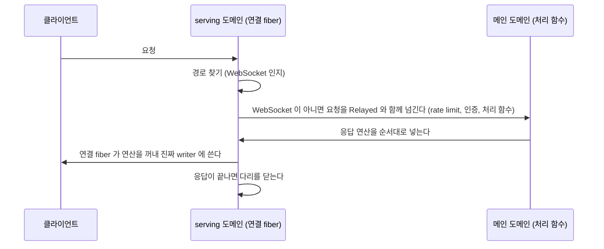

# RFC — HTTP 전송은 자기 도메인에서 돌고, 경로마다 어느 도메인에서 도는지 적는다

## 0. 요약

서버는 HTTP 연결과 Keeper 턴을 도메인 하나(메인)에서 같이 돌린다. Keeper 쪽 fiber 가 양보 없이 계산하면 그동안 모든 연결이 멈춘다. 2026-11-10 운영 서버에서 그 시간은 한 번에 최대 6.7초였다.

이 RFC 는 둘을 나눈다.

- 연결을 받고, 요청을 읽고, 응답과 SSE 프레임을 쓰는 일은 serving 도메인이 한다.
- 경로마다 "어느 도메인에서 도는가"를 타입으로 적는다. `Owner` 는 메인 도메인으로 건너가서 돌고, `Serving` 은 serving 도메인에서 바로 돈다.
- 모든 경로는 `Owner` 로 시작한다. 도메인을 가리지 않는 값만 읽는다고 확인한 경로만 `Serving` 으로 옮긴다. 확인은 OCaml 의 ThreadSanitizer 빌드로 한다.

목표는 평상 부하에서 serving 도메인의 scheduler lag p99 1 ms 이하, 최대 10 ms 이하다.

## 1. 문제

### 1.1 잰 것

운영 서버 pid 29957, build `227056a94eed`, 16코어, 2026-11-10 17:14~18:13 KST. 측정 중 load1 은 92~273 이었다. 원본은 `artifacts/server-main-domain-stall-20261110/README.md` 에 있고 저장소에는 올리지 않았다.

| 값 | load1 92 | load1 197~214 |
|---|---|---|
| 메인 도메인 scheduler lag p50 | 1.4 ms | 19.6~29.1 ms |
| p99 | 332 ms | 470~495 ms |
| max | 1,999 ms | 955~3,525 ms |
| 도메인 0 점유 | 51.2% | 69.8~78.1% |
| 100 ms 넘게 양보 없이 돈 fiber 실행 (60~90초) | 29번 | 31~66번 |

가장 긴 실행은 Keeper 하나의 Librarian durable round 였다(1.7~2.1초, load 214 에서 6.7초, #51050). 그 round 가 없는 60초 창에서도 100 ms 넘는 실행이 66번 있었다. 이름이 붙는 것은 도구 호출 장부 행 만들기(36번, 합 2.9초), Keeper 프로필을 읽은 뒤의 계산(26번, 합 3.1초), 7.2 MB Task 보관 파일 파싱(302 ms)이다. 모두 Keeper 턴 fiber 가 한 일이다.

### 1.2 왜 하나씩 옮기는 것으로 끝나지 않는가

2026-09-05 부터 메인 도메인의 계산을 하나씩 pool 로 옮겨 왔다([RFC-main-domain-scheduler-latency](RFC-main-domain-scheduler-latency.md) P4g~P4v). 그때 기준선은 도메인 0 점유 11.2%, 최장 229 ms 였다. 두 달 뒤 값은 위 표다. Keeper 쪽 코드가 늘 때마다 새 계산이 메인 도메인에 들어온다. 연결이 Keeper 와 같은 스케줄러를 쓰는 한, 연결의 지연은 Keeper 코드 전체의 가장 긴 실행을 따라간다.

### 1.3 이미 있는 스위치는 MCP 를 못 연다

`MASC_SERVING_DOMAIN_ENABLED=true` 는 accept loop 와 핸들러를 통째로 다른 도메인에서 돌린다(`lib/server/server_runtime_bootstrap.ml`). 기본값은 `false` 이고 운영 서버에도 없다.

2026-11-10 에 설치본(`227056a94eed`)을 이 값으로 빈 workspace 에 띄워 봤다.

| 요청 | 결과 |
|---|---|
| `GET /health?full=1` | 200 |
| `GET /api/v1/gate/keepers`, `keepers/turns`, `operator`, `keepers/asks`, `board` (토큰 있음) | 200 |
| `POST /mcp` `initialize` | 500 `Invalid_argument("Switch accessed from wrong domain!")` |
| `GET /mcp` (SSE) | 404, 세션이 만들어지지 않았다 |

핸들러가 메인 도메인에서 만든 switch 로 fiber 를 띄운다. Eio 는 다른 도메인의 switch 에 fork 하면 예외를 낸다. #48907 은 SSE 에서 같은 일을 예상했다. 실제로는 그 앞의 `initialize` 에서 막힌다.

`lib` 에는 `Fiber.fork ~sw` 가 193곳 있고 그중 48곳이 `lib/server` 다. 핸들러를 통째로 옮기는 방식은 이 전부와, 핸들러가 읽는 모든 가변 상태가 도메인을 가리지 않아야 성립한다.

## 2. 공식 문서가 정한 것

2026-11-10 에 읽었다.

- OCaml 매뉴얼 Parallel programming: "It is recommended that programs do not spawn more domains than the number of available cores." minor heap 은 한 도메인이 다 쓰면 stop-the-world 로 모든 도메인이 같이 모은다.
- `Domain.recommended_domain_count`: 동시에 도는 도메인 수의 권장 최대값이다. 이미 도는 도메인을 포함한다.
- Eio `Executor_pool`: 도메인 합계가 `Domain.recommended_domain_count` 를 넘지 않게 하고, 원래 도메인이 CPU 일을 하면 하나 줄인다.
- Eio `Net.run_server`: 여러 도메인에서 accept loop 를 돌리면 "you must ensure that `connection_handler` only accesses thread-safe values." CPU 가 병목인 서비스는 accept loop 하나를 두고 핸들러가 CPU 일을 `Executor_pool` 에 낸다.
- Eio README: Promise, Stream, Mutex, Semaphore 는 도메인 사이에서 써도 된다. `Domain_manager.run` 에 넘기는 함수는 thread-safe 하지 않은 값에 닿으면 안 되고, "The type system does not check this."
- OCaml 매뉴얼 ThreadSanitizer: 실행 중에 일어난 data race 를 찾는다. OCaml 코드끼리의 race 는 false positive 가 없다. macOS arm64 를 지원한다. 2~7배 느려지고 메모리를 4~7배 쓴다.

여기서 나오는 것은 셋이다.

1. 도메인 수. 서버는 `Domain_budget`(RFC-0474 L1)이 프로세스 전체를 `recommended - 1` 로 묶는다. serving 도메인은 그 예산의 `fixed` 에 이미 들어 있어서, 켜면 shared pool 이 하나 준다. 서버의 도메인 수는 문서와 맞고 이 RFC 는 늘리지 않는다. TUI 는 16코어에서 16개를 띄워 하나 많다(#49274).
2. 핸들러를 다른 도메인에서 돌리려면 핸들러가 닿는 값이 thread-safe 하다는 것을 사람이 보장해야 한다. 타입 검사기는 봐 주지 않는다.
3. 그 보장을 확인하는 공식 도구는 ThreadSanitizer 다.

## 3. 설계

### 3.1 두 도메인이 맡는 일

| 일 | serving 도메인 | 메인(owner) 도메인 |
|---|---|---|
| listener, accept, TLS, ALPN | 한다 | 안 한다 |
| HTTP/1.1·HTTP/2 파싱, 요청 본문 읽기 | 한다 | 안 한다 |
| 응답 헤더와 본문, SSE 프레임, WebSocket 프레임 쓰기 | 한다 | 안 한다 |
| keepalive 타이머, 연결별 정체 감시(RFC-0518) | 한다 | 안 한다 |
| rate limit, origin·버전 검사, workspace 전제 검사(`Server_http_ingress.admitted`) | 한다 | 안 한다 |
| 인증(`Server_auth.with_*`). 처리 함수를 감싸므로 경로를 따라간다 | `Serving` 경로만 | `Owner` 경로 |
| `Serving` 경로의 처리 함수 | 한다 | 안 한다 |
| `Owner` 경로의 처리 함수 | 안 한다 | 한다 |
| Keeper 턴, MCP 도구 실행, lane, Librarian | 안 한다 | 한다 |

응답을 쓰는 fiber 는 연결마다 하나고 연결의 도메인에 있다. RFC-0493 §3.1 이 정한 그대로다. httpun 과 h2 의 writer 는 도메인 사이에서 안전하지 않다.

### 3.2 경로가 도는 곳은 타입이다

지금 경로의 대상은 둘이다(`lib/http_server_eio.mli`).

```ocaml
type route_target =
  | Plain of request_handler
  | Ws of ws_handler
```

`Plain` 을 둘로 나눈다.

```ocaml
type route_target =
  | Owner of request_handler    (* 메인 도메인에서 돈다 *)
  | Serving of request_handler  (* 연결의 도메인에서 돈다 *)
  | Ws of ws_handler
```

- `Server_route.get`, `post`, `add`, `prefix_*` 는 `Owner` 를 만든다. 등록 407곳은 고치지 않는다.
- `Server_route.Serving.get` 등이 `Serving` 을 만든다. 3.4 의 조건을 통과한 경로만 이쪽으로 옮긴다.
- `Server_http_ingress.dispatch_route` 가 이 타입을 빠짐없이 가른다. 새 대상이 생기면 컴파일러가 빠진 갈래를 잡는다.

serving 도메인이 꺼져 있으면 연결의 도메인이 메인이다. `Owner` 와 `Serving` 은 같은 곳에서 돌고 지금과 같다.

타입은 첫 `Serving` 경로가 생기는 L4 에서 나눈다. 그 전에는 `Plain` 이 전부 `Owner` 처럼 돈다. 만드는 곳이 없는 생성자를 먼저 넣지 않는다.

### 3.3 Owner 경로: 응답 다리

처리 함수는 응답을 돌려주지 않고 `Http_reqd.t` 에 직접 쓴다(`lib/http_reqd.mli`). 메인 도메인의 처리 함수가 serving 도메인의 writer 를 건드리면 안 되므로, `Owner` 경로의 처리 함수는 진짜 `Http_reqd.t` 대신 다리를 받는다.

`Http_reqd.t` 에 세 번째 생성자를 둔다.

```ocaml
type t =
  | Http1 of { ... }
  | Http2 of { ... }
  | Relayed of relay   (* 다른 도메인의 Http1·Http2 로 가는 다리 *)
```

요청 하나의 흐름은 이렇다.



- 요청마다 연산 큐 하나(`Domain_mailbox`)와 그 큐를 도는 fiber 하나를 만든다. fiber 는 HTTP/2 에서는 stream 의 switch, HTTP/1.1 에서는 연결의 switch 에 띄운다. 연산은 넣은 순서대로 나온다.
- 처리 함수는 `Eio_context.run_on_owner_domain` 과 같은 길(`dispatch_stream`)로 메인 도메인에 넘어간다. 메인 도메인의 root switch 아래 fiber 에서 돈다. 그래서 처리 함수 안의 `Fiber.fork ~sw:state.sw` 는 지금처럼 된다. §1.3 의 `initialize` 500 이 여기서 없어진다.
- 그 fiber 가 큐에서 연산을 꺼내 진짜 `Http_reqd.t` 에 쓴다. 응답이 끝나면(문자열 응답을 썼거나, 본문을 닫았거나, transport 가 닫혔으면) 큐를 닫는다. switch 가 먼저 끝나도 닫는다.
- 큐가 닫힌 뒤의 연산은 끝난 요청이 하는 대로 답한다. 응답은 거절되고, 스트리밍은 닫힌 writer 를 받고, `flush` 는 `` `Closed `` 다. 넣은 연산은 처리되거나 이렇게 답을 받거나 둘 중 하나라서, 답을 기다리는 처리 함수가 남지 않는다.

`Http_reqd` 의 함수마다 `Relayed` 가 하는 일이다.

| 함수 | `Relayed` 에서 | 기다리는가 |
|---|---|---|
| `request`, `protocol` | 넘어올 때 복사한 값을 돌려준다 | 아니오 |
| `upgrade` | `None`. WebSocket 경로는 `Ws` 대상이고 다리를 타지 않는다 | 아니오 |
| `read_body` | 연결 fiber 가 본문을 다 읽어 한 번에 넘긴다. `on_body`, `on_error` 는 메인 도메인에서 돈다 | 콜백 |
| `try_respond_with_string` | 연산을 넣고 연결 fiber 가 돌려주는 `acceptance` 를 기다린다 | 예 |
| `respond_with_streaming` | 연산을 넣고 시작 결과를 기다린다. transport 가 던진 예외는 메인 도메인에서 다시 던진다 | 예 |
| `Body_writer.write_string`, `close` | 연산을 넣고 돌아온다 | 아니오 |
| `Body_writer.flush f` | 연산을 넣는다. 연결 fiber 가 진짜 flush 의 결과를 메인 도메인으로 보내고 `f` 는 거기서 돈다 | 콜백 |
| `Body_writer.is_closed` | 연결 fiber 가 닫힘을 알릴 때 고치는 `Atomic` 을 읽는다. 닫힌 직후 한동안 `false` 일 수 있다 | 아니오 |
| `Body_writer.stream_end` | 진짜 writer 의 것을 그대로 준다. HTTP/2 는 stream 의 switch 가 끝날 때 resolve 되는 promise 이고 HTTP/1.1 은 지금처럼 `None` 이다. `Eio.Promise` 는 도메인 사이에서 써도 된다 | 아니오 |
| `response_state` | 연결 fiber 에 물어본다 | 예 |
| `report_exn` | 연산을 넣는다 | 아니오 |

`write_string` 은 지금도 기다리지 않는다. HTTP/2 에서는 ledger 에 자리가 없으면 stream 을 reset 하고 writer 를 닫는다. 다리에서는 그 판단이 연결 fiber 가 연산을 꺼낼 때 일어난다. 메인 도메인은 그 뒤의 `flush` 가 `` `Closed `` 로 답하거나 `is_closed` 가 `true` 가 될 때 안다. 지금도 처리 함수는 닫힘을 이 두 길로만 안다.

`Owner` 경로의 응답 시간은 여전히 메인 도메인을 따라간다. 메인 도메인이 400 ms 를 혼자 돌면 그 요청은 400 ms 늦는다. 달라지는 것은 그동안 다른 연결이 멈추지 않는다는 점이다. accept, TLS, 다른 요청의 본문 읽기, 이미 열린 SSE 의 프레임과 keepalive, `Serving` 경로가 계속 돈다.

### 3.4 Serving 경로의 조건

`Serving` 경로의 처리 함수는 Keeper 턴과 동시에 다른 도메인에서 돈다. Eio 문서의 조건 그대로, 닿는 값이 전부 thread-safe 해야 한다.

닿아도 되는 것:

- 바뀌지 않는 값, `Atomic`, `Stdlib.Mutex` 로 지키는 표
- `Eio.Promise`, `Eio.Stream`, `Eio.Mutex`, `Eio.Semaphore`
- `Domain_pool_ref.submit_*` 로 내는 pool 작업과 그 결과
- 자기 연결의 switch 에 띄우는 fiber

닿으면 안 되는 것:

- 메인 도메인의 switch 에 `Fiber.fork`. Eio 가 `Invalid_argument` 를 던진다
- lock 없는 `Hashtbl`, `ref`, `mutable` 필드, `Lazy`
- `Eio_context.run_on_owner_domain` 을 요청마다 부르는 것. 그럴 경로는 `Owner` 다

경로를 `Serving` 으로 옮기는 PR 은 둘을 낸다.

1. 처리 함수가 닿는 모듈 수준 상태의 목록과, 각각이 위 어느 줄에 해당하는지.
2. ThreadSanitizer 빌드에서 그 경로에 요청을 되풀이하는 동안 Keeper 턴을 돌린 실행의 보고. 그 경로의 프레임이 든 race 가 0건이어야 한다.

2026-11-10 조사에서 `/health`, `/api/v1/gate/keepers`, `/api/v1/operator`, `/api/v1/board`, `/api/v1/keepers/turns`, `/api/v1/keepers/asks` 여섯 경로는 lock 없는 모듈 수준 상태를 읽지 않았다. 다만 `Keeper_meta_store.keeper_names_result`, operator snapshot 계산, `Server_keeper_waiting_inventory`, `Server_auth.with_*` 안쪽은 끝까지 읽지 않았다. 이 여섯이 첫 후보고, 위 두 가지를 낸 뒤 옮긴다.

### 3.5 스트리밍

SSE 는 RFC-0493 의 모양을 그대로 쓴다. 만드는 쪽은 큐에 넣고 바로 돌아간다. 큐를 비워 writer 에 쓰는 pump 는 연결의 도메인에 있다.

지금 코드는 pump 를 메인 도메인의 switch 에 띄운다. serving 도메인을 켜면 RFC-0493 §3.2 의 "처리 함수가 연결의 도메인에서 이 fiber 를 띄운다"와 어긋난다.

| endpoint | 지금 pump·fiber 를 띄우는 switch | 바꿀 것 |
|---|---|---|
| `GET /mcp`, `/sse`, observer | `runtime.sw` (메인) | 연결의 switch |
| `/ag-ui/events`, `/events/presence` | `runtime.sw` (메인) | 연결의 switch |
| `POST /mcp` `tools/call` 의 SSE 응답과 keepalive | 요청 fiber 와 `runtime.sw` | `Owner` 경로로 두고 3.3 의 다리로 쓴다. keepalive 는 연결 fiber 가 낸다 |
| `POST /mcp` `subscriptions/listen` | 요청 처리 fiber 안의 `Switch.run` | `Owner` 경로, 다리 |
| artifact draft live | `state.sw` (메인) | 연결의 switch |
| fleet, Keeper chat, log, exec output | `make_routes ~sw` 로 받은 switch. 스위치를 켜면 serving 도메인의 것이 온다 | `Owner` 경로이므로 메인의 switch 를 넘긴다. 쓰기는 다리 |

`Serving` 경로는 switch 를 인자로 받지 않는다. 연결 fiber 에 묶인 switch(`Eio_context.with_turn_switch`)를 쓴다.

`GET /mcp` 같은 경로는 "세션을 등록한다"와 "프레임을 쓴다"가 한 처리 함수에 있다. 등록은 메인 도메인의 상태를 고치고, 쓰기는 연결의 도메인 일이다. 이런 경로는 `Owner` 로 두고 다리로 쓰게 하면 처리 함수를 안 고쳐도 맞다. 프레임마다 도메인을 한 번 건넌다. 프레임이 많은 경로는 나중에 등록만 메인에 맡기고 pump 를 연결의 switch 로 옮긴다.

### 3.6 WebSocket

`/ws` 는 `Sse.subscribe_external` 의 콜백 안에서 `Ws_wsd.send_text_bigstring` 을 부른다. 콜백은 broadcast 를 부른 쪽의 도메인에서 돈다. serving 도메인을 켜면 메인 도메인이 연결의 writer 에 직접 쓴다. `Stdlib.Mutex` 로 순서는 지키지만, gluten writer 가 다른 도메인의 쓰기를 견디는지는 확인하지 못했다.

SSE 와 같게 맞춘다. 콜백은 연결의 큐에 넣기만 하고, 연결의 도메인에 있는 pump 가 `Ws_wsd` 에 쓴다. inbound 메시지 처리(`server_runtime_bootstrap.ml` 의 `Fiber.fork ~sw`)는 `run_on_owner_domain` 으로 메인에 넘긴다.

### 3.7 취소와 실패

- 클라이언트가 끊으면 연결 쪽 switch 가 끝난다. 다리 fiber 가 큐를 닫고 닫힘 `Atomic` 을 고친다. HTTP/2 는 `stream_end` 도 resolve 된다. 처리 함수는 지금처럼 `flush` 의 `` `Closed `` 나 `stream_end` 로 알고 멈춘다.
- 메인 도메인의 처리 함수 fiber 를 연결 쪽에서 취소하지 않는다. `POST /mcp` 는 지금도 클라이언트가 끊겨도 도구 호출을 끝까지 돌리려고 root switch 에 fiber 를 띄운다. 그 성질을 지킨다.
- 처리 함수가 예외로 끝나면 지금과 같다. 응답 전이면 500, 스트리밍 중이면 `report_exn` 이다. 그 판단은 연결 fiber 가 진짜 `response_state` 로 한다.
- 메인 도메인으로 넘기는 큐(`dispatch_stream`)에는 상한이 없다. 넘기는 쪽은 기다리지 않는다. 연결 fiber 는 정리 중에도(취소를 막은 채로) `flush` 답을 넘기는데, 메인이 더 꺼내지 않는 종료 때 여기서 기다리면 serving 도메인이 끝나지 않는다.
- 메인으로 넘긴 일의 예외는 그 큐가 버린다. 처리 함수의 예외는 ingress 가 지금처럼 500 이나 `report_exn` 으로 바꾸고, 본문·flush 콜백의 예외는 ingress 가 로그로 남긴다.

### 3.8 도메인 수

늘리지 않는다. §2 의 1번대로 serving 도메인은 `Domain_budget` 의 `fixed` 에 이미 들어 있다. 켜면 shared pool worker 가 하나 준다.

## 4. 이 RFC 가 못 줄이는 것: GC 정지

OCaml 5 의 minor GC 는 모든 도메인을 같이 세운다. serving 도메인도 선다. 도메인을 나눠도 이 정지는 그대로다.

| 값 | 2026-09-05 | 2026-11-10 (load1 약 200) |
|---|---|---|
| minor GC 한 번에 도메인이 leave barrier 에서 기다린 평균 | 1.3 ms | 29.4 ms |
| 도메인당 minor GC | — | 30초에 80회 |

평상 부하에서 정지가 9월 값(1.3 ms)이고 초당 2.7회면, serving 도메인은 시간의 약 0.35% 를 정지 안에 있다. 그러면 lag p99 는 정지에 걸리지 않고, max 는 가장 긴 정지를 따라간다. 목표(p99 1 ms, max 10 ms)는 가장 긴 GC 정지가 10 ms 아래일 때만 선다.

이 값은 호스트 부하에 크게 움직인다. 11월 값은 다른 세션의 빌드와 시험이 같이 돌던 때의 것이다. 평상 부하(load 20 이하) 값은 아직 재지 못했다.

할당을 줄이면 minor GC 가 준다. 같은 날 Memprof 표를 6분 간격으로 두 번 읽은 차이(365초, load1 약 160)에서 서버는 초당 917 MB 를 할당했고 초당 441 MB 가 major heap 에 닿았다. 할당의 35%, major heap 에 닿은 양의 56% 가 이미 인코딩한 checkpoint 메시지를 다시 인코딩한 것이었고 #51077 이 그것을 없앤다. GC 정지는 이 RFC 밖에서 따로 줄인다(RFC-0474).

평상 부하에서도 가장 긴 정지가 10 ms 를 넘으면, 한 프로세스 안에서는 목표에 닿지 못한다. 그때 남는 방법은 §7 의 프로세스 분리다.

## 5. 측정과 통과 기준

코드를 쓰기 전에 기준을 고정한다. 아래는 이 RFC 의 구현 PR 이 고치지 못하는 평가다.

**E1. serving 도메인을 켠 서버가 MCP 를 연다.** 빈 workspace 에 서버를 띄우고 요청을 보낸다.

| 요청 | 통과 |
|---|---|
| `GET /health?full=1` | 200 |
| `POST /mcp` `initialize` | 200, `serverInfo` 가 있다 |
| `POST /mcp` `tools/list` | 200, 도구가 하나 이상 |
| `POST /mcp` `tools/call` (`masc_status`) | 200 또는 SSE 로 결과 하나 |
| `GET /mcp` (SSE) 를 연 뒤 broadcast 하나 | 그 프레임이 온다 |
| `GET /ws` 를 연 뒤 broadcast 하나 | 그 프레임이 온다 |

2026-11-10 의 설치본은 둘째 줄에서 500 이다(§1.3).

**E2. 메인 도메인이 멈춰도 serving 경로는 답한다.** 시험 전용 진입점으로 메인 도메인에 양보 없는 500 ms 계산을 넣고, 그동안 `Serving` 경로에 요청 20개를 보낸다. 20개 모두 50 ms 안에 답해야 한다. 같은 시험에서 `Owner` 경로 요청은 계산이 끝난 뒤에 답한다. serving 도메인을 끄면 `Serving` 경로도 500 ms 뒤에 답한다. 이 차이가 이 RFC 의 효과다.

**E3. serving 도메인의 scheduler lag.** `Scheduler_lag` 을 serving 도메인에 하나 더 띄우고 `/health?full=1` 에 `scheduler.serving_lag` 으로 낸다. 운영 서버에서 평상 부하(load1 20 이하) 10분 동안 p99 1 ms 이하, max 10 ms 이하. 넘으면 그 창의 GC 정지 값을 같이 적는다(§4).

**E4. race 0건.** ThreadSanitizer 빌드로 E1 을 돌린다. `Serving` 경로와 다리(`Http_reqd` 의 `Relayed`, 연산 큐)의 프레임이 든 race 보고가 0건이어야 한다. TSan 빌드는 2~7배 느리고 메모리를 4~7배 쓰므로 PR 마다 돌리지 않고 `main` 에서 정기적으로 돌린다.

## 6. 단계

각 단계는 그 자체로 병합할 수 있고, serving 도메인을 끈 서버의 동작을 바꾸지 않는다.

| 단계 | 하는 일 | 확인 |
|---|---|---|
| L1 | `Http_reqd.Relayed` 와 연산 큐(`Domain_mailbox`). ingress 가 WebSocket 이 아닌 요청을 인증·rate limit 까지 통째로 메인으로 넘긴다. 타입은 아직 나누지 않는다 | 도메인 둘에서 도는 `Http_reqd` 시험, E1 의 `health`, `initialize`, `tools/list`, `tools/call` |
| L2 | `GET /mcp`, ag-ui, presence, artifact draft 가 다리로 쓰는지 E1 로 확인하고, 처리 함수 밖에서 메인 switch 를 쓰는 곳을 고친다 | E1 의 SSE 줄 |
| L3 | WebSocket 을 큐와 pump 로 | E1 의 `/ws` 줄 |
| L4 | `scheduler.serving_lag`. `route_target` 을 `Owner`·`Serving`·`Ws` 로 나누고 첫 `Serving` 경로 여섯을 옮긴다 | E2, E3 |
| L5 | TSan workflow | E4 |
| L6 | 운영 서버에서 켜고 일주일 본 뒤 기본값으로 한다. `MASC_SERVING_DOMAIN_ENABLED` 와 끈 쪽 갈래를 지운다 | E3 |

L6 뒤에는 대시보드 읽기 경로를 하나씩 `Serving` 으로 옮긴다. 옮길 때마다 3.4 의 두 가지를 낸다.

## 7. 다른 방법

**메인 도메인의 계산을 하나씩 pool 로 옮기기만 한다.** 고칠 때마다 그 계산의 정지는 없어진다. 단점은 §1.2 다. 두 달 사이 점유가 11% 에서 51~78% 로 돌아왔다. 이 일은 계속하되, 연결을 지키는 방법으로는 모자란다.

**처리 함수를 전부 serving 도메인에서 돌린다(지금의 스위치).** 도메인을 건너는 비용이 없다. 단점은 처리 함수가 닿는 모든 상태가 thread-safe 해야 한다는 것이다. `lib/server` 에만 메인 switch 로 가는 fork 가 48곳이고, MCP 도구 실행은 Keeper runtime 전체에 닿는다. 타입 검사기가 봐 주지 않으므로 빠뜨린 곳은 운영에서 드러난다. #33351 이 기본값을 켰다가 12분 뒤 #33353 이 껐다.

**HTTP 를 다른 프로세스로 뗀다.** heap 이 따로라서 GC 정지도 따로다. §4 의 한계가 없다. 단점은 MCP 호출, 인증, SSE 구독을 프로세스 사이 통신으로 다시 만들어야 하고, 프로세스 둘의 기동·종료·배포 순서가 생긴다는 것이다. E3 이 GC 정지 때문에 통과하지 못할 때 다시 본다. 이 RFC 의 `Owner`/`Serving` 구분과 연산 큐는 그때 프로세스 경계로 옮겨도 모양이 같다.

**연결의 도메인을 여럿 둔다.** Eio `Net.run_server` 의 `additional_domains` 다. 연결 처리가 CPU 병목일 때 쓴다. 지금 병목은 메인 도메인이고, 도메인 예산도 남지 않는다. 하지 않는다.

## 8. 열린 질문

- `Ws_wsd`(gluten) writer 가 mutex 로 순서만 지키면 다른 도메인의 쓰기를 견디는가. L3 은 견디지 않는다고 보고 설계했다.
- `Server_auth.with_*` 가 읽는 상태가 전부 thread-safe 한가. `Serving` 경로에서는 인증이 serving 도메인에서 돈다. #33353 이 `Eio.Mutex` 를 `Stdlib.Mutex` 로 바꿨지만 전체를 다시 읽지 않았다. L4 에서 읽고 E4 로 확인한다.
- `Server_http_ingress.admitted` 의 rate limit 과 workspace 전제 검사가 읽는 상태. L1 은 `admitted` 를 통째로 메인에서 돌려서 이 질문을 미뤘다. `Serving` 경로가 생기는 L4 에서 읽는다.
- 메인으로 넘기는 큐(`dispatch_stream`)는 L1 에서 상한을 없앴다. 연결 쪽이 정리 중에 넘길 때 기다리면 종료가 걸리기 때문이다. 요청 수는 연결과 stream 수가 묶는다. L4 에서 큐 길이를 잰다.
- 평상 부하의 GC 정지 값(§4).
