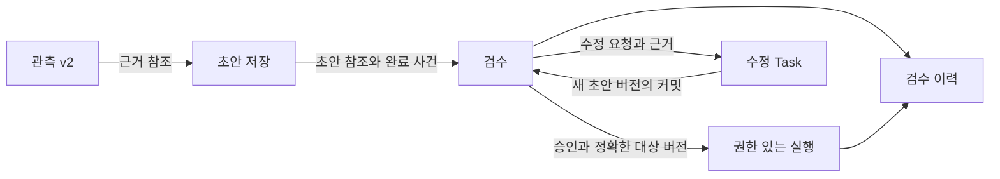

# Lane 패치의 포트, 시간, 피드백

## 초록

WKBL 경기 기록에 정정이 들어오면, 그 기록을 읽은 기사와 경기 카드를 찾아 필요한 검수만 다시 해야 한다. gayo.yoga 출시 후보의 연관 포즈가 바뀌었을 때도 같은 인계 문제가 생긴다. 반품 응대에서는 고객 답변 주체와 물류 확인 주체가 서로 다른 상태에서 같은 건을 이어받는다.

모듈러 신스의 패치에서 세 가지를 가져온다. **이름 있는 In/Out**, **값과 실행 시점을 전달하는 별도의 출력**, **완료된 결과가 다시 입력이 되는 피드백**이다. MASC의 관측 연결은 현재와 같이 비순환으로 유지한다. 피드백은 검수에서 수정으로, 수정에서 새 검수로 이어지는 건별 상태 전이로 표현한다. 각 전이는 정확한 입력 버전과 원인 사건을 남긴다. 이를 바탕으로 다음 Keeper가 건을 이어받고, 운영자가 영향 범위를 살펴보고, 시뮬레이터가 외부 실행 없이 같은 기록을 재생할 수 있는지 검증한다.

결정 요청은 **기존 Lane의 명명된 출력을 사용해 두 서비스에서 같은 검수·인계 계약을 시험할 것인가**다. 포트의 wire 형식과 저장소 선택은 이 실험에서 확인할 설계 항목이다.

## 1. 연구 질문과 범위

1. **결합성** — 서비스별 입력과 실행 권한을 유지하면서 공통 검수·인계 모듈을 교체하거나 재사용할 수 있는가.
2. **시간과 인과** — 주기, 새 입력, 수정 완료가 각각 언제 실행을 열어야 하는가. 늦은 원본과 오래된 완료 신호를 어떻게 식별하는가.
3. **지속성** — 모델 호출, 네트워크, Keeper 교체, 서버 재시작 사이에서 무엇을 한 번만 반영할 수 있는가.
4. **가치** — 출처가 정정됐을 때 관련 없는 재작업, 인계에 드는 조회, 잘못된 자동 처리가 줄어드는가.

선행 연구는 전기적 패칭, 이산사건 시간, 반복 데이터플로, 근거 이력, 외부 실행 복구를 질문별로 목적 표집했다. 논문은 저자·학회가 공개한 원문을, 제품 동작은 제조사 매뉴얼을, 상호운용 규칙은 공식 규격을 읽었다. 각 출처가 성립시키는 조건과 이 RFC에서 새로 정해야 하는 규칙을 구분한다. 논문 결과의 수치나 시스템 보장을 MASC의 실측으로 인용하지 않는다. 이 조사는 체계적 문헌고찰에 필요한 포괄 검색과 독립 선별을 수행하지 않았다.

## 2. 선행 연구에서 가져올 것

| 근거 | 원문에서 다루는 문제 | MASC 설계에 쓰는 지점 |
| --- | --- | --- |
| Doepfer A-100, VCV Rack, Make Noise MATHS | 한 출력을 여러 입력으로 배선한다. MATHS는 곡선 값과 상승·사이클 종료 신호를 별도로 낸다. | 같은 근거를 편집과 웹에 각각 연결한다. 완료 신호는 쓰기 완료 후에 생기며, 어떤 출력을 읽을지 가리킨다. 포트 호환성은 신호 이름과 데이터 계약으로 판단한다. |
| Lee와 Sangiovanni-Vincentelli (1998), Ptolemy II §7.1 | 사건에 태그를 붙여 합성한다. DE 모델은 모델 시간과 microstep을 써서 같은 시간에 연쇄하는 사건을 구별한다. | 시뮬레이션에서 같은 시각의 입력 → 관측 저장 → 검수 시작을 순서 있게 재생한다. 실운영은 저장 순서와 명시된 인과 링크를 사용한다. |
| Chow와 Zeigler (1994), Parallel DEVS | 내부에서 예약한 전이와 외부 입력이 같은 시각에 만나면, 충돌 전이를 별도로 모델링할 수 있다. | 정기 실행과 정정이 같은 가상 시각에 오면 두 순서와 충돌 규칙을 시험한다. 이 RFC의 모형은 DEVS의 합성 규칙 전체를 요구하지 않는다. |
| Lamport (1978), 「The Partial Ordering」 | 메시지와 프로세스 내 순서가 사건 간 선후 관계를 만든다. 물리 시각이나 임의의 총순서에는 다른 의미가 있다. | 경기 시각, MASC 수신 시각, 저장 위치, 선행 사건을 따로 기록한다. 다른 소스의 시간값만으로 의존성을 추론하지 않는다. |
| Akidau 외 (2015), §2.1–2.4 | 자료가 발생한 시간과 시스템이 처리하는 시간이 어긋나며, 언제 결과를 낼지는 별도 문제다. | 늦은 정정을 새 버전으로 처리한다. 배치 마감이나 스트림의 진행 표시와 서비스가 선언한 ‘확정’을 구별한다. |
| Murray 외 (2013), §2 | Naiad는 구조화된 피드백과 반복 좌표를 사용하고, 진행 추적으로 특정 시간에 대한 추가 입력 여부를 다룬다. | 루프를 통과하려면 식별 가능한 다음 상태가 필요하다. 이 RFC는 건별 전이만 다루며 분산 진행 추적이나 반복 좌표 전파는 성능 증거가 생길 때 검토한다. |
| CloudEvents 1.0.2, W3C PROV-DM §5.1–5.3 | 전자는 사건 식별에 생산 맥락과 ID를 쓴다. 후자는 산출물, 활동, 책임 주체와 파생·수정 관계를 모델링한다. | 이벤트 중복 제거, 근거 버전, 실행 주체를 각각 식별한다. 결과는 입력 참조와 생산 실행을 남긴다. |
| Helland (2007), 「Retries and Idempotence」, Temporal Activity Definition | 메시지 재전달과 외부 실행 재시도에서 멱등성을 다룬다. Temporal에서는 완료 기록이 한 번 관측되어도 Activity 자체는 여러 번 수행될 수 있다. | 내부 전이의 원자적 반영과 외부 적용 확인을 따로 설계한다. 응답 유실은 대상 확인이 필요한 상태로 보존한다. |

문헌의 결론을 적용할 범위가 다르다. 신스의 연속 피드백은 전압과 회로의 물리적 특성에 의존한다. 이 RFC는 커밋한 결과와 사건을 그다음 작업에 전달하는 모델을 택한다. Ptolemy의 microstep은 시뮬레이터의 표기다. Naiad의 진행 보장과 Temporal의 복구 방식은 해당 엔진과 계약 안에서 성립한다. 각 출처의 위치는 [참고 문헌](#10-참고-문헌)에 정리했다.

## 3. 현재 MASC에서 쓸 수 있는 것

조사 기준은 `0755777b6cd0cf3259df7ff33ec65c05b21c5c27`이다.

| 현재 동작 | 이 RFC에서 사용할 범위 |
| --- | --- |
| `world.outputs`는 패키지의 이름 있는 출력과 포함할 Lane을 선언한다. `lane_output`은 같은 run의 설치 ID, 출력 이름, `latest_completed`를 사용해 읽는다. 캡처는 적용된 패키지·설정·인스턴스·순번과 근거를 보존한다. | 최신 관측에는 기존 연결을 사용한다. 검수와 인계는 보존된 캡처를 정확한 참조로 다시 읽는다. [출력 포트](../guides/lane-output-ports.md) · [출력 연결](../guides/lane-output-composition.md) |
| 생산자 출력 커밋으로 직접 소비자가 깨어난다. 알림은 합쳐질 수 있다. 각 입력은 개별 시점에 캡처되고, 이름 있는 출력도 생산자 전체의 커버리지를 전달한다. 관측 연결의 순환은 거절한다. | 기존 자동 갱신은 최신 관측을 보는 데 사용한다. 실행 근거가 되는 완료 사건은 유실 없이 다시 읽을 수 있는 기록이 필요하다. 입력 여러 개의 원자성이나 포트별 완전성은 별도의 근거가 있을 때만 주장한다. [갱신 규칙](../guides/lane-addon-refresh.md) |
| Keeper의 Lane 구독은 턴에 새 관측의 참조를 넣는다. 읽기와 명시적 확인이 각각 기록되며, 구독 자체로 턴을 시작하지 않는다. | 기존 참조 전달을 인계에 사용한다. 읽었다는 기록과 실제 판단에서 근거를 사용했다는 기록은 각각 확인한다. [Keeper 구독](../guides/lane-subscriptions.md) |
| 입력 바인딩은 스키마를 선언할 수 있다. 패키지는 `host_process`로 MCP stdio 프로그램을 실행할 수 있다. 행 동작은 기존 `lane_act` 검증과 권한을 거친다. | 로컬 실험은 호스트 실행을 사용한다. 화면과 포트가 보여 주는 정보에서 도구 호출 또는 실행 권한을 파생하지 않는다. [패키지 인터페이스](../guides/lane-addon-interface.md) · [TOML 계약](../guides/lane-addon-toml.md) |
| `lane_act`의 영수증은 입력과 요청 ID, 실행 위치, 패키지 보고를 보존한다. 작업 중단으로 결과를 알 수 없으면 `outcome_unknown`으로 남긴다. | 실행 추적에 재사용한다. 외부 목적지 확인은 해당 서비스의 읽기 증거를 사용한다. [Lane 실행 영수증](../guides/lane-world-actions.md) |
| Task claim, 검증과 Goal 완료는 각 소유 경로가 있다. 변경 복구 로드맵은 외부 적용 직후에 결과 기록이 빠지는 경우를 검증 대상으로 둔다. | 패치에서 Task 상태를 직접 쓰거나 승인 권한을 만들지 않는다. 외부 실행은 기존 권한과 복구 경로에 위임한다. [도메인 계약](../constitution.xml) · [변경 복구 로드맵](../RELIABLE-CHANGE-ROADMAP.md) |

기존 패키지와 시나리오가 이 제안의 성능을 증명하지는 않는다. 탐색 실험에서는 과거 WKBL 경기의 두 Lane 출력을 로컬 Keeper가 읽었다. 별도 오프라인 MCP 실행에서 같은 집계 worker에 WKBL 관측과 gayo.yoga 로컬 빌드 진단을 각각 넣어, gayo.yoga 상세 페이지 100개 분량의 데이터에서 누락된 연관 참조 두 건을 읽었다. 새 피드백 계약, 라이브 수집, 운영 배포, 사람 검수 시간의 효과는 이번 RFC의 검증 대상이다.

## 4. 제안

### 4.1 포트와 사건

패치는 어떤 모듈의 어느 출력이 어느 입력으로 가는지 정하는 워크스페이스 설정이다. 평가에는 패치 리비전과 사용한 모듈 리비전을 기록한다. 모듈을 교체하면 새 실행은 적용된 리비전을 사용한다. 이미 수락된 작업은 고정된 리비전과 근거를 보존하고, 제거된 모듈이 필요한 작업은 대기나 명시적 인계로 표시한다. 타입이 맞는 범위에서 한 출력은 여러 소비자에게 연결할 수 있다. 한 입력에 여러 생산자를 연결하려면 합치는 모듈 또는 결합 조건을 선언해야 한다.

| 포트 역할 | 전달하는 것 | 소비자가 확정할 사실 |
| --- | --- | --- |
| 데이터 Out/In | 타입과 버전이 붙은 산출물 참조와 읽을 수 있는 근거 | 어느 건의 어느 버전이며 어느 입력을 사용했는가 |
| Trigger Out/In | 저장된 상태 변화에 대한 사건 참조. 예시는 새 관측, 검수 반려, 수정 완료 | 이 사건이 이 건의 상태에서 해당 전이를 열며 요구한 입력이 준비됐는가 |
| 외부 실행 입력 | 실행 종류, 권한 대상, 적용할 산출물 버전, 한 건의 실행 의도 | 현재 권한, 이전 시도 결과, 목적지의 버전 조건을 충족하는가 |

패치가 모듈을 붙여 줄 때 연결된 타입을 검증한다. 생산자의 알림은 조회를 깨울 수 있다. 사건 수락에는 정확한 산출물 참조와 건 상태를 사용한다. `v2`와 `v3`가 연달아 저장되어 갱신 알림이 합쳐져도 `v2`의 격리된 검수는 권한 있는 보존 기록에서 `v2`를 다시 읽는다. 실험에서는 입력 어댑터가 수락한 버전과 캡처를 함께 남긴다. 알림 순번의 네임스페이스와 누락을 확인할 수 없는 소스는 순서가 보존됐다는 판정 대신 대기 이유를 보고한다.

자료가 늦으면 해당 전이를 보류하고, 준비되거나 다른 입력으로 승계될 때 다시 판정한다. 필수 입력은 선언한 타입, 정확한 버전, 요구 범위를 충족해야 한다. 생산자 전체의 커버리지에 공백이 있으면 그 공백을 전파한다. 일부 행을 검수할 경우, 그 행의 근거가 충분한지 검수 규칙에서 명시하고 결과에도 부분 범위를 적는다.

아래는 제안 형식을 설명하는 JSON 예다. 현행 `lane.toml`에 추가할 키를 확정하는 예시는 아니다.

```json
{
  "source": "wkbl-game-record",
  "id": "046-01-48:correction:2",
  "type": "source_revision_accepted",
  "subject": "game:046-01-48",
  "revision_kind": "source",
  "revision_key": "game-record:046-01-48",
  "revision": "v2",
  "workspace_id": "wkbl-editorial",
  "patch_revision": "recap-r1",
  "artifact_ref": "evidence:game-046-01-48-v2",
  "caused_by": ["wkbl-game-record/046-01-48:final:1"]
}
```

`source + id`는 같은 생산 사건이 다시 왔는지 판정한다. 같은 키에 다른 내용이 오면 충돌로 보존한다. 버전은 `revision_kind`와 안정된 `revision_key`로 이름을 붙인다. 정정은 원본(`source`), 파생 정의(`derivation`), 표시 규약(`display`) 중 해당 종류와 버전을 가리킨다. 원본이 그대로여도 리드 체인지의 계산 정의나 경기 카드의 표시 규약이 바뀌면, 해당 정의를 사용했다고 기록한 결과를 다시 검수한다. 입력 키는 포트별 산출물 참조와 실제 적용한 정의·표시 규약 버전의 정규화한 목록이다. 검수 규칙 버전은 판단 자체에 결속한다. 하나의 생산 사건이 여러 건에 적용될 수 있다. 생산 사건 중복 판정은 `(source, id)`에, 건별 전달은 `(workspace, case, path, source, id)`에 결속한다. 적용 경로마다 기록한 전달 의무를 수습한다. 같은 데이터에서 다른 각도의 초안을 요청하는 일은 별도 실행 의도로 남긴다. 실제 식별자는 기존 MASC 타입을 확인한 뒤 정한다.

근거에는 정정한 단위와 확인 주체를 남긴다. 예를 들어 경기 ID와 득점 이벤트 ID, 대조 시각, 원문 참조 또는 해시, 출처에서 다시 받은 정정인지 담당자가 기록한 정정인지를 보존한다. 담당자 정정에는 판단에 사용한 출처와 적용 권한을 남긴다.

### 4.2 시간과 실행 조건

| 시간 또는 순서 | 사용처 |
| --- | --- |
| **소스 시각** | 경기 내 `period + clock`, 주문 시스템에서의 발생 시각처럼 소스가 뜻을 정한다. 늦은 정정은 원본 경기 시각을 그대로 가질 수 있다. |
| **수신·처리 시각** | 수집 지연과 처리 대기를 관측한다. 서로 다른 시스템의 시계 오차가 포함된다. |
| **저장 순번과 선행 사건** | 저장 순번은 소유 기록의 읽기와 재생에 쓴다. 인과 관계는 실제 사용한 사건과 산출물 참조로 추적한다. |
| **가상 시각 `(t, μ)`** | 재생 실험은 같은 시각 `t`에 반응이 이어지면 microstep `μ`를 증가시킨다. 같은 태그에서 충돌하는 입력에는 미리 기록한 도착 순서 또는 명시된 충돌 규칙을 적용한다. |

실제 실행 시점은 **외부 사건**, **앞 단계의 커밋 완료**, **예약 시각** 중 필요한 것에 결속한다. 정기 집계만 Clock처럼 주기를 받는다. 검수는 수정이 커밋됐을 때 열린다. 건별 안정 상태는 승인, 확인할 사람이 필요한 상태, 취소처럼 도메인에서 근거를 갖는 상태로 나타낸다.

Sine, Triangle, Saw, Square도 시간과 값을 함께 보는 설계에 도움이 된다. 시뮬레이터에서 주기 부하, 완만한 증감, 갑작스러운 버스트, 교대 가동을 만들 때 이런 패턴을 샘플링할 수 있다. 운영에서는 대응하는 의미를 직접 나타낸다. 예를 들어 사전에 정한 예약 시각은 타이머 사건이고, 공개 가능 기간은 정책 상태이며, 완료는 저장된 전이에서 나온다.

| 다른 신스 모듈 | 이 설계에서의 대응 |
| --- | --- |
| Gate, Comparator | 승인된 후보처럼 지속하는 상태와, 상태가 성립하는 순간의 사건을 구별한다. 허용 기준은 해당 업무의 검증 가능한 규칙에서 온다. |
| Sample & Hold | 검수가 시작되면 실제 읽을 근거 버전을 고정한다. 이후 들어온 최신값은 새 검수의 입력이 된다. |
| Divider, Switch | 주기 집계 간격과 경로 선택을 설정한다. 승인·반려에 따라 검수 결과가 다른 입력으로 연결될 수 있다. |
| Scope | 산출물과 시작 사건의 시간축을 함께 본다. 지연이 자료 수신, 담당 대기, 외부 적용 확인 중 어디에서 생겼는지 확인한다. |

### 4.3 피드백과 Keeper 인계



이 그림에서 되돌아가는 연결은 **초안 저장 → 검수 → 수정 요청 → 새 초안 저장**이라는 상태 전이다. 관측 캡처는 기존 비순환 연결로 유지한다. 검수 반려는 다음 담당자가 볼 수 있는 수정 항목과 해당 버전의 근거를 기록한다. 수정 완료는 다른 초안 버전과 검수에서 제기한 항목의 처리 내역을 지목한다. 같은 항목에 대해 직전과 동일한 검수 입력이 반복되면 기존 판단을 찾는다. 다음 검수 후보는 미해결 항목의 원래 근거, 수정을 보여 주는 새 근거, 담당자가 요청한 판단을 포함한다. 예를 들어 틀린 득점 시각과 관련 없는 문장부호 변경은 그 항목의 처리 근거가 될 수 없다. 수정 근거를 제시할 수 없거나 수정 권한이 없으면 이유와 함께 사람에게 넘긴다. 검수 횟수는 관측치로 남긴다.

활성 건의 다음 Keeper는 **건 ID, 현재 담당과 상태, 검수 대상 버전, 선행 판단의 근거, 미해결 항목**을 받는다. Keeper가 바뀌어도 Task의 기존 claim 규칙을 적용한다. 근거가 바뀌면 실제 참조를 따라 영향을 받는 결과를 찾는다. 비교 기준은 기록된 의존성이다. 경기 카드는 템플릿이 사용하는 필드와 규약을 기록해 영향을 좁힐 수 있다. 자유 서술 초안은 포트 전체를 읽는다면 경기 단위로 재검수한다. 세부 행이나 결과 투영으로 범위를 좁히려면 실제 사용 범위를 사전에 선언하고 반례로 확인한다.

### 4.4 장애, 중복과 권한

- **후보 저장과 실행.** 모델 호출 전에 사건, 입력 참조, 예상 상태 순번과 전이 의도 ID를 저장한다. 같은 의도 ID와 같은 입력 해시로 재요청하면 기존 결과를 반환한다. 같은 의도 ID에 다른 해시가 오면 충돌이다. 다른 의도를 이전 상태 순번에 제출하면 현재 상태를 읽어 재판단하도록 돌려준다. 수락과 미전달 의무를 같은 권위 있는 기록에 커밋한다. 재시작 뒤 남은 의무는 그 기록으로 찾고 같은 전달 ID를 쓴다. 수신 확인도 해당 의무에 결속한다.
- **버전 확인.** 제출한 판단은 실제 읽은 산출물과 검수 규칙 버전에 결속한다. `v1` 승인 뒤 `v2`가 들어오면 이전 기록을 두고 현재 결과의 재검토 여부를 계산한다. 대상 서비스로 쓰기 직전에도 유효성을 확인한다. 현재 버전 확인과 외부 쓰기 사이에 새 정정이 도착할 수 있다. 자동 쓰기는 목적지가 승인에 묶인 버전이나 권한을 적용 시점에 검사할 수 있을 때 검토한다. 목적지 객체 자체의 리비전 비교만으로 소스 정정과의 경합을 막을 수는 없다. 두 시스템이 공통 조건을 사용할 수 없으면 담당자가 결과를 검토하고 적용하며, 외부 적용 이후 확인한 정정은 별도 수정 요청으로 남긴다. 첫 실험은 모의 목적지에 쓴다.
- **외부 실행과 복구.** 실행 의도에 안정된 작업 ID, 목적지 리소스 키, 승인에 묶인 입력·계약 버전을 붙인다. 실행 후 응답을 받지 못하면 이전 의도를 `unknown`으로 보존한다. 현재 버전이 바뀌어도 새 검수는 할 수 있다. 같은 목적지 리소스에 선행 적용이 미확인 상태라면 다음 자동 쓰기는 적용 여부를 확인한 뒤 판단한다.
- **쓰기와 읽기 권한.** 읽기 권한이 있으면 작업 ID에 결속된 대상 상태를 조회해 이전 의도를 정산한다. 쓰기 재시도에는 현재 권한과 입력·계약 버전, 대상의 멱등 키 계약을 모두 확인한다. MASC의 기존 고아 `lane_act` 영수증은 자동으로 재실행하지 않는다. 읽기 권한도 없거나 조회 결과가 불명확하면 불확실한 의도와 필요한 근거를 담당자에게 넘긴다. 확인할 수 없다는 이유로 미적용 상태를 부여하지 않는다.
- **효과와 결과.** 패키지가 `confirmed`를 보고했다는 사실과 대상에서 작업 ID에 해당하는 변경을 확인했다는 사실을 별도로 보존한다. 대상 적용 상태는 목적지에서 읽은 증거로 결정한다. 글의 검수 결과와 Goal 완료는 각각 해당 경로에서 확인한다. Candle 귀속에는 현행 Goal 완료·보상 규칙을 적용한다.
- **회사 경계.** 패치는 연결에 필요한 산출물과 읽기 가능한 근거만 전달한다. 외부 파트너의 조회·게시 권한은 목적지에서 다시 확인한다. 링크를 보는 권한, 근거 본문을 읽는 권한, 외부 서비스에 쓰는 권한을 각각 검증한다.

### 4.5 최소 전이 모형

건에서 한 검수 경로의 상태를 `S = (inputs, phase, candidate, effects)`로 적는다. `effects`는 의도 ID별 실행 기록이다. `inputs`는 사용한 원본, 파생 정의, 표시 규약을 각 버전에 결속한다. 기사와 경기 카드처럼 독립적인 경로는 상태를 따로 가진다. 입력 `e`는 커밋한 사건과 불변 산출물 참조다. 전이 함수 `δ(S, e)`는 상태와, 있다면 다음 처리 의무를 계산한다. 모델 응답과 사람의 결정은 이 함수 바깥에서 발생하고, 검증한 사건으로 들어온다.

| 상태와 사건 | 다음 상태와 처리 의무 |
| --- | --- |
| 초기 또는 이전 버전 + 권위 있는 새 원본·정의·표시 규약 채택 | 바뀐 입력을 현재 버전으로 둔다. 이전 후보와 모든 효과 의도를 보존한다. 그 입력을 사용한 검수만 다시 연다. |
| 현재 버전보다 오래된 입력 도착 | 이전 이력에 붙인다. 현재 입력과 검수 상태는 유지한다. |
| 검수 중 + 현재 후보에 대한 수정 요청 | 수정 대기로 전이한다. 후보와 근거에 결속한 수정 의무를 기록한다. |
| 수정 대기 + 그 요청과 해결 근거를 지목하는 새 후보의 커밋 | 새 후보를 검수 대상으로 둔다. 근거를 제시할 수 없다는 명시적 결과는 판단을 요청하는 상태로 옮긴다. |
| 검수 중 + 현재 후보, 규칙에 대한 권한 있는 승인 | 승인 근거를 기록한다. 적용이 요청된 건만 외부 실행 의도를 생성한다. |
| 상태 변경 뒤에 도착한 이전 후보의 결정 | 결정 원문을 이전 후보의 이력에 붙인다. 현재 후보에는 승계하지 않는다. |
| 미확인 효과 + 대상에서 얻은 실행 증거 | 원래 실행 의도에 결과를 결속한다. 현재 후보의 검수와 별도로 진행한다. 적용 여부를 여전히 모르면 의도를 미확인 상태로 유지한다. |

버전 승계는 각 입력의 소유자가 제공한 비교 계약을 사용한다. 결과는 이전, 동일, 이후, 비교 불가 중 하나다. 같은 버전의 내용이 다르면 충돌로 남긴다. 비교할 수 없으면 권한 있는 수락 또는 원본 대조의 근거를 기다린다. 새 사건에서 `parent`로 참조하는 사건은 이미 커밋되어 있어야 한다. 따라서 유효한 부모 링크는 항상 해당 건에서 앞서 확정된 기록을 가리키며, 실제 사건의 인과 그래프에 순환이 생길 수 없다. 패치의 반복은 같은 상태 종류를 새로운 사건으로 다시 방문하는 형태다.

**검증 불변식**

- 하나의 건 상태에 대한 같은 전이 의도는 하나의 수락 기록으로 수렴한다. 실행 횟수나 메시지 전달 횟수와는 별도다.
- 현재 승인에서 역추적한 입력 참조는 승인 당시 기록과 정확히 일치한다. 새 원본은 이전 승인의 이력을 보존한다.
- 외부 효과를 적용됨으로 표시하려면 해당 실행 의도와 기대 결과에 대응하는 목적지 증거가 있어야 한다. 현재 입력의 버전 승계는 선행 효과의 확인 의무를 지우지 않는다.
- 같은 순서로 기록한 사건에 결정적인 전이 함수를 적용하면 같은 투영을 얻는다. 입력 순서가 달라도 같은 결과라는 보장이나 임의 루프의 종료를 이 모형에서 도출할 수는 없다.

## 5. 작동 예

### WKBL 경기 정정

| 사건 | 패치가 남기는 결과 |
| --- | --- |
| 경기 기록 `v1` 도착 | 기사와 경기 카드가 각자의 필요한 관측을 읽는다. 기사 초안 `a1`이 검수 대상으로 등록된다. |
| 검수에서 첫 득점의 시간 표기 반려 | 검수자가 사용한 행과 수정 요청을 저장한다. 수정 Task가 `a1`과 반려 근거를 받는다. |
| 수정 완료 | `a2`와 수정된 항목을 저장한다. 완료 사건으로 `a2`의 검수가 열린다. |
| 같은 경기의 원본 정정 `v2` 도착 | 실제 정정된 관측을 참조한 산출물의 검수를 다시 연다. `a2`의 늦은 승인 응답은 그 버전의 이력에 남는다. |
| 최신 검수 결과로 목적지 작업 | 승인된 버전으로 모의 게시한다. 적용 직후 응답이 끊기면 모의 목적지에서 작업 ID를 읽어 작업이 한 번만 적용됐는지 확인한다. |

정정의 적용 범위는 운영자가 확인 가능한 WKBL 사이트의 기사·카드다. 외부 SNS와 메신저의 공유 미리보기는 각 서비스의 캐시에서 별도로 관리한다.

### gayo.yoga와 반품 응대

gayo.yoga에서는 경기 입력을 빌드와 콘텐츠 목록으로 바꾼다. 연관 포즈 누락을 지적한 결과가 담당자에게 가고, 수정된 후보에서 달라진 참조를 검수한다. 개발팀과 콘텐츠팀은 각자의 담당을 이어받고, 그로스팀은 현재 후보에서 승인된 페이지 집합을 읽는다.

반품 응대에서는 반품 건의 주문·회수 관측과 답변 초안을 연결한다. 회수 상태를 기다리는 중이면 고객 응대와 물류 확인을 병렬로 준비한다. 실제 회수 상태가 바뀐 사건과 다음 답변 후보를 결속한다. 최초 실험에서는 이 사례를 합성 입력으로 사용해 개인정보를 다른 회사 작업 공간으로 넘기지 않고도 권한과 지연 시나리오를 시험한다.

## 6. 시뮬레이션과 재생

**기록 재생**은 저장된 입력, 전이, 모델 판단, 사람의 결정, 실행 결과를 읽어 당시 상태를 다시 구성한다. 같은 순서의 정규화한 기록에서 같은 상태와 인과 링크가 나오는지 확인한다. 모델을 다시 호출할 필요 없이 저장한 판단을 사용한다.

**가정 실험**은 기록의 한 지점에서 별도 run을 만들고, 더 늦은 정정이나 다른 검수 경로를 넣는다. 고정된 정책과 가상 이벤트 큐에 입력을 넣어 실행한다. 모델을 다시 부르는 실험이라면 결과를 별도 시도의 입력으로 기록한다. 시드는 합성 메시지와 장애 스케줄을 재현하는 데 사용한다. 사람과 모델의 판단이 같은 입력에서 항상 일치한다는 가정은 두지 않는다.

예를 들어 가상 시각 30에 정정이 도착하면 `(30, 0)`에 수신하고, `(30, 1)`에 새 원본을 채택하며, `(30, 2)`에 재검수 후보를 연다. 늦은 이전 승인이 `(31, 0)`에 도착해도 이전 후보의 판단으로만 남는지 확인한다. 괄호의 숫자는 예시 가상 스케줄이다.

모의 목적지는 작업 의도, 버전 조건, 성공·거절·불확실 응답을 재현할 수 있어야 한다. 시뮬레이션은 가상 큐가 비었거나 다음 사건의 입력을 기다릴 때 그 상태를 보고한다. 시각 진행 없이 상태와 대기 이벤트가 반복되는 재현 시나리오에서는 반복 경로를 보고한다. 시뮬레이션의 관측 구간은 실운영 중단 조건에 영향을 주지 않는다.

## 7. 대안

| 대안 | 장점과 비용 | 선택 기준 |
| --- | --- | --- |
| 기존 Lane 출력 DAG와 사람이 재실행 | 설치와 개념이 가장 단순하다. 소수의 정정을 사람이 확인할 수 있다. | 관측된 정정 빈도와 건당 인계·재검수 시간으로 반복 비용을 구한다. 패치 설치와 의존 선언의 비용을 포함해 운영자가 정한 기간 안에 개선을 입증할 수 없으면 이 방식을 유지한다. |
| 기존 DAG에 건별 전이를 연결 | 출력의 근거를 유지하면서 의존 자료와 실제 담당을 이어 준다. 입력과 실행 ID, 유실 복구 규칙이 추가된다. | 주기적으로 정정이 들어오고 같은 건이 여러 담당을 건널 때 실험한다. |
| 범용 순환 데이터플로 또는 별도 워크플로 엔진 | 반복·시간 처리와 복구를 범용화할 여지가 있다. 엔진의 권한·버전·장애 모델을 MASC와 맞추는 비용이 있다. | 건별 전이로 설명할 수 없는 반복 처리 수요와 정량적 부하가 관측되면 검토한다. |

선택안은 두 번째다. 신규 워크스페이스 그래프 에디터가 선행 조건이 될 필요는 없다. 먼저 기존 Lane 결과와 Task에 사건·근거를 따라갈 수 있는 연결을 보여 준다. 화면의 Scope에 해당하는 정보는 마지막 입력 버전, 대기 이유, 결과를 만든 전이, 낮아진 출처 커버리지다.

## 8. 검증 계획

### 사전 등록할 실험

1. WKBL은 원본 정정, 파생 지표 정의 변경, 표시 규약 변경을 각 한 건 이상 준비한다. gayo.yoga는 후보별 카탈로그·빌드와 검수 항목을 준비한다. 입력 전후 버전과 해시를 보존하고, 실제 사례는 원문을 대조한 뒤 사용한다. 과거 기록과 합성 사례의 기원을 구별한다. 구현에 참여하지 않은 서비스 검수자가 결과를 보기 전에 기준 영향 집합을 확정한다.
2. 동일한 작업자 규칙과 입력으로 **현행 Lane DAG + 수동 재검수**와 **제안 패치**를 쌍으로 실행한다. 외부 효과는 같은 모의 목적지에서 검증한다. 최초 비교에는 모델·리뷰 결과를 고정한다. 별도 Keeper 검증에서는 입력 순서를 교차하고 검수자, 모델, 실패율을 기록한다.
3. 입력별 실행 순서, 처리 결과, 미해결 상태를 남긴다. 결과를 처음 보기 전에 채택·보류의 기준을 정한다. 쌍별 차이와 원시 분모를 보고한다. 여러 사건이 같은 경기나 출시 후보에서 나왔다면 그 건을 독립 표본의 단위로 센다. 파일럿은 정정 유형별 통과·실패와 건별 실행 차이를 보고한다. 관측한 정정 빈도와 범위가 있을 때 기대 효과를 추정한다.

| 지표 | 단위와 판정 |
| --- | --- |
| 정정의 영향 식별 | 기준 영향 집합 중 누락된 수와, 영향 없는 산출물 중 재검토로 들어간 수를 각각 셈한다. 두 분모를 함께 공개한다. |
| 인계 비용과 시간 | 건별로 앞 단계 근거를 찾는 조회 수, 의존 범위를 선언하는 시간, 사람의 재검수 시간과 수정 커밋 수신부터 검수 개시까지의 지연을 잰다. 완료·대기 건을 같이 보고한다. |
| 작동 오류 | 실행 시도가 있었던 의도별로 외부 중복 적용, 잘못된 버전 허용, 불확실한 효과의 거짓 완료를 확인한다. |
| 리플레이 일관성 | 같은 기록의 재생 결과에서 상태, 인과 링크, 대기 이유를 비교한다. 모델 판단의 품질은 별도 검토다. |
| 재사용성 | 두 서비스 간 공통 검수·인계 코드가 동일한지, 변경된 어댑터·설정과 남은 서비스별 작업을 기록한다. |

정정 누락, 중복 적용, 잘못된 버전의 실행은 해당 시나리오에서 불변식 위반으로 기록한다. 분모와 정정 유형을 함께 보고하고, 이 결과로 운영 장애율을 추정하지 않는다. 효과가 관측됐더라도 두 서비스에서 공통 모듈을 바꾸지 않고 적용하는 데 실패하거나, 운영자가 사용 이유를 추적하기 어려우면 일반화는 보류한다. 재검토·인계의 개선 폭이 작으면 현행 DAG 방식의 복잡도 이점도 평가한다.

### 장애와 권한 검증표

| 주입 사건 | 관측할 결과 |
| --- | --- |
| 동일 이벤트 중복, 다른 내용의 동일 이벤트 키 | 같은 전이는 한 번 수락한다. 충돌은 원본을 덮지 않고 드러난다. |
| 순서가 뒤바뀐 정정, `v2` 이후 받은 `v1` 승인 | 현재 승인 대상으로 바뀌지 않는다. 정정의 영향 범위와 이전 판단을 읽을 수 있다. |
| 커밋 직후 전달 전 중단, 후보 저장 뒤 Keeper 교체 | 미전달 전이를 찾는다. 다음 Keeper가 정확한 후보를 인계받는다. |
| 외부 적용 후 응답 유실, 권한 철회, 새 버전 도착 | 이전 의도를 읽기 권한으로 수습한다. 새 검수는 진행하고 같은 리소스의 자동 쓰기는 선행 결과를 확인할 때까지 보류한다. 조회할 수 없다면 불확실 결과와 필요한 확인 항목을 남긴다. |
| 목적지 쓰기 직전 더 최신 버전 또는 권한 철회 | 대상의 버전·권한 조건이 실행을 거절하거나, 모의 목적지에서 경합이 드러난다. |
| 다중 소스 중 하나 누락, 출력 타입 불일치, 요구 포트 제거 | 필요한 입력의 대기 이유가 보인다. 이미 기록한 판단의 출처를 다시 읽을 수 있다. |
| 무관한 수정 제출, 담당자 부재, 교차 워크스페이스 참조 | 해당 검수 항목에 어떤 근거가 있는지와 담당 권한을 확인한다. 무권한 읽기·쓰기가 발생하면 실패다. |
| 파생 정의 사건 1건이 경기 여러 건에 적용 | 같은 사건을 다시 받아도 각 경기의 전달 의무를 각각 한 번 수락한다. |

이 파일럿은 보존 자료와 모의 목적지에서 계약을 검증한다. 운영 효과를 평가할 때는 데이터 담당이 원천과 영향을 확인하고, 편집 담당이 기사·리캡 검수 시간을 기록하며, 웹 담당이 배포된 카드의 실제 응답을 다시 읽어 변경 값을 확인한다. 실제 수집의 범위와 운영 지연 분포도 함께 보고한다.

## 9. 먼저 결정할 사항

1. **정확한 캡처 조회.** 기존 보존 참조에서 필요한 산출물 버전을 회수할 수 있는지 확인한다. 불충분하면 가장 좁은 불변 참조 해석을 설계한다.
2. **전이의 권위.** Task·Lane·효과 기록에서 이미 있는 사실을 참조한다. 미전달 의무와 상태 수락은 한 기록에서 확정한다. 그 기록을 어느 소유 저장 경로에서 구현할지는 실험 전에 선택한다.
3. **완전성.** 어떤 검수에 생산자 전체 커버리지가 필요한지 확인한다. 부분 입력으로 가능한 검수는 입력의 범위와 불확실성을 결과에 함께 남긴다.

첫 단계에는 WKBL 정정 유형 세 가지와 gayo.yoga 후보 수정을 넣는다. 카드의 필드 단위 검수와 기사의 경기 단위 검수를 각각 비교한다. 호스트에서 실행하는 검수 모듈과 모의 목적지를 통해, 두 서비스에서 같은 포트 계약과 인계 경험이 성립하는지 먼저 확인한다.

## 10. 참고 문헌

- Doepfer, *A-100 Technical Details*, 신호 종류와 CV·Gate. [제조사 기술 문서](https://doepfer.de/a100_man/a100t_e.htm)
- VCV, *Getting Started* 및 *VCV Free Modules*, 출력 분기와 Clock, Delay, Sample & Hold. [패칭 매뉴얼](https://vcvrack.com/manual/GettingStarted) · [모듈 매뉴얼](https://vcvrack.com/Free)
- Make Noise, *MATHS User Manual*, Signal Outs의 EOR/EOC. [제조사 매뉴얼](https://www.makenoisemusic.com/wp-content/uploads/2024/03/MATHSmanual2013.pdf)
- Edward A. Lee, Alberto Sangiovanni-Vincentelli. 1998. *A Framework for Comparing Models of Computation*. IEEE Transactions on CAD, 17(12). [Berkeley 원문 PDF](https://ptolemy.berkeley.edu/publications/papers/98/framework/ieeeVersion.pdf)
- Claudius Ptolemaeus, 편. 2014. *System Design, Modeling, and Simulation Using Ptolemy II*, 제7장 §7.1. [Discrete-Event Models](https://ptolemy.berkeley.edu/books/Systems/chapters/DiscreteEventModels.pdf)
- Alex ChungHen Chow, Bernard P. Zeigler. 1994. *Parallel DEVS: A Parallel, Hierarchical, Modular Modeling Formalism*. Winter Simulation Conference, 716–722. [학회 논문 PDF](https://www.cs.mcgill.ca/~hv/articles/DiscreteEvent/DEVS/p716-chow.pdf)
- Leslie Lamport. 1978. *Time, Clocks, and the Ordering of Events in a Distributed System*. Communications of the ACM 21(7), 558–565. [저자 원문](https://lamport.azurewebsites.net/pubs/time-clocks.pdf)
- Tyler Akidau 외. 2015. *The Dataflow Model*. PVLDB 8(12), 1792–1803. [학회 원문](https://www.vldb.org/pvldb/vol8/p1792-Akidau.pdf)
- Derek G. Murray 외. 2013. *Naiad: A Timely Dataflow System*. SOSP, 439–455. [논문 DOI](https://doi.org/10.1145/2517349.2522738) · [원문 PDF](https://www.cs.utexas.edu/~witchel/380L/papers/murray13naiad.pdf)
- CNCF, *CloudEvents Core Specification* v1.0.2, `id`, `source`, `time`. [공식 규격](https://github.com/cloudevents/spec/blob/v1.0.2/cloudevents/spec.md)
- W3C. 2013. *PROV-DM: The PROV Data Model*, §5.1–5.3. [W3C Recommendation](https://www.w3.org/TR/prov-dm/)
- Pat Helland. 2007. *Life beyond Distributed Transactions: An Apostate’s Opinion*. CIDR, 「Retries and Idempotence」. [학회 원문](https://www.cidrdb.org/cidr2007/papers/cidr07p15.pdf)
- Temporal, *Activity Definition*, 「Idempotency」 및 「Activity retry policy」. [공식 실행 계약](https://docs.temporal.io/activity-definition)
