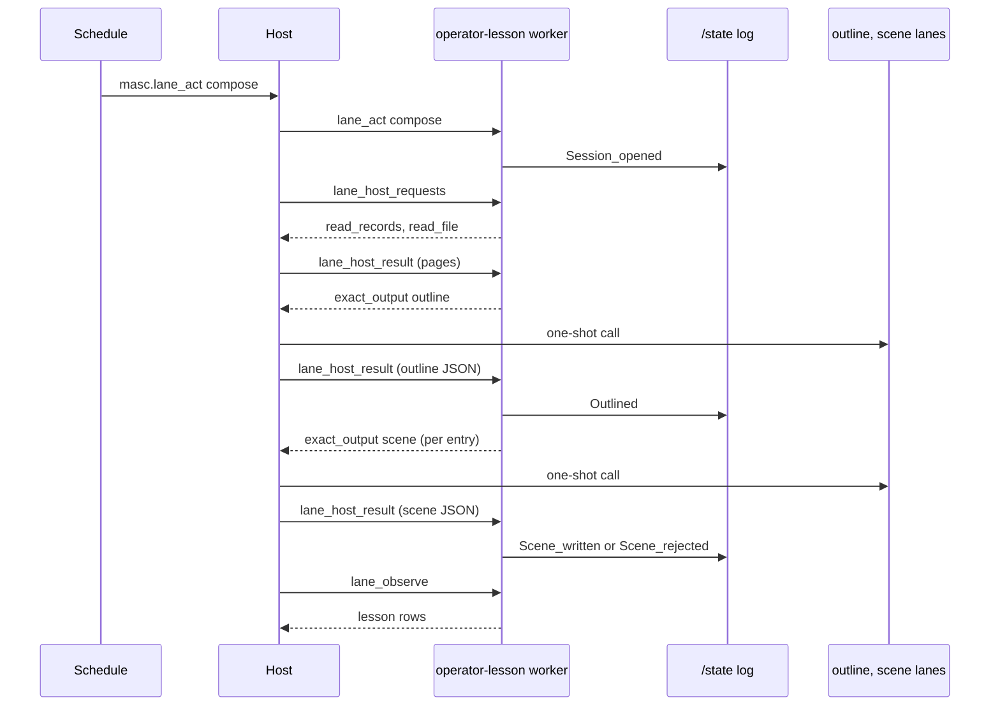

# RFC: 운영자 수업 (operator-lesson-lane)

- 상태: Draft. 운영자 결정 넷이 남았다(§9). 2026-11-13 적대 리뷰의 지적을 본문에 반영했다(§12).
- 운영자 요청(2026-11-13, Claude Code 세션, 원문): "이 제품을 분석하고 장점과 매커니즘을 확인한 다음 Lane Addon 스타일로 우리 스타일로 masc 로 체득하고싶다. 범위를 가장 넓게 바라보고 빠르게 적용할 수 있는 부분부터 흡수해나가자." 대상 제품은 OpenMAIC 다.
- 조사: [OpenMAIC 메커니즘 조사](../research/2026-11-13-openmaic-mechanisms-and-lane-addon-absorption.md). 이 RFC 는 그 문서 §6 의 1번이다.
- 좌표는 `71626e7e1d80` 기준 `파일:줄` 이다. §11 에 읽은 범위를 적었다.

## 0. 요약

`operator-quiz` 는 운영자에게 묻기만 한다. 틀린 문제의 답은 공개 행에 나오지만, 그 일이 왜 그렇게 됐는지 이어서 설명하는 것은 없다.

`operator-lesson` 은 같은 기록(Board, 커밋, wiki, 병합된 PR)에서 짧은 수업을 쓰는 Lane Add-on 패키지다.

- Schedule 이 `compose` 를 보낸다.
- 패키지가 host 에게 기록을 읽어 달라고 요청한다.
- `outline` 출력이 무엇을 설명할지 고르고, `scene` 출력이 장면 하나씩을 쓴다.
- 패키지는 장면의 인용문이 보존된 기록 바이트에 글자 그대로 있는지 검사한다. 통과한 장면만 `lesson/scenes` 행으로 나온다.
- 화면은 공통 Add-on Results 다. 슬라이드, 음성, 화이트보드는 없다.

core 는 고치지 않는다. 패키지가 쓰는 host 요청(`read_records`, `read_file`, `read_result`, `exact_output`)은 `operator-quiz` 가 이미 쓰는 것이다(`docs/guides/lane-addon-toml.md:373-415`).

## 1. 문제

1. 기록을 읽고 "무슨 일이 왜 있었는지"를 운영자에게 설명해 주는 것이 없다. 퀴즈의 공개 행은 정답과 인용문 한 줄을 보여 준다.
2. 퀴즈가 무엇을 물을지는 `author` 가 그때 고른다. 운영자가 그 주제를 먼저 읽을 기회가 없다.

주장의 한계: 수업은 기록에 적힌 것만 설명한다. 아무도 적지 않은 사정은 설명하지 못한다.

수업이 운영자의 이해를 높이는지는 모른다. §8 이 재는 방법이다.

## 2. OpenMAIC 에서 가져오는 것과 버리는 것

| OpenMAIC | 여기서 |
| --- | --- |
| outline 을 먼저 쓰고 장면을 하나씩 쓴다 | 가져온다. 장면 요청에는 그 장면이 인용할 기록만 싣는다(§4.3) |
| 다음 단계는 끝난 단계 집합의 순수 함수 | `operator-quiz` 의 `Flow.listing` 과 같은 방식으로 이미 있다(`addons/operator-quiz/quiz_flow.py:483`) |
| outline 뒤 사람 확인, 카운트다운 뒤 자동 확인 | 확인 단계를 두지 않는다(§9 D2). 카운트다운은 `no_wall_clock_death` 에 어긋난다 |
| 깨진 장면을 기본 대사로 채움, 잘린 outline 을 성공으로 침 | 버린다. 실패한 장면은 이유와 함께 버리고 행에 남긴다 |
| 자유 텍스트 속 JSON 복구 | 버린다. `exact_output` 은 스키마로 받는다 |
| 슬라이드·TTS·화이트보드·교사와 학생 에이전트 | 범위 밖(§10) |

## 3. 이미 있는 것

- `operator-quiz` 0.3.2: log, 세션 fold, 기록 읽기와 cursor, pin 일곱 종류, 인용문 검사(`addons/operator-quiz/quiz_log.py`, `quiz_flow.py:257`).
- host 요청 종류와 그 복구 규칙(`docs/guides/lane-addon-toml.md:401-415`). 수업은 그중 `read_records`, `read_file`, `read_result`, `exact_output` 넷만 쓴다.
- Lane action Schedule(`docs/guides/operator-quiz.md` "시간 정하기").
- Results 화면이 선언한 readings 를 그린다(`docs/guides/lane-addon-interface.md`).

없는 것은 수업의 뜻을 아는 코드뿐이다: 스키마 둘, 프롬프트 둘, 사건 몇 개, 행 셋.

## 4. 설계

### 4.1 흐름

1. Schedule 이 `{installation_id = "operator-lesson", action = {kind = "compose", scenes = 3}}` 를 보낸다. `scenes` 는 꼭 적는다. 패키지에는 기본값이 없다.
2. 패키지가 세션을 log 에 적고 `confirmed` 로 답한다.
3. 패키지가 `read_records` 와 `read_file` 을 권한마다 나열한다. 어디서부터 읽는지는 §4.8 이 정한다. 읽는 동안 worker 가 메모리에 두는 것은 퀴즈와 같이 결과의 요약뿐이다(RFC operator-quiz-lane §4.9).
4. 다 읽으면 `exact_output outline` 을 나열한다. 싣는 것: 읽은 기록, 지난 수업의 장면 제목과 인용 pin, 장면 수, 언어.
5. 돌아온 outline 의 항목마다 검사한다: pin 이 읽은 기록을 가리키는가, 항목 id 가 겹치지 않는가, 이미 `scenes` 개가 통과하지 않았는가. 통과한 항목을 `Outlined` 로, 나머지를 `Entry_rejected` 로 적는다.
6. 항목마다 `exact_output scene` 을 나열한다. 싣는 것: 그 항목의 제목과 요점, 항목이 가리킨 기록만.
7. 돌아온 장면마다 검사한다: 문단마다 출처가 하나 이상인가, 인용문이 요청에 실은 그 기록의 제목이나 본문에 글자 그대로 있는가. 통과하면 `Scene_written`, 아니면 `Scene_rejected` 와 이유.
8. 모든 항목이 `Scene_written` 이나 `Scene_rejected` 가 되면 세션이 끝난다. 다음 관측에서 행이 나온다.



### 4.2 manifest

```toml
id = "operator-lesson"
revision = "0.1.0"
title = "Operator lesson"
ui_category = "memory_judgment"
contributions = ["derive", "act"]
image = "masc-lane-operator-lesson:0.1.0"
command = ["python3", "server.py", "--state", "/state"]

[world.actions]
tool = "lane_act"

[world.state]
mode = "persistent"

[world.exact_outputs.outline]
schema = "schemas/outline.json"

[world.exact_outputs.scene]
schema = "schemas/scene.json"

[world.outputs.lesson]
lanes = ["lesson/scenes", "lesson/sessions", "lesson/measures"]

[resources]
cpus = 0.5
memory_bytes = 134217728
pids = 16
max_reply_bytes = 4194304

[interface]
binding_schema = '''{ … sources(늘 빈 배열), records 권한, language, since … }'''
presentation = '''{ … 세 lane 의 readings. 첫 값은 lesson/scenes 의 본문 … }'''
```

- `[world.asks]` 는 선언하지 않는다. v1 은 운영자에게 묻지 않는다.
- binding 은 `sources = []`, `language`, `records`, `since` 다. `since` 는 §4.8 에서 쓴다. `timezone` 은 쓰지 않는다. 날짜로 세는 값이 없다.
- 행동은 `compose {scenes}` 와 `export {}` 다. 행동의 스키마는 manifest 가 아니라 worker 가 광고하는 `lane_act` 의 inputSchema 다(`docs/guides/lane-world-actions.md:60-73`).
- `[resources]` 는 필수다(`lib/lane_addon/lane_addon_manifest.ml:347-366`). 값은 퀴즈와 같다.

### 4.3 왜 출력이 둘인가

출력 하나(`lesson`)로 전부 받는 쪽이 더 단순하다. 둘로 나누는 이유는 둘이다.

- 장면 요청에는 그 장면이 인용할 기록만 들어간다. 읽은 기록 전체를 장면 수만큼 다시 보내지 않는다.
- 장면 하나의 실패가 다른 장면을 버리지 않는다. 출력이 하나면 인용문 하나가 틀린 장면 때문에 나머지를 다시 받을 길이 없다.

대가: 모델 호출이 장면 수 + 1 번이다. `max_exact_in_flight` 가 1 이면 장면을 차례로 쓴다(`docs/guides/lane-addon-toml.md:37-39`).

### 4.4 스키마

`outline`:

```json
{"entries": [{"entry_id": "e1", "title": "…", "points": ["…"],
              "sources": [{"kind": "pr", "source_id": "masc-prs", "pin": "51785@71626e7e…"}]}]}
```

`scene`:

```json
{"title": "…",
 "paragraphs": [{"text": "…",
                 "sources": [{"kind": "pr", "source_id": "masc-prs", "pin": "…", "quote": "…"}]}]}
```

- 모든 object 는 `additionalProperties: false` 다.
- `kind` 는 퀴즈의 일곱 종류와 같은 닫힌 enum 이다. pin 의 모양도 같다(RFC operator-quiz-lane §5).
- 본문은 평문이다. 마크업을 해석하지 않는다.

### 4.5 log

`/state/operator-lesson/log.jsonl`. 덧붙이기만 하고 엄격하게 읽는다. 모르는 사건이나 필드는 그 줄을 이름으로 든 오류다.

| 사건 | 담는 것 |
| --- | --- |
| `Session_opened` | 세션 id, action 요청 id, 장면 수, 권한, 언어, 연 시각 |
| `Material_read` | 세션 id, 요청 id, 보관한 요청·결과의 digest |
| `Exact_requested` | 세션 id, 요청 id, 출력 이름, 요청 digest. 본문은 먼저 `requests/<digest>.json` 에 있다 |
| `Outlined` | 세션 id, outline 요청 id, 통과한 항목(id, 제목, 요점, pin) |
| `Entry_rejected` | 세션 id, outline 요청 id, 항목 index, 이유 |
| `Scene_written` | 세션 id, 항목 id, scene 요청 id, 쓴 시각, 제목, 문단과 출처(pin, 인용문, 그 기록을 담은 보존 페이지의 SHA-256) |
| `Scene_rejected` | 세션 id, 항목 id, scene 요청 id, 이유 |
| `Session_failed` | 세션 id, 이유 |

세션 상태는 log 를 접은 값이다.

| 상태 | 들어가는 사건 | 나가는 사건 |
| --- | --- | --- |
| `reading` | `Session_opened` | `Outlined` → `writing`; `Session_failed` → `failed`; 뒤의 `Session_opened` → `superseded` |
| `writing` | `Outlined` | 모든 항목이 `Scene_written` 이나 `Scene_rejected` → `written` |
| `written` | 파생 | 없음 |
| `failed {reason}` | `Session_failed` | 없음 |
| `superseded` | 파생 | 없음 |

`Session_failed` 의 이유(닫힌 집합): `not_allowed {request_id, reason}`, `outline_invalid_output`, `outline_input_refused`, `outline_outcome_unknown`, `outline_request_exceeds_frame`, `result_exceeds_frame`, `no_material`, `no_entry_passed`.

`Entry_rejected` 의 이유(닫힌 집합): `source_not_read {source}`, `duplicate_entry_id`, `beyond_requested_scenes`.

`Scene_rejected` 의 이유(닫힌 집합): `not_allowed {reason}`, `invalid_output`, `input_refused`, `outcome_unknown`, `request_exceeds_frame`, `result_exceeds_frame`, `quote_not_in_record {paragraph, source}`, `source_not_in_entry {paragraph, source}`, `paragraph_without_source {paragraph}`.

- host 의 최종 결과는 이렇게 받는다. `output_limit_reached` 는 `invalid_output` 으로, `request_id_reused` 는 `not_allowed` 로 적는다. 퀴즈가 받는 방식과 같다(`addons/operator-quiz/quiz_flow.py:701-708`). 설치 선언이 `exact_outputs = ["outline"]` 만 고르면 장면은 모두 `not_allowed` 로 끝난다.
- 새 `compose` 는 `reading` 세션만 대체한다. `writing` 세션은 건드리지 않고, 그 장면 요청은 계속 나열된다. 퀴즈가 `asked` 세션을 건드리지 않는 것과 같다. 대체하면 `scene` lane 이 묶이지 않았거나 쉬는 동안 compose 마다 outline 만 받고 장면은 하나도 나오지 않는다. 대가: `scene` lane 이 오래 막혀 있으면 `writing` 세션이 compose 마다 하나씩 쌓이고, lane 이 열릴 때 한꺼번에 쓰인다. `lesson/sessions` 가 그 수를 보여 준다.
- 장면이 하나도 통과하지 못한 세션도 `written` 이다. 행이 장면 0 개와 거절 이유를 보여 준다. 세션을 따로 실패로 만들지 않는다. 장면마다 이미 사건이 있다.
- 거절된 장면을 대신할 `scene` 요청을 나열하지 않는다. 실패하는 lane 이 주기를 계속 돌리지 못하게 하는 퀴즈의 규칙과 같다.
- 상태는 시간이나 횟수로 끝나지 않는다.
- log 를 읽지 못하면 쓰는 행동은 효과 전에 실패한다.

요청이 너무 커서 provider 가 거절하면 줄인다. 먼저 지난 수업의 제목과 pin 을 뺀다. 그래도 거절하면 읽은 기록의 새 절반만 싣고, 거절마다 다시 반으로 줄인다. 기록 하나가 남았는데도 거절하면 `outline_input_refused` 다. 패키지의 응답 frame 에 들어가지 않는 요청도 나열 전에 같은 순서로 줄인다. provider 의 typed 거절과 전송 한도에 반응하는 것이고 크기 규칙이 아니다(RFC operator-quiz-lane §7).

### 4.6 행

- `lesson/scenes`: `Scene_written` 하나에 한 행. 제목, 본문(문단을 빈 줄로 이은 글), 출처(pin, 인용문, SHA-256), 세션 id, 쓴 시각. readings 의 첫 값이 본문이라 Results 가 이 lane 에서 열린다.
- `lesson/sessions`: compose 하나에 한 행. 상태, 장면 수(요청·통과·거절·아직 안 쓴 것), 거절 이유, 실패 이유, 대체한 세션.
- `lesson/measures`: 세션 수(상태별, `superseded` 포함), 쓴 장면 수, 거절된 항목과 장면 수(이유별), 실패한 세션 수(이유별). 합격·불합격 필드는 없다.

### 4.7 사실이 사는 곳

| 사실 | 위치 |
| --- | --- |
| 장면이 인용한 기록 바이트 | Lane store blob (host) |
| exact 요청과 결과 | Lane store (host) |
| outline 항목, 장면 본문, 거절 이유 | 패키지 log |
| 행 | 저장하지 않는다. 관측마다 log 에서 만든다 |
| 켜고 끄기, 시각 | 선언 `enabled` 와 Schedule |

새 host 상태는 없다.

### 4.8 어디서부터 읽는가

- cursor 를 옮기는 사건은 `Outlined` 다. 권한마다, `Outlined` 를 가진 가장 최근 세션이 마지막으로 읽은 자리에서 다음 세션이 읽는다. 실패했거나 `reading` 에서 대체된 세션이 읽은 기록은 다시 읽는다. 퀴즈는 같은 일을 `Posed` 로 한다(`addons/operator-quiz/quiz_flow.py:420-442`).
- 그런 세션이 없으면 binding 의 `since`(Unix 시각, 초)부터 읽는다. `since` 는 꼭 적는다. 기본값이 없다.
- 퀴즈는 이 자리에 "처음 켠 시각"을 쓴다(`quiz_flow.py:462-466`). 퀴즈에는 다시 물을 문항이 쌓이지만 수업에는 없어서, 같은 규칙이면 첫 compose 가 `no_material` 로 끝난다.
- host 가 거절한 cursor 는 건너뛰고 그 앞 세션의 자리에서 읽는다. 퀴즈와 같다.

## 5. 퀴즈와 겹치는 코드

기록 권한, pin, 읽은 결과 조립, cursor, 인용문 검사, log 쓰기, 본문 저장은 퀴즈와 같다. 지금 그 코드는 `addons/operator-quiz/` 안에 있고, 패키지 폴더는 `/addon` 에 붙고 이미지에는 `protocol.py` 만 들어 있다(`addons/operator-quiz/Dockerfile`).

두 길이 있다.

- 복사한다. 퀴즈를 건드리지 않는다. pin 종류를 더할 때 두 곳을 고쳐야 하고, 한쪽만 고치면 같은 기록을 두 패키지가 다르게 가리킨다.
- 공용 모듈 `addons/records.py` 로 뽑는다. `protocol.py` 처럼 두 이미지에 넣는다. 퀴즈 이미지를 다시 만들고 패키지 revision 을 올려야 한다. 퀴즈의 log 모양과 행은 그대로다.

이 RFC 는 뽑는 쪽을 따른다(§9 D1). 퀴즈 타입과 얽힌 정도가 달라서 셋으로 나뉜다.

- 그대로 옮기는 것: `Grant` 와 `grants_of_binding`, pin 과 `parse_pin`, `Source`, `reads`, `material`, `summary`, `digest`, `InvalidResult`, `InvalidBinding`, log 값을 엄격하게 읽는 함수들.
- 인자를 받게 고쳐 옮기는 것: `Log` 와 `Blobs`. 폴더 이름 `operator-quiz` 와 퀴즈 사건 codec 이 박혀 있었다. 폴더와 codec 을 받는다.
- 함수로 떼어 옮기는 것:
  - 인용문 검사. `check_draft` 안에서 다시 묻기 출처와 섞여 있었다. `cited_record` 와 `holds_quote` 로 뗐다.
  - 다음에 읽을 요청(`next_read`). 권한의 첫 페이지가 어디서 시작하는지만 패키지가 준다.
  - 앞 세션이 멈춘 자리(`last_cursor`). 어느 세션이 cursor 를 옮기는지만 패키지가 준다. 퀴즈는 `Posed` 가 있는 세션, 수업은 `Outlined` 가 있는 세션이다(§4.8). host 가 거절한 cursor 를 건너뛰는 규칙은 하나다.
  - 읽은 결과의 요약을 메모리에 두는 부분(`Pages`).
- 옮기지 않는 것: 사건, 세션과 그 fold, 읽은 결과를 받아 사건으로 쓰는 일, 채점, 투영. 패키지마다 쓴다.

`quiz_log` 와 `quiz_flow` 는 옮긴 이름을 공용 모듈에서 가져와 지금 이름 그대로 둔다. 시험은 `q.Log`, `q.Grant`, `f.material` 같은 지금 이름으로 부른다(`addons/tests/test_operator_quiz_flow.py:18`).

## 6. 규칙과 맞는가

- `strict_parse_no_default`: 스키마에 맞지 않는 답은 `invalid_output` 이다. 깨진 장면을 채우는 기본 글은 없다.
- `closed_sum_over_string`: 상태, 실패 이유, 거절 이유, pin 종류는 닫힌 집합이다.
- `persist_before_model_call`: `Exact_requested` 를 쓴 뒤에 요청을 나열한다. host 는 호출 전에 요청을 보존한다.
- `failure_keeps_evidence`: 거절된 항목과 장면은 사건으로 남고 행에 보인다.
- `no_wall_clock_death`, `budget_gate`, `magic_number`: 기한, 재시도 횟수, 장면 수 상한이 없다. 장면 수는 운영자가 action 에 적는다.
- `string_matching`: 인용문 검사는 "이 글이 host 가 준 그 기록의 제목이나 본문에 그대로 있는가" 하나만 묻는다. host 는 그 기록을 담은 페이지를 보존하고, 출처에 그 페이지의 SHA-256 을 적는다. 기록의 낱말로 다음 행동을 고르지 않는다.
- Keeper 의 턴은 흐름 어디에도 없다. 수업은 Keeper 활동의 선행 조건이 아니다. `github_pulls` 권한은 `pr_reader` Keeper 의 token 으로 GitHub 을 읽는다(`docs/guides/lane-addon-toml.md:509`).
- 기록은 `outline` 과 `scene` 에 묶인 slot 의 provider 에게 간다. Board 의 `internal` 을 넣기 전에 확인할 것은 퀴즈와 같고, binding schema 의 설명에 같은 문장을 넣는다.

## 7. 구현 계획

Native stack 이다. 층마다 PR 하나와 changelog 조각 하나다.

| 층 | 종류 | 내용 | 시험 |
| --- | --- | --- | --- |
| L0 | 문서 | 조사 문서와 이 RFC | `scripts/rfc-generate-index.py --check` |
| L1 | 패키지 | `addons/records.py` 로 뽑기(§5). 퀴즈가 그것을 쓴다. 퀴즈 이미지 `0.2.0`, revision `0.4.0` | 기존 `test_operator_quiz_*.py` 116개가 본문을 고치지 않고 통과한다. 시험 파일 셋이 `addons/` 를 import 경로에 넣는 줄만 더한다 |
| L2 | 패키지 | `addons/operator-lesson`: manifest, 스키마 둘, 프롬프트 둘, log, flow, 투영, worker | 가짜 host 로: `Exact_requested` 가 나열보다 먼저 디스크에 있다. 읽지 않은 pin 의 항목은 버려진다. 인용문이 없는 장면은 `quote_not_in_record` 다. 장면 하나의 `invalid_output` 이 다른 장면을 막지 않는다. 다시 뜬 worker 가 같은 digest 의 요청을 나열한다. 새 `compose` 가 `reading` 세션을 대체하고 `writing` 세션은 그대로 둔다. 첫 세션이 binding 의 `since` 부터 읽고, 다음 세션이 `Outlined` 세션의 cursor 부터 읽는다. `scenes` 를 넘는 항목은 `beyond_requested_scenes` 다. `not_allowed` 로 끝난 scene 이 `Scene_rejected` 가 된다. 읽을 수 없는 log 는 쓰기를 거절한다 |
| L3 | 문서 | `docs/guides/operator-lesson.md`, 예제 선언, `runtime.toml` 표, `addons/README.md` 한 줄 | `test_lane_addon_config` 가 예제 선언을 검사한다 |

L3 뒤에 운영자가 이미지를 만들고 선언을 저장하고 `outline`·`scene` slot 을 묶고 Schedule 을 만든다. 첫 compose 가 `since` 뒤의 기록으로 장면을 쓰고, 예약한 compose 의 장면이 Results 에 나오고 `lesson/sessions` 가 모든 세션의 상태를 보여 주면 v1 을 받아들인다.

## 8. 무엇으로 재는가

v1 이 재는 것은 쓰기가 되는가뿐이다.

- `lesson/measures`: 쓴 장면 수와 거절된 장면 수(이유별). `quote_not_in_record` 가 많으면 묶은 모델이 인용을 지어낸다는 뜻이다.
- 근거로 남기는 것: export 한 log 와 SHA-256, 보존된 `outline`·`scene` 요청과 결과, Results 화면 캡처.

v1 이 재지 못하는 것: 운영자가 읽었는가, 읽고 나서 더 잘 아는가. 읽었다는 신호를 받으려면 운영자에게 물어야 한다(§9 D3).

효과는 퀴즈와 이은 뒤에 잰다(§10). 수업이 인용한 pin 을 출처로 가진 문항과 그렇지 않은 문항의 첫 시도 정답 비율을 나란히 본다. 무작위 배정이 아니므로 주제의 난이도 차이가 섞인다. 그 값은 보고하는 값이고, 어떤 상태도 그 값을 읽지 않는다.

## 9. 운영자 결정

| # | 질문 | 권하는 쪽 | 대가 |
| --- | --- | --- | --- |
| D1 | 퀴즈와 겹치는 코드를 공용 모듈로 뽑는가, 복사하는가 | 뽑는다 | 퀴즈 이미지를 다시 만들고 설치본을 갱신해야 한다. 복사하면 그 일이 없지만 pin 을 고칠 곳이 둘이 된다 |
| D2 | outline 뒤에 운영자가 항목을 고르는 질문을 넣는가 | 넣지 않는다 | 운영자가 주제를 고르지 못한다. 넣으면 수업마다 답해야 하고, 답할 때까지 장면이 나오지 않는다 |
| D3 | 수업 끝에 "읽었다"를 받는 질문을 넣는가 | 넣지 않는다 | 읽었는지 모른다. 넣으면 Approvals 에 수업마다 질문이 하나 쌓인다 |
| D4 | 이름 | `operator-lesson`, "운영자 수업" | |

## 10. 범위 밖과 다음

- **수업 뒤 퀴즈 잇기.** 퀴즈가 `lane_output` 으로 `lesson/scenes` 의 pin 을 읽고 그 범위에서 묻는다. 퀴즈의 binding 은 지금 `sources` 를 빈 배열로 고정한다(`addons/operator-quiz/lane.toml`). 따로 RFC 를 쓴다.
- **운영자 질문에 답하기.** `question {scene_id, text}` 행동과 `answer` 출력. 답도 인용문 검사를 거친다.
- **역할 토론, 단계 확인 패키지.** 조사 문서 §6 의 3, 4.
- 슬라이드, 음성, 화이트보드, 그림. 수업을 Board 에 올리기. Keeper 에게 수업 보내기.

## 11. 읽은 범위와 확신

**직접 읽음(`71626e7e1d80`):**
- `AGENTS.md`, `docs/constitution.xml` 전부.
- `addons/README.md`, `docs/guides/lane-addon-toml.md`, `docs/guides/WORKSPACE-STORAGE.md` 전부. `docs/guides/lane-addon-interface.md:1-92`, `docs/guides/operator-quiz.md:1-120`.
- `docs/rfc/RFC-operator-quiz-lane.md` §0-2, §4.1-4.2, §4.9-§8, §14-17.
- `addons/operator-quiz/lane.toml`, `README.md`, `Dockerfile`, `prompts/author.md` 앞 60줄, `schemas/author.json` 앞 80줄, `quiz_flow.py:504-516` 과 함수 목록, `quiz_log.py` 의 class·함수 목록.

**읽지 않음:**
- `quiz_flow.py`, `quiz_log.py` 의 본문 대부분. 직접 읽은 곳은 `quiz_flow.py:288-302, 420-468, 695-714, 746-754` 와 `quiz_log.py:830-834, 905-911` 이다. §5 의 나머지는 리뷰 보고에 기댄다.
- `lib/lane_addon/` 의 host 코드 대부분. 리뷰가 든 좌표 가운데 `lane_addon_manifest.ml:343-368` 과 `lane_addon_exact.ml:250` 만 직접 읽었다.
- Results 화면이 긴 글을 그리는 코드(`docs/guides/tui-lane-addons.md` "Reading multiline results" 절이 있다는 것만 확인했다).

**확신:**
- core 를 고치지 않아도 된다: 높다. 쓰는 요청은 모두 퀴즈가 쓰는 것이다.
- §5 의 뽑는 범위: 중간. 얽힌 곳 셋은 확인했다. `reads`·`material` 이 얽히지 않았다는 것은 리뷰 보고에만 있다.
- 긴 본문이 Results 에서 읽을 만하다: 낮다. 재지 않았다. L2 뒤에 화면에서 확인한다.
- 수업이 운영자의 이해를 높인다: 모른다.

## 12. 리뷰 반영 (2026-11-13)

읽기 전용 적대 리뷰 한 번. P0 는 없었다. 근거 좌표는 §11 에 적은 범위에서 직접 다시 읽었다.

| 지적 | 반영한 곳 |
| --- | --- |
| `writing` 세션을 대체하면 `scene` lane 이 막힌 동안 장면이 하나도 안 나온다 | §4.5: `reading` 만 대체한다 |
| cursor 를 옮기는 사건과 첫 읽기 시작점이 없다 | §4.8, binding `since` |
| host 최종 결과 `not_allowed`, `request_id_reused`, `output_limit_reached` 를 받을 이유가 없다 | §4.5 |
| L1 시험이 그대로는 통과하지 않는다, 뽑는 범위가 퀴즈 타입과 얽혔다 | §5, §7 L1 |
| manifest 예시에 `[resources]` 와 `[interface]` 가 없다 | §4.2 |
| `Scene_written` 에 시각이 없다, `Entry_rejected` 에 세션 id 와 이유 집합이 없다, 항목이 `scenes` 를 넘을 때가 없다 | §4.1, §4.5 |
| outline 요청의 지난 수업 목록이 끝없이 자란다 | §4.5 줄이기 순서 |
| 인용문 검사와 Keeper 서술이 사실보다 넓다 | §6 |

확인하지 못하고 남긴 것: lane 이 쉬다가 풀릴 때 host 주기가 도는지, exact output 스키마 검사기가 `minItems`·`enum` 을 받는지, 퀴즈 이미지와 revision 을 올릴 때 persistent volume 이 유지되는지. L1·L2 에서 확인한다.
