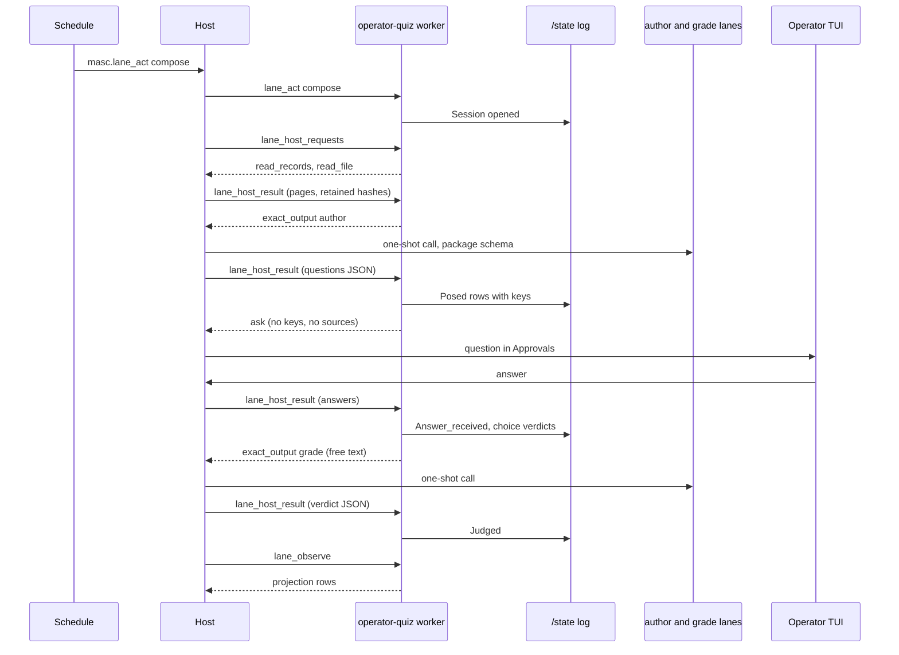

# RFC: Operator quiz

- Status: Draft. Times are UTC unless marked.
- Operator request: Board `p-c15d88ca431ebdcc30bd9869a212c1df` (2026-10-20T01:23:52Z), verbatim: "야 그리고 이거 지식 격차나 이해부채, 운영자에게 자꾸 부채가 쌓이는데 이거 해결할 어떤 장치? / Quiz Lane ? 음 / 되새김 Lane? ㅋㅋ / 음 이거 켜면 / 매일 또는 지정한 시간마다 문제 - 채점 - 평균 점수 및 시험 보는 기능 있음 좋겠음 / 내가 부채가 계속 쌓이거든..."
- This revision replaces the Keeper-centred design merged in #44101. The operator answered the eight questions of that revision (§13). The previous design is now alternative A1 (§12).
- Coordinates are `path:line` at `a6b9b1f58c2`. §16 lists what the author read.
- The file slug keeps the word "lane". The feature is a Lane Add-on package that owns two exact-output lanes, which is what "Lane" means in the glossary (`docs/spec/00-glossary.md:1352-1355`).

## 0. Summary

The operator says knowledge gaps and "understanding debt" keep piling up and asks for a quiz. The operator chose who writes and grades it: not a Keeper, but "Lane Add-on 안에 Exact Output Lane 이 포함된 스타일".

The design in one paragraph:

- An `operator-quiz` Lane Add-on package runs in its own container and keeps its own append-only log on its persistent state volume.
- A Schedule sends it a `compose` action at the times the operator picks.
- The package reads recent fleet records through the host, then asks its `author` exact-output lane for questions as JSON that must match a schema shipped in the package.
- It checks every quote against the record bytes it read, writes the answer key to its log, and only then raises the questions in TUI Approvals.
- Choice answers are graded by comparing choice ids. Free-text answers go to its `grade` exact-output lane.
- The package publishes score, sessions, the debt map and review items as ordinary Lane rows. The TUI shows them on the generic Add-on Results screen.

The package needs five things the core does not offer today (§3.9). Each is generic: the core still does not know what a quiz is. §4.2 marks every piece as core or package.

## 1. Decisions

### 1.1 Operator decisions (2026-10-20)

| # | Question (§13) | Decision |
|---|---|---|
| O1 | Delete the existing `quiz-questions` / `quiz-grader` pair? | Delete it, with its tests, glossary entry and doc mentions. |
| O2 | Name | "operator quiz" |
| O3 | Who writes questions | Not a Keeper: "별도 lane", clarified as "Lane Add-on 안에 Exact Output Lane 이 포함된 스타일". |
| O4 | Who grades free text | Not a Keeper, same answer as O3. |
| O5 | Direct grade override by the operator | Not in v1. Disputes go by message. |
| O6 | Allowed sources | All seven kinds (§5). |
| O7 | Targets | As proposed: 30 days, at least 20 re-asked items, recovery at least 2/3 (§14). |
| O8 | Does a skip count? | A skipped question counts as a miss. |

The operator's own words were relayed for O3 and O4 only. O1, O2 and O5-O8 were relayed as "the recommended option".

### 1.2 Design decisions

- D1. The feature is a Lane Add-on package, `operator-quiz`. It appears in the Lanes list as one `package` row (`docs/spec/00-glossary.md:1374-1384`).
- D2. Question writing and free-text grading are two exact-output lanes owned by the package: `author` and `grade`. The package ships their JSON Schemas. The operator binds their slots in `runtime.toml`.
- D3. The package never calls the host. The host asks the package what it is waiting for and delivers results (§4.4). The package's state says what it waits for. The host's records say what happened.
- D4. The answer key is on the package's persistent volume before the question exists anywhere the operator can see it.
- D5. A choice grade is a pure function of the key and the answer. It is never stored.
- D6. A free-text grade is the `grade` lane's output, accepted by the package and stored as `Judged`. A later `Judged` replaces an earlier one for display and scoring. Both stay in the log.
- D7. The operator disputes a grade with a `dispute` action carrying their own words. The package regrades through the `grade` lane. The operator never writes a grade (O5).
- D8. The code has no spacing intervals or due dates. The `author` lane sees each review item's attempt history and picks re-asks, following the practice written in the package prompt (§7).
- D9. Success is measured by recovery on re-asked items (§14), not by the average score.
- D10. Every question cites at least one record with a verbatim quote. The package checks every quote against record bytes the host read and retained, for all seven source kinds.

## 2. Problem

In the operator's words (paraphrased): "Knowledge gaps and understanding debt keep piling up on me. Is there a device for it? A Quiz Lane? A review lane? When it is on, every day or at times I choose, it asks me questions, grades them and keeps an average score, like taking a test."

Two Keepers replied on the same post. ocaml-refactor-woman offered OCaml question sets built from real review pitfalls. geek-scout proposed three things:
- draw questions from what this fleet actually merged (PRs, release notes, board decisions), not general trivia;
- ask missed questions again with spaced repetition;
- report which topics the operator keeps missing, not only an average.

Concretely, these things are missing today:

1. Nothing asks the operator questions on a clock with an answer fixed in advance.
2. Nothing keeps the operator's graded answers over time.
3. Nothing shows which areas the operator misses again and again.

Limit of the claim: a quiz checks whether the operator can recall facts and reasons the fleet wrote down. It cannot check understanding of things nobody recorded. This RFC claims only the first.

Why a test and not a digest: the retrieval-practice literature reports that taking a test improves later retention more than re-reading, and that spaced re-exposure helps (Roediger & Karpicke 2006; Cepeda et al. 2006, §17). The design does not rely on any number from those papers.

## 3. What exists

### 3.1 Lane Add-ons

**Package manifest (`lane.toml`).**
- Top-level keys are `id`, `revision`, `title`, `image`, `runtime`, `command`, `contributions` and `[resources]` (`lib/lane_addon/lane_addon_manifest.ml:178-217`).
- `[world]` accepts only `skills`, `actions`, `outputs`, `tools` and `state` (`:60-66`). `[interface]` accepts only `binding_schema`, `presentation`, `refresh_policy` and `model_access` (`:134-143`).
- `[world.state] mode = "persistent"` selects a persistent volume (`:122-132`).
- The parsed package record is `Lane_addon_types.package` (`lib/lane_addon/lane_addon_types.mli:56-79`).

**Declarations.**
- An installation is a TOML file under `<base-path>/.masc/config/lane-addons/` (`docs/guides/tui-lane-addons.md:127`).
- Its keys are `id`, `enabled`, `run_id`, `manifest_path` and `[binding]`; anything else is refused (`lib/lane_addon/lane_addon_config.ml:106-108`).
- `enabled = false` removes the worker and keeps the TOML and retained observations (`docs/guides/lane-package-activity.md:3-20`).

**Worker container.**
- Docker and Apple workers run with `--network none`, a read-only root and all capabilities dropped (`lib/lane_addon/lane_addon_engine.ml:60`, `:66`).
- The worker is an MCP server over stdio. The host is the client.

**Actions.**
- A package with `contributions = ["act"]` advertises one action tool taking exactly `context`, `request_id` and `action` (`docs/guides/lane-world-actions.md:60-69`).
- Callers use `POST /api/v1/lane-addons/actions` or `masc_lane_act` with `instance_id`, `expected_incarnation`, `request_id` and `action` (`:82-93`; `config/tools/masc_lane_act.toml:1-40`).
- The request is durable before dispatch. The same request id with the same input returns the same receipt; different input is refused (`docs/guides/lane-world-actions.md:108-110`).
- Receipt states are `queued`, `running`, `confirmed`, `failed_before_effect` and `outcome_unknown` (`:112-118`; `lib/lane_addon/lane_addon_action.mli:3`).
- Orphaned receipts are never replayed against a replacement worker (`docs/guides/lane-world-actions.md:150-153`).
- An action carries no sources. Only observations receive `binding` and `sources` (`:74-75`; `lib/lane_addon/lane_addon_worker.ml:531-540`).

**Observations and sources.**
- Source kinds are `fusion_run`, `snapshot_file`, `msx_capture`, `dos_capture`, `lane_output` and `browser_document` (`lib/lane_addon/lane_addon_sources.mli:8-15`).
- `snapshot_file` takes an absolute path to a file in a fixed JSON envelope, not an arbitrary file (`lib/lane_addon/lane_addon_sources.ml:101-103`, `:386-397`). The host retains the file bytes as a content-addressed blob (`:398`).
- Read access has three values: `Operator_configuration`, `Keeper of string` and `Unauthenticated` (`lib/lane_addon/lane_addon_sources.mli:70-72`).
- No source reads the Board, the wiki, a git repository or GitHub.

**Lane updates.** `masc_lane_updates` lets a subscribed Keeper read and acknowledge an installation's output. It never wakes a Keeper (`config/tools/masc_lane_updates.toml:2-8`; `docs/guides/lane-subscriptions.md:16-19`). It is a Keeper-facing reader and plays no part in this design.

**Persistent state.**
- The state owner is the workspace, the installation and the package. A TOML installation uses its declaration `id`; a manual Attach uses its instance id (`lib/lane_addon/lane_addon_runtime.ml:211-218`).
- The Docker volume is `masc-lane-state-<sha256 of the owner>` and its single writer container is the same name plus `-writer` (`lib/lane_addon/lane_addon_worker_state.ml:13-28`). Incarnations of one installation share that writer name (`lib/lane_addon/lane_addon_slot.mli:5-13`).
- The worker sees the volume at `/state`. Detach and disable remove the worker, not the volume. Renaming the declaration id or the package id starts a new, empty state (`docs/guides/machine-addon-state.md:27-42`).
- Changing the runtime (Docker or Apple) of a persistent installation is refused; it needs a new installation id (`lib/lane_addon/lane_addon_runtime.ml:1631-1647`).

**TUI.**
- An instance detail has four tabs: Results, Links, Installation and Records (`docs/guides/tui-lane-addons.md:66-76`).
- `interface.presentation` declares which row fields Results shows (`:78-80`; `lib/lane_addon/lane_addon_presentation.mli:1-16`).
- The action menu `a` lists closed values from the action schema's `enum`/`const`. A schema with a required free-text field sends the operator to `A`, where they type `act {…}` as JSON (`docs/guides/tui-lane-addons.md:111-119`).

**Skills.** `[world.skills] directory` publishes read-only Skills into the Keeper Skill catalog (`lib/lane_addon/lane_addon_manifest.ml:81-85`; `docs/guides/tui-lane-addons.md:166-167`). They are for Keepers. This package ships none.

**What a package may not do.**
- The core does not interpret a package's domain meaning (`docs/design/lane-addon-v0.md:42`).
- A package that needs a change to the server dispatcher, a TUI menu or a Dashboard component has failed the contract (`:53`; `docs/guides/lane-world-actions.md:207-209`).
- Writing a new source driver is a different, allowed kind of work (`docs/design/lane-addon-v0.md:54`).
- No new scheduler for add-ons: they react to existing completion signals or explicit requests (`:99`).
- Worker control tools cannot be exported to Keepers: `lane_observe`, the call-context tool, `lane_machine_inputs`, the controller tools and the action tool (`lib/lane_addon/lane_addon_types.ml:62-73`). The host already pages `lane_machine_inputs` from the worker on its own initiative (`docs/design/lane-addon-tool-exports.md:78-83`).

### 3.2 Model access for packages today: host sampling

- A manifest may declare `[interface] model_access = "host_sampling"` (`lib/lane_addon/lane_addon_manifest.ml:144-151`; `docs/design/lane-addon-model-boundary.md:46-50`).
- The route comes from `binding.model_route` and resolves through the Keeper runtime candidate order (`[runtime.lanes.<id>]`), not through exact-output lanes (`lib/server/server_lane_addon_sampling.ml:35-45`; `docs/design/lane-addon-model-boundary.md:113-128`).
- Sampling is allowed only inside an observation, never inside an action (`lib/lane_addon/lane_addon_worker.ml:524-527`; `lib/lane_addon/lane_addon_sampling.mli:12-14`).
- Replies are free text. No JSON Schema is enforced (`docs/design/lane-addon-model-boundary.md:157-163`).
- Official-client runtimes are refused because they cannot take a per-request output limit (`:140-144`).
- MCP sampling is deprecated in the 2026-07-28 specification, and new designs should not adopt it (`:9-13`; `docs/spec/00-glossary.md:86-92`).

Host sampling therefore cannot give the quiz a schema-checked answer, cannot run during an action, and cannot use the operator's exact-output slots. `addons/fusion-compute` uses it (`addons/fusion-compute/lane.toml:17-19`); this RFC leaves it alone.

### 3.3 Exact-output lanes

- A lane is one `[runtime.exact_output_lanes.<id>]` table (`config/runtime.toml:162-184`). Its keys are `enabled`, `slots`, `cli_slots`, `max_output_tokens` and `thinking` (`lib/runtime/runtime_toml.ml:2805-2824`; `lib/runtime/runtime_schema.mli:369-392`).
- Lane ids are the closed type `Standalone_lane.t` with seven constructors (`lib/runtime/standalone_lane.mli:13-21`). A table under any other name fails the load, because it would otherwise vanish from every surface (`lib/runtime/runtime_toml.ml:2975-2991`).
- An enabled lane needs at least one slot; a Required lane cannot be disabled (`:2908-2919`; `docs/guides/exact-lane-activity.md:19-21`).
- An HTTP slot whose provider declares no `exact-body-timeout-s` is a typed gap. A save that adds one is refused (`lib/runtime/runtime.ml:195-215`; `lib/runtime/runtime_config_error.mli:38-45`, `:104-109`). A `cli_slots` entry must be an official client with an output-schema channel (`:57-79`).
- The registry publishes all lanes at once and resolves one lane to its admitted slots. Errors are `Exact_lane_unconfigured`, `Exact_lane_off` and `No_admitted_lane_slots` (`lib/runtime/runtime_exact_output_registry.mli:108-111`, `:134-158`, `:261-267`). A consumer can subscribe to changes of one lane (`:113-132`).
- A caller inside the server builds the requirement with `Exact.make_output_requirement ~schema ~minimum_guarantee:Exact.Json_syntax` (`packages/agent_core/lib/llm_provider/exact_output.mli:162-167`, `:548-551`). The Candle appraiser is a complete small example:
  - it resolves its lane (`lib/server/server_candle_appraiser.ml:6-10`);
  - it walks the HTTP slots and validates each answer, returning `Accept` or `Reject_and_advance` (`:143-200`, `:176-179`);
  - it falls back to `cli_slots` through `Keeper_lane_cli_oneshot.walk` with the same requirement (`:329-345`);
  - it records the run in `Exact_lane_run_registry` (`:377`), whose lane type is also closed (`lib/exact_lane_run_registry.mli:7-12`).
- Thirteen files read `exact_output_lane_decl`, including account removal, prompt presets, lane editing and server bootstrap (`lib/runtime/runtime_account_removal.ml`, `lib/prompt_preset.ml`, `lib/runtime/runtime_lane_edit.ml`, `lib/server/server_runtime_bootstrap.ml`).

Nothing lets a Lane Add-on request an exact-output call today.

### 3.4 Ask and Approvals

- `Keeper_ask` calls itself surface-neutral, but an ask is owned by a Keeper: it carries `keeper_name`, a Keeper continuation channel and a source turn (`lib/keeper/keeper_ask.mli:1-18`, `:87-104`).
- Questions have stable `choice_id`s, `Single` or `Multi` mode, and every question also accepts free text and `Skipped` (`:26-32`, `:43-51`, `:121-126`). Asks never expire (`:12-14`).
- The fold keeps the first terminal event per ask (`:191-196`).
- The only writer of an ask is `masc_ask` (`lib/mcp_tool_runtime_ask.ml:175`). The log is `<base_path>/.masc/keeper_ask/<keeper>.jsonl` (`lib/keeper/keeper_ask_store.mli:1-13`).
- The answer route is `POST /api/v1/keepers/ask-answer` with a Keeper `name` (`lib/server/server_routes_http_routes_dashboard.ml:3831`; `lib/server/server_routes_http_keeper_stream.ml:4176-4177`). An answer becomes a Keeper wake (`:4155-4161`), and maintenance recovers undelivered wakes (`lib/server/server_bootstrap_maintenance.ml:820-822`).
- The TUI fetches `/api/v1/keepers/asks` and posts answers (`bin/masc_tui_http.ml:2565-2585`, `:3699-3712`). Approvals shows "[?] Questions waiting on you" (`bin/masc_tui_render_approvals.ml:400`). A new question shows the banner "<keeper> is waiting on a decision" (`bin/masc_tui.ml:12022`).

An add-on cannot raise a question in Approvals through any existing path.

### 3.5 Schedules

- Recurrences are `One_shot`, `Interval`, `Daily` and `Cron`, with fixed-offset timezones such as `Asia/Seoul` (+09:00) (`lib/schedule/schedule_domain.mli:34-61`).
- The payload is opaque `{kind; body}`. The consumer of a kind owns authorization of its effect (`:1-5`).
- The only supported kind is `masc.keeper_wake` (`lib/schedule/schedule_supported_kinds.ml:18-20`; `lib/schedule_payload_projection.mli:7`). A new kind needs a list entry, a creation validator branch and a consumer branch (`lib/schedule/schedule_supported_kinds.ml:1-16`; `lib/tool_schedule.ml:404-412`; `lib/server/server_schedule_consumers.ml:379`, `:1191`, `:1373`).
- A due occurrence is held while the previous one is unconsumed (`lib/schedule/schedule_runner.mli:21-24`).
- The TUI creates schedules by posting its JSON form to `masc_schedule_create` (`bin/masc_tui_http.ml:2787-2796`).

Add-ons have no timer of their own, and a worker cannot start anything: it only answers the host.

### 3.6 Where fleet records live

- **Board:** the host Board store (`lib/board/board.mli:1`). Post ids start with `p-` and comment ids with `c-` followed by lowercase hex (`lib/board_types/board_types.ml:85`, `:100-109`). Posts can be edited (`config/tools/masc_board_post_update.toml`).
- **Wiki:** pages carry a `revision` that starts at 1 and grows by one per update (`lib/wiki_page.mli:70`).
- **Git:** registered repositories have a local clone path (`lib/repo_manager/repo_store.mli:39`).
- **GitHub:** the server already reads open PRs of registered repositories over GraphQL, with the token of the Keeper named by `[repositories] pr_reader` (`lib/server/server_repository_pulls.mli:1-22`). It does not read merged PRs or review comments.
- **Changelog fragments:** each PR adds `changelog.d/<PR>.md` (`changelog.d/README.md:3-17`). Release folds them into `CHANGELOG.md` and deletes them (`:20-23`), so a question cites a fragment by commit.

### 3.7 The existing "Quiz Lane" pair (deleted by O1)

- `quiz-questions` turns a fact deck into multiple-choice questions from six closed templates (`addons/quiz-questions/server.py:22-31`).
- `quiz-grader` allows one graded attempt per question and claimed answerer: "the first grade stands" (`addons/quiz-grader/server.py:200-209`).
- Its state lives only in the worker incarnation and is not replayed (`:10-11`). A new worker starts with an empty score (`addons/quiz-grader/README.md:40-41`).
- Its deck had to be built by a script outside MASC, `build_deck.py` (`docs/spec/00-glossary.md:1912-1931`).

Worth keeping: the answerer never sees which choice is right; every answer is backed by a quote; wrong choices come from real neighbouring facts. Its own limits still apply: a quote check does not catch a negation elsewhere in the record, and it cannot show the fact was worth asking (`addons/quiz-questions/skills/quiz-deck/SKILL.md:27-33`).

### 3.8 Live state

Read on 2026-10-20 for the previous revision and not re-read: `<base-path>/.masc/config/lane-addons/` held five declarations, none of them quiz. This revision touched no live state.

### 3.9 Gaps

| The operator's choice needs | Exists today | Missing |
|---|---|---|
| Exact-output lanes owned by a package, slots bound by the operator | Built-in lanes only, closed set (§3.3) | K1 |
| The package asks the host for work and gets results | Host sampling only, free text, observation only (§3.2) | K2 |
| Records of all seven kinds reach the package | No Board, wiki, git or GitHub source (§3.1) | K3 |
| The operator answers in Approvals | Keeper-owned asks only (§3.4) | K4 |
| It runs at times the operator picks, without a Keeper | Schedules wake Keepers only (§3.5) | K5 |
| Key, attempts and grades survive restarts | Persistent volume (§3.1) | nothing |
| Score, history, debt map visible | Generic rows and presentation (§3.1) | nothing |

## 4. Design

### 4.1 Flow

1. A Schedule fires `masc.lane_act` with `{installation_id = "operator-quiz", action = {kind = "compose"}}` (K5).
2. The host queues the action on the installation's live worker. The package records a new session in its log and returns `confirmed`.
3. The action reaching a terminal receipt starts a host request cycle (K2). The package lists what it waits for: record reads first (K3).
4. The host reads the records, retains the bytes, and delivers each page. The package stores its cursors and asks for an `author` call with the new material and the review items' histories.
5. The host runs the `author` lane (K1) and delivers the JSON. The package checks every question and quote. It appends `Posed` rows with the keys, then lists an `ask` without keys or sources.
6. The host records the installation ask (K4). The question appears in Approvals.
7. The operator answers in Approvals. The answer is recorded by the host and starts a cycle. The host delivers the answers.
8. The package grades choices on the spot. For each free-text answer it asks for a `grade` call, and stores the result as `Judged`.
9. After the cycle, the host runs one ordinary observation. The package publishes its projection rows, and the TUI Results screen shows them.



### 4.2 Core or package

| Piece | Kind | Knows about quizzes? |
|---|---|---|
| K1 Package exact-output lanes | core | no |
| K2 Host requests (two private worker tools) | core | no |
| K3 Record reads for Board, wiki, repository, GitHub | core | no |
| K4 Installation questions in Approvals | core | no |
| K5 Scheduled lane action | core | no |
| K6 Generic TUI support for K1, K2, K4 | core (TUI) | no |
| P `addons/operator-quiz`: schemas, prompts, log, grading, spacing, projections | package | yes |

All quiz meaning lives in P. If the core needs a quiz-specific branch anywhere, the design has failed the add-on contract (`docs/design/lane-addon-v0.md:53`).

### 4.3 K1: Package exact-output lanes (core)

**Manifest.** A package declares named exact outputs. The schema file ships in the package:

```toml
[world.exact_outputs.author]
schema = "schemas/author.json"

[world.exact_outputs.grade]
schema = "schemas/grade.json"
```

- The name matches `[a-z][a-z0-9_]*`. The path is package-relative, like `world.skills.directory`.
- Manifest load reads each schema and checks it with the validator action schemas already use (`lib/lane_addon/lane_addon_action.mli:25-27`). It must describe an object. Unsupported keywords are refused, as for actions (`docs/guides/lane-world-actions.md:71-73`).
- The schemas become part of the package value, so they change the declaration's semantic revision (`lib/lane_addon/lane_addon_config.mli:27-31`).

**Binding in `runtime.toml`.** The operator binds slots per installation and output:

```toml
[runtime.addon_exact_lanes.operator-quiz.author]
slots = ["glm-coding.glm-5-3"]
cli_slots = ["claude-code"]
max_output_tokens = 8192

[runtime.addon_exact_lanes.operator-quiz.grade]
slots = ["ollama_cloud.ollama-cloud-deepseek-v4-1-flash"]
```

- The first key is the declaration `id`, the same identity that owns the persistent volume. The second is the output name.
- Each table is parsed by the existing `parse_exact_output_lane` (`lib/runtime/runtime_toml.ml:2800`), so `enabled`, `slots`, `cli_slots`, `max_output_tokens`, `thinking`, the body-deadline rule and the CLI schema-channel rule apply unchanged.
- `Runtime_schema.exact_output_lane_decl` gains a typed owner: `Builtin of Standalone_lane.t | Addon of { declaration_id; output }`. The registry key is derived from it. Add-on lanes travel in the same list as built-in lanes, so all thirteen readers (§3.3) see them without a per-site patch.
- Add-on lanes are always Optional. Their admission class is `Standard` (`lib/runtime/standalone_lane.mli:43-50`).
- `runtime.toml` loads before declarations, so it cannot check that the declaration and output exist. An unknown pair loads and shows as an unbound row in the Lanes list. A declared output with no table resolves to `Exact_lane_unconfigured` at call time. Neither case is silent.
- A manual Attach has no declaration id, so all its exact requests resolve to `Exact_lane_unconfigured`.

**Execution.** The host runs a package request the way the Candle appraiser runs its own (§3.3):
- the requirement is the package schema with `Json_syntax`;
- each HTTP answer is validated against the package schema, then `Accept` or `Reject_and_advance`;
- `cli_slots` run afterwards through `Keeper_lane_cli_oneshot.walk`;
- the package supplies an optional `system` text and the user `messages`. Images are out of scope for v1.

**Retention.** The host retains the request in the Lane store before the first provider call, and every attempt's outcome after it, keyed by declaration id and request id with a digest of the request. This is the same order `Lane_addon_sampling` already keeps (`lib/lane_addon/lane_addon_sampling.mli:1-7`; `docs/design/lane-addon-model-boundary.md:65-86`). A request listed again after a restart gets its retained final result. The model is not called twice for a request that already has one.

**Final results, delivered to the package** (closed sum):
- `answered {output; slot; usage?}`;
- `invalid_output {detail}`: every slot answered and no answer matched the schema;
- `input_refused {kind}`: a provider refused this input itself (input capacity, context overflow, invalid request, request body refused). The same input cannot succeed, so the package must change it;
- `outcome_unknown`: a call was sent and no outcome was retained.

**Not final, so not delivered:** the lane is unconfigured, off or has no admitted slots; a provider refusal that may pass (rate limit, overload, network, timeout); an authentication or authorization refusal. The request stays listed, the Host requests view (K6) shows the reason, and the host tries it again on the next trigger (§4.4). Each attempt is retained as evidence. This follows `failure_keeps_evidence`: a failed delivery leaves evidence and does not consume the request (`docs/constitution.xml:250-253`).

**No ceilings.** MASC adds no input or output size limit. `max_output_tokens` is the operator's optional lane key. If a provider refuses an input as too large, that typed refusal reaches the package as `input_refused`, and the package changes the input (§7).

### 4.4 K2: Host requests (core)

**Two private worker tools.**
- `lane_host_requests`: no arguments. Returns `{requests: [...]}`, everything the package is waiting for.
- `lane_host_result`: `{request_id, result}`. Returns `{accepted: bool}`.

Both join the list of control tools that cannot be exported (`lib/lane_addon/lane_addon_types.ml:62-73`).

**Request kinds** (closed; an unknown kind refuses the whole listing and shows an issue on the instance):

| Kind | Fields | Allowed when |
|---|---|---|
| `read_records` | `source_id`, `after` | the binding grants `source_id` (K3) |
| `read_file` | `source_id`, `commit`, `path` | a `repository` grant whose `paths` cover `path` |
| `exact_output` | `output`, `system?`, `messages` | the manifest declares `output` (K1) |
| `ask` | `questions`, `context?` | the manifest declares `[world.asks] operator = true` (K4) |
| `withdraw_ask` | `ask_id`, `reason` | same |

**When the host asks.** Only on existing events, never on a timer:
- the worker finished initializing, including after a restart;
- an action of that instance reached a terminal receipt;
- an installation question of that installation was answered (K4);
- a publication changed one of its add-on lanes (registry subscription, §3.3);
- its declaration was reconciled.

A trigger that arrives during a cycle becomes one more cycle, as observation hints already do (`docs/design/lane-addon-v0.md:98`). Cycles of one instance never overlap.

**One cycle.**
1. List the requests.
2. For each request in order: deliver a final result the host already holds, or try the work once and deliver its result if it is final.
   - An `ask` is recorded once per request id. Its result is delivered only when the operator has answered it or the package has withdrawn it.
   - A request whose attempt was not final stays undelivered until the next trigger. It is tried at most once per cycle, so it cannot keep a cycle running.
3. List again. The cycle ends when a listing produces no delivery.
4. Run one ordinary observation, so the package's rows show the new state.

**Rules.**
- The same request id with a different digest is refused as `request_id_reused`, the rule action receipts already follow (`docs/guides/lane-world-actions.md:108-110`).
- A request id already delivered in this cycle and listed again ends the cycle and shows `relisted_delivered_request` on the instance. There is no attempt count.
- A result that does not fit the frame the worker connection accepts is delivered as `result_exceeds_frame {retained_sha256; bytes}`. That frame limit is the transport limit `max_reply_bytes` is meant to be (`docs/rfc/RFC-0471-max-reply-bytes-bounds-one-thing.md`, row 1).
- The host keeps no list of pending requests. What the package waits for lives in the package. What happened lives in host records: retained pages, exact outcomes, questions and answers. This keeps the host a record of facts, not a workflow engine.

### 4.5 K3: Record reads (core)

**Grants.** The binding names what the package may read, as `binding.records`. The host reads that key itself, as it reads `binding.sources` and `binding.model_route`:

```toml
[[binding.records]]
source_id = "board"
kind = "board"
visibilities = ["public", "unlisted", "internal"]

[[binding.records]]
source_id = "wiki"
kind = "wiki"

[[binding.records]]
source_id = "masc-repo"
kind = "repository"
repository_id = "masc"
paths = ["changelog.d/", "CHANGELOG.md", "docs/rfc/", "docs/constitution.xml", "lib/", "bin/"]

[[binding.records]]
source_id = "masc-prs"
kind = "github_pulls"
repository_id = "masc"
```

- Only an operator-owned TOML declaration may hold grants (`Operator_configuration`, `lib/lane_addon/lane_addon_sources.mli:70-72`).
- `visibilities` is required for `board` and takes the Board's own four values, `Public`, `Unlisted`, `Internal` and `Direct` (`lib/board_types/board_types.ml:157-161`), written in lower case. A missing value is an error, not a default. `direct` posts are read only when the grant names them.

**What `read_records` returns.** Records after the given cursor, oldest first, until the frame is full, with the next cursor and `complete`:

| Kind | Records |
|---|---|
| `board` | posts and comments: id, author, created and updated time, title, body |
| `wiki` | page versions: name, revision, updated time, body |
| `repository` | first-parent commits on the default branch: SHA, author, commit time, subject, body, changed paths; the reply names the clone head it read |
| `github_pulls` | merged PRs (number, title, body, merge commit, merge time, author) and review comments (PR, comment id, author, time, path, line, body), read with the `[repositories] pr_reader` token |

`read_file` returns one file's bytes at a commit, under the grant's `paths`.

**Retention.** Every page and file is retained as a content-addressed blob in the Lane store, as `snapshot_file` bytes are today (`lib/lane_addon/lane_addon_sources.ml:398`). The result carries the SHA-256. A citation names that hash, so a Board post edited later or a fragment deleted at release still leaves the quoted bytes readable.

### 4.6 K4: Installation questions in Approvals (core)

- A new store per declaration in the Lane store, append-only, with `Asked`, `Answered` and `Withdrawn`.
- It reuses `Keeper_ask.question`, `Keeper_ask.parse_answers`, `Keeper_ask.answer`, the responder record and the first-terminal-wins fold (`lib/keeper/keeper_ask.mli:191-196`).
- The asker is the installation: its declaration id and package title. It carries no Keeper continuation and wakes no Keeper.
- Routes: `GET /api/v1/lane-addons/asks` (open by default, `include_resolved` optional) and `POST /api/v1/lane-addons/ask-answer`. The responder is recorded as the Dashboard surface, as Keeper answers are.
- An answer starts a K2 cycle. If the worker is down, the answer waits in the store and is delivered when the next worker lists the `ask` again. No separate delivery ledger is needed.
- Only the package withdraws its own question.
- Why a separate store and not a new field on Keeper asks: a Keeper ask carries Keeper-only fields (`lib/keeper/keeper_ask.mli:87-104`) and its answer becomes a Keeper wake (`lib/server/server_routes_http_keeper_stream.ml:4155-4161`). Changing that record would be a hard cut of every live Keeper ask log, and would still need a second delivery path.

### 4.7 K5: Scheduled lane action (core)

- New payload kind `masc.lane_act`. Body: `{installation_id, action}`.
- The validator checks that `action` is an object and `installation_id` is non-blank. Whether the action fits the package schema is checked at dispatch, against the worker that will run it.
- Dispatch finds the declaration's live instance in the inventory (`lib/lane_addon/lane_addon_runtime.mli:109-117`). It queues the action through the existing `Act` operation (`:31`). The request id is the occurrence id, so a redelivered occurrence returns the same receipt.
- The occurrence is `Succeeded` once the receipt is durably queued. It is `Failed` with a typed reason when the declaration is missing, disabled, has no live instance, or the action is refused.
- A due occurrence is held while the previous occurrence's receipt is still `queued` or `running`, the existing hold rule (`lib/schedule/schedule_runner.mli:21-24`).
- The receipt's requester is the schedule's creator, with the schedule id.
- This reuses the one scheduler MASC has. It adds no add-on timer (`docs/design/lane-addon-v0.md:99`).

### 4.8 K6: Generic TUI support (core, TUI)

- **Approvals** lists installation questions beside Keeper questions, labelled with the installation title. Answering uses the same keys and editor. The answer posts to the K4 route.
  - The banner reads "<title> is waiting on you".
  - The answer receipt offers a jump to that installation's Results. The key is chosen in L8 from the keys Approvals leaves free.
- **Lanes list:** a package row lists its declared exact outputs with their binding state: bound, unbound, off, or a table with no declaration. Each entry opens the preview-checked `runtime.toml` editor at `[runtime.addon_exact_lanes.<id>.<name>]`, the editor `e` opens for built-in exact lanes (`docs/guides/TUI-KEYS.md:449`).
- **Add-on detail:** a "Host requests" view lists the requests of the last listing and the host's state for each: done, waiting for an answer, or refused with its typed reason.
- Nothing here names a quiz.

### 4.9 P: the `operator-quiz` package

**Manifest.**

```toml
id = "operator-quiz"
revision = "0.1.0"
title = "Operator quiz"
contributions = ["derive", "act"]
image = "masc-lane-operator-quiz:0.1.0"
command = ["python3", "server.py"]

[world.actions]
tool = "lane_act"

[world.state]
mode = "persistent"

[world.asks]
operator = true

[world.exact_outputs.author]
schema = "schemas/author.json"

[world.exact_outputs.grade]
schema = "schemas/grade.json"

[world.outputs.quiz]
lanes = ["quiz/sessions", "quiz/questions", "quiz/topics", "quiz/items", "quiz/measures"]

[resources]
cpus = 0.5
memory_bytes = 134217728
pids = 16
max_reply_bytes = 4194304

[interface]
binding_schema = '''{ … records grants, language … }'''
presentation = '''{ … readings for the five lanes … }'''
```

**Actions** (the action schema's `kind` is a closed enum, so the TUI menu lists them):
- `compose {questions?}`: start a session. `questions` is how many to write. The Schedule body or the operator sets it; nothing caps it.
- `dispute {ask_id, question_id, note}`: the operator's words about a grade (O5, D7).
- `export {}`: return the whole log as an artifact. The host retains its bytes with a SHA-256 (`docs/guides/lane-world-actions.md:156-186`).

**Log** at `/state/operator-quiz/log.jsonl`. It is append-only and decoded strictly: an unknown event or field is an error naming the line. Events:

| Event | Holds |
|---|---|
| `Session_opened` | session id, action request id, requested question count |
| `Material_read` | grant id, page SHA-256, cursor after |
| `Exact_requested` | request id, output name, request digest |
| `Posed` | ask request id, question id, item id, topic, key (`choices` ids or `points` rubric), sources |
| `Draft_rejected` | author request id, question index, reason |
| `Asked` | request id, host ask id |
| `Answer_received` | host ask id, answers, responder, answered time |
| `Judged` | ask id, question id, verdict (`correct`, `incorrect`, `void {reason}`), rationale, grade request id |
| `Disputed` | ask id, question id, note, action request id |

If the log cannot be read, every write action fails before effect. An unreadable log never authorizes a write (`docs/constitution.xml:245-248`).

**Compose, step by step.**
1. List `read_records` from each grant's stored cursor until each reports `complete`. List `read_file` for the files the new commits changed under the grant paths.
2. List `exact_output author` with:
   - the material, each record with its retained SHA-256;
   - every review item's attempt history (§7);
   - the requested count and the language.
3. On the result, check each question:
   - every key choice id is one of its choices;
   - a `Single` question has exactly one key;
   - a question without choices has a rubric;
   - every source names a record the package read;
   - every quote occurs byte for byte in that record's retained bytes.
4. A question that fails is dropped as `Draft_rejected`, with the reason. The package may list a new `author` request; it is not obliged to.
5. Append the `Posed` rows. Only after that write succeeds, list the `ask`, without keys or sources.

### 4.10 Where each fact lives

| Fact | Where | Why |
|---|---|---|
| Record bytes a question cites | Lane store blobs (K3) | The citation must stay checkable after an edit or a release deletes the source |
| Exact request and outcome | Lane store (K1) | Persist before the model call (`docs/constitution.xml:240-243`); a restart must not call the model again |
| Question text and the operator's answer | Installation question store (K4) | The answer reaches the host, possibly while the worker is down |
| Key, topic, review item, sources | Package log on `/state` | Must exist before the answer; only the package knows what they mean |
| Free-text verdict | Package log `Judged`, plus the retained `grade` outcome | The package's acceptance and the model's output are different facts |
| Choice verdict | Not stored | A pure function of key and answer |
| Score, sessions, debt map, items, R/G/P | Not stored; rows published per observation | Projections (§8) |
| Dispute | Action receipt (exists) and `Disputed` | An ordinary request to the installation |
| On/off and times | Declaration `enabled` and Schedules (exist) | Unchanged |

New host state is limited to the first three rows. Each one holds a fact that would otherwise be lost.

### 4.11 Fit with the rules

- **`no_wall_clock_death` (`docs/constitution.xml:220-226`):** open questions, unjudged answers and review items never expire.
- **`closed_sum_over_string` and `strict_parse_no_default` (`:228-238`):** request kinds, result kinds, record kinds, verdicts and log events are closed sets. Unknown input is an error.
- **`persist_before_model_call` (`:240-243`):** the host retains each exact request before the provider call. The package writes `Exact_requested` before listing the request.
- **`failure_keeps_evidence` (`:250-253`):** every attempt's outcome is retained. An attempt that is not final leaves the request listed and is tried again on the next trigger. A final failure reaches the package as a typed result, and the package decides what to ask next.
- **`magic_number` and `budget_gate` (`:440-449`, `:459-466`):** no intervals, caps, daily limits or weights in the core or the package. Frame limits are transport limits.
- **`string_matching` (`:451-457`):** the quote check compares a claimed citation with stored bytes. It is an evidence check, not a classifier that picks the next step.
- **`legacy_residue` (`:487-494`):** new stores, no readers for older data, and the old quiz pair is deleted.
- **Operator rules:**
  - Records hold facts. The package chooses its next request, the way a Keeper chooses its next action.
  - New host state exists only where a fact would be lost (§4.10).
  - Visibility is a projection: rows and the Approvals list are read models.
  - There is no Keeper anywhere in the flow.

## 5. Question sources and citations

| Kind | Pin | Read through | Quote checked against |
|---|---|---|---|
| `pr` | number + merge commit | `github_pulls` grant | retained page |
| `pr_comment` | PR number + comment id | `github_pulls` grant | retained page |
| `commit` | 40-hex SHA | `repository` grant | retained page |
| `repo_file` | commit + path + line range | `repository` grant, `read_file` | retained file |
| `board_post` | `p-…` | `board` grant | retained page |
| `board_comment` | `p-…` + `c-…` | `board` grant | retained page |
| `wiki_page` | name + revision | `wiki` grant | retained page |

- Each source carries a verbatim `quote` with no whitespace or case normalisation, plus the SHA-256 of the retained bytes. The key must follow from the quoted text. The `author` prompt asks for that, and the dispute path checks it.
- `repo_file` covers changelog fragments (cited by a commit that still has them), `CHANGELOG.md` release sections, RFCs, the constitution and code. ocaml-refactor-woman's review pitfalls fit `pr_comment`.
- A source is never shown before the answer, because a citation like "PR #44081" can give the answer away.
- Selection is guidance in the `author` prompt, not code. Prefer:
  - things the operator decided or merged;
  - records since the last session;
  - release notes;
  - reviews that found P1/P2 problems;
  - RFC decisions.

  Ask "why" and "what changed" rather than "who" and "which SHA". The deleted templates (§3.7) show how a quiz drifts into trivia.
- "Checkable" means that from the reveal row, the retained bytes named by the hash show the quote, and the pin opens the live record.
- The limits from `SKILL.md:27-33` still apply.

## 6. Grading

### 6.1 Choice questions

- An answer `Chose ids` is correct when its id set equals the key set, and incorrect otherwise. A `Multi` question needs the exact set; there is no partial credit.
- The verdict is recomputed whenever the package builds its rows, and never stored.
- On a re-ask, the prompt tells the `author` lane to reshuffle choice positions and draw wrong choices from real neighbouring facts.

### 6.2 Free text

- A `Wrote` answer on any question waits for judgment until a `Judged` event exists. Ask always allows free text (`lib/keeper/keeper_ask.mli:47-51`).
- The `grade` lane receives:
  - the question;
  - what was recorded before the answer: the rubric for a free-text question, or the label of the key choice for a choice question;
  - the sources with their quotes;
  - the answer.
- Its schema allows `correct`, `incorrect` or `void` with a reason, and requires a rationale that names the missing point.
- The verdict is binary. A partial score would be a number standing in for a judgment.
- While the `grade` lane is unavailable or a provider is rate-limited, the request stays listed and the answer stays waiting, visibly and with no expiry (§4.3). An `invalid_output` or `outcome_unknown` result leaves it waiting too; the package lists a new `grade` request.

### 6.3 Skips and unanswered questions

- `Skipped` counts as a miss (O8).
- Withdrawn and unanswered questions are not attempts. They are counted separately.

### 6.4 Disputes

- The operator sends `dispute {ask_id, question_id, note}`. In the TUI this is the add-on action command `A` with `act {…}`, because `note` is free text (`docs/guides/tui-lane-addons.md:116-119`). A Keeper can send the same action with `masc_lane_act`.
- The package lists a `grade` request with the note, the prior verdict and the retained source bytes. The result is a new `Judged`: correct, incorrect, or void when the question or key was wrong.
- A `Judged` also overrides a key-based choice grade. Deterministic grading is the default, not a lock.
- The reveal row shows the whole chain of judgments.
- How often grades change after a dispute is the guard metric G (§14).

## 7. Spaced repetition

- The unit is the review item (`item_id`). It stays the same across re-asks, while the wording and choices may change.
- For each item, the package derives:
  - every attempt with its time and verdict;
  - the latest verdict;
  - how many correct answers in a row end the history;
  - its topic and sources.
- No code computes a due date. A table of intervals would be a number deciding what to ask, and there is no local data to choose between Leitner boxes, SM-2 and FSRS.
- The `author` lane receives every item's history and picks re-asks. The package prompt describes a starting practice in words:
  - ask a missed item again on a later day;
  - leave longer gaps after each correct answer;
  - stop asking an item after several correct answers spread over time.
- The package checks that every `reask_of` names a known item.
- If the provider refuses the `author` request as too large, the package sends the open-debt items (latest attempt a miss) alone and marks the session `history_scope = open_debt_only`. If material is too large, it splits the material into two requests. These react to the provider's typed refusal. They are not size rules.
- Trade-off: this is less predictable than a coded schedule. Every re-ask shows in the item history, and R (§14) shows whether it works. If R stays low, a coded schedule is the next RFC.

## 8. Projections: score, history, debt map

The package computes these from its log and publishes them as rows on every observation. The host retains them as it retains any output. Nothing new is stored.

- **Attempt state (closed):** `open | withdrawn | correct of by | incorrect of by | skipped | awaiting_judgment | void of reason`, where `by = key | judgment of judged_at`.
- **`quiz/sessions`:** one row per compose. It shows counts of correct, incorrect, skipped, awaiting and void questions, plus the session's history scope.
- **`quiz/questions`:** one row per answered question. This is the reveal: your answer, the expected answer, the verdict and its chain, and the sources with quotes and hashes. A question that is still open has no row, so the key never shows early.
- **Score:** correct divided by (correct + incorrect + skipped), per session and over all attempts. It is always shown with its numerator and denominator. Rows carry timestamps; grouping by local day happens on display. The score is not used as a control or as the success signal.
- **`quiz/topics` (debt map):** one row per topic, showing:
  - items and attempts;
  - misses;
  - open debt, meaning items whose latest attempt is a miss;
  - the time of the last miss;
  - the open-debt items with their sources.

  There are no weights and no ranking formula. Order on screen is by open debt, then name, for display only.
- **`quiz/items`:** the review items of §7.
- **`quiz/measures`:** R, G and P (§14) as fractions, plus counts of rejected drafts, refused calls and questions posed but never asked.

## 9. TUI surfaces

- **Today's quiz:** Approvals, through K4 and K6. Same answering keys as today.
- **Reveal after answering:** the Approvals answer receipt jumps to the installation's Results. `quiz/questions` rows show the reveal through the package's presentation readings.
- **History, debt map, items, measures:** the same Results screen, through the other four lanes.
- **Material, calls, refusals:** the K6 "Host requests" view, and the Records tab for raw rows.
- **No quiz-specific screen.** The previous revision's Quiz surface is dropped. A quiz-specific TUI menu would break the add-on contract (`docs/design/lane-addon-v0.md:53`).
- **Tests** check requests sent, decoded state and decisions. No test pins screen text, layout or row order (`docs/constitution.xml:371-373`).

## 10. Turning it on and off, setting times

1. **Prepare the image:** build `masc-lane-operator-quiz:<revision>` and load it into the engine MASC uses. Reconciliation does not build images (`docs/guides/lane-world-actions.md:21-23`).
2. **Install:** add `operator-quiz.toml` under `lane-addons/`, with grants and `language`.
3. **Bind slots:** add the two `[runtime.addon_exact_lanes.operator-quiz.*]` tables. Using different models for `author` and `grade` keeps a model from grading its own questions.
4. **Set the times:** create a Schedule with kind `masc.lane_act`. For example `Daily {hour = 8; minute = 30; timezone = "Asia/Seoul"}`, or `Cron "30 8 * * 1-5"` with the same timezone for weekdays. Body: `{installation_id = "operator-quiz", action = {kind = "compose", questions = 5}}`.

Day to day:
- **Change the time:** `masc_schedule_update`.
- **Pause:** cancel the Schedule (Schedules have no pause state), or set `enabled = false` on the declaration. Disabling removes the worker and keeps the volume. Open questions stay in Approvals and can still be answered; the next worker receives the answers.
- **Ad hoc:** run `compose` from the add-on action menu.
- **Unanswered quizzes:** nothing withdraws or limits them. Each compose raises a new question. The operator sees how many are open, and P (§14) reports participation.
- **Two quizzes:** install the package twice under two declaration ids. Each gets its own volume, lanes and Schedules.

## 11. Out of scope

- General learning material the fleet has not recorded.
- A coded spacing algorithm or due dates.
- Any gate or consequence: a quiz result never blocks a merge, an approval, a task or a Keeper action. No Candle rewards and no penalties.
- Weighted debt scores and rankings by formula.
- More than one human operator.
- A web dashboard view, and delivery over Slack or Discord.
- Changes to Keeper asks, `masc_ask` or the Gate approval queue.
- Moving `fusion-compute` off host sampling.
- Images in exact requests.
- Importing data from the deleted quiz pair.

## 12. Alternatives considered

| Alternative | For | Against |
|---|---|---|
| A1. The previous revision: a quiz Keeper woken by a Schedule, `masc_quiz_ask`/`judge`/`history` tools, a `keeper_quiz/<keeper>.jsonl` log | No new add-on core; Keepers already read every source with their tools | The operator chose not to have a Keeper write or grade (O3, O4). Each quiz costs Keeper turns. Three new Keeper tools with nested schemas carry the error rate RFC-0425 measured. Quiz meaning would enter the Keeper tool surface. |
| A2. Host sampling for the two model calls | Exists today | Free text, so no schema; observation only, so no model call during an action; Keeper candidate order instead of exact lanes; official clients refused; deprecated in the MCP specification (§3.2) |
| A3. Two new built-in lanes, `quiz_author` and `quiz_grade`, in `Standalone_lane.t` | Smallest code; reuses everything in §3.3 | The core then names quiz meaning, against `docs/design/lane-addon-v0.md:42`, and every future package would need a core constructor |
| A4. Extend the old quiz pair | Keeps its quote checks | "First grade stands" rules out re-asks; no model; ephemeral score; self-claimed answerer label; a deck built outside MASC (§3.7) |
| A5. Answer in the add-on detail screen instead of Approvals (no K4) | Package-only | A static action schema cannot list each question's choices, so every answer becomes `act {…}` typed as JSON; no bell or banner |
| A6. A field on Keeper asks naming an installation | One question store | Hard cut of every live Keeper ask log; the answer path is a Keeper wake and would still need a second delivery path (§4.6) |
| A7. Host requests carried in action results, with the host tracking what is pending | No new worker tools | The host would keep a workflow ledger of pending requests; with K2 the package alone says what it waits for |
| A8. Material as `snapshot_file` decks built by a script | Exists today | Someone has to run the script on time, and the envelope has to be produced outside MASC; this is what the old pair needed |
| A9. Coded spacing (Leitner, SM-2, FSRS) | Predictable and studied | No local data to set parameters; revisit if R stays low |
| A10. A daily digest instead of a quiz | Less effort for the operator | Re-reading is what retrieval practice beats in the cited studies, and a digest shows nothing about what the operator missed |

## 13. Operator decisions

### 13.1 Recorded (2026-10-20)

- **O1. Delete the old pair.** Decided: delete. Layer L9 removes:
  - `addons/quiz-questions/` and `addons/quiz-grader/`;
  - `addons/tests/test_quiz_lane.py`, `test/test_lane_quiz_packages.py`, `test/stanzas/test_lane_quiz_packages.inc` and its include at `test/dune:5665`;
  - the two package ids in `dashboard/src/lib/lane-binding-form.test.ts:9`;
  - the rows at `addons/README.md:22-23`;
  - the glossary entry `docs/spec/00-glossary.md:1912-1934` and the `quiz-grader` example at `:1878`;
  - the `quiz-grader` example at `docs/design/lane-addon-v0.md:40`;
  - the four `docs/evidence/2026-09-30-quiz-*` directories, which only describe the deleted pair.
- **O2. Name.** Decided: "operator quiz".
- **O3. Who writes questions.** Decided: not a Keeper. "별도 lane", clarified as "Lane Add-on 안에 Exact Output Lane 이 포함된 스타일". Implemented as the package's `author` lane (K1).
- **O4. Who grades free text.** Decided: not a Keeper, same words as O3. Implemented as the package's `grade` lane.
- **O5. Direct grade override.** Decided: not in v1; disputes by message. With no Keeper to message, the message is the `dispute` action carrying the operator's own words (§6.4).
- **O6. Sources.** Decided: all seven kinds. This is what makes K3 necessary.
- **O7. Targets.** Decided: as proposed (§14).
- **O8. Skips.** Decided: a skip counts as a miss.

### 13.2 Still open

- **Q1. Where the operator answers.** Approvals through K4 (recommended), or the add-on detail screen with no K4 (A5). Choosing A5 removes one core layer and makes every answer a typed JSON command.
- **Q2. GitHub credential.** K3 reads merged PRs and review comments with the `[repositories] pr_reader` Keeper's token, as the PR overview does today (`lib/server/server_repository_pulls.mli:3-7`). Is that acceptable for quiz material, or should `github_pulls` wait for a host-owned credential?
- **Q3. Leftover history.** Recommendation: L9 leaves the released `CHANGELOG.md` lines (`CHANGELOG.md:5479`, `:5605-5606`) and the evidence manifests that only list file hashes. They record what shipped or what a past run read; they do not describe the current system. Delete them too?

## 14. Success criterion

- **Primary, R (recovery on re-ask):**
  - The denominator is the number of review items that had a miss (`incorrect` or `skipped`) followed by a graded attempt on a later local day.
  - The numerator is the number of those items whose first later attempt was correct.
  - `quiz/measures` reports R as a fraction n/d.
- **Target (O7):** after 30 days of running the Schedule, d ≥ 20 and n/d ≥ 2/3.
  - With d < 20, the result is "not measurable yet", not a pass.
  - No baseline exists. These numbers are a starting proposal, not derived from data.
- **Guard, G (grading error):** the number of `Judged` events that change an earlier verdict on the same question (from the key or an earlier judgment), divided by graded attempts. Target: ≤ 1/20. A high G means the keys or the `grade` lane are wrong more often than the operator is.
- **Reported, P (participation):** graded attempts divided by posed questions in the window. No target. A low P means the quiz costs more attention than the operator gives it; acting on that is the operator's call.
- **Why not the average:** the question writer sets the difficulty, so the average can rise just because questions got easier. R holds the item fixed.
  - Caveat: rewording an item changes its difficulty a little.
  - Reshuffling choices stops the operator from remembering a choice's position.
- **What R does not show:** understanding of anything outside the recorded facts (§2).
- **Evidence (`docs/constitution.xml:528-532`):**
  - the exported log artifact with its SHA-256;
  - retained `author` and `grade` requests and outcomes;
  - `quiz/measures` rows;
  - TUI screenshots of Approvals, the reveal in Results and the Host requests view after the first week;
  - R, G and P on day 30.

## 15. Implementation plan

The work is a native stack (`gh stack`). Each layer is one PR with its tests, stays within the 20k-token work unit (`docs/constitution.xml:329-341`), and carries its own changelog fragment. Core layers come first, then the package, then the TUI, then the deletion.

| Layer | Kind | Content | Tests |
|---|---|---|---|
| L0 | doc | This RFC | `scripts/rfc-generate-index.py --check` |
| L1 | core | K1 config: `[world.exact_outputs]` in the manifest; `[runtime.addon_exact_lanes.<id>.<name>]`; the typed owner on `exact_output_lane_decl`; publication with built-in lanes | Manifest: schema file read, unsupported keyword refused, unknown key refused. TOML: the same key rules, body-deadline gap and CLI schema-channel refusals for add-on tables. Publication: add-on lanes are Optional, and `enabled = false` resolves to `Exact_lane_off`. Account removal and preset capture include add-on lanes. |
| L2 | core | K2 ports and cycle, plus the K1 runner and retention | A fixture worker (Python, like `addons/tests`) and a loopback HTTP provider fixture, as the sampling integration scenario uses (`docs/design/lane-addon-model-boundary.md:146-153`). Covered: the request is retained before the provider call; a re-listed request after restart gets its retained final result with no second call; an unconfigured lane or a rate limit leaves the request undelivered, tried once per cycle and again after the lane's publication changes; `request_id_reused`; `relisted_delivered_request` ends the cycle; an undeclared output is refused; a schema-invalid answer advances to the next slot; the CLI tail runs; `result_exceeds_frame`. |
| L3 | core | K3 `board`, `wiki`, `repository` grants; `read_records`, `read_file`; page retention | Ungranted source refused; Keeper-owned and manual installations hold no grants; a missing `visibilities` refused; `read_file` outside `paths` refused; cursors move forward; the hash in the result equals the retained blob. |
| L4 | core | K3 `github_pulls` | A GraphQL fixture for merged PRs and review comments; no reader configured gives a typed refusal. |
| L5 | core | K4 store, routes and delivery through K2 | First answer wins; an answer given while the worker is down is delivered by the next worker; only the package withdraws; Keeper ask logs are untouched. |
| L6 | core | K5 `masc.lane_act` | Creation validator; dispatch finds the live instance; missing, disabled or absent instance fails with its reason; hold while the previous receipt is queued or running; redelivery returns the same receipt. |
| L7 | package | `addons/operator-quiz`: manifest, two schemas, two prompts, worker, log, grading, spacing input, projections, presentation; `docs/guides/operator-quiz.md`; glossary entry "Operator quiz"; example declaration and `runtime.toml` tables | Against a fake host speaking K2: `Posed` is on disk before the `ask` is listed; a quote missing from the retained bytes drops the question; choice right and wrong; exact `Multi` set; `Wrote` waits; `Judged` overrides the key; `void` is excluded; skip is a miss; a dispute leads to a new `Judged`; an input-capacity refusal leads to `open_debt_only`; state survives a worker restart on the same volume; an unreadable log refuses writes; R/G/P on a fixed two-week fixture. |
| L8 | core (TUI) | K6: Approvals installation questions, banner, jump to Results; Lanes list exact outputs and `e`; Host requests view | Requests sent and decoders: asker label, answer path and editor target. Unknown states refused. No screen-text tests. |
| L9 | delete | O1 removals (§13.1) | `git grep -i quiz` finds only the operator quiz and the history Q3 keeps; the Dashboard binding-form test passes without the two ids. |

After L8 is deployed, the operator installs the package, binds the two lanes and creates the Schedule. The live acceptance in §14 starts then.

## 16. Read scope and confidence

**Read directly by the author at `a6b9b1f58c2`:**
- `AGENTS.md` and `docs/constitution.xml` in full.
- The previous revision of this RFC and `docs/rfc/README.md`.
- `docs/design/lane-addon-v0.md` and `lane-addon-model-boundary.md` in full; `lane-addon-tool-exports.md` in full.
- `docs/guides/lane-world-actions.md`, `tui-lane-addons.md`, `machine-addon-state.md`, `lane-subscriptions.md` and `exact-lane-activity.md` in full; `lane-package-activity.md:1-20`.
- `lib/lane_addon/`: `lane_addon_manifest.ml` in full; the interfaces of `types`, `action`, `sources`, `sampling`, `worker_state`, `config`, `declaration`, `presentation`; parts of `slot.mli`, `worker.mli`, `runtime.mli`, `worker.ml:515-540`, `sources.ml:40-104`, `:386-416`, `runtime.ml:205-225`, `:1625-1680`, `types.ml:60-73`, `engine.ml` (network flags) and `worker_state.ml:1-32`.
- Exact lanes: `standalone_lane.mli`, `runtime_exact_output_registry.mli` and `server_candle_appraiser.ml` in full; `runtime_toml.ml:2800-3007`; `runtime_schema.mli:360-392`, `:466-478`; `runtime_config_error.mli:30-110`; `runtime.ml:195-215`; `exact_lane_run_registry.mli` outline; `exact_output.mli:155-175`, `:540-560`; `config/runtime.toml:140-185`.
- Ask: `keeper_ask.mli:1-240`, `keeper_ask_store.mli:1-80`, `server_routes_http_keeper_stream.ml:4150-4215`.
- Schedules: `schedule_supported_kinds.ml:1-40`, `schedule_domain.mli:1-80`, `schedule_runner.mli:1-60`, `schedule_payload_projection.ml:30-52`, `tool_schedule.ml:404-412`, `server_schedule_consumers.ml:1360-1373`.
- Records: `server_repository_pulls.mli:1-60`, `repo_store.mli` outline, `repo_manager_types.mli:1-30`, `board.mli:1-12`, `board_types.ml:80-110`, `:155-161`, `wiki_page.mli:1-15`, `:70`.
- Old pair: both `lane.toml` files, `quiz-grader/server.py:8-12`, `:199-210`, `README.md:38-43`, `quiz-questions/server.py:20-31`, `SKILL.md:25-34`; glossary `:86-104`, `:1350-1386`, `:1870-1936`; every `git grep -i quiz` hit.
- RFC-0471 §1.

**Not read:**
- the Board post itself;
- the Board and wiki store internals a K3 reader would call;
- `Repo_sync`, and how fresh a registered clone is;
- the GitHub GraphQL fields for merged PRs and review comments;
- the TUI code for Approvals answering beyond the lines cited;
- the body of `Keeper_lane_cli_oneshot.walk`.

**Confidence:**
- Existing state (§3): high. Every claim was read at the cited line.
- That K1-K5 are the smallest generic additions for the operator's choice: medium. K2 is a new protocol and its edge cases (§4.4) are designed here but not proved.
- Fit with the rules: medium to high. The weakest point is K3's reach: the package can read Board posts and send them to the model providers in the operator's `author` slots. The required `visibilities` grant is the only control.
- Whether the quiz reduces the operator's debt: unknown. §14 is how it gets measured.

## 17. References

Cited from memory and not re-read for this RFC. No number in this RFC comes from them.

- H. L. Roediger, J. D. Karpicke, "Test-enhanced learning: taking memory tests improves long-term retention", Psychological Science 17(3), 2006.
- N. J. Cepeda et al., "Distributed practice in verbal recall tasks: a review and quantitative synthesis", Psychological Bulletin 132(3), 2006.
- S. Leitner, "So lernt man lernen", 1972 (the Leitner box system).
- FSRS, the Free Spaced Repetition Scheduler (open-spaced-repetition project), offered as a scheduler option in Anki.
