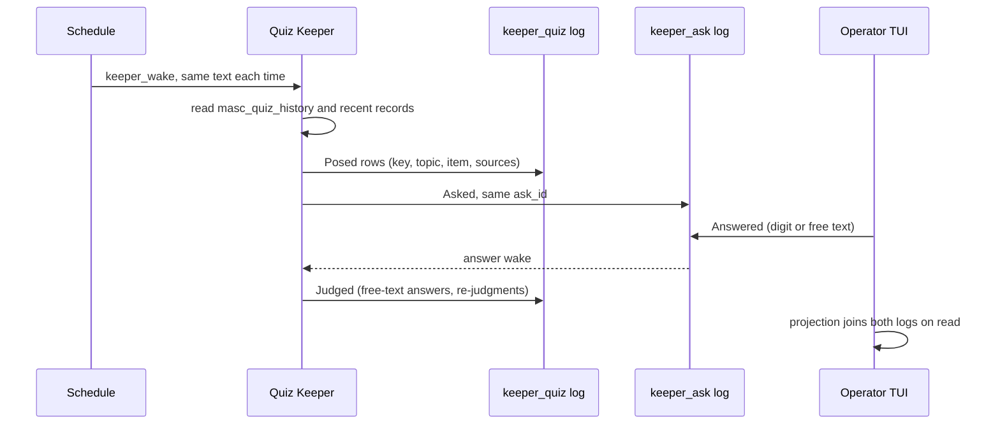

# RFC: Operator quiz

- Status: Draft. Times are UTC unless marked.
- Operator request: Board `p-c15d88ca431ebdcc30bd9869a212c1df`. The author did not re-read the post. The text below is the paraphrase given in the task brief (원문 미직독).
- Coordinates are `path:line` at `b5a3e7540a3`. §16 lists what the author read directly and what came from research agents.
- The file slug keeps the word "lane" because the request used it. The feature is not a Lane (§3.8, D1).

## 0. Summary

The operator says knowledge gaps and "understanding debt" keep piling up and asks for a quiz. This RFC proposes the smallest version that fits the existing system:

- A Keeper writes the quiz when a Schedule wakes it.
- The operator answers in TUI Approvals, exactly as they answer any Keeper question today.
- One new append-only log records the expected answer, the topic, the review item and the cited sources for each question. It is written before the question becomes visible.
- Choice answers are graded by comparing choice ids with that record. Free-text answers are judged by the Keeper against a rubric it wrote before the answer.
- Score, history, the "which topics I keep missing" map and the re-ask list are computed on read. None of them is stored.

A "Quiz Lane" already exists as a Lane Add-on pair (`quiz-questions`, `quiz-grader`). It has never been installed on the live workspace, and its design refuses repeat attempts. This RFC does not build on it. O1 asks the operator whether to delete it.

## 1. Decisions

- D1. The feature is called "operator quiz". It is a Keeper, a Schedule and Ask. It is not a Lane, and it adds no Lanes-list row.
- D2. One new durable record: `<base-path>/.masc/keeper_quiz/<keeper>.jsonl`. It is append-only and has two event kinds, `Posed` and `Judged`. Nothing else is stored.
- D3. The operator sees an ordinary Ask. The answer keys, answer route and answer log do not change.
- D4. The key is on disk before the question exists. One tool appends the `Posed` rows and then the Ask, under the same `ask_id`.
- D5. A choice grade is a pure function of the recorded key and the recorded answer. It is never stored.
- D6. A free-text grade is a Keeper judgment, stored as `Judged`. A later `Judged` replaces an earlier one for display and scoring. Both stay in the log.
- D7. The operator disputes a grade by sending the quiz Keeper an ordinary message. The operator does not write grades (O5).
- D8. The code has no spacing intervals or due dates. The projection shows each review item's attempts, and the Keeper decides what to ask again.
- D9. Success is measured by recovery on re-asked items (§14), not by the average score.
- D10. Every question cites at least one source with a verbatim quote. The server checks the quote for sources it stores itself: Board and wiki.

## 2. Problem

In the operator's words (paraphrased): "Knowledge gaps and understanding debt keep piling up on me. Is there a device for it? A Quiz Lane? A review lane? When it is on, every day or at times I choose, it asks me questions, grades them and keeps an average score, like taking a test."

Two Keepers replied on the same post. ocaml-refactor-woman offered OCaml question sets built from real review pitfalls. geek-scout proposed three things:
- draw questions from what this fleet actually merged (PRs, release notes, board decisions), not general trivia;
- ask missed questions again with spaced repetition;
- report which topics the operator keeps missing, not only an average.

Concretely, these things are missing today:

1. Nothing asks the operator questions on a clock with an answer fixed in advance.
2. Nothing keeps the operator's graded answers over time.
3. Nothing shows which areas the operator misses again and again.

Limit of the claim: a quiz checks whether the operator can recall facts and reasons the fleet wrote down. It cannot check understanding of things nobody recorded. This RFC claims only the first.

Why a test and not a digest: the retrieval-practice literature reports that taking a test improves later retention more than re-reading, and that spaced re-exposure helps (Roediger & Karpicke 2006; Cepeda et al. 2006, §17). The design does not rely on any number from those papers.

## 3. What exists

### 3.1 The existing "Quiz Lane" add-on pair

- Glossary: a Lane Add-on pair `quiz-questions` and `quiz-grader` (#38433, task-1688). Questions come from a fact deck of records, and grading is a separate package (`docs/spec/00-glossary.md:1912-1934`).
- `quiz-questions` turns deck facts into multiple-choice questions.
  - It has a closed set of six templates: `author`, `claimant`, `status`, `merged_commit`, `cause`, `decision` (`addons/quiz-questions/server.py:22-31`).
  - It offers at most four choices, and the wrong choices are real answers taken from other facts (`:31`, `:54-59`).
- The `quiz-deck` skill refuses any fact whose answer is not a whole word inside a quote copied from the saved record (`addons/quiz-questions/skills/quiz-deck/SKILL.md:8-26`). It also states its limits: it does not catch a negation elsewhere in the quote, and it cannot show that the fact was worth asking (`:27-33`).
- `quiz-grader` grades `masc_lane_act` answers by exact string comparison with the deck answer (`addons/quiz-grader/server.py:182-210`).
  - Only one graded attempt is allowed per question and claimed answerer: "the first grade stands" (`:201-209`).
  - The answerer is a label the caller writes in, not an authenticated identity (`addons/quiz-grader/README.md:5-7`).
  - Grader state lives only in the worker incarnation and is not replayed after a restart (`server.py:10-11`). A new worker starts with an empty score (`README.md:40-42`).
- Live state (read 2026-10-20): `<base-path>/.masc/config/lane-addons/` holds five declarations (`dos-counter`, `dos-machine`, `dos-output-statistics`, `msx-machine`, `vst-phrase`), none of them quiz. `quiz` does not occur anywhere under `.masc/lane-addons/`.

Gaps between this pair and the request:
- (a) Answers go through `masc_lane_act`, not the operator's Approvals.
- (b) The same question cannot be graded twice for the same answerer, so spaced repetition is ruled out.
- (c) The score resets with every worker incarnation.
- (d) The six templates are mostly recall of names and SHAs, and there is no free text.
- (e) There are no topics, so no debt map can be built.
- (f) The add-on contract says the core does not interpret package meaning (`docs/design/lane-addon-v0.md:42`). It also says a package that needs TUI menu changes has failed the contract (`:53`). An operator history and debt-map view for this package would break both rules.

Worth keeping from it:
- The person answering never sees which choice is right.
- Every answer is backed by a quote from a record.
- Wrong choices come from real neighbouring facts.

### 3.2 Ask (Keeper questions)

- A question has choices with a stable `choice_id` (`lib/keeper/keeper_ask.mli:26-32`) and a `Single` or `Multi` mode (`:43-45`).
  - Every question also accepts a free-text `Wrote` answer (`:47-51`) and a `Skipped` answer (`:121-126`).
  - Questions never expire, and the asking Keeper is not suspended (`:12-14`).
  - The ask's `context` is rendered beside the prompt (`:91-94`), so it cannot hold a hidden key.
- Store: append-only `<base_path>/.masc/keeper_ask/<sanitized-keeper>.jsonl`. Writes go through a per-path mutex and a file lock, and the first recorded answer wins (`lib/keeper/keeper_ask_store.mli:1-13`).
- Tool `masc_ask` makes the `ask_id` and appends `Asked` (`lib/mcp_tool_runtime_ask.ml:155-175`). Its description says "Use for missing external decisions" (`config/tools/masc_ask.toml:2-7`). The answer reaches the Keeper as a wake that carries the original questions (`:4-7`; `lib/keeper/keeper_ask_answer_wake.mli:16-27`).
- Measured weak spot: in 2026-09, 84 of 131 `masc_ask` calls failed, mostly because Keepers got the nested schema wrong (`docs/rfc/RFC-0425-a-question-says-how-it-can-be-answered.md:15-31`). A quiz tool with more nested fields carries the same risk.
- Answer route: `POST /api/v1/keepers/ask-answer` (`lib/server/server_routes_http_routes_dashboard.ml:3829-3833`). The responder is recorded as `Surface_ref.Dashboard` (`lib/server/server_routes_http_keeper_stream.ml:4196-4199`).
- The list route accepts `include_resolved` (`:4348-4349`), but the TUI only fetches open questions (`bin/masc_tui_http.ml:3673-3678`).
- Live use: 45 per-Keeper ask logs, 1,972 lines in total (count of `.masc/keeper_ask/*.jsonl`, 2026-10-20).

### 3.3 Schedules

- Recurrence options are `One_shot`, `Interval`, `Daily {hour; minute; second; timezone}` and `Cron`. The timezone is a fixed offset: `Asia/Seoul`/`KST` is +09:00, with no DST (`lib/schedule/schedule_domain.mli:36-61`).
- Statuses are Scheduled, Due, Running, Succeeded, Failed, Cancelled and Expired (`:18-25`).
  - There is no enabled or paused state.
  - Cancel is terminal, and update works only on Scheduled or Due rows (`config/tools/masc_schedule_cancel.toml:3-6`, `masc_schedule_update.toml:3-5`; agent).
- The only payload kind is `masc.keeper_wake` (`lib/schedule/schedule_supported_kinds.ml:18-20`; agent).
  - A due wake goes into the Keeper's event queue (`lib/server/server_schedule_consumers.ml:1023-1061`; agent).
  - A recurring wake sends the same text every time (`config/tools/masc_schedule_create.toml:53-62`).
  - The next occurrence is held while the previous one has not been consumed (`lib/schedule/schedule_runner.mli:23`).
- The TUI already posts create, update and cancel (`bin/masc_tui_http.ml:2765-2784`; agent).

### 3.4 Goals

- A Goal stores its metric and target as strings (`lib/goal/goal_document.mli:3-16`).
- It keeps one observation, and a new one replaces the previous (`lib/goal/goal_measurement.mli:35-36`).
- A metric must name something the completion judge can open: a URL, a `board:` post or a `fusion:` run (`config/tools/masc_goal_upsert.toml:31-41`; agent).

A Goal cannot hold per-question history.

### 3.5 Wiki, Keeper memory, artifacts

- **Wiki:** Keepers can create and update pages, and an update needs `base_revision` (glossary `:3925`; `config/tools/masc_wiki_update.toml:5-10`; agent). It is knowledge to cite, not a ledger.
- **Keeper memory:** a write first waits for Librarian admission and can be declined (`config/tools/keeper_memory_write.toml:5`; agent). It is the Keeper's own subjective view, so it is not a record of grades.
- **Artifacts:** `keeper_artifact_publish` stores revisioned Markdown or HTML (`config/tools/keeper_artifact_publish.toml:1-45`; agent). It fits a human-readable report, not a ledger.

### 3.6 Places questions can come from

- **Changelog fragments:**
  - Each PR adds `changelog.d/<PR>.md`. Its bullets sit under fixed `###` sections and cite the PR's own number (`changelog.d/README.md:3-17`).
  - Release deletes the fragments (`:20-24`), so a question has to cite them by commit.
- **Board:**
  - Post and comment ids are `p-`/`c-` followed by 32 hex characters (`lib/board_types/board_types.ml:85`, `:99-108`; agent).
  - `masc_board_post_get` returns a post with up to its 20 newest comments (`config/tools/masc_board_post_get.toml:6-12`; agent).
  - Posts can be edited (`config/tools/masc_board_post_update.toml`).
- **GitHub:**
  - Keepers reach GitHub through `tool_execute` in their sandbox (`config/tools/tool_execute.toml:1-18`). The images ship `gh` and `git` (`sandbox-images/base/Dockerfile:17-21`), and each Keeper has its own `gh` identity (`lib/keeper/keeper_github_identity.ml:100-107`) (all agent).
  - Unconfirmed: whether a given Keeper has a login, network access and a checkout.

### 3.7 TUI

- Open questions sit under Approvals as "[?] Questions waiting on you" (`bin/masc_tui_render_approvals.ml:383-401`). `a` opens answering (`bin/masc_tui.ml:15482`; agent).
- Answering keys:
  - Digits 1-9 pick a choice by position.
  - The digit just after the last choice opens free text (`bin/masc_tui.ml:25808-25818`).
  - Enter must be pressed twice to send (`:15795-15826`; agent).
- After sending, one "last answer" receipt block is shown (`bin/masc_tui_render_approvals.ml:245-361`; agent). Home also lists question rows (`bin/masc_tui_home.ml:34-45`; agent).
- A new question rings the bell and shows a desktop banner, "<keeper> is waiting on a decision" (`bin/masc_tui.ml:12008-12029`).
- The tab ring has seven entries (`bin/masc_tui_types.ml:3961-3969`), and Approvals belongs to the Work family (`bin/masc_tui_surface_navigation.ml:7-22`; agent).
- Neither the TUI nor the web dashboard shows answered questions anywhere (agent).

### 3.8 What "Lane" means here

- The glossary defines Lane as a fixed execution path for exact-output model work. It names four other, unrelated uses of the word (`docs/spec/00-glossary.md:1352-1372`).
- Lane family is the row group in the operator's Lanes list: exact, browser, machine or package (`:1374-1384`). A package lane is switched by a root `enabled` key (`docs/guides/lane-package-activity.md:3-20`).

A quiz driven by a Keeper wake fits none of these. Calling it a Lane would add a sixth meaning, which is why D1 names it "operator quiz".

## 4. Design

### 4.1 Pieces and flow

1. The operator creates a Schedule that wakes the quiz Keeper (§10).
2. On the wake, the Keeper reads `masc_quiz_history` (open quizzes, review items, topics) and recent records (§5).
3. The Keeper decides whether to ask and what to ask. It calls `masc_quiz_ask` with the questions.
4. The tool checks the input, appends the `Posed` rows, then appends `Asked` to the ask log under the same `ask_id`.
5. The operator answers in Approvals as today.
6. The TUI answer receipt reveals each question's verdict, the expected answer and the sources (§9).
7. The answer wake reaches the Keeper. For every free-text answer, the Keeper calls `masc_quiz_judge`.
8. The Quiz surface shows sessions, reveals, the debt map and review items.



### 4.2 The one new record

The record is append-only JSONL with one file per asking Keeper. It follows the layout and lock pattern of `Keeper_ask_store`.

```ocaml
type source =
  | Pr of { number : int; merge_commit : Commit_sha.t; quote : Quote.t }
  | Pr_comment of { number : int; comment_id : int; quote : Quote.t }
  | Commit of { sha : Commit_sha.t; quote : Quote.t }
  | Repo_file of { commit : Commit_sha.t; path : Repo_path.t;
                   first_line : int; last_line : int; quote : Quote.t }
  | Board_post of { post_id : Post_id.t; quote : Quote.t }
  | Board_comment of { post_id : Post_id.t; comment_id : Comment_id.t; quote : Quote.t }
  | Wiki_page of { name : Wiki_page_name.t; revision : int; quote : Quote.t }

type expected =
  | Choices of string list  (* non-empty; ids of this question's choices *)
  | Points of string        (* rubric for a free-text question *)

type posed = private {
  ask_id : string; question_id : string;
  item_id : Item_id.t;      (* stable across re-asks, [a-z0-9-]+ *)
  topic : Topic.t;          (* [a-z0-9-]+ *)
  expected : expected;
  sources : source list;    (* non-empty *)
  posed_at : float;
}

type verdict = Correct | Incorrect | Void of { reason : string }

type judged = private {
  ask_id : string; question_id : string;
  verdict : verdict; rationale : string; judged_at : float;
}

type event = Posed of posed | Judged of judged
```

- **Writers:** only the owning Keeper, through the two tools in §4.4.
- **Decode:**
  - The decoder is strict. An unknown event kind, an unknown source kind or a malformed id is a decode error that names the path and line.
  - A missing log is a different result from an empty log, as in `Keeper_ask_store` (`keeper_ask_store.mli:42-46`).
- **Fold:**
  - A second `Posed` for the same `(ask_id, question_id)` is dropped and counted as an anomaly. The first one wins, the same rule as the ask fold (`keeper_ask.mli:191-196`).
  - For each question, the last `Judged` in file order is the current one, and earlier ones stay as its history.
- **Ordering (D4):** `masc_quiz_ask` makes the `ask_id` and appends every `Posed` row. Only after that write succeeds does it build the `Keeper_ask.ask` and call `Keeper_ask_store.record_ask`.
  - So the key is durable before the operator can see the question.
  - If the Ask append fails, the `Posed` rows have no Ask. The projection counts them as "posed, never asked" and leaves them out of every score.
- **Spoilers:** the read route leaves out `expected` and `sources` while a question is still open. That is a visibility choice, not a guard. The file on disk holds the key, and the operator can read it.

### 4.3 Why each fact lives where it does

| Fact | Where it lives | Why |
|---|---|---|
| Question text, choices, time asked | Ask log (exists) | Unchanged |
| The answer, who answered, when | Ask log (exists) | Unchanged |
| Expected answer, fixed before the answer | `Posed` (new) | The ask `context` and choice text are rendered to the operator (`keeper_ask.mli:26-32`, `:91-94`), so there is no hidden slot. Keeper memory can be declined. The add-on deck exists only inside a worker. Without this record, nothing shows that a grade predates the answer. |
| Topic, review item, sources | `Posed` (new) | The debt map and re-asks group by them. No record holds them as typed values, and reading them out of prose is string matching (constitution `docs/constitution.xml:451-457`). |
| Free-text verdict and reasons | `Judged` (new) | A judgment exists nowhere else. Running the model again could give a different answer. |
| Choice verdict | Not stored | A pure function of the key and the answer |
| Score, history, debt map, review items | Not stored | Projections (§8) |
| Dispute | Chat log (exists) | An ordinary message. If it changes the grade, the result is a new `Judged`. |
| On/off and times | Schedule (exists) | Unchanged |

### 4.4 Tools

- **`masc_quiz_ask`**
  - Arguments: the `questions` array of `masc_ask`, where every question object also carries a required `quiz` object `{item_id, topic, key_choice_ids | key_points, sources}`, plus the optional top-level `context`. It reuses the question parser in `mcp_tool_runtime_ask.ml`, so the Ask part cannot drift from `masc_ask`.
  - It refuses before writing anything when:
    - a question has no `quiz` object;
    - a key choice id is not one of that question's choices;
    - a `Single` question has more or fewer than one key;
    - a question with choices has no `key_choice_ids`;
    - a question without choices has no `key_points`;
    - `sources` is empty, or a source kind is unknown;
    - a Board or wiki quote does not occur in the stored record right now (D10).
  - It returns the `masc_ask` body plus the number of `Posed` rows. Its description includes one complete call; RFC-0425 found that a real example removed most nesting mistakes.
- **`masc_quiz_judge`**
  - Arguments: `{ask_id, question_id, verdict: correct|incorrect|void, rationale, void_reason?}`.
  - It refuses when:
    - the caller is not the Keeper that asked;
    - the ask is still open or was withdrawn;
    - the question has no `Posed` row;
    - either log cannot be read. An unreadable store never permits a write (constitution `:245-248`).
- **`masc_quiz_history`**
  - Read-only. It returns the projection from §8 for the calling Keeper or for the whole fleet.
  - Large results are split with a cursor. Tool results over 16,384 bytes become sealed blobs (copied from `RFC-wiki-lint-and-page-contracts.md` §4.1; not re-read).

### 4.5 Fit with the constitution

- **`no_wall_clock_death` (`:220-226`):** open quizzes, unjudged answers and review items never expire.
- **`persist_before_model_call` (`:240-243`):** the key is written before the question can be seen.
- **`closed_sum_over_string` and `strict_parse_no_default` (`:228-238`):**
  - Verdict, source kind and attempt state are closed sums.
  - Unknown input fails to decode.
- **`magic_number` and `budget_gate` (`:440-466`):** the code has no intervals, caps, daily limits or weights.
- **`legacy_residue` (`:487-494`):** this is a new store with no readers or converters for older data.
- **Operator rules:**
  - The log holds facts, and the Keeper chooses the next question.
  - Visibility is a projection.
  - A dispute is a message, not a contract.

## 5. Question sources and citations

| Kind | Pin | How a reader checks it | Server-checked |
|---|---|---|---|
| `pr` | number + merge commit | `gh pr view <n>` | no |
| `pr_comment` | PR number + comment id | GitHub comment URL | no |
| `commit` | 40-hex SHA | `git show <sha>` | no |
| `repo_file` | commit + path + line range | `git show <sha>:<path>` | no |
| `board_post` | `p-…` | `masc board post get` | yes, at pose time |
| `board_comment` | `p-…` + `c-…` | same | yes, at pose time |
| `wiki_page` | name + revision | `keeper_wiki_read` | yes, against the current revision |

- Each source carries a verbatim `quote`, with no whitespace or case normalisation. The key must follow from the quoted text. That is the Keeper's duty, and the dispute path checks it.
- `repo_file` covers several sources:
  - changelog fragments, cited by a commit that still has them because release deletes them;
  - `CHANGELOG.md` release sections;
  - RFCs;
  - the constitution;
  - code.
  ocaml-refactor-woman's review pitfalls fit `pr_comment`.
- Board posts can be edited. The pose-time check proves what the record said at that moment, and the reveal says so.
- A source is never shown before the answer, because a citation like "PR #44081" can give the answer away. The Skill (L5) tells the Keeper not to put sources in the ask `context`.
- Selection is guidance in the Skill, not code. Prefer:
  - things the operator decided or merged;
  - PRs and fragments merged since the last quiz;
  - release notes;
  - reviews that found P1/P2 problems;
  - RFC decisions.

  Ask "why" and "what changed" rather than "who" and "which SHA". The existing templates (§3.1) show how a quiz drifts into trivia.
- "Checkable" means that from the reveal, one command or one TUI jump opens the record at the pinned coordinate and shows the quote.
- The limits from `SKILL.md:27-33` still apply. A quote check does not catch a negation elsewhere in the record, and it does not show that the fact was worth asking.

## 6. Grading

### 6.1 Choice questions

- An answer `Chose ids` is `Correct` when its id set equals the key set, and `Incorrect` otherwise.
- A `Multi` question needs the exact set. There is no partial credit.
- The verdict is recomputed on every read and never stored.
- On a re-ask, the Skill tells the Keeper to reshuffle choice positions and draw wrong choices from real neighbouring facts, as `quiz-questions` did (`server.py:54-59`).

### 6.2 Free text

- A `Wrote` answer on any question is `Awaiting_judgment` until a `Judged` row exists. Ask always allows free text (`keeper_ask.mli:47-48`).
- The asking Keeper judges against what it recorded before the answer and the sources:
  - for a free-text question, the `key_points`;
  - for a choice question, the label of the key choice.
- The rationale names the point that was missing.
- The verdict is binary. A partial score would be a number standing in for a judgment.
- An unjudged answer stays visibly awaiting, with no expiry. O4 asks whether the judge should be someone other than the asking Keeper.

### 6.3 Skips and unanswered questions

- `Skipped` counts as a miss: the operator said "I don't know" (O8).
- Withdrawn and unanswered questions are not attempts. They are counted separately.

### 6.4 Disputes

- From a reveal, `d` opens chat with the quiz Keeper, prefilled with the `ask_id` and `question_id`.
- The Keeper reads the source again and may append a new `Judged`: `Correct`, `Incorrect`, or `Void` when the question or the key was wrong.
- A `Judged` row also overrides a key-based choice grade. Deterministic grading is the default, not a lock.
- The reveal shows the whole chain of judgments.
- How often grades change after a dispute is the guard metric G (§14).

## 7. Spaced repetition

- The unit is the review item (`item_id`). It stays the same across re-asks, while the wording and the choices may change.
- For each item, the projection gives:
  - every attempt with its time and verdict;
  - the latest verdict;
  - how many correct answers in a row end the history;
  - its topic and sources.
- The code computes no due date. A table of intervals would be a number deciding what the Keeper does (constitution `:440-449`). Leitner boxes, SM-2 and FSRS also differ, and there is no local data to choose between them.
- The Keeper reads each item's history and decides. The Skill describes a starting practice in words:
  - ask a missed item again on a later day;
  - leave longer gaps after each correct answer;
  - stop asking an item after several correct answers spread over time.
- Trade-off: this is less predictable than a coded schedule. The operator can see every re-ask in the item history, and R (§14) shows whether it works. If R stays low, a coded schedule is the next RFC.

## 8. Projections: score, history, debt map

- **Inputs:** every Keeper's ask log and quiz log, found the same way as `Keeper_ask_store.discover_rows_result` (`keeper_ask_store.mli:52-61`).
- **Join:** on `(keeper, ask_id, question_id)`. An ask with no `Posed` rows is a decision, not a quiz, and is excluded.
- **Attempt state (closed sum):**

  ```ocaml
  Open | Withdrawn | Correct of by | Incorrect of by | Skipped
  | Awaiting_judgment | Void of reason
  (* by = Key | Judgment of { judged_at } *)
  ```
- **Session:** one quiz Ask, with counts of correct, incorrect, skipped, awaiting and void questions.
- **Score:** correct divided by (correct + incorrect + skipped). It is shown per session and over all attempts, always with its numerator and denominator.
  - The server returns timestamps, and the TUI groups them by day or week in local time. This needs no timezone setting.
  - The score is not used as a control or as the success signal.
- **Debt map:** one row per topic, showing:
  - review items and attempts;
  - misses;
  - "open debt": items whose latest attempt is a miss;
  - the time of the last miss;
  - the open-debt items with their sources.

  There are no weights and no ranking formula. Rows are sorted by open-debt count and then by name, for display only. Deciding which debt matters is left to the operator or a Keeper, in words.
- **Review items:** as described in §7.
- **Observability:** the projection also counts posed-but-never-asked questions, fold anomalies and unreadable logs. An unreadable log is reported as such, never as an empty one.

## 9. TUI surfaces

- **Today's quiz:** Approvals and Home rows, with the same answering keys as today.
  - The ask-list route adds a derived `quiz` mark to each row: `Quiz`, `Decision`, or `Unknown` when the quiz log cannot be read. A failed quiz-log read never hides the ask itself.
  - Quiz rows are labelled "Quiz". The banner reads "<keeper> sent a quiz" instead of "is waiting on a decision" (`bin/masc_tui.ml:12021-12026`).
- **Reveal after answering:** the answer receipt block shows, for each question:
  - the operator's answer;
  - the expected answer;
  - the verdict, or "waiting for judgment";
  - the sources with their quotes.
- **Quiz surface:** new, in the Work family, reached from the palette ("go Quiz") and a Home row.
  - It lists sessions, newest first. Enter opens one question's reveal with its judgment chain.
  - It shows topics (the debt map), review items, and the R, G and P counts from §14.
  - `d` disputes and `o` opens the source.
  - Data comes from one new read route, `GET /api/v1/keepers/quiz`, using the same tool auth as the asks list.
- **Web dashboard:** no change in this RFC. It already answers asks.
- **Tests:** they check the requests sent and the decoded state. No test pins screen text, layout or row order (constitution `:371-373`).

## 10. Turning it on and off, setting times

- **On:** pick the quiz Keeper (O3). Then create a Schedule for it, from the TUI schedule form or with `masc_schedule_create`.
  - Use `Daily {hour = 8; minute = 30; timezone = "Asia/Seoul"}`, or `Cron "30 8 * * 1-5"` with the same timezone for weekdays only.
  - Example message: "Compose today's operator quiz with the operator-quiz skill. Read masc_quiz_history first."
  - The wake text repeats unchanged, so it tells the Keeper to read current state each time (`masc_schedule_create.toml:53-62`).
- **Change the time:** use `masc_schedule_update`.
- **Off:** cancel the Schedule. No pause state exists (§3.3), so turning it back on means creating a new Schedule. Quiz history is not touched.
- **Ad hoc:** ask the quiz Keeper in chat.
- **Several quizzers:** give each Keeper its own Schedule. The logs are per Keeper, and the projection merges them.
- **No new settings:** this adds no config key, no flag and no `runtime.toml` table.
- **Unanswered quizzes:**
  - The next wake is held only while the previous wake is unconsumed (`schedule_runner.mli:23`).
  - Open quiz asks stay open.
  - The Keeper sees the open count in `masc_quiz_history` and in the ask tool's `open_count` (`mcp_tool_runtime_ask.ml:185-201`). It decides whether to withdraw yesterday's quiz or skip today. The code sets no limit.

## 11. Out of scope

- General learning material that the fleet has not recorded.
- A coded spacing algorithm or due dates.
- Any gate or consequence:
  - a quiz result never blocks a merge, an approval, a task or a Keeper action;
  - there are no Candle rewards and no penalties.
- Weighted debt scores and rankings by formula.
- More than one human operator.
- A web dashboard quiz view, and delivery over Slack or Discord.
- Changes to the Gate approval queue or the `masc_ask` schema.
- Generating questions on the server without a Keeper.
- Importing data from the existing Quiz Lane add-ons.

## 12. Alternatives considered

| Alternative | For | Against |
|---|---|---|
| A1. Extend the existing Quiz Lane add-ons | Keeps its quote checks and the split between asking and grading | "First grade stands" rules out re-asks. The score resets with each incarnation. Answers go through `masc_lane_act` with a self-written label. Six recall-style templates and no free text. An operator history view breaks the add-on contract (§3.1 f). Fixing all of this rewrites both packages and adds a core replay path. |
| A2. No new record: key in Keeper memory, grades in chat or on the Board | No new code | Memory can decline the key, and nothing shows the key predates the answer. Score and debt map would mean parsing prose or re-running a model on every read. Not reproducible. |
| A3. New `Keeper_ask.event` variants for key and judgment | One file and one fold per Keeper | Every surface that encodes asks must remember to hide the key. Quiz meaning enters a module whose contract is decisions. The Gate/Ask split (`keeper_ask.mli:7-10`) already keeps different meanings in separate records. |
| A4. Goal plus measurement for the score | Existing surface | One observation per Goal and no per-question history. Could later mirror R as a Goal, through a Board post the metric names. |
| A5. Wiki page or artifact as the quiz log | Human-readable | Prose to parse. A wiki page is knowledge, not a ledger. A weekly report artifact built on the projection could come later. |
| A6. Coded spacing (Leitner, SM-2, FSRS) | Predictable and studied | A number decides Keeper behaviour, with no local data to set parameters. Revisit if R stays low. |
| A7. An independent judge for free text (another Keeper or a Fusion panel) | The judge did not write the question | More moving parts and an extra turn per answer. Kept as O4. |
| A8. A daily digest instead of a quiz | Less effort for the operator | Re-reading is what retrieval practice beats in the cited studies, and a digest gives no signal of what the operator missed. It could run alongside. |
| A9. A separate quiz-answering UI | Could be shaped for quizzes | Duplicates the Approvals answering keys, free-text editor and two-step send for no gain. |

## 13. Open decisions for the operator

- O1. The existing Quiz Lane add-on pair has never been installed live. Two options:
  - Delete it in this stack: `addons/quiz-questions`, `addons/quiz-grader`, `addons/tests/test_quiz_lane.py`, `test/test_lane_quiz_packages.py` with its stanza and `test/dune` entry, the glossary entry, and the mentions in `docs/design/lane-addon-v0.md:40`, glossary `:1878` and `addons/README.md`.
  - Keep it as a Keeper-facing add-on example.

  Recommendation: delete it. Two quiz concepts invite the wrong context.
- O2. Name the feature "operator quiz" (recommended), or keep "Quiz Lane". "Quiz Lane" collides with the existing meanings of Lane even if O1 removes the add-on.
- O3. Which Keeper or Keepers quiz, and how many questions per session. The count goes in the schedule message or the Keeper's instructions, not in code.
  - Suggested start: one dedicated Keeper. ocaml-refactor-woman and geek-scout send it material as ordinary messages.
  - The alternative is that each of them quizzes on its own Schedule.
- O4. Who judges free text:
  - the asking Keeper (recommended for v1);
  - a separate Keeper;
  - the operator, through a follow-up self-check Ask.
- O5. May the operator write a grade directly (override or void)? Recommendation: not in v1. Disputes go by message.
- O6. Which sources are allowed:
  - all seven kinds (recommended);
  - only the server-checked kinds (Board and wiki). This would drop PRs, commits and code, which is most of what the fleet merges.
- O7. The targets in §14.
- O8. Does `Skipped` count as a miss (recommended), or is it left out of the score?

## 14. Success criterion

- **Primary, R (recovery on re-ask):**
  - The denominator is the number of review items that had a miss (`Incorrect` or `Skipped`) followed by a graded attempt on a later local day.
  - The numerator is the number of those items whose first later attempt was `Correct`.
  - The projection reports R as a fraction n/d.
- **Proposed target (O7):** after 30 days of running the Schedule, d ≥ 20 and n/d ≥ 2/3.
  - With d < 20, the result is "not measurable yet", not a pass.
  - No baseline exists. These numbers are a starting proposal, not derived from data.
- **Guard, G (grading error):** the number of `Judged` rows that change an earlier verdict on the same question (from the key or from an earlier judgment), divided by graded attempts. Proposed target: ≤ 1/20. A high G means the keys or the judge are wrong more often than the operator is.
- **Reported, P (participation):** graded attempts divided by posed questions in the window. It has no target. A low P means the quiz costs more attention than the operator gives it, and acting on that is the operator's call.
- **Why not the average:** the question writer sets the difficulty, so the average can rise just because the questions got easier. R holds the item fixed.
  - Caveat: rewording an item changes its difficulty a little.
  - Reshuffling the choices stops the operator from remembering a choice's position.
- **What R does not show:** understanding of anything outside the recorded facts (§2).
- **Evidence (constitution `:528-532`):** the live quiz log, the projection output, and TUI screenshots of the Approvals reveal and the Quiz surface after the first week, with R, G and P on day 30.

## 15. Implementation plan

The work is a stacked set of PRs (`gh stack`). Each layer stays within the 20k-token work unit (constitution `:329-341`) and carries its own changelog fragment.

| Layer | PR | Content | Tests |
|---|---|---|---|
| L0 | this RFC | Design | `scripts/rfc-generate-index.py --check` |
| L1 | Record | `lib/keeper/keeper_quiz.ml(i)`: types, constructors that return `result` over `private` types, codec. `lib/keeper/keeper_quiz_store.ml(i)`: append, read and discover, with the `Keeper_ask_store` lock pattern | Each event and source kind round-trips. An unknown kind or bad id fails with path and line. A missing log differs from an empty one. A duplicate `Posed` keeps the first and counts an anomaly. Concurrent appends are serialized. |
| L2 | Projection | `Keeper_quiz_projection`, pure: attempt states, sessions, items, topics, R/G/P | Table cases: choice right and wrong; Multi exact set; `Wrote` → awaiting; `Judged` overrides the key; `Void` is excluded; `Skipped` is a miss; decision asks are excluded; posed-but-never-asked is counted; R/G/P on a fixed two-week fixture. |
| L3 | Tools | `masc_quiz_ask`, `masc_quiz_judge`, `masc_quiz_history`, their `config/tools/*.toml`, cases in `test/test_keeper_tool_matrix_cases.ml`, and the Board/wiki quote check | Every refusal writes nothing. `Posed` is on disk before `Asked`, shown with an interleaving hook like `Keeper_ask_store.For_testing`. The `Asked` row decodes the same as a `masc_ask` row. Judge refusals: open, withdrawn, other Keeper, unreadable log. |
| L4 | Server and TUI | `GET /api/v1/keepers/quiz`; the `quiz` mark on ask rows; the TUI label, banner text, reveal in the answer receipt, Quiz surface and dispute prefill | The TUI sends the expected paths and queries. The decoders accept the projection and refuse unknown states. No screen text or layout tests. |
| L5 | Skill and guide | `skills/operator-quiz/SKILL.md` covers sources, verbatim quotes, reusing topics, rewording and reshuffling, the re-ask practice, judging against the rubric, and not leaking sources. Also `docs/guides/operator-quiz.md` (on/off and schedule examples) and a glossary entry "Operator quiz" | The guide's example calls match the tool toml. |
| L6 | Only if O1 = delete | Remove the add-on pair and every mention of it | The add-on test suite passes without the quiz cases. |

After L5, the operator creates the Schedule and the live acceptance in §14 begins.

## 16. Read scope and confidence

**Read directly by the author at `b5a3e7540a3`:**
- `AGENTS.md` and `docs/constitution.xml` in full.
- `docs/rfc/README.md`, and `RFC-wiki-lint-and-page-contracts.md` (outline and §11-13).
- `lib/keeper/keeper_ask.mli` and `keeper_ask_store.mli` in full. The first 60 lines of `keeper_ask_answer_wake.mli`, and `keeper_ask_operator_projection.mli`.
- `lib/mcp_tool_runtime_ask.ml:121-210` and `config/tools/masc_ask.toml:1-60`.
- The whole `addons/quiz-questions` and `addons/quiz-grader` packages, apart from the Dockerfiles and `build_deck.py`.
- `docs/design/lane-addon-v0.md`; glossary `:1352-1384` and `:1860-1934`.
- `lib/lane_addon/lane_addon_action.mli`, and `config/tools/masc_lane_act.toml:1-40`.
- `schedule_domain.mli:18-61`, `masc_schedule_create.toml:50-64`, `goal_measurement.mli:30-37`, `changelog.d/README.md:1-24` and `lane-package-activity.md:1-20`.
- Spot checks against the agent reports:
  - `bin/masc_tui.ml:25806-25820` and `:12008-12030`;
  - `bin/masc_tui_http.ml:3673-3690`;
  - `bin/masc_tui_render_approvals.ml:245-250` and `:383-401`;
  - `bin/masc_tui_types.ml:3961-3969`;
  - `server_routes_http_routes_dashboard.ml:3825-3834`;
  - `server_routes_http_keeper_stream.ml:4194-4200` and `:4348-4372`;
  - `schedule_runner.mli:23-25`.
- Live counts on 2026-10-20: the `lane-addons` declarations, `quiz` under `.masc/lane-addons/`, and the ask logs.

**Read by research agents in this session and not re-read** (marked "agent" in the text): schedule consumer and tool details, Goal tools, wiki/memory/artifact tool text, Board ids, GitHub sandbox access, TUI navigation and answer flow line numbers outside the spot checks.

**Not read:**
- the Board post itself;
- the body of `Keeper_ask_answer_wake`;
- `Workspace_utils.masc_dir`;
- whether old wiki revisions are retained;
- which Keepers actually have a GitHub login and a checkout.

**Confidence:**
- Existing state (§3): high where read directly, medium where an agent read it.
- How well the design fits the rules: medium to high. The weakest point is D10, the exact quote check. It compares a claimed citation with stored bytes, not a heuristic, and is the same check the `quiz-deck` skill already makes.
- Whether the quiz reduces the operator's debt: unknown. §14 is how it gets measured.

## 17. References

Cited from memory and not re-read for this RFC. No number in this RFC comes from them.

- H. L. Roediger, J. D. Karpicke, "Test-enhanced learning: taking memory tests improves long-term retention", Psychological Science 17(3), 2006.
- N. J. Cepeda et al., "Distributed practice in verbal recall tasks: a review and quantitative synthesis", Psychological Bulletin 132(3), 2006.
- S. Leitner, "So lernt man lernen", 1972 (the Leitner box system).
- FSRS, the Free Spaced Repetition Scheduler (open-spaced-repetition project), offered as a scheduler option in Anki.
