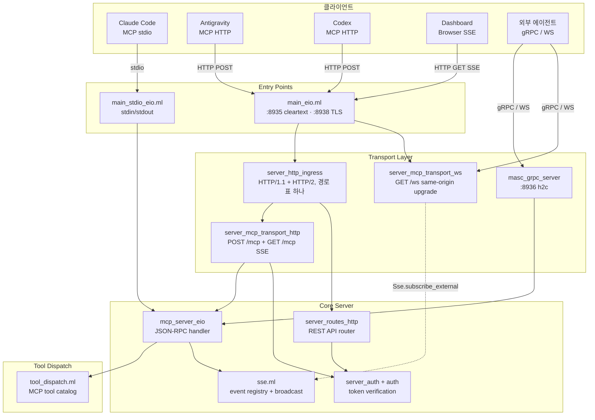
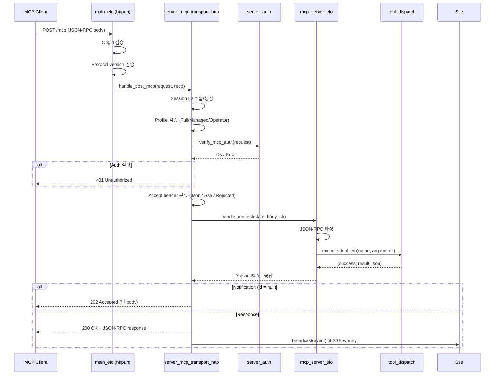
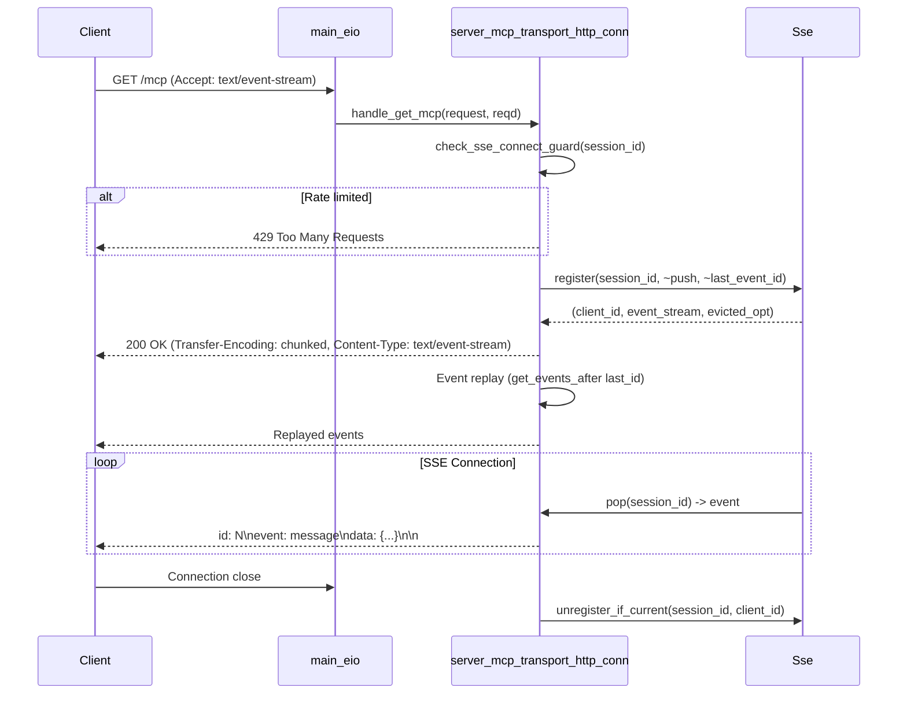

# Server & Transport

| 항목 | 값 |
|------|-----|
| Status | Draft |
| Team | Server |
| Maps to | `lib/server/`, `lib/sse.ml`, `lib/transport.ml`, `lib/http_server_eio.ml`, `lib/mcp_server_eio*.ml`, `bin/main_eio.ml`, `bin/main_stdio_eio.ml` |
| Dependencies | 02-types-and-invariants |
| Modules | `lib/server/` and the files in Maps to are the inventory SSOT |
| LOC | Derived from the source tree, not duplicated here |

---

## 1. Purpose

MCP(Model Context Protocol)를 다중 트랜스포트(HTTP/1.1, HTTP/2(h2c 와 TLS ALPN), WebSocket, gRPC, stdio)로 제공하는 서버 레이어. JSON-RPC 2.0 기반 MCP 요청을 받아 도구 디스패치로 라우팅하고, SSE(Server-Sent Events)로 이벤트를 스트리밍한다.

핵심 설계 결정:

- **httpun-eio** 기반 HTTP/1.1이 canonical transport. Eio direct-style async.
- SSE는 per-session `Eio.Stream.t` mailbox 패턴. broadcast 시 global write-lock 없음.
- HTTP/2는 `h2-eio` 기반이다. cleartext 리스너(8935)는 `MASC_USE_H2=auto|1|0`로 mode 를 고르고, 기본값 `auto`는 HTTP/1.1과 h2c를 같은 포트에서 자동 감지한다. TLS 리스너(8938, `transport.https_port`)는 ALPN 으로 h2 또는 http/1.1 을 고른다. 두 리스너와 두 프로토콜은 경로 표 하나(`Server_http_ingress` → `Router`)를 탄다(RFC-0512).
- WebSocket은 기본 활성화(`MASC_WS_ENABLED=0`으로 비활성화), gRPC는 기본 비활성화(`MASC_GRPC_ENABLED=1`로 활성화)되는 보조 지원 트랜스포트다.
- stdio 모드는 Claude Code 등 로컬 MCP 클라이언트의 표준 연결 방식.

---

## 2. Architecture



---

## 3. Transport Matrix

| Transport | Protocol Stack | Module | Port | 활성화 조건 | Status |
|-----------|---------------|--------|------|------------|--------|
| HTTP/1.1 | httpun-eio | `server_http_ingress` + `server_mcp_transport_http` | 8935 | 기본값 | Canonical |
| HTTP/2 (h2c) | h2-eio | `server_h2_gateway`(연결 어댑터) + `server_http_ingress` | 8935 | `MASC_USE_H2=auto` (기본) 또는 `1` | Available |
| HTTPS (TLS 1.3, ALPN h2 또는 http/1.1) | tls-eio + h2-eio / httpun-eio | `server_bootstrap_http.serve_tls` + `server_http_ingress` | 8938 | 기본 켜짐, `transport.https_port = 0` 으로 끔 | Available |
| WebSocket | ws-direct (`ws-direct-eio` / `ws-direct-gluten`) | `server_mcp_transport_ws` | HTTP 리스너의 `/ws` same-origin 업그레이드 | 기본값, `MASC_WS_ENABLED=0`으로 비활성화 | **Experimental** |
| gRPC | grpc-direct (h2c) | `masc_grpc_server` | 8936 | 기본 비활성, `MASC_GRPC_ENABLED=1`로 활성화 | Available |
| stdio | Eio stdin/stdout | `main_stdio_eio` + `mcp_server_eio.run_stdio` | N/A | `masc-stdio` 실행 | Available |

**Experimental** 상태의 의미: 해당 transport는 코드가 존재하고 로컬 테스트에서 동작하지만, 프로덕션 interop 검증이 미완료. API/프로토콜은 향후 breaking change가 발생할 수 있음. 기본값으로 활성화되어 있으나, 주의해서 사용.

### 3.1 Transport 값 (아직 아무것도 고르지 않는다)

`lib/config/masc_grpc_transport.ml`이 값을 정의한다:

```ocaml
type t = Http | Grpc | Ws | Local
```

`MASC_AGENT_TRANSPORT` 로 값을 정하고 기본은 `Local` 이다. **그런데 값을 바꿔도
에이전트가 서버에 닿는 경로는 달라지지 않는다.** 코드 전체에서 이 값을 읽는
곳은 한 군데이고, 하는 일은 로그 한 줄이다.

```ocaml
(* lib/runtime/runtime_agent.ml:1101 *)
(match config.transport with
 | Masc_grpc_transport.Local -> ()
 | t ->
   Log.Runtime_agent.info "%s: transport=%s"
     config.name (Masc_grpc_transport.to_string t));
```

`grpc` 로 두면 서버 부팅 때 keeper heartbeat 클라이언트가 생기는 효과는 있다
(`server_runtime_bootstrap.ml`). 그 외 에이전트 트래픽은 값과 무관하게 같은
경로로 간다.

이 절은 전에 "선택 순서" 를 세 단계로 적어놓고 1번을 `~transport` 파라미터라고
했는데, 코드에 있는 그 이름의 파라미터는 `Llm_provider.Llm_transport.t` 로
**에이전트가 LLM 과 말하는 방식**이다. 여기 `Masc_grpc_transport.t`
(**에이전트가 masc 서버와 말하는 방식**) 와는 타입이 다르다.

배선 여부와 방향은 #30370 에서 다룬다.

---

## 4. MCP Protocol

### 4.1 JSON-RPC 2.0 Wire Format

MCP는 JSON-RPC 2.0 위에 구축된다. 모든 요청은 동일한 구조를 따른다:

```json
{
  "jsonrpc": "2.0",
  "id": 1,
  "method": "tools/call",
  "params": {
    "name": "masc_status",
    "arguments": {}
  }
}
```

응답:

```json
{
  "jsonrpc": "2.0",
  "id": 1,
  "result": {
    "content": [{"type": "text", "text": "..."}]
  }
}
```

에러 응답:

```json
{
  "jsonrpc": "2.0",
  "id": null,
  "error": {
    "code": -32601,
    "message": "Method not found"
  }
}
```

### 4.2 표준 JSON-RPC 에러 코드

| Code | 이름 | 설명 |
|------|------|------|
| -32700 | Parse Error | JSON 파싱 실패 |
| -32600 | Invalid Request | 유효하지 않은 JSON-RPC 요청 |
| -32601 | Method Not Found | 존재하지 않는 메서드 |
| -32602 | Invalid Params | 유효하지 않은 파라미터 |
| -32603 | Internal Error | 서버 내부 오류 |
| -32000 | Server Error | 범용 서버 오류 |
| -32001 | Not Initialized | 서버 미초기화 |
| -32002 | Task Not Found | Task ID 없음 |
| -32003 | Permission Denied | 권한 부족 |

### 4.3 MCP Protocol Version

지원 버전은 `Mcp_transport_protocol.supported_protocol_versions`에 정의된다. 세션 생성 시 `initialize` 요청의 `params.protocolVersion` 필드로 버전을 협상한다.

- `mcp_protocol_versions`: 지원 버전 목록(위 값의 별칭)
- `mcp_protocol_version_default`: 기본 버전(`Mcp_transport_protocol.default_protocol_version` 의 별칭)
- 세션별 버전은 세션 레지스트리에 기록된다(`remember_protocol_version`).
- 동일 세션에서 버전 변경 시도는 `validate_protocol_version_continuity`가 거부한다.

### 4.4 MCP Session Management

HTTP MCP 세션은 `Mcp-Session-Id` 헤더로 식별된다. 세션 ID는 `Mcp_session.generate()`로 UUID-like 문자열을 생성한다.

```
mcp_session_record = {
  id: string;
  agent_name: string option;
  created_at: float;
  last_seen: float;
}
```

세션 생명주기:

1. **생성**: `initialize` 요청 시 새 session ID 발급. 서버가 `Mcp-Session-Id` 응답 헤더로 반환.
2. **유지**: 이후 모든 요청에 `Mcp-Session-Id` 헤더 포함 필수 (initialize/ping 제외).
3. **삭제**: `DELETE /mcp` 요청 시 세션 종료. SSE 연결 해제 + 리소스 구독 정리.

### 4.5 Tool Profile (Endpoint 분리)

MCP 엔드포인트별로 노출되는 도구 집합이 다르다:

```ocaml
type tool_profile =
  | Full              (* /mcp - 전체 도구 *)
  | Managed_agent     (* /mcp/managed - 제한된 도구 세트 *)
  | Operator_remote   (* /mcp/operator - operator 전용 도구 *)
```

동일 session ID로 다른 profile의 엔드포인트에 접근하면 `409 Conflict`를 반환한다 (`validate_mcp_session_profile`).

---

## 5. SSE Event Streaming

**소스**: `lib/sse.ml`

### 5.1 동시성 모델

SSE는 per-session `Eio.Stream.t` mailbox 패턴으로 구현된다:

1. SSE 연결 시 `Sse.register`가 session당 `Eio.Stream.t`(capacity=1024)를 생성한다.
2. `broadcast`는 registry의 읽기 스냅샷을 잡고, 각 client의 stream에 이벤트를 push한다.
3. 각 SSE connection fiber는 `Sse.pop`으로 자기 stream을 drain하며, transport writer에 write한다.
4. broadcast 중 global write-lock을 잡지 않으므로, 느린 client가 다른 client의 broadcast를 지연시키지 않는다.

```
broadcast() --> [registry snapshot under read-lock]
            --> for each client: Eio.Stream.add client.event_stream event
            --> notify_external_subscribers(event)  // gRPC, WS 등

SSE fiber --> loop: Sse.pop session_id --> send_raw to HTTP body writer
```

### 5.2 Session Kind

SSE 세션은 두 종류로 분류된다:

| Kind | 대상 | 수신 이벤트 |
|------|------|-----------|
| `Observer` | Dashboard, 읽기 전용 뷰어 | dashboard snapshot |
| `Agent stream` | MCP 에이전트 연결 | heartbeat, task event |

`broadcast_to` 함수로 대상을 지정할 수 있다:

```ocaml
type broadcast_target = All | Observers | Presence_only
```

`broadcast json`은 `broadcast_to All json`과 동일하다 (하위 호환).

### 5.3 Event Format

SSE 이벤트는 MCP Spec 2025-03-26을 따른다:

```
id: 42
event: message
data: {"jsonrpc":"2.0","method":"notifications/message","params":{...}}

```

- `id`: 단조 증가하는 정수 (`Atomic.fetch_and_add event_counter 1 + 1`)
- `event`: 항상 `"message"`
- `data`: JSON-RPC notification 또는 응답

### 5.4 Resumability

MCP Spec에서 MUST인 event replay를 지원한다:

- 최근 100개 이벤트를 ring buffer에 저장 (`event_buffer`, 300초 TTL)
- 클라이언트가 `Last-Event-Id` 헤더로 마지막 수신 ID를 전달하면, `get_events_after`로 누락분을 replay

### 5.5 Connection Guard

SSE 재연결 폭주(connection storm)를 방지하는 rate limiter:

| 환경변수 | 기본값 | 설명 |
|---------|--------|------|
| `MASC_SSE_RECONNECT_MIN_INTERVAL_S` | 1.0 | session별 최소 재연결 간격 (`<= 0` 이면 비활성) |
| `MASC_SSE_CONNECT_WINDOW_S` | 60.0 | sliding window 크기 (`<= 0` 이면 비활성) |
| `MASC_SSE_CONNECT_MAX_IN_WINDOW` | 10 | window 내 최대 연결 수 (`<= 0` 이면 비활성) |

제한 초과 시 `429 Too Many Requests` + `Retry-After` 헤더를 반환한다.

### 5.6 External Subscriber Hook

SSE가 아닌 소비자(gRPC Subscribe stream, WebSocket 등)가 broadcast 이벤트를 수신할 수 있다:

```ocaml
Sse.subscribe_external ~id:"ws-123"
  ~is_alive:(fun () -> not session.closed)
  ~callback:(fun sse_event -> send_text session sse_event)
  ()
```

- `is_alive`가 `false`를 반환하면 자동 제거 (리소스 누수 방지)
- broadcast 완료 후 동기적으로 호출됨

### 5.7 Transport resource boundaries

Each client owns its stream buffer and request-scoped cancellation. A slow or
closed client may end only that transport connection; it cannot block the
broadcast producer, another client, or a Keeper lane. Replay/pagination uses a
durable cursor rather than age/count-based deletion of canonical events.

Transport buffer sizes and request timeouts, when required by the HTTP stack,
are explicit deployment inputs and observations. They are not hardcoded Keeper
admission or lifecycle policy.

---

## 6. HTTP Route Map

### 6.0 Request authority admission

라우팅, 인증, credential I/O보다 먼저 `Server_request_authority`가 요청의
authority를 한 번만 분류한다. HTTP/1.1은 case-insensitive `Host` 필드 전체를
읽어 `Missing | Single authority | Multiple | Malformed | Untrusted`로 닫고,
configured bind identity 또는 명시된 `MASC_HTTP_BASE_URL` identity와 일치하는
`Single`만 request fiber에 바인딩한다. 바인딩 값은 `(scheme, authority,
trust_class)`를 함께 보존한다. HTTP/2는 `:authority`만 authority 원천으로 쓰며
`Host`가 함께 있으면 정규화한 host와 typed `:scheme` 기본 port가 같은지 교차
검증한다.
반복 `:authority`, 반복 `Host`, userinfo, 불완전 IPv6/port, 두 authority의
불일치와 미신뢰 Host는 모두 route projection 전에 400이다. H2의 authority 없는
`OPTIONS *`는 일반 missing authority와 합치지 않고 지원하지 않는 request
target으로 명시적으로 거부한다.

Auth/CORS, redirect, OpenAPI, agent-card, discovery/runtime projection은 이
typed authority만 소비한다. downstream에서 raw `Host`/`:authority`를 다시
고르거나 설정 host로 fallback하는 경로는 두지 않는다.

### 6.0.1 Workspace precondition

두 전송의 공용 입구 `Server_http_ingress` 는 rate limit 과 MCP origin 검사 다음,
라우팅 바로 앞에서 `Server_workspace_precondition` 확인을 거친다(#43356, RFC-0512). 한
작업공간을 보고 요청하는 client 는 두 헤더를 같이 보낸다.

| 헤더 | 값 |
|---|---|
| `x-masc-expected-base-path` | `/health` 의 `paths.effective_base_path` |
| `x-masc-expected-masc-root` | `/health` 의 `paths.effective_masc_root` |

서버는 헤더가 붙은 요청마다 자기 작업공간 경로를 `/health` 와 같은 함수
(`Server_base_path_diagnostics.served_paths`)로 풀어서 문자열로 비교한다. 그래서
`/health` 와 이 확인은 늘 같은 경로를 말하고, 부팅 뒤에 symlink 가 바뀌면 둘 다
새 경로를 말한다. 다르게 적은 경로(끝의 `/`, symlink)는 다른 작업공간이다.
헤더가 없는 요청은 경로를 풀지 않는다.

| 경우 | 응답 |
|---|---|
| 두 헤더가 다 없음 | 확인 없이 라우팅 |
| 하나만 있음, 반복, 빈 값, 상대 경로 | 400 `invalid_workspace_precondition` |
| 다른 작업공간 | 409 `workspace_precondition_failed` |
| 서버 상태가 아직 없거나 ready 전 | 503 `server_booting`, `retry-after: 1` |

형식이 틀리면 다른 것을 보기 전에 400 이다. 서버 상태가 있으면 ready 전이라도
다른 작업공간이면 409 다. 본문은 `Server_refusal` 모양(`error` 문장과 `code`)이고
서버 경로를 담지 않는다.

`/health` 는 확인하지 않는다. 거절을 받은 client 가 서버가 어느 작업공간을
보는지 읽는 곳이라서다. 이 확인은 route 인증보다 먼저 돈다. 인증 없는 client 도
경로를 맞춰 볼 수 있지만, 같은 경로를 `/health` 가 이미 공개한다.

### 6.1 MCP 엔드포인트 (`Server_routes_http_routes_frontend` 가 경로 표에 등록, 두 전송 공용)

| Method | Path | Handler | 설명 |
|--------|------|---------|------|
| POST | `/mcp` | `handle_post_mcp ~profile:Full` | MCP JSON-RPC (전체 도구) |
| GET | `/mcp` | `handle_get_mcp` | SSE 스트림 (Agent stream) |
| DELETE | `/mcp` | `handle_delete_mcp` | MCP 세션 종료 |
| POST | `/mcp/managed` | `handle_post_mcp ~profile:Managed_agent` | 관리 에이전트 MCP |
| GET | `/mcp/managed` | `handle_get_mcp` | 관리 에이전트 SSE |
| DELETE | `/mcp/managed` | `handle_delete_mcp ~profile:Managed_agent` | 관리 에이전트 세션 종료 |
| POST | `/mcp/operator` | `handle_post_mcp ~profile:Operator_remote` | Operator MCP |
| GET | `/mcp/operator` | `handle_get_operator_mcp` | Operator SSE |
| DELETE | `/mcp/operator` | `handle_delete_mcp ~profile:Operator_remote` | Operator 세션 종료 |
| GET | `/sse` | `sse_simple_handler` | 단순 SSE (Observer) |
| GET | `/ws` | `websocket_discovery_json` | WebSocket discovery JSON (`enabled`, `ws_url`) |
| OPTIONS | `*` | `options_handler` | CORS preflight |

### 6.2 REST API 라우트 (server_routes_http 조립)

`lib/server/server_routes_http.ml` 의 `make_routes` 가 `Server_routes_http_routes_<이름>.add_routes` 를
차례로 이어 붙여 HTTP Router 를 만든다. 라우트 모듈의 목록과 순서는 그 파일이 기준이다.

주요 REST 라우트 그룹:

| 그룹 | Prefix | 모듈 | 예시 경로 |
|------|--------|------|----------|
| Frontend | `/`, `/health` | `_frontend` | `GET /health`, `GET /.well-known/agent.json` |
| Dashboard | `/api/v1/dashboard/*` | `_dashboard` | `GET /api/v1/dashboard/shell` |
| Workspace | `/api/v1/status`, `/api/v1/tasks`, `/api/v1/agents`, `/api/v1/messages` | `_workspace` | `GET /api/v1/status` |
| Provider Runs | `/api/v1/providers`, `/api/v1/models/*` | `_provider_runs` | `GET /api/v1/providers` |
| Runtime | `/api/v1/runtime/*` | `_dashboard` / `_activity` | `GET /api/v1/runtime/resolved` |
| Activity | `/api/v1/activity/*` | `_activity` | `GET /api/v1/activity/events` |
| Channel Gate | `/api/v1/gate/*` | `_channel_gate` | `GET /api/v1/gate/health` |
| Lane Add-ons | `/api/v1/lane-addons/*` | `_lane_addons` | `GET /api/v1/lane-addons` |
| Board | `/api/v1/board/*` | `_activity` | `GET /api/v1/board/{id}` |
| OpenAPI | `/api/v1/openapi.json` | `_frontend` (`Transport.Rest`) | OpenAPI 3.1 문서 자동 생성 |

### 6.3 Dashboard Static Files

| Path | 제공 방식 |
|------|----------|
| `/dashboard`, `/dashboard/` | `assets/dashboard/index.html` (SPA entry) |
| `/dashboard/assets/*` | Vite 빌드 산출물 정적 파일 |

---

## 7. Authentication

**소스**: `lib/auth/auth.ml`, `lib/server/server_auth.ml`

### 7.1 인증 모델

파일 기반 토큰 인증. `.masc/auth/` 디렉토리에 상태를 저장한다.

```
.masc/auth/
  config.json          -- auth_config (enabled, require_token, token_expiry_hours, account_mode)
  authz.jsonl          -- 권한 기록. 첫 줄은 Fresh_bootstrap 모드 사건
  workspace_secret.hash     -- workspace-level secret (SHA256 해시)
  initial_admin        -- 최초 admin agent 이름
  agents/
    claude-code.json   -- credential JSON (agent_name, token_hash, admin, expires_at)
    codex.json
```

### 7.2 인증 흐름

1. **토큰 생성**: agent 이름과 admin 여부를 바탕으로 raw token과 credential을 만든다. raw token은 한 번만 반환, 서버는 SHA256 해시만 저장한다.
2. **요청 인증**: `Authorization: Bearer <raw_token>` 헤더로 전달. 서버가 해시 비교. 인메모리 토큰 인덱스에 없는 토큰이 들어오면 `.masc/auth/agents/` 디렉토리를 즉시 재로드(live reload)하여 외부 CLI(`masc-mcp login` 등)가 발급한 신규 토큰을 서버 재시작 없이 수용한다.
3. **저장소 가용성**: `.masc/auth/` 또는 credential 스토어를 읽을 수 없는 I/O 장애는 `401 Unauthorized`로 위장하지 않고 `503 Service Unavailable`을 반환해 일시적 저장소 오류와 잘못된 자격 증명을 구분한다.
4. **만료 검사**: `expires_at` ISO 문자열 비교 (`now > exp_str`).

### 7.3 인증 계층

| 계층 | 조건 | 검증 함수 |
|------|------|----------|
| **비활성** | auth disabled | 모든 요청 허용 |
| **선택 토큰** | auth enabled, `require_token=false` | 토큰 있으면 검증, 없으면 anonymous worker 권한으로 처리 |
| **토큰 필수** | auth enabled, `require_token=true` | 토큰 없으면 401 |
| **Strict HTTP** | `MASC_HTTP_AUTH_STRICT=1` 또는 non-loopback bind | `/mcp` 등 경로에 토큰 필수 |

`MASC_HTTP_AUTH_STRICT`는 서버가 non-loopback 주소(예: `0.0.0.0`)에 bind되면 자동 활성화된다.

### 7.4 권한 체계 (RBAC)

| Role | 권한 범위 |
|------|----------|
| `Admin` | 모든 작업 (auth enable/disable, tool grant/revoke 포함) |
| `Worker` | 도구 호출, broadcast, task claim/complete |
| `Player` | 머신/게임 레인 조작 (`CanPlayMachine`, `CanBroadcast`) |
| `Observer` | 읽기 전용 (status, messages 조회) |

도구 인증은 per-tool required-permission 매핑을 사용하지 않는다. 알려진 내부 도구와 `masc_*` 도구는 `CanBroadcast` 이상을 요구하고, unknown external 도구명은 거부한다. 이 동작은 fail-closed 고정값이며 환경변수로 완화할 수 없다.

### 7.5 Admin 인증

Admin 전용 HTTP 경로는 `with_token_permission_auth ~permission:CanAdmin`으로
보호한다. Workspace auth가 enabled이고 `require_token=true`여야 하며,
요청의 bearer를 저장된 credential로 해석한 뒤 그 role의 권한을 검사한다.
요청마다 환경변수 값과 직접 비교하는 방식이 아니다
(`Server_auth.authorize_token_bound_permission_request`).

`MASC_ADMIN_TOKEN`은 서버 시작 시 credential 동기화 입력이다. 값이 있으면
초기 admin 신원에 그 토큰을 Admin credential로 저장하고, 없으면 Admin
토큰 발급을 시도한다. 미설정은 인증 비활성화를 뜻하지 않는다. 동기화·발급
실패는 시작 로그에 남는다 (`Server_runtime_startup_credentials.sync_admin_token_env`).

운영자 bearer 발급과 클라이언트 연결은
[Local Dashboard Auth Runbook](../LOCAL-DASHBOARD-AUTH-RUNBOOK.md)을 따른다.
`login --client-env VAR`는 발급된 토큰을 클라이언트가 읽을 환경변수 이름을
선택하며, 서버의 요청 인증 방식을 변경하지 않는다.

### 7.6 CORS

```
Access-Control-Allow-Origin: <origin>
Access-Control-Allow-Methods: GET, POST, DELETE, OPTIONS
Access-Control-Allow-Headers: Content-Type, Accept, Origin, Authorization,
  Idempotency-Key, Mcp-Session-Id, Mcp-Protocol-Version, Last-Event-Id,
  X-MASC-Agent, X-MASC-Agent-Name
Access-Control-Expose-Headers: Mcp-Session-Id, Mcp-Protocol-Version
Access-Control-Allow-Credentials: true
```

HTTP/1.1과 HTTP/2 모두 MCP 경로(`/mcp`, `/mcp/managed`,
`/mcp/operator`, `/sse`, `POST /`)에서 같은 typed request authority를 기준으로
Origin을 비교한다. `Origin`은 `get_multi`로 정확히 한 필드만 허용하고, path,
query, fragment, trailing bytes 없이 HTTP(S) serialized-origin 문법 전체를
소비한다. scheme/host/effective-port가 모두 같아야 `Same_origin`이며,
HTTP(S)가 아닌 scheme, userinfo, 부분 파싱 값은 거부한다. Origin이 없는 native
client는 허용한다. 로컬 Vite cross-port는 명시된 loopback dev-origin 목록의
정확한 typed 값일 때만 별도 `Allowed_dev_origin`으로 허용하며 loopback alias를
`Same_origin`으로 합치지 않는다.

---

## 8. HTTP/2

**소스**: `lib/server/server_h2_gateway.ml`(연결 어댑터), `lib/http_reqd.ml`(응답 손잡이), `lib/http_h2_response_ledger.ml`(응답 자원 원장), `lib/server/server_bootstrap_http.ml`(리스너, `h2_config`), `lib/server/server_http_ingress.ml`(공용 입구)

### 8.1 활성화

cleartext 리스너(8935): `MASC_USE_H2=auto`는 같은 포트에서 HTTP/1.1과 HTTP/2 prior-knowledge 연결을 첫 바이트로 판별한다. `1`/`h2_only`는 HTTP/2만, `0`/`h1_only`는 HTTP/1.1만 받는다. 그 밖의 값은 서버 시작 전에 거부된다.

TLS 리스너(8938, `transport.https_port`, 0 이면 끔): TLS 1.3 handshake 의 ALPN 결과로 h2 또는 http/1.1 연결 핸들러를 고른다. ALPN 없이 끝난 handshake 는 http/1.1 핸들러로 가고 `https_listener.alpn_none_total` 에 센다. 인증서는 `transport.tls_cert_file`/`tls_key_file`, 없으면 `<base>/.masc/tls/` 의 자체 서명 인증서다. 브라우저와 cloudflared 는 ALPN 으로만 HTTP/2 를 고르므로 HTTP/2 멀티플렉싱은 이 리스너로 받는다. 설정·인증서·확인 명령은 `docs/guides/https-and-http2.md` 에 있다.

### 8.2 동작 방식

경로 표는 하나다(RFC-0512). H2 어댑터는 연결 층만 맡는다: 스트림 registry 와 요청 fiber(`Server_h2_stream_registry`), `H2.Request.t` 를 `Httpun.Request.t` 로 옮기기(`Http_reqd.request_of_h2`: `:authority` 가 `host` 로, version 2.0), `:scheme`/`:authority` 검사(`Server_request_authority.classify_h2_request`), `Http_reqd.Http2` 손잡이 만들기. 그 뒤는 HTTP/1.1 과 같은 `Server_http_ingress.serve` 를 부른다(rate limit → MCP origin·버전 검사 → workspace 전제조건 → `Router.dispatch`, 인증은 route 안). 핸들러 서명이 `Httpun.Request.t -> Http_reqd.t -> unit` 하나라서 한쪽 전송에만 경로를 더하는 일이 생기지 않는다.

응답은 `Http_reqd`(닫힌 합타입 `Http1 | Http2`)가 전송별로 쓴다. H2 쪽은 응답 자원 원장(`Http_h2_response_ledger`)에 바이트를 예약하고 flush 뒤 돌려준다. 예약이 안 되면 빈 503 `no-store` 로 답하고, 스트리밍 중 용량이 다하면 그 스트림만 리셋한다(`docs/guides/h2-response-resources.md`). connection 전용 헤더(`connection`, `keep-alive`, `proxy-connection`, `transfer-encoding`, `upgrade`)는 H2 응답에서 뺀다(RFC 9113 §8.2.2).

H2 연결 설정은 `Server_bootstrap_http.h2_config` 하나가 만들고 cleartext·TLS 가 같이 쓴다: server push 끔(RFC 9113 §8.4), `transport.h2_max_concurrent_streams`(100), `transport.h2_initial_window_size`(기본 134217728 = 2^27, h2 라이브러리 기본). 최대 프레임 크기는 라이브러리 기본 16384 로 고정이고 키는 두지 않는다(#49940).

HTTP/1.1 과 다른 점: 한 연결에 SSE 스트림을 여럿 둘 수 있다(브라우저의 origin 당 6연결 상한 밖). `/ws` 는 426 이다(h2 에 RFC 8441 extended CONNECT 가 없다). `subscriptions/listen` 의 막힌 구독자는 HTTP/1.1 과 같은 규칙으로 내려간다(stall 또는 reset). 스트림·연결 하나의 예외는 그 H2 연결 안에서만 처리되고 리스너나 다른 세션을 멈추지 않는다.

### 8.3 Cloudflare Tunnel

```
Browser --[HTTPS/HTTP2]--> Cloudflare --[HTTP/1.1 :8935 | HTTPS+HTTP/2 :8938]--> MASC
```

cloudflared 는 origin 에 HTTP/2 를 TLS 로만 보낸다. `service: https://127.0.0.1:8938` 과 `originRequest.http2Origin: true`(자체 서명이면 `noTLSVerify: true`)로 바꾸면 origin 도 HTTP/2 다. 그대로 두면 origin 은 8935 HTTP/1.1 이고 Cloudflare 가 브라우저에만 HTTP/2 를 준다.

---

## 9. WebSocket Transport

**소스**: `lib/server/server_mcp_transport_ws.ml`

### 9.1 활성화

기본값은 활성이다. `MASC_WS_ENABLED=0` 또는 `false`일 때만 비활성화된다. `GET /ws`는 두 가지로 동작한다 — `Upgrade: websocket` 헤더가 있으면 `POST /mcp` 와 같은 검사 둘을 같은 순서로 지난 뒤 업그레이드하고(`server_routes_http_routes_frontend.ml`의 `websocket_upgrade_authorized`), 헤더가 없으면 standalone WS 소켓 discovery JSON을 반환한다. 먼저 다른 사이트의 `Origin` 을 거절한다. 자격이 있어도 거절하고, `Origin` 이 없는 네이티브 클라이언트는 통과한다. 그다음 `/mcp` 의 자격 판정을 받는다. 같은 출처 `Origin` 은 bearer 를 대신하지 않는다.

### 9.2 동작 방식

1. `GET /ws`로 `enabled`, `ws_url`, `session_count`를 discovery
2. 실제 연결은 같은 HTTP 리스너의 `GET /ws`로 HTTP 101 upgrade. token 이 필요한 workspace 에서는 업그레이드 요청에 `Authorization: Bearer` 를 싣는다
2. WebSocket 연결 성공 후 `Sse.subscribe_external`로 broadcast 이벤트 수신 등록
3. 인바운드 메시지: JSON-RPC 요청으로 디스패치 (현재 `on_message` callback, 기본값은 log & ignore)
4. Ping/Pong 자동 처리
5. 연결 종료 시 `cleanup_session`이 SSE 구독 해제 + 세션 제거

WebSocket 세션은 `ws-{timestamp_ms}-{counter}` 형식 ID를 사용한다. SHA1은 httpun-ws 핸드셰이크에 Digestif.SHA1을 사용한다.

---

## 10. gRPC Service

**소스**: `lib/server/masc_grpc_server.ml`, `lib/server/masc_grpc_service.ml`, `lib/server/masc_grpc_client.ml`, `lib/server/masc_grpc_types.ml`, `lib/config/masc_grpc_transport.ml`

### 10.1 활성화

기본값은 **비활성**이다 (2026-08-25부터). `MASC_GRPC_ENABLED=1`일 때만 뜬다. 포트는 `MASC_GRPC_PORT` (기본값: 8936). 활성화 시 리스닝 소켓 바인드가 실제로 완료된 뒤에만 gRPC readiness를 공개하므로, 부트스트랩 직후 내부/외부 클라이언트가 바인드 전 포트에 연결해 실패하는 경쟁 조건을 방지한다.

껐다기보다 **아무도 켠 적이 없었다**: 서버 자신의 transport-health 집계가 이 표면이 듣고 있던 내내 `subscribers: 0`, `events_delivered: 0`을 보고했다. 그동안 websocket이 `primary_path`를 맡고 SSE가 브로드캐스트를 날랐다. 코드는 그대로이므로 되돌리는 건 환경변수 하나다.

### 10.2 Service 정의

```
Service: masc.workspace collaboration.v1.MascWorkspace

RPCs:
  Join(JoinRequest) -> JoinResponse            // Unary
  Leave(LeaveRequest) -> LeaveResponse          // Unary
  Heartbeat(HeartbeatPing) -> HeartbeatAck      // Unary
  CallTool(ToolCallRequest) -> ToolCallResponse // Unary
  Broadcast(BroadcastRequest) -> BroadcastResponse // Unary
  Subscribe(SubscribeRequest) -> stream Event   // Server streaming
  GetStatus(Empty) -> StatusResponse            // Unary
```

### 10.3 Wire Format

Protobuf 바이너리를 gRPC 프레이밍으로 전송. 타입은 `proto/masc_workspace.proto`에서 `ocaml-protoc-plugin`으로 생성되며, 생성된 모듈은 `Masc_proto.Masc_workspace.Masc.Workspace.V1` 아래에 있다. 각 메시지 타입은 `to_bytes`/`of_bytes`로 직렬화/역직렬화한다.

### 10.4 Subscribe Streaming

`Subscribe` RPC는 server-streaming으로 SSE broadcast 이벤트를 gRPC 스트림으로 전달한다. `Sse.subscribe_external`을 통해 이벤트를 받아 gRPC 응답 스트림에 기록한다.

### 10.5 Health & Reflection

- `grpc.health.v1.Health/Check` 지원
- `grpc.reflection.v1.ServerReflection` 지원
- transport harness는 `grpc_health_v1.proto`를 사용해 health check를 검증한다

---

## 12. Stdio Transport

**소스**: `bin/main_stdio_eio.ml`, `lib/mcp_server_eio.ml` (`run_stdio`), `lib/mcp_server_eio_protocol.ml` (`detect_mode`)

### 12.1 Protocol Detection

```ocaml
type transport_mode = Framed | LineDelimited
```

stdin의 첫 바이트를 읽어 Content-Length 프레이밍 여부를 판단한다:
- `Content-Length:` 로 시작: `Framed` 모드 (표준 MCP)
- 그 외: `LineDelimited` 모드 (한 줄 = 한 JSON-RPC 메시지)

### 12.2 동작

- stdin에서 JSON-RPC 요청을 읽고, `mcp_server_eio.handle_request`로 처리한 후 stdout으로 응답을 쓴다.
- 서버 상태 초기화는 HTTP 서버와 동일하게 `Server_runtime_bootstrap`를 통해 수행한다.
- BasePath lease 를 잡은 뒤 HTTP 부팅과 같은 계정 모드 판정(`Authz_boot_mode_read.boot`)을 거친다. 단일 사용자가 아니면 부팅을 거절한다. `initialize_owner_state_blocking` 은 이 판정이 만든 값만 받는다.
- Keeper bootstrap, background maintenance, board flush 등 모든 부트스트랩 절차를 거친다.

---

## 13. Request Flow

### 13.1 HTTP/1.1 POST /mcp 처리 흐름



### 13.2 SSE 연결 흐름



---

## 14. Server Bootstrap

**소스**: `lib/server/server_runtime_bootstrap.ml`

부트스트랩 순서 (`run_server` -> `Server_runtime_bootstrap.run`):

1. `init_runtime_context`: Eio 환경(clock, net, proc_mgr, fs) 추출
2. `create_server_state`: 서버 상태 생성 (Workspace config, Eio context 설정)
3. `bootstrap_server_state`: 단일 루트 `<base-path>/.masc` Workspace 초기화, Chain bootstrap, Tool registry warm-up, 단일 루트 `.masc` JSONL pruning
4. `bootstrap_keepers`: Keeper 에이전트 부트스트랩
6. `start_background_maintenance`: 주기적 cleanup fiber 시작
7. HTTP 서버 listen 시작

### 14.1 Graceful Shutdown

`main_eio.ml`에서 SIGTERM/SIGINT 핸들러로 구현:

1. `notifications/shutdown` SSE broadcast -> 200ms 대기
2. `Shutdown_hooks.run_all()` 실행 (orchestrator 취소, SSE 닫기 등)
3. `Board_dispatch.flush()` (dirty 데이터 저장)
4. `close_all_sse_connections()`
5. `Eio.Switch.fail sw Shutdown` -> Switch 종료
6. 5초 타임아웃 후 강제 종료 (별도 Thread)

### 14.2 Port Bind Retry

포트 사용 중(`EADDRINUSE`)이면 exponential backoff로 최대 5회 재시도한다 (`2^attempt` 초, 최대 30초).

---

## 15. Configuration

### 15.1 서버 설정

| 환경변수 | 기본값 | 설명 |
|---------|--------|------|
| `MASC_HOST` | `127.0.0.1` | 바인드 주소 |
| `--port` / `-p` | `8935` | 리스닝 포트 |
| `--base-path` | `$MASC_BASE_PATH` or `cwd` | workspace/base 경로. runtime root는 `<base-path>/.masc` |

### 15.2 트랜스포트 설정

| 환경변수 | 기본값 | 설명 |
|---------|--------|------|
| `MASC_USE_H2` | `auto` | HTTP listener mode (`auto`, `1`=`h2_only`, `0`=`h1_only`) |
| `MASC_WS_ENABLED` | 1 | WebSocket 활성화 (`0`으로 비활성화) |
| `MASC_GRPC_ENABLED` | 0 | gRPC 활성화 (`1`로 활성화) |
| `MASC_GRPC_PORT` | 8936 | gRPC 포트 |
| `MASC_AGENT_TRANSPORT` | `local` | 값만 정한다. 경로는 안 바뀐다 (§3.1) |

### 15.3 인증 설정

| 환경변수 | 기본값 | 설명 |
|---------|--------|------|
| `MASC_HTTP_AUTH_STRICT` | non-loopback시 자동 | MCP 경로 토큰 인증 강제 |
| `MASC_ADMIN_TOKEN` | 미설정 시 시작 단계에서 발급 시도 | 초기 Admin credential 동기화 입력 (§7.5); 요청은 저장된 bearer 신원·권한으로 검증 |

### 15.4 SSE 설정

| 환경변수 | 기본값 | 설명 |
|---------|--------|------|
| `MASC_SSE_RECONNECT_MIN_INTERVAL_S` | 1.0 | 최소 재연결 간격 (`<= 0`이면 비활성화) |
| `MASC_SSE_CONNECT_WINDOW_S` | 60.0 | Rate limit window (`<= 0`이면 비활성화) |
| `MASC_SSE_CONNECT_MAX_IN_WINDOW` | 10 | Window 내 최대 연결 수 (`<= 0`이면 비활성화) |

### 15.5 HTTP Compression

`Http_response_payload` 모듈이 `Accept-Encoding` 을 보고 응답 본문을 압축한다:

- `zstd`: 클라이언트가 `zstd` 를 받아들이면 zstd 로 압축한다 (`Compression_codec`)
- `gzip`: `zstd` 는 안 받고 `gzip` 은 받아들이면 gzip 으로 압축한다 (`Compression_gzip`)
- 둘 다 안 받아들이면 압축하지 않는다. 32바이트 미만이거나 압축해도 줄지 않는 본문도 그대로 보낸다
- 압축을 협상하는 응답에는 `Vary: Accept-Encoding` 을 항상 붙인다. 압축하지 않고 보내는 응답도 포함한다

---

## 16. OpenAPI Document Generation

`Transport.Rest.generate_openapi_document`가 OpenAPI 3.1 문서를 런타임에 생성한다:

- `GET /api/v1/openapi.json`으로 접근
- 모든 REST-바인딩된 MCP 도구를 OpenAPI path로 변환
- `x-mcp-operations`: MCP 도구 카탈로그 (inputSchema, tags, help entry)
- `x-agent-core-tools`: Agent Core 바인딩
- `/mcp` POST 엔드포인트에 전체 operation catalog 첨부

---

## 17. Invariants

**INV-SERVER-001**: HTTP/1.1 서버는 항상 활성. H2와 gRPC는 opt-in(`MASC_USE_H2=auto|1`, `MASC_GRPC_ENABLED=1`)이고, WS는 default-on이며 `MASC_WS_ENABLED=0`일 때만 비활성화된다.

**INV-SERVER-002**: 모든 MCP POST 요청은 `initialize`/`ping` 제외 `Mcp-Session-Id` 헤더 필수. 없으면 `validate_session_requirement`가 거부한다.

**INV-SERVER-003**: 동일 session ID로 다른 tool_profile의 엔드포인트 접근 불가 (`validate_mcp_session_profile` -> 409 Conflict).

**INV-SERVER-004**: 동일 세션에서 protocol version 변경 불가 (`validate_protocol_version_continuity`).

**INV-SERVER-005**: SSE broadcast는 registry에 global write-lock을 잡지 않는다. Read snapshot -> per-client stream add -> external subscriber notify 순서.

**INV-SERVER-006**: `Sse.register`가 `max_clients` (200) 도달 시 oldest client를 evict한다. 신규 client 등록은 항상 성공한다.

**INV-SERVER-007**: SSE event ID는 `Atomic.fetch_and_add`로 단조 증가한다. 동일 ID가 두 번 발급되지 않는다.

**INV-SERVER-008**: Non-loopback bind 시 `MASC_HTTP_AUTH_STRICT`가 자동 활성화되어, 토큰 없는 MCP 접근을 차단한다.

**INV-SERVER-009**: Credential 검증 레코드는 토큰의 SHA256 해시를 저장한다. `login`과 file-backed credential 경로는 클라이언트가 읽을 raw token을 별도 private 파일에도 저장하므로, 그 파일과 bearer가 포함된 URL·출력은 비밀로 취급한다.

**INV-SERVER-010**: WebSocket/gRPC는 `Sse.subscribe_external`로 broadcast를 수신한다. SSE 레지스트리와 독립적인 세션 관리를 유지하면서 이벤트 통합은 external subscriber hook으로 달성한다.

**INV-SERVER-011**: SIGTERM/SIGINT 수신 시 5초 내 graceful shutdown. 타임아웃 초과 시 `exit 1`. Shutdown notification이 모든 SSE 클라이언트에 broadcast된 후 종료한다.

**INV-SERVER-012**: Admin 전용 HTTP 경로는 workspace auth enabled·`require_token=true`와 유효한 저장된 bearer credential의 `CanAdmin` 권한을 요구한다. `MASC_ADMIN_TOKEN` 미설정은 이 검증을 해제하지 않는다.

---

## 18. Module Inventory

### 18.1 Core Server (lib/)

| Module | 역할 |
|--------|------|
| `mcp_server_eio.ml` | JSON-RPC 핸들러 조립 (include 기반) |
| `mcp_server_eio_protocol.ml` | initialize/ping/tools 메서드 디스패치 |
| `mcp_server_eio_execute.ml` | 도구 실행 엔진 |
| `mcp_server_eio_call_tool.ml` | 도구 호출 래퍼 |
| `mcp_server_eio_tool_profile.ml` | Profile별 도구 필터링 |
| `mcp_server_eio_resource.ml` | MCP Resource/Prompt 핸들러 |
| `server_routes_http_routes_dashboard.ml` | 대시보드 라우트 |
| `server_routes_http_routes_keeper_gate.ml` | Keeper Gate 대시보드 라우트 |
| `sse.ml` | SSE event registry + broadcast |
| `keeper_event_bridge.ml` | Agent Core Event_bus -> SSE 이벤트 브릿지 |
| `transport.ml` | 프로토콜 바인딩 추상화 + OpenAPI 생성 |
| `http_server_eio.ml` | httpun-eio 래퍼 (Router, Compression) |
| `auth.ml` | 인증/인가 코어 |

### 18.2 Server Sub-library (lib/server/)

| Module | 역할 |
|--------|------|
| `server_runtime_bootstrap.ml` | 서버 부트스트랩 전체 |
| `server_mcp_transport_http.ml` | HTTP MCP 트랜스포트 통합 |
| `server_mcp_transport_http_session.ml` | MCP 세션 상태 관리 |
| `server_mcp_transport_http_conn.ml` | SSE 연결 registry + rate limiter |
| `server_mcp_transport_http_headers.ml` | HTTP 헤더 유틸리티 |
| `server_mcp_transport_http_protocol.ml` | 프로토콜 버전/세션 유효성 |
| `server_h2_gateway.ml` | HTTP/2 게이트웨이 (전체 라우팅) |
| `server_h2_gateway_routes_extra.ml` | H2 추가 라우트 |
| `server_mcp_transport_ws.ml` | WebSocket 트랜스포트 |
| `server_auth.ml` | HTTP 레벨 인증/권한 |
| `server_routes_http.ml` | 라우트 조립 진입점 |
| `server_dashboard_http.ml` | Dashboard API 핸들러 |
| `server_utils.ml` | 공용 유틸리티 |

### 18.3 gRPC

| Module | 역할 |
|--------|------|
| `lib/server/masc_grpc_types.ml` | gRPC 메시지 타입 (protobuf wire format) |
| `lib/server/masc_grpc_service.ml` | gRPC 서비스 핸들러 |
| `lib/server/masc_grpc_server.ml` | gRPC 서버 시작 |
| `lib/server/masc_grpc_client.ml` | gRPC 클라이언트 |
| `lib/config/masc_grpc_transport.ml` | 트랜스포트 선택 로직 |

---

## 19. References

| 문서 | 위치 |
|------|------|
| MCP Specification | https://modelcontextprotocol.io/specification |
| httpun-eio | https://github.com/anmonteiro/httpun |
| h2-eio | https://github.com/anmonteiro/ocaml-h2 |
| httpun-ws | https://github.com/anmonteiro/httpun-ws |
| grpc-direct | `workspace/yousleepwhen/grpc-direct` |
| Cloudflare Tunnel | `docs/spec/01-system-overview.md` |
| README quickstart | `README.md#start-here` |
| COMMON-PITFALLS.md | `docs/COMMON-PITFALLS.md` |
| 02-types-and-invariants | `docs/spec/02-types-and-invariants.md` |
