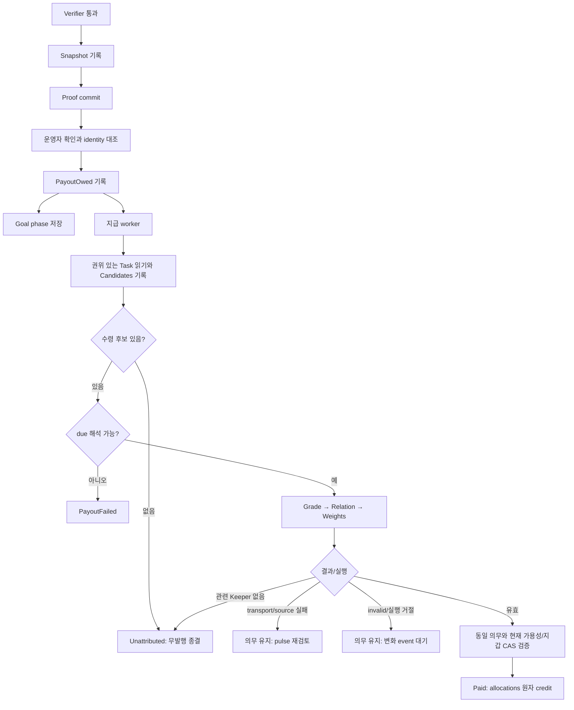

# Candle 전체 요구사항 명세서

작성·분석 기준일: 2026-10-21. 소스 기준:
`4fff07da4516d871a7ef71260585afaedad6c776`.
현황·운영 읽기 관측·고정 소스 링크는
[현황 분석](../audits/2026-10-21-candle-current-state.md)에 있다.

이 명세는 현재 제공하는 기능, 제공하지 않는 기능, 정책 결정과 검증이 남은 항목을
함께 정리한다. 새 경제 정책이나 운영 설정을 승인하는 문서는 아니다. 여기의 수용 조건은
앞으로 무엇을 관측해야 해당 요구를 충족했다고 말할 수 있는지를 뜻하며, 이번에 모두
실행했다는 뜻이 아니다.

## 1. 목적·범위·읽는 법

Candle은 Keeper가 Goal의 기여에 대해 받는 화폐다. 원장에 남은 사실로 잔액·소유권·
착용·공급량을 계산하고, 화폐는 초상화 장신구 구매에 쓴다. 운영자 지급과 Keeper 간
선물도 현재 구현에 포함된다. Candle 마스코트·/about 애니메이션 자체는 화폐 기능과
별개다. Board Karma 역시 별도 도메인이다.

권위 순서는 명시적 운영자 결정과 [헌법](../constitution.xml), 채택된 정책, 현재
인터페이스·구현이다. [초기 RFC](../rfc/RFC-goal-candle-ledger.md)는 Draft이며 과거
현황·제안·수치가 섞여 있다. 구현의 존재만으로 그 RFC의 모든 제안이 채택되었다고
보지 않는다. 충돌·결정 원문 미확인은 아래에 남긴다.

| 표시 | 뜻 |
|---|---|
| 구현 | 고정 소스에서 생산 경로와 소비자가 연결됨. 실행 성공 판정과 다름 |
| 부분 | 요구 중 일부만 구현되거나 인수 근거가 부족함 |
| 없음 | 지정된 기능 경로가 확인되지 않음 |
| 결정 필요 | 현재 동작을 기술할 수 있으나 목표 정책·합격선이 미채택 또는 채택 원문 미확인 |
| 범위 밖 | 현재 제공하지 않도록 정한 범위. 단순 미구현 결함과 다름 |
| S / T / H / L | 소스 직독 / 테스트 소스 존재 / 과거 실행 보고 / 이번 운영 읽기 관측. 상세 한계는 현황 분석 참조 |

표의 S00–S16, T01–T05, H01–H03은 현황 분석의 근거 색인이다. **모든 현재 테스트의
실행 여부는 이번 분석에서 미실행**이다. `구현·T`만으로 배포·현재 UI·실제 모델 품질이
확인된 것은 아니다. L에서 새 지급·구매·착용·선물·모델 요청을 만들지 않았다.

### 사용자와 자산

| 주체 / 자산 | 역할과 경계 |
|---|---|
| Keeper | 인증된 자기 지갑으로 조회·구매·착용·선물. 요청 인자로 임의 구매자를 지정하지 않음 |
| 운영자 | 정책·lane 설정, Goal 확정, 읽기 화면 사용, 로컬 grant CLI 실행 |
| Verifier / appraiser | Verifier는 Goal 통과를 판단. appraiser는 등급·관계·가중치를 판단하며 직접 돈을 쓰지 않음 |
| 서버 payout worker | durable 의무·후보를 읽고 모델 경계를 호출한 뒤 호스트 산술·CAS로 정산 |
| 원장 | `<base-path>/.masc/candle-ledger.jsonl`; 금전·소유·착용 사실의 단일 원천 |
| 정책 | resolver가 선택한 config directory의 `candle.toml`. lane 선언은 `runtime.toml`의 candle_appraiser |
| 단위 | 1 Candle = 1000 milli-Candle. 개별 금액은 nonnegative OCaml int, 합계는 Zarith/정확한 십진 표현 |
| 장신구 | face/neck/head/hand/base 슬롯의 정규 Item. 기본 외형은 구매 소유권이 아님 |

## 2. 현재 지원 요약

**소스에 구현됨:** Goal 보상, 의무·후보 고정, 중복 지급 방지, 설정 가능한 등급·배분·
지연 감액, 지수 감쇠, 고정/유통량 연동 가격, 구매·착용·기본 복원, 운영자 지급,
Keeper 간 돈·아이템 선물, 공급량·잔액·Items·초상화 조회.

**운영 기록에서 관측됨:** Paid 1건, Granted 28건, 무료 Purchased/Equipped 각 1건,
half_life 168시간의 설정과 정책 행. 이 기록은 과거 사건이며 현 서버에서의 새 거래 성공
증거가 아니다. 관측 파일의 지연 감액률은 0이다. 파일은 runtime-root 아래에서 읽었으며,
별도 `MASC_CONFIG_DIR` override와 서버 실효 설정 API는 미검증이다.
선물·유료 구매·supply_scaled는 이번 운영 읽기에서 실행 증거가 확인되지 않았다.

**부족함:** 지급 대기·최근 거절·거래 내역 전용 화면/API, 부분 평가 resume, 채택된
사람 평가 기준·공정성 합격선, reader/writer 버전 혼용 방어. 초기 복구 실패 시 의무
누락과 appraiser 장애 중 경제 조회·소비 차단은 현재 정책 경계를 다시 정해야 한다.

**현재 범위에 없음:** operator가 Items에서 대신 구매·착용·선물·지급하는 버튼,
Candle 전용 정책 편집 화면, 환불·재판매·미귀속 판정 재개. 기능 확장으로 선택하려면
별도 계약이 필요하다. Tool/Skill/model/turn budget 구매는 헌법상 범위 밖이다.

## 3. 요구사항 목록

### 3.1 도메인과 소유권

| ID | 요구사항과 수용 조건 | 현재 상태 | 근거 |
|---|---|---|---|
| CND-DOM-01 | 원장의 사실만으로 잔액·소유·착용·공급을 복원한다. 별도 지갑 DB와 결과가 갈라지는 경로를 두지 않는다 | 구현 | S02–S04, T02 |
| CND-DOM-02 | Goal 보상은 확정된 verifier identity에 결속하고 기여 Keeper에게만 지급한다. 요청 caller에게 자동 지급하지 않는다 | 구현 | S06–S08, T01 |
| CND-DOM-03 | 잔액이 0이어도 일반 턴·도구·Goal 활동을 금전 budget으로 막지 않는다. 구매·선물의 자금 검사는 별도다 | 구현. Candle 기록 쓰기 실패가 Goal 전이를 거절하는 예외는 3.4 참조 | S00/S06/S11 |
| CND-DOM-04 | 장신구만 구매한다. Tool/Skill/model/토큰·턴 예산 구매·실제 화폐 교환을 제공하지 않는다 | 범위 밖 | S00 |
| CND-DOM-05 | 감쇠는 금액 계산이다. Task/Goal/Board·원장 사건·장신구 소유권을 시간 경과로 삭제하지 않는다 | 구현 | S00/S04/S05, T02 |
| CND-DOM-06 | Goal 자체와 Task claim의 책임을 Candle 지갑 소유와 혼동하지 않는다. 조율·PR·리뷰·Board 기여는 Task 담당자 근거를 대신하지 않는다 | 현 보상 근거는 구현. 확장 기여 모델은 범위 밖 | S06/S07, RFC 3.4/7 |

### 3.2 설정과 가용성

| ID | 요구사항과 수용 조건 | 현재 상태 | 근거 |
|---|---|---|---|
| CND-CFG-01 | resolver를 사용해 workspace/config 경계를 정한다. 파일 부재는 Off, 읽기·형식 오류는 사유가 있는 Disabled로 구별한다 | 구현 | S01/S06, T02 |
| CND-CFG-02 | 필수 payout·등급 금액/기준·배분·감액·half_life를 명시한다. 누락·알 수 없는 key·잘못된 타입을 경제 기본값으로 채우지 않는다 | 구현. 선택적 pricing의 기본은 별도 CFG-08 | S01, T02 |
| CND-CFG-03 | 등급 id 목록과 기준 목록이 같고 비어 있지 않아야 한다. id는 정규 형식, 금액 0..max_int, weight_max 1..max_int, 감액률/바닥 0..1000을 검증한다 | 구현. 다섯 등급 고정 아님 | S01/S08, T02/T03 |
| CND-CFG-04 | half_life는 명시한 off 또는 양의 정수 시간이다. 0·음수·실수·미지정·알 수 없는 문자열을 거절한다 | 구현. Off 운용의 적절성은 정책 판단 | S01/S05, T02 |
| CND-CFG-05 | appraiser lane이 없거나 게시 중이어도 유효한 config/ledger의 Snapshot·PayoutOwed를 남기고 지급만 지연한다 | 구현 | S06/S09/S10, T01/T03 |
| CND-CFG-06 | appraiser 장애 시 어떤 경제 동작을 유지할지 명시한다. 현재 balance/catalog/purchase/equip/gift는 lane gate에 영향받고 grant는 우회한다 | 현재 비대칭 정책 구현. 분리 여부 결정 필요 | S06/S11/S13 |
| CND-CFG-07 | 설정을 다시 읽되 과거 금액·가격·배분·감쇠 구간을 현 설정으로 덮어쓰지 않는다. 읽기 관측과 정책 발행을 구별한다 | 구현. 과거 정산 의미 검증은 LED-07 | S01/S04/S06/S13, T02/T04 |
| CND-CFG-08 | shop.pricing 생략/Fixed와 Supply_scaled를 구별한다. 후자는 양의 target, min/max 범위·순서, down/up rounding을 검증한다 | 구현. 코드 기본 Fixed/down, ratio 상한 10000 및 active 기준은 4절의 현재 정책 | S01, T02 |
| CND-CFG-09 | config 오류는 Candle 사유로 드러나며 임의 활성화하지 않는다. 별도 Candle config 오류와 runtime lane 선언 오류의 서버 부팅 영향을 구별한다 | 구현. 모든 runtime.toml 오류에서 서버가 뜬다고 보장하지 않음 | S01/S06/S10 |

### 3.3 원장·정확성·내구성

| ID | 요구사항과 수용 조건 | 현재 상태 | 근거 |
|---|---|---|---|
| CND-LED-01 | event kind/필드/타입을 엄격하게 읽고, unknown·missing·duplicate field나 잘못된 값 한 행을 조용히 생략하지 않는다 | 구현 | S02/S03, T02 |
| CND-LED-02 | 하나의 private durable JSONL cursor/lock 계열로 읽고 append·fsync한다. append 실패는 부분 사실을 정상 성공으로 반환하지 않는다 | 구현 | S03, T02 |
| CND-LED-03 | Cursor_mismatch는 새 사실을 읽어 결정 재시도, 현재 lock 점유는 Locked/Write_locked 즉시 반환한다. 점유를 무한 busy retry로 바꾸지 않는다 | 구현. 과거 결함 수리됨 | S03, T02 |
| CND-LED-04 | 서버 시작/첫 사용 복구 경계에서만 잘린 끝줄을 복구한다. 정상 읽기·구매는 손상 행을 자르거나 last-good로 쓰기를 승인하지 않는다 | 구현. 최초 실패의 Goal 정책은 GOAL-09 | S03/S06, T02 |
| CND-LED-05 | 한 Goal의 모든 allocations를 한 Paid로 기록한다. 일부 recipient만 credit하거나 wallet overflow를 clamp하지 않는다 | 구현 | S04/S05/S08, T02/T03 |
| CND-LED-06 | 지급·구매·선물·정책의 시간 역행, 음수 금액, 중복 지급, 중복 구매·gift·grant와 과소 잔액을 거절한다. 공급량 합계는 machine int를 넘더라도 정확히 표현한다 | 구현 | S02/S04/S05/S11, T02/T04 |
| CND-LED-07 | 과거 정산을 현재 정산 알고리즘 변경 때문에 부당하게 읽지 못하는 일이 없어야 한다. 과거 사실 admission과 새 append 검증의 경계를 고정한다 | 부분. 과거 산술 재계산은 제거됐으나 정산 관계/후보 및 지갑 의미 검증 유지. #44391 미병합 | S03/S04/S07, GAP-06 |
| CND-LED-08 | 사고 분석에서 row 순서·시각·goal/request/run·판정 trace·지급 정책·실제 allocations를 확인할 수 있어야 한다 | 원장·영수증 구현. 전용 UI는 OPS-01/02 | S02/S05/S08 |

### 3.4 Goal→보상 생명주기

| ID | 요구사항과 수용 조건 | 현재 상태 | 근거 |
|---|---|---|---|
| CND-GOAL-01 | 검증 통과의 criterion revision·request/run·passed_at·제목/metric/target·due 원문·링크 id를 Snapshot으로 먼저 기록한 뒤 proof를 커밋한다 | 구현 | S06, T01 |
| CND-GOAL-02 | 운영자 확인은 현재 criterion/request/run을 대조하고 권한을 검사한다. 임의 옛 Snapshot이나 다른 run을 보상 근거로 쓰지 않는다 | 구현. 실제 사람의 UI 확인은 이번 미검증 | S06, T01 |
| CND-GOAL-03 | confirmation 저장→PayoutOwed→Goal phase 순서를 지킨다. Owed 쓰기 실패면 확인 성공을 반환하지 않는다 | 구현. 세 저장은 단일 원자 트랜잭션 아님 | S06, T01 |
| CND-GOAL-04 | Owed 뒤 phase 저장 실패/재확인에도 의무를 중복 생성하지 않는다. 이후 reopen/drop은 기존 의무를 지우지 않는다 | 구현. Completed 미저장 상태에서도 지급 가능한 정책의 채택 근거는 결정 필요 | S06/S07, T01 |
| CND-GOAL-05 | Goal별 Paid/Unattributed 종결 뒤 재확인·새 proof·재오픈·worker 재시작으로 추가 지급하거나 기존 금액을 회수하지 않는다 | 구현 | S07/S08, T01 |
| CND-GOAL-06 | Snapshot이 없는 과거 완료 Goal에는 소급 지급하지 않는다. Off/Disabled 중 통과한 Goal에 나중 활성화만으로 의무를 만들지 않는다 | 구현. 재오픈→새 검증→첫 지급 가능성은 별도 | S06/S07, T01 |
| CND-GOAL-07 | 후보는 Snapshot 링크를 원본 backlog/archive에서 읽는다. 못 읽음을 삭제/빈 목록으로 대체하지 않고 후보 확정을 보류한다 | 구현 | S07, T01 |
| CND-GOAL-08 | 후보 Task는 Done이고 completed_at이 Goal 생성 뒤·확정 이하이다. 등록 Keeper 담당자를 당시 고정하고 지급 때 임의 수령자를 추가하지 않는다 | 구현. 링크 시각/조율 기여는 별도 한계 | S07/S08, T01/T03 |
| CND-GOAL-09 | 원장 장애 시 Goal 가용성과 의무 누락의 계약을 일관되게 정한다. 최초 복구 불가와 이후 append 실패를 각각 재현해야 한다 | 결정 필요/부분. 초기 Disabled는 skip+warn, 유효 Enabled append 실패는 전이 거절 | S06, T01, #41322 |
| CND-GOAL-10 | 후보 없음·모두 무관·관련 Keeper 없음은 무발행 Unattributed로 종결한다. 관련 후보가 있으나 due가 해석 불가면 PayoutFailed, 수정 후 새 proof/확정으로 재시도한다 | 구현. 후보 없는 분기는 due 검사보다 먼저 종결 | S07/S08, T01/T03 |
| CND-GOAL-11 | set_task_goal은 끝난 Done/Cancelled Task의 사후 연결과 기존 Goal 연결의 덮어쓰기를 거절한다. due_date 입력 형식을 검증하고 기한·priority 변경을 기록한다 | 구현. 연결 시각 자체를 기여 증거로 저장하는 것은 별도 한계 | lib/task/task_goal_assignment.ml:53, lib/goal/goal_store.ml:474/502 |

### 3.5 평가와 정산

| ID | 요구사항과 수용 조건 | 현재 상태 | 근거 |
|---|---|---|---|
| CND-APR-01 | 모델 전에 Snapshot/Owed/Candidates를 durable하게 남긴다. 모델은 후보·지갑·발행액을 직접 수정하지 못한다 | 구현 | S06–S08, T01/T03 |
| CND-APR-02 | Grade는 Goal 제목·metric·target와 운영 등급 기준만 본다. Task 수/비용/priority/증거 전문을 몰래 등급 입력으로 넣지 않는다 | 구현 | S08, T03 |
| CND-APR-03 | Relation은 후보 Task 하나씩 평가한다. Weights는 관련 후보의 정확한 Keeper 집합에만 값을 주며 누락·중복·추가 이름·범위 밖/비정수·전부0을 거절한다 | 구현 | S07/S08, T03 |
| CND-APR-04 | 응답 schema는 요청에 포획된 grade id/단계/후보에 결속한다. 임의 숫자 지급이나 잘못된 응답의 fallback payout을 하지 않는다 | 구현 | S01/S08, T03 |
| CND-APR-05 | 호스트가 포획한 payout 정책으로 몫·감액을 계산한다. 모델 대기 뒤 CAS에서 같은 의무·현재 가용성·현재 half-life·수령 지갑을 재검증한다 | 구현 | S05/S08, T03 |
| CND-APR-06 | 실행 run/slot과 실제 입력·출력·실패를 영수증으로 남기고 Paid에는 등급·관계·가중치 trace를 남긴다. 영수증을 정산 권위로 임의 승격하지 않는다 | 구현 | S02/S08/S10, T03 |
| CND-APR-07 | no-candidate는 모델을 부르지 않는다. 단일 수령자라도 현재 Weights 호출 경로를 거친다 | 구현. 단일 수령자 최적화는 현재 없음, 채택 제안 아님 | S08, T03 |
| CND-APR-08 | 부분 평가 재개를 채택한다면 성공 단계의 identity·정책·prompt/slot 변경 무효화와 재시작 계약을 정한다 | 없음/확장 결정 필요. 현재 실패 뒤 Grade부터 재평가 | S08, T03, #41323 |
| CND-APR-09 | 운영 grade·slot·prompt별 사람 기준, 반복 안정성, 표현/순서/이름/Task 분할 불변성, 주입 저항, 관계 정확도와 기여 공정성을 검증한다 | 부분/합격선 결정 필요. 자료는 있으나 사람 기준·현 운영 정책 인수 미완료 | H03 |

판정 trace를 Paid에 남기는 것과 원시 실행 payload의 영구 보존은 다르다.
현재 exact-lane registry에는 lane별 완료 기록 retention이 있다. 오래된 raw prompt/output이
항상 남는다고 보장하지 않는다(`lib/exact_lane_run_registry.mli:123–139`).

### 3.6 금액·시간·가격

| ID | 요구사항과 수용 조건 | 현재 상태 | 근거 |
|---|---|---|---|
| CND-ECO-01 | 총액은 운영 grade 금액표에서만 나온다. 배분 중간 합·곱·나눗셈은 Zarith로 정확하게 계산한다 | 구현 | S01/S05, T02/T03 |
| CND-ECO-02 | largest_remainder/down, 이름 순 tie-break, 감액 down/up을 명시하고 Paid에 기록한다. down의 미배분액은 미발행으로 분리한다 | 구현 | S05, T02/T03 |
| CND-ECO-03 | 기한은 YYYY-MM-DD 달력 날짜의 UTC 23:59:59로 해석한다. 사람이 확인을 늦춘 시간을 감액에 포함하지 않는다 | 구현. 관측 파일 rate=0은 실제 감액 검증 아님 | S05/S08, T01/T02 |
| CND-ECO-04 | 초과 완전 시간과 천분율 rate/floor로 선형 감액한다. 기한 없음은 감액0, invalid due는 임의 기본 기한으로 바꾸지 않는다 | 구현. 기한 변경으로 감액을 피하는 문제는 7절 정책 | S05/S08, T02/T03 |
| CND-ECO-05 | 명시적 HalfLifeSet 경계별로 감쇠한다. 동일 정책·조회·장착·다른 지갑 사건으로 자기 감쇠 내림 구간을 임의 분할하지 않는다 | 구현 | S04–S06, T02/T04 |
| CND-ECO-06 | 정수 Q128·whole-second 산술과 정의된 오차를 따른다. 정확한 whole half-life, 경계·큰 금액·시간 역행을 검사한다 | 구현. 실수 지수 floor와 모든 입력의 완전 일치를 약속하지 않음 | S05, 산술 계약/T02 |
| CND-ECO-07 | issued는 실제 allocations+grants, burned는 구매+계산 감쇠, circulating=issued−burned를 보존한다. 선물·장착으로 새 발행하지 않는다 | 구현. L의1280은 현재 circulating 아님 | S04/S13, T02/T04, L |
| CND-ECO-08 | 카탈로그와 구매는 같은 현재 실효 가격 함수를 쓴다. Supply_scaled의 공급·active 기준·clamp·rounding·overflow 정책을 명시하고 CAS 경합에서 다시 계산한다 | 구현. 공식은 4절, 경제 효과 미검증 | S01/S11/S13, T02/T04 |

### 3.7 구매·착용

| ID | 요구사항과 수용 조건 | 현재 상태 | 근거 |
|---|---|---|---|
| CND-SHOP-01 | 정규 Item id/slot/설정가격 여부/실효 가격을 제공한다. 미가격은 Unpriced, 명시적0은 무료로 구별한다 | 구현 | S01/S11/S12, T04 |
| CND-SHOP-02 | 구매 시 정책·가격·잔액·소유를 같은 CAS의 새 판단에서 검증하고, 차감과 소유 획득을 한 사건으로 기록한다 | 구현 | S03/S04/S11, T04 |
| CND-SHOP-03 | 잔액 부족·중복 소유·Unpriced를 차감 없이 거절한다. 무료도 중복 구매하지 않는다 | 구현. L은 무료 구매만 관측 | S04/S11, T04/L |
| CND-SHOP-04 | expected_price_milli가 있으면 구매 시점 가격이 상한보다 큰 경우 거절한다. 동액 일치 조건으로 오해하지 않는다 | 구현 | S11/S12, T04 |
| CND-SHOP-05 | 올바른 slot의 소유 Item만 착용한다. 같은 선택은 Equipped를 중복 append하지 않는다 | 구현. 필요 시 정책 행만 생길 수 있음 | S04/S11, T04/L |
| CND-SHOP-06 | default는 해당 slot의 명시 착용을 해제하고 이름 기반 기본 모습으로 복원한다. 기본 장신구와 소유권을 혼동하지 않는다 | 구현 | S04/S11/S16, T04 |
| CND-SHOP-07 | 환불·재판매·가격 변동 소급 정산·이미 지급한 보상 회수를 자동 제공하지 않는다 | 현재 없음/범위 확장 시 결정 필요 | S00/S02/S04 |

### 3.8 선물·운영자 지급

| ID | 요구사항과 수용 조건 | 현재 상태 | 근거 |
|---|---|---|---|
| CND-GIFT-01 | 인증된 자기 지갑에서 등록된 다른 Keeper에게 양의 milli를 이전한다. 자기 선물·빈 사유·잘못된 수신자·잔액 부족·overflow는 거절한다 | 구현, L 선물0 | S04/S11/S12, T04 |
| CND-GIFT-02 | 현재 구현의 중복 키는 from/to/정규화 reason/amount다. 같은 사유라도 금액이 다르면 별도 선물로 허용한다. 발행량은 늘리지 않는다 | 구현. mli의 세 항목 키 설명과 불일치하여 계약 정리 필요 | S04/S11, T04 |
| CND-GIFT-03 | 아이템 선물은 주는 쪽 소유를 빼고 받는 쪽 소유를 더한다. 착용 중이면 그 Item만 주는 쪽에서 해제하며 다른 착용은 유지한다 | 구현, L 미관측 | S04/S11, T04 |
| CND-GIFT-04 | 이미 받은 쪽이 가진 아이템·미소유 송신자·자기 선물을 거절한다. 금액 선물의 reason 멱등 키와 아이템 현재 소유 검증을 구분한다 | 구현 | S02/S04/S11, T04 |
| CND-GIFT-05 | masc-candle-grant는 양의 금액·수신 Keeper·사유를 요구하며 Keeper+정규화 reason 재실행을 거절한다 | 구현. L Granted28 | S11, T04/L |
| CND-GIFT-06 | operator grant와 Keeper gift를 구별한다. grant는 발행, money gift는 이전이다. grant의 현재 권한 경계는 로컬 실행/파일 접근이며 HTTP CanAdmin 검사가 아니다 | 구현. 버전 격리는 SEC-05 | S02/S04/S11/S12 |

### 3.9 API·인증·표시 계약

| ID | 요구사항과 수용 조건 | 현재 상태 | 근거 |
|---|---|---|---|
| CND-API-01 | Keeper의 balance/catalog/purchase/equip/gift 도구를 제공한다. 자기 지갑 identity는 내부 턴 또는 MCP bearer의 owner Keeper에서 얻는다 | 구현. 일반 client 이름만으로 대체 불가 | S12, T04 |
| CND-API-02 | 공개 공급량·잔액은 정확한 십진 문자열로 전달한다. 0·없음·Disabled를 숫자0으로 합치지 않는다 | 구현 | S12/S13, T04/T05 |
| CND-API-03 | Item 읽기는 CanReadState와 workspace/존재를 검증한다. mismatch409, malformed400, 없는 Keeper404, ledger 오류503을 구별한다 | 구현 | S16, T04 |
| CND-API-04 | HTTP portrait는 읽기 권한·크기·preview·기대 장비를 검증한다. 기대 장비 mismatch를 ETag304보다 먼저 거절한다 | 구현 | S16, T04 |
| CND-API-05 | 화면용 observation은 정책 append·행 복구를 하지 않는다. Keeper balance 조회는 변경된 HalfLifeSet을 발행할 수 있어 일반 읽기와 분리한다 | 구현 | S06/S11/S13, T04 |
| CND-API-06 | summary/개인 계정/portrait를 한 응답의 일관된 authoritative observation으로 만든다. 서로 다른 시점의 설정·원장으로 금액과 장비를 합치지 않는다 | 구현. 전체 시스템 linearizability 보장과 다름 | S13/S16, T04 |

주요 호출면은 다음과 같다. 이 표의 예시는 계약 설명이며 운영 사건을 실행하라는 지시가 아니다.

| 호출면 | 입력 | 반환 / 효과 |
|---|---|---|
| keeper_candle_balance | 추가 인자 없음, 인증된 자기 Keeper | 잔액·감쇠·반감기·마지막 사건·소유. 필요한 정책 행을 발행할 수 있음 |
| keeper_candle_catalog | 추가 인자 없음 | 정규 id/slot/price_status. price_milli는 priced 항목에만 존재 |
| keeper_candle_purchase | item, 선택적 expected_price_milli 0 이상 정수 상한 | 실제 구매 금액과 구매 뒤 계정. 구매만으로 착용하지 않음 |
| keeper_candle_equip | slot=face/neck/head/hand/base, item=id 또는 default | 현재 equipment와 changed. 소유권 구매는 하지 않음 |
| keeper_candle_gift | to + (amount_milli와 reason 또는 item); item에는 reason 불가 | 송수신자·이전 내역·양쪽 잔액. 두 이전 종류를 한 요청에 섞지 않음 |
| keeper_portrait_read | 선택적 size(48–512, 기본160), preview_item | PNG artifact·시작/현재/그림 장비·카탈로그. 구매 소유 목록은 아님. ledger 불가용은 명시하고 기본 외형 PNG로 fallback 가능 |
| GET /api/v1/keepers/{name}/items | 선택적 expected_workspace, CanReadState | ready/off/disabled 계정 또는 오류. ready는 account_revision/balance_milli/owned_items/catalog |
| GET /api/v1/keepers/{name}/portrait.png | size(16–512, 기본160), preview, expected_equipment와 서버 read 정책 | PNG/ETag/304 또는 refusal. Item API와 MCP portrait의 파라미터·fallback 계약은 다름 |
| masc-candle-grant | --keeper, --amount-milli, --reason, 선택적 --base DIR | 로컬 grant와 stdout 영수증. 다른 CLI의 --base-path가 아닌 --base 사용 |

`masc-candle-grant`는 `bin/dune`의 별도 public executable이다. 현재 기본 binary installer의
동반 실행 파일 목록에는 없으므로 일반 binary 설치만으로 명령이 생긴다고 가정하지 않는다.
별도 소스 빌드/설치와 호환성 확인이 필요하다. 또한 gift TOML 도구 설명의 ‘같은 사유’
중복 제한도 실제 금액을 포함한 키와 다르므로 GIFT-02의 계약 정리 범위에 포함한다.

### 3.10 TUI·Dashboard·초상화

| ID | 요구사항과 수용 조건 | 현재 상태 | 근거 |
|---|---|---|---|
| CND-UI-01 | TUI·Dashboard에서 발행/소각/유통 요약과 Keeper 잔액을 표시한다. Off는 요약 숨김, Disabled는 이유/불가용으로 취급한다 | 구현. 모든 화면의 Off 배너 요구는 없음 | S13–S15, T05/H02 |
| CND-UI-02 | Items는 잔액·가격·소유·착용·카탈로그와 미리보기를 제공한다. 미리보기는 돈·소유·착용을 변경하지 않는다 | 구현. 이번 화면 실측 미검증 | S14/S15, T05 |
| CND-UI-03 | Items는 로딩·실패·Off·Disabled를 구별하고, 읽기 실패 시 옛 잔액을 현재값으로 남기지 않는다 | 구현 | S14/S15, T05 |
| CND-UI-04 | workspace/token/계정 revision 변경과 오래된 요청 응답을 구별한다. 무료 구매·가격 변경도 계정 갱신을 유발한다 | Items 구현. 모든 portrait 부모 수명 경계까지의 보장은 추가 추적 필요 | S13–S16, T05 |
| CND-UI-05 | 서버 PNG 캐시/ETag는 실행 바이너리·이름·크기·장비에 결속한다. Dashboard는 이전 object URL을 폐기하고 변경 장비의 이미지를 표시한다 | 구현. 과거 component 증거만 H02 | S15/S16, T04/T05/H02 |
| CND-UI-06 | 표시 잔액의 관측 시각/갱신 계약을 정한다. Fixed 정책의 시간 감쇠만으로는 account_revision이 바뀌지 않는다 | 부분/신선도 기준 결정 필요. 수동 새로고침은 있음 | S13–S15 |
| CND-UI-07 | 원격 TUI는 서버가 보고한 장비를 받아 로컬 렌더하고 terminal 출력·장비 캐시를 구별한다. 서버 PNG 다운로드 경로로 잘못 설명하지 않는다 | 구현. 현재 remote TUI 시각 검증 미실행 | S14/S16, T05 |
| CND-UI-08 | Items에서 operator 구매·착용·선물·grant 버튼과 전용 정책 편집을 제공할지 결정한다 | 현재 없음/확장 후보. 현 계약은 Keeper 도구가 변경 수행 | S11/S14/S15, TUI 가이드 |

### 3.11 관측·복구·운영

| ID | 요구사항과 수용 조건 | 현재 상태 | 근거 |
|---|---|---|---|
| CND-OPS-01 | 운영자가 Goal별 지급 의무·후보·settled/failed/pending·최근 거절·다음 재검토 조건을 읽을 수 있어야 한다 | 부분. 내부 원장/상태/로그는 존재, 전용 public API/UI 없음 | S07–S09/S13, GAP-01 |
| CND-OPS-02 | 지급·구매·선물·grant·거절 내역을 감사할 수 있어야 한다. 전용 경제 이력 화면을 일반 도구 기록과 구별한다 | 원장 감사 구현. 전용 거래/거절 내역 API/UI 없음 | S02/S08/S13–S15 |
| CND-OPS-03 | 서버 시작과 확인/선언·관련 event, maintenance pulse로 worker를 깨운다. wake가 실행 중 도착해도 잃지 않는다 | 구현 | S09/S10, T03 |
| CND-OPS-04 | Goal별 in-flight 하나로 느린 평가가 다른 Goal을 막지 않는다. 중복 start를 거절하고 server switch 종료와 함께 daemon이 끝난다 | 구현. 현재 부하·다중 프로세스 실행은 미검증 | S09, T03 |
| CND-OPS-05 | transport/source 실패는 재시도, invalid output/실행 거절은 변화 event를 기다린다. 공급자 한도를 임의 지급 fallback으로 덮지 않는다 | 구현. 같은 slot의 credential/provider 변경만은 declaration probe가 감지하지 않을 수 있음 | S08–S10, T03 |
| CND-OPS-06 | 재시작 후 durable 의무·후보에서 복구하고 정산 전 현재 의무·가용성·지갑을 재검증한다. 복구 사본만으로 돈을 쓰지 않는다 | 구현 | S03/S07–S09, T01/T03 |
| CND-OPS-07 | 운영 binary/ledger schema/config/lane 변경을 맞추고 불일치를 배포 전에 확인한다. 이번 분석이 배포 검증을 대체하지 않는다 | 부분. 로컬 grant 버전 admission 없음; Candle 전용 upgrade/운영 UI 없음 | S02/S03/S11, SEC-05 |
| CND-OPS-08 | 활성화 전후 Goal·Task·기한 변경·분배/가격·도구 사용·협업 변화를 같은 정의로 비교한다. 인과·행동 개선을 자동 단정하지 않는다 | baseline 자료/수집기 존재. 주기 운영·행동 개선·장기 연속성 미검증 | RFC3.11, H03 |

### 3.12 보안·신뢰 경계

| ID | 요구사항과 수용 조건 | 현재 상태 | 근거 |
|---|---|---|---|
| CND-SEC-01 | 이름/요청 인자로 타 Keeper 지갑을 사칭하지 못한다. 수신자 parse·등록 여부와 모호한 이름을 검사한다 | 구현 | S11/S12, T04 |
| CND-SEC-02 | 가격/수령자/발행액의 권위는 host 정책·동일 CAS다. 모델 출력과 미리보기는 그 권위를 얻지 않는다 | 구현 | S03/S08/S11, T03/T04 |
| CND-SEC-03 | 불가용 계정이나 원장 손상을 0원·성공으로 위장하지 않는다. 단순 읽기에 복구·지급 권한을 묵시 부여하지 않는다 | 화면/금전 경계 구현. Disabled 중 Goal 기록 skip은 GOAL-09 | S03/S06/S13–S16 |
| CND-SEC-04 | 로컬 파일 쓰기 권한을 가진 공격자에 대한 금전 무결성 범위를 명시한다. 서명/hash-chain이 있다고 주장하지 않는다 | trusted-host 경계. 변조 방지 보장은 없음 | S02/S03 |
| CND-SEC-05 | 서로 다른 버전의 CLI/server가 공유 원장을 쓸 때 구 reader가 모르는 row를 넣는 위험을 통제한다 | 부분/방법 결정 필요. 로컬 grant는 공통 CAS만 사용, HTTP 단일 writer/세대 확인 없음 | S11, GAP-05 |
| CND-SEC-06 | 지급 규칙·prompt·slot 변경 때 현재 diff와 평가 근거를 독립 검토한다. 모델 품질·경제 정책 채택·실제 실행의 판정을 분리한다 | 개발 계약/영수증 구현. 현재 정책별 품질 승인은 별도 미확인 | S00/S08, H03 |

## 4. 산술·정책의 정확한 의미

### 지급과 감액

- `share_rounding=largest_remainder`: 각 몫을 내린 뒤 나머지 순으로 잔여 milli를 배분한다.
  `down`: 잔여액을 `unallocated_milli`로 남기며 미발행이다. 동률은 설정의 이름 순서다.
- `overdue_hours = max(0, floor((passed_at - due_instant) / 3600))`.
  due는 Snapshot의 값이고, 사람이 늦게 확인한 시간은 포함하지 않는다.
- `coefficient = max(deduction_floor, 1000 - deduction_rate * overdue_hours)`.
  각 지급액은 `share * coefficient / 1000`을 설정의 down/up으로 반올림한다.
- 실제 발행은 allocations의 실제 지급액 합이다. 설정 총액·미발행 잔여·감액된 금액을
  이미 발행한 돈으로 세지 않는다. 수령 지갑 overflow면 부분 credit하지 않는다.

### 감쇠와 정책 경계

경제값은 대략 `amount * 2^(-elapsed/half_life)`이나 실제 계약은
[정수 Q128 산술](../design/candle-decay-arithmetic.md)이다. 전체 반감기는 정확한
정수 halving, 분수 구간은 보수적 근사이며 이상적인 실수 floor보다 1 milli 낮을 수 있다.
계산된 감쇠를 이벤트로 계속 쓰지 않는다. 반감기 변경은 `HalfLifeSet`이 기록되는 시점부터
효력이 있고 TOML 파일의 수정 시각을 과거 정책 경계로 소급하지 않는다.
화면 읽기는 기록된 경계만 사용하며 Keeper balance/금전 writer는 필요한 경계를 발행할 수 있다.

### 유통량 연동 가격 — 현재 코드 정책

Fixed가 기본이며 선택적 `Supply_scaled`는 다음을 따른다. 이 공식은 현재 구현을
기술한 것으로 경제적 최적성·운영자 채택·Sybil 저항성을 인증하지 않는다.

1. 공급은 관측 시각의 양수 지갑 잔액 전체 합이다. tiny/dust 잔액도 합에 포함한다.
2. active 수는 roster나 실행 중 Keeper 수가 아니다.
   `balance >= max(1, target_per_keeper_milli / 10)`인 지갑 수다.
3. `ratio = round(total_supply_milli * 1000 / (active * target_per_keeper_milli))`를
   min/max_permille 사이로 clamp한다. active가 없으면 기준 가격을 쓴다.
4. `round(base_price_milli * ratio / 1000)`을 쓴다. 명시적 무료는 0,
   양수 기준가는 최소1이다. 표현 범위를 넘는 산출 가격은 max_int로 제한한다.
5. 현재 ratio 설정 상한은 10000(10배), rounding 생략은 down이다.
   배분·지급 금액 overflow를 거절하는 계약과 가격 scaling의 cap을 구분한다.
6. 구매 상한은 `actual_price <= expected_price_milli`이다. 가격이 내려갔다고 거절하지 않는다.
   CAS 경합 후 가격이 올랐다면 다시 판단한다.

## 5. 상태·데이터 계약

### 경로별 가용성 — 현재 동작

`Enabled`는 아래 모든 경로가 같은 조건으로 가능하다는 뜻이 아니다.

| 조건 | Snapshot/Owed | balance/catalog/purchase/equip/gift | 로컬 grant | summary/Items 관측 | persisted portrait 읽기 |
|---|---|---|---|---|---|
| config·원장 유효, lane 준비 | 기록 | 허용 | 허용 | Ready | 기록 장비 |
| config 없음(Off) | 생략 | 거절 | 거절 | Off; 요약 숨김/기본 외형 | config/lane과 독립적으로 원장 장비 읽기 |
| config 오류(Disabled) | 경고 후 생략 | 거절 | 거절 | Disabled | 유효 원장이라면 기록 장비 읽기 |
| lane 없음/미공개, config·원장 유효 | 기록 유지 | 거절 | 허용 | Disabled | 기록 장비 읽기 |
| 최초 복구 불가 | 경고 후 생략 | 해당 원장 사용 거절 | 거절 | 오류/Disabled | 오류 |
| 복구 성공 뒤 append 실패/lock | 해당 전이 거절 | 금전·장착 변경 거절 | 거절 | 원장 관측 실패면 오류 | 원장 관측 실패면 오류 |

PNG/MCP portrait의 persisted 장비 읽기와 roster/TUI의 Candle observation은 gate가
다르다. 따라서 Off/Disabled에서 모든 표면이 동일한 외형을 표시한다고 보장할 수 없다.
조회와 소유권 표시를 appraiser에서 분리할지는 CFG-06의 정책 결정에 포함한다.

이 그림의 각 단계가 모두 성공하는 조건은 앞의 표를 따른다. Off/설정 Disabled/초기 복구
불가는 Snapshot/Owed를 생략할 수 있고, Enabled append 실패는 Goal 전이를 거절한다.
Owed가 생겼다면 뒤의 Goal phase 저장 실패·reopen/drop과 별개로 정산될 수 있다.

| row kind | 최소 의미 / identity |
|---|---|
| half_life_set | 관측된 정책 경계와 시각. 초기 돈보다 먼저 필요 |
| snapshot | goal/request/verification_run/criterion revision, passed_at, 생성 시각, due 원문, Goal 평가 입력, 링크 id |
| payout_owed | 정확히 확인한 goal/request/run, passed_at/confirmed_at |
| candidates | 당시 Task 읽기 결과, 후보 Task/Keeper, Task별 동결 Keeper 인정 |
| paid | 정산 identity, 등급·총액·실제 allocations·미배분·배분/감액 정책·모델 trace |
| unattributed / payout_failed | 무수령 종결 근거 / 해석 불가 due 등 해당 실패 근거 |
| purchased / equipped | 당시 구매 금액과 Item / 해당 slot의 명시 착용 또는 default |
| granted | 수신 Keeper·양의 금액·정규화 사유. 별도 발행 |
| gifted / gifted_item | 송신/수신·금액/사유 또는 Item. 발행 없는 이전 |

원장 JSON은 엄격한 숫자/필드 계약을 따르고, 공개 공급/계정의 정확한 십진 문자열과
혼동하지 않는다. 지급 의무의 `goal_id` 중복 방지와 판정의 request/run identity는
역할이 다르다. 새 run이 생겨도 이미 Paid/Unattributed인 Goal을 다시 발행하지 않는다.

## 6. 기능 수용 시나리오와 증거의 빈칸

| 시나리오 | 관측할 성공/실패 조건 | 현재 근거와 남은 실행 |
|---|---|---|
| ACC-01 정상 보상 | 실제 링크된 Done Task·Keeper·Goal → proof → 운영자 확인 → Candidates → 정확한 Paid 1개 | T01/H01 존재. 판정 주입이며 현재 head 전체 실행은 미실행 |
| ACC-02 중복·재시작 | 확인 재전달·Owed 뒤 reopen/drop·새 proof·worker 재시작에도 원래 recipient/금액 한 번 | T01. 현재 다중 프로세스·운영 재시작 별도 |
| ACC-03 lane 불가용 | 미공개/없는 appraiser 중 Snapshot/Owed 유지, 복구 후 원래 identity 한 번 정산 | T01/T03. 실제 공급자 장애 전환은 미실행 |
| ACC-04 기록 실패 | 최초 손상·초기 lock·복구 후 lock·append I/O·phase 저장 실패 각각의 Goal/의무 결과 확인 | T01/T02. GOAL-09/SEC-05 정책 경계 미결정 |
| ACC-05 후보 신뢰 | archive Task, 삭제, 읽기 실패, 비Keeper, 완료 전/후 경계, 잘못된 후보 위조를 구별 | T01/T03. 현재 fixture 실행 미실행 |
| ACC-06 판정 격리 | Grade/Relation/Weights 입력 제한·추가 recipient·미설정 grade·가중치 오류 거절 | T03. 실모델 주입 저항·공정성은 ACC-07 |
| ACC-07 모델 품질 | 운영 등급/slot/prompt별 사람 label·채택된 반복/변형/주입/관계/기여도 기준과 실패 전수 보존 | H03은 부분 자료. 기준·사람 보정 미완료 |
| ACC-08 부분 실패 | Relation/Weights 실패 후 동일 의무 유지. 현 구현은 Grade 재호출을 확인; 단계 재개를 채택하면 무효화 포함 별도 검증 | T03. 부분 resume 미구현 |
| ACC-09 배분·기한 | remainder/tie/down/up·due 없음/잘못됨·UTC 날짜 경계·확인 지연 배제·wallet overflow | T02/T03. 관측 파일 감액률0, 실제 감액 사건 미관측 |
| ACC-10 감쇠·정책 | Off→Hours→다른 Hours, 동일 정책 반복·조회·장착·다른 지갑 사건에도 정의된 금액/소각 유지 | T02/T04. L은168 설정/정책 행만 확인 |
| ACC-11 구매 경합 | 두 구매·가격 상승·상한·Unpriced·무료 중복·잔액 부족에서 원자 차감/소유, 실패 무차감 | T04. L 무료1건 외 현재 실행 미검증 |
| ACC-12 착용·이미지 | 구매→equip→동일 선택→default→재시작, PNG ETag/장비 mismatch, TUI 장비 관측·캐시 확인 | T04/T05/H02. 현재 실제 Dashboard/remote TUI 미실측 |
| ACC-13 선물 | 돈 이전 공급 보존·이중 시도, 아이템 이동·착용 해제·수신 중복·자기 선물·인증 위조 거절 | T04. L 선물0, 실제 전송 미검증 |
| ACC-14 grant·버전 혼용 | 동일 Keeper/reason 중복 거절, 신/구 CLI/server 공유 원장 때 unknown row admission을 안전하게 처리 | T04 및 L grant28. 버전 혼용 방어는 부분 |
| ACC-15 관측·권한 | reader/player/anonymous, workspace 전환, stale response, loading/Disabled/Off 구별, 금액 문자열 정확성 | T04/T05. 현재 화면·수동 조작 미실측 |
| ACC-16 관측 부족 | Goal별 pending/최근 거절·거래 이력·표시 금액 시각을 사용자 표면에서 진단 | 전용 기능 없음/부분. 내부 원장·로그만으로 완성 판정 불가 |
| ACC-17 경제·행동 효과 | 같은 정의의 활성화 전후 자료로 구매 가능성·수령 분포·가격·위임/협업을 비교 | 기준선 자료 존재. 인과·운영 효과·장기 안정성 인수 미완료 |

## 7. 확정이 필요한 정책과 현재 제공하지 않는 기능

1. **의무와 Goal 저장의 결합:** Owed 후 phase 저장 실패에도 지급하는 현재 계약을 유지할지,
   재확인 없이 reopen/drop했을 때의 사용자 기대를 어떻게 설명할지 결정 원문을 확인한다.
   이 명세가 승인 원문을 대신하지 않는다.
2. **초기 복구 실패:** 기능을 Disabled로 분리해 Goal은 계속 진행할지, 지급 누락을 막기
   위해 전이를 거절할지, 별도 durable 보류를 둘지 정한다. 현재는 실패 시점에 따라 다르다.
3. **appraiser와 경제 조회:** lane 장애가 지갑 읽기/소비까지 막는 현재 비대칭과,
   grant만 가능한 경계를 유지할지 정한다.
4. **평가 기준:** 현재 정책 목록에 맞는 사람 label·공정성 정의·합격선을 채택한다.
   초기 RFC의 20회 중18회·90% 같은 제안 수치를 채택된 운영 기준으로 쓰지 않는다.
5. **가격·감쇠 운용:** 관측 파일의 168시간·무료 가격과 현재 구현의 Supply_scaled
   공식/상한/active 지갑 기준이 적절한지는 별도로 평가한다. 가격표 완비가 구매 가능성 보장은 아니다.
6. **기여·감액의 조작 가능성:** 기한 변경·기준 완화·관계 있어 보이는 Task 제목·Task 분할·
   자기 Goal 경로와, 조율/리뷰 기여 미반영을 어떻게 다룰지 정한다. 자동 행동 budget을 새로 만들지 않는다.
7. **운영 편의 확장:** 전용 pending/거절/거래 이력, 설정 편집, operator 변경 버튼,
   부분 평가 재개, 환불/재판매/미귀속 재심은 각각 명시적 범위와 권한·멱등 계약이 필요하다.
8. **선물 멱등 키:** 현재 구현·테스트는 금액까지 포함한 네 항목 키를 쓰지만 event/balance/gift
   mli는 세 항목 키로 설명한다. 같은 사유·다른 금액이 새 선물이라는 실제 동작과 원한 계약을
   대조해 설명 또는 정책을 정리한다. 사유만 같은 모든 재시도가 차단된다고 쓰지 않는다.
9. **버전/호스트 신뢰:** 로컬 CLI writer의 서버 schema admission과 호스트 파일 쓰기
   권한을 분리한다. CAS만으로 버전 혼용이나 호스트 변조를 방지했다고 말하지 않는다.

## 8. 후속 작업 우선순위

| 순서 | 범위 | 완료를 주장할 조건 |
|---|---|---|
| 1 | 의무 누락·원장 과거 의미 검증·CLI 버전 혼용 | GOAL-09/LED-07/SEC-05 정책 확정과 해당 실패 시나리오 재현·개선·검증 |
| 2 | 지급 운영 관측 | OPS-01/02로 pending/최근 실패/거래 사실을 권한 있는 사용자에게 제공 |
| 3 | 모델 품질과 정책 | APR-09의 채택된 기준·사람 보정·현 운영 slot/prompt 측정 |
| 4 | 재시도 비용·표시 신선도 | APR-08/CFG-06/UI-06을 개별 계약으로 정하고 현재 문제에 맞춰 개선 |
| 5 | 실제 사용자 경로 인수 | 선택한 동일 source/binary/config의 ACC 시나리오와 TUI/Dashboard 관측 결과. 배포된 정체성까지 기록 |

이 순서는 분석에 따른 제안이다. 사용자 승인 없는 운영 정책 변경·서버 교체·실제 금전
사건 실행을 포함하지 않는다. 현재 명세 작성 완료와 기능 전체 인수 완료를 구분한다.
