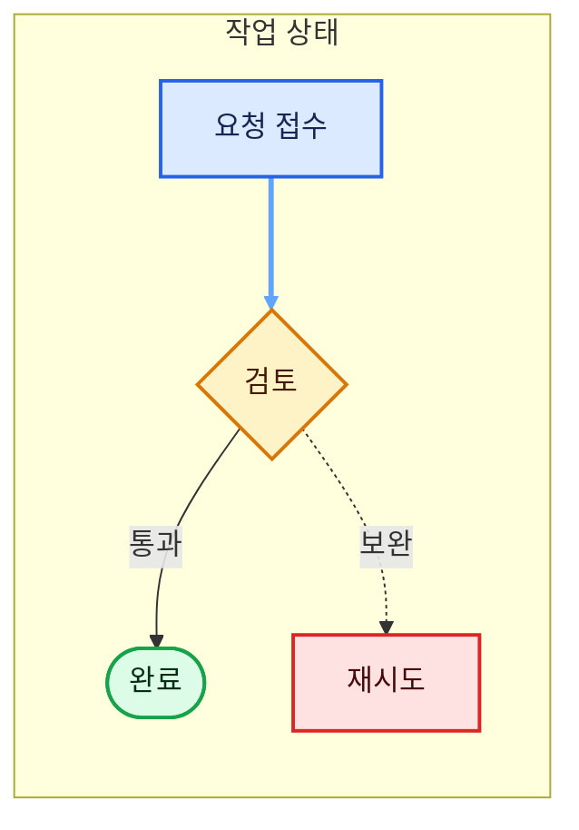
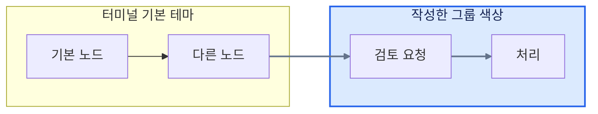
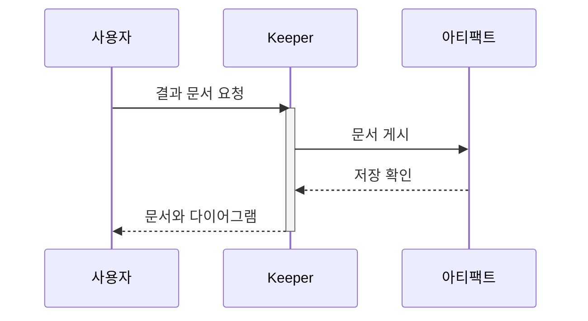
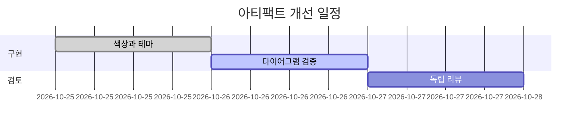
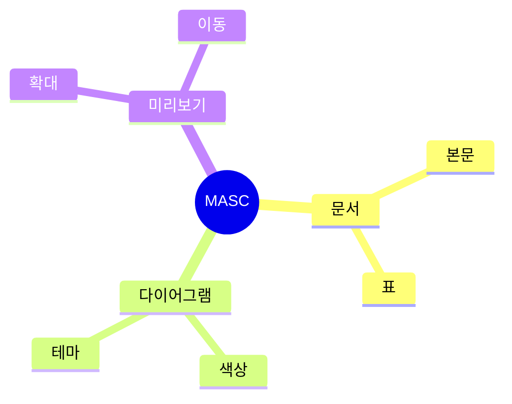
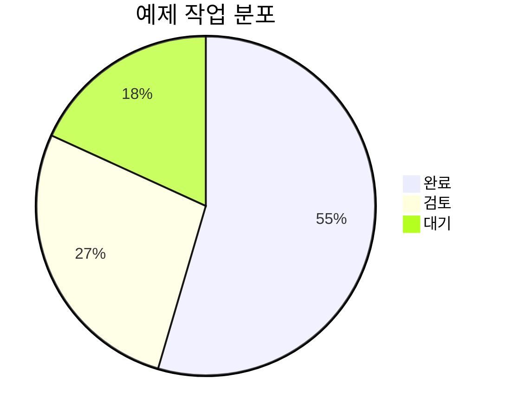
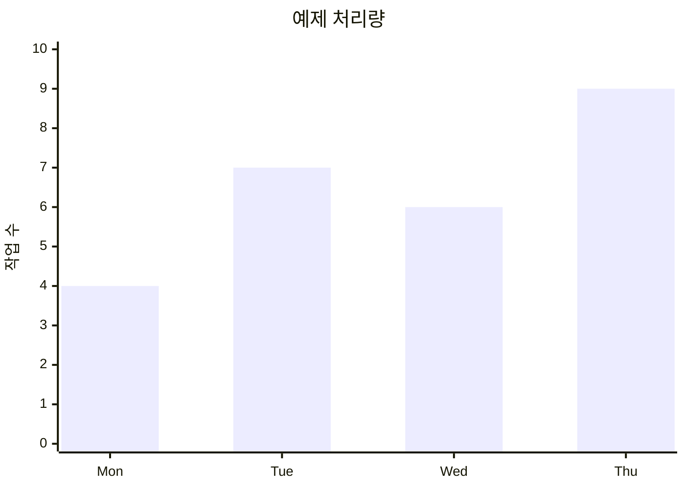

# 색상과 다이어그램

노드 색상은 `classDef`와 `style`, 연결선은 `linkStyle`로 지정합니다.
지정한 색은 밝은·어두운 터미널에서도 유지됩니다. 기본 노드와 그룹은
터미널 팔레트에 맞춰 표시됩니다. 의미는 색상과 함께 이름·모양·선으로 구분하세요.

## 작업 흐름

## 기본 테마와 그룹 색상

## 시퀀스

## 일정

## 마인드맵

## 원형 차트

## 막대 차트

문서에서 `Ctrl-O`로 그림을 열고, `,`와 `.`로 그림을 선택할 수 있습니다.
Kitty 그래픽을 지원하는 터미널에서는 `+`/`-` 확대, 방향키 이동,
`0` 전체 맞춤, `v` 원문 전환을 사용할 수 있습니다.
